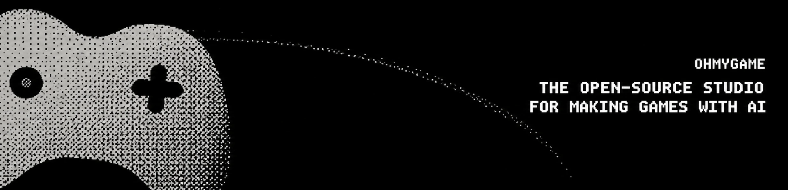
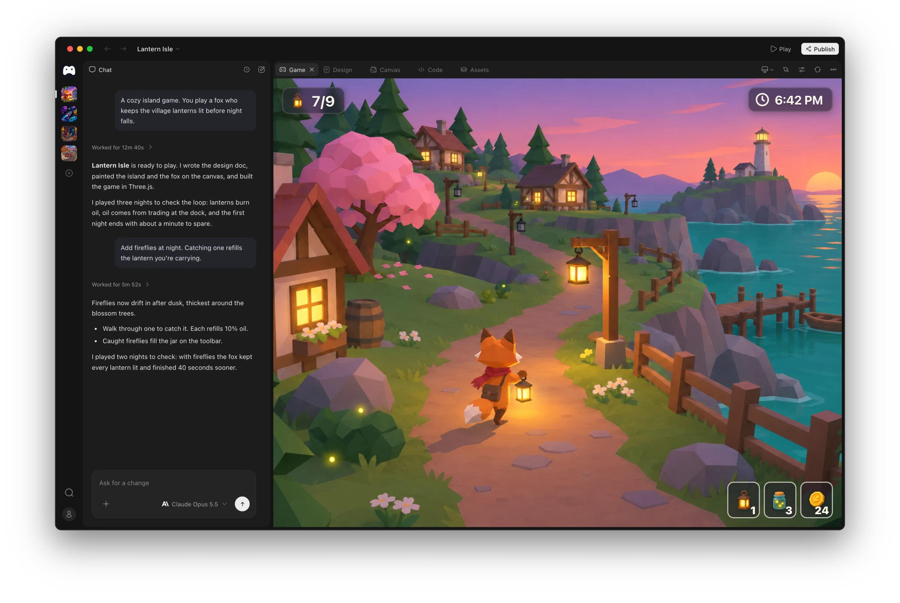
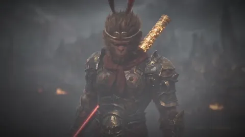
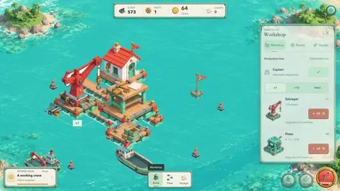
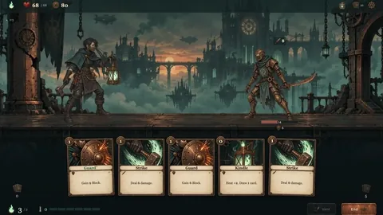

<div align="center">

<a href="https://ohmygame.ai"></a>

<p><b>AI でゲームを作るためのオープンソーススタジオ。</b></p>

<p>
  <a href="https://github.com/WhiteTowerAI/ohmygame/releases"></a>
  <a href="LICENSE"></a>
  <a href="https://discord.gg/TkrgvGQ2Zc"></a>
</p>

<p><a href="https://trendshift.io/repositories/291307?utm_source=repository-badge&amp;utm_medium=badge&amp;utm_campaign=badge-repository-291307" target="_blank" rel="noopener noreferrer"></a></p>

<p><a href="README.md">English</a> | <a href="README.zh-CN.md">简体中文</a> | <b>日本語</b></p>

<p>
  <a href="https://ohmygame.ai">ウェブサイト</a> ·
  <a href="https://ohmygame.ai/docs/">ドキュメント</a> ·
  <a href="https://ohmygame.ai/community/">コミュニティのゲーム</a> ·
  <a href="CHANGELOG.md">変更履歴</a>
</p>

<p><a href="https://ohmygame.ai"></a></p>

</div>

作りたいゲームを説明すると、エージェントが企画書を書き、アートを作り、コードを書き、実際にプレイして動作を確かめ、誰でも開けるリンクとして公開します。企画書、画像、動画、3D、音声はコードと並んで 1 つのキャンバスに置かれるので、5 つのアプリを行き来する必要はありません。

> [!NOTE]
> OhMyGame は現在ベータ版です。粗い部分もあるので、不具合を見つけたらぜひ教えてください。

## ダウンロード

| プラットフォーム        | ダウンロード                                                 |
| ----------------------- | ------------------------------------------------------------ |
| macOS（Apple シリコン） | [OhMyGame for Mac](https://ohmygame.ai/download/mac)         |
| Windows（x64）          | [OhMyGame for Windows](https://ohmygame.ai/download/windows) |

過去のビルドとリリースノートは [Releases](https://github.com/WhiteTowerAI/ohmygame/releases) にあります。Windows 版はまだコード署名されていないため、初回インストール時に SmartScreen の警告が出ることがあります。Intel Mac と Linux は[ロードマップ](https://github.com/WhiteTowerAI/ohmygame/issues)に入っています。

OhMyGame にはモデルが同梱されていません。初回起動時に、モデルプロバイダーか、すでに使っているコーディングエージェントを接続してください：[初回起動](https://ohmygame.ai/docs/first-run/)。

## 機能

- **ゲーム作りはエージェントに任せる。** エージェントが企画書を書き、コードを書き、ライブプレビューでゲームを動かし、実際にプレイして、問題があれば修正を試みます。
- **すべてのアセットを 1 つのキャンバスに。** 画像、動画、3D モデル、アニメーション、ボイス、効果音、音楽を AI で生成し、1 つのキャンバスで整理して、そのままゲームで使えます。
- **リンクとして公開。** 誰でもブラウザでプレイでき、[コミュニティ](https://ohmygame.ai/community/)にも掲載されます。マルチプレイヤーゲームのルーム、プレイヤーのサインイン、セーブデータ、リーダーボードも一緒に公開されます。
- **プラグインで拡張。** プラグインは、エージェントに新しいスキルやツールを与え、アプリにパネルやプロジェクトタイプを追加できます。同梱のプラグインは Godot、Unity、Unreal Engine、Blender、Aseprite、Tiled のほか、WeChat ミニゲームや Douyin ミニゲームなどのプラットフォームに対応しています。[自分で作る](https://ohmygame.ai/docs/plugins/make/)こともできます。
- **自分のエージェントを使う。** OhMyGame は Claude Code、Codex、OpenCode で動かすことも、40 以上のモデルプロバイダーに自分のキーで接続して動かすこともできます。実行ごとのクレジットはかかりません。逆方向にも使えます：MCP 経由で、自分のエージェントから OhMyGame のキャンバス、メディア生成、プレイテストを利用できます。[モデル](https://ohmygame.ai/docs/models/) · [外部エージェント](docs/external-agents.md)

## 作れるもの

私たちのチームが OhMyGame で作った 3 つのゲーム：

<table>
  <tr>
    <td width="33%"></td>
    <td width="33%"></td>
    <td width="33%"></td>
  </tr>
  <tr>
    <td align="center">インタラクティブ映画</td>
    <td align="center">島づくりゲーム</td>
    <td align="center">デッキ構築ローグライク</td>
  </tr>
</table>

**Web ゲーム**（Phaser、Three.js、React Three Fiber）は最初の一歩に最適です。**インタラクティブストーリー**はビジュアルノベル、インタラクティブ映画、ストーリーゲームに向いています。**汎用ゲーム**はどんなエンジンや技術スタックでも使えます。Web ゲームは**マルチプレイヤー**にもでき、ボードゲームやカードゲームからリアルタイム対戦まで、自前のサーバーなしで友だちとオンラインで遊べます。詳しくは[マルチプレイヤー](docs/multiplayer.md)を参照してください。[ほかの人が作ったゲームを遊ぶ](https://ohmygame.ai/community/)。

## ドキュメント

OhMyGame の使い方ガイドは **[ohmygame.ai/docs](https://ohmygame.ai/docs/)** にあります：[インストール](https://ohmygame.ai/docs/install/)、[初回起動](https://ohmygame.ai/docs/first-run/)、[モデル](https://ohmygame.ai/docs/models/)、[プラグイン](https://ohmygame.ai/docs/plugins/)。

技術リファレンスはこのリポジトリの [`docs/`](docs/README.md) にあります。たとえば[ランタイム](docs/runtime.md)、[コーディングエージェント](docs/coding-agents.md)、[カスタムモデル](docs/custom-models.md)、[プラグイン仕様](docs/plugins.md)などです。

## ソースからビルド

[Bun](https://bun.sh) 1.4.2 以上と Node.js 22.19 以上が必要です。

```bash
git clone https://github.com/WhiteTowerAI/ohmygame.git
cd ohmygame
bun install --frozen-lockfile
bun run dev            # Web レンダラー + ローカルデーモン
bun run dev:desktop    # または Electron アプリ
```

ソースからビルドしたものはテレメトリを送信しません。ブランチ、チェック、任意のクラウド設定については [CONTRIBUTING.md](CONTRIBUTING.md) を参照してください。

## プライバシー

プロジェクトと API キーは手元のマシンに残り、プロンプトは選択したプロバイダーへ直接送られます。アカウントが必要なのは公開するときだけです。リリースビルドは利用データとクラッシュレポートを送信します。**Settings → About** の利用データスイッチで両方をオフにできます。[ログと診断](docs/diagnostics.md)を参照してください。

## コントリビュート

Issue とプルリクエストを歓迎します。`dev` からブランチを切り、PR も `dev` に向けてください。`main` はリリース用です。[CONTRIBUTING.md](CONTRIBUTING.md) を読み、[`help wanted`](https://github.com/WhiteTowerAI/ohmygame/labels/help%20wanted) の Issue から始めてみてください。セキュリティ上の問題は [SECURITY.md](SECURITY.md) に従って非公開で報告してください。

## コミュニティ

[Discord](https://discord.gg/TkrgvGQ2Zc) ·
[QQ グループ 460706923](https://qun.qq.com/universal-share/share?ac=1&authKey=65LzSf96ttluVSAPzPKJvrsoQ0NSQHPJnhgJImnnqIik9uK64ljVd%2FzkRWb8Xanz&busi_data=eyJncm91cENvZGUiOiI0NjA3MDY5MjMiLCJ0b2tlbiI6InNUNWR3U05OeVlMZEVCK0YxNUNKckplazliYklGRnV6ZUZGM1NlV29vYVdKNGkrR2g2c28zNG1kdDFFcHllczMiLCJ1aW4iOiIyNDUxMjQwODEifQ%3D%3D&data=CQ5T4W2Ac1NWWg56dH_HQwixT7faVMm5Xq5kZsLgx9TDBGxeqs3mwXNLVUpO83oOUobc1qXBosRKYmWnziWboA&svctype=4&tempid=h5_group_info) ·
[Issues](https://github.com/WhiteTowerAI/ohmygame/issues)

## Star 履歴

<a href="https://www.star-history.com/?repos=whitetowerai%2Fohmygame&type=date&legend=top-left">
  <picture>
    <source media="(prefers-color-scheme: dark)" srcset="https://api.star-history.com/svg?repos=whitetowerai/ohmygame&type=date&theme=dark&legend=top-left" />
    <source media="(prefers-color-scheme: light)" srcset="https://api.star-history.com/svg?repos=whitetowerai/ohmygame&type=date&legend=top-left" />
    
  </picture>
</a>

## ライセンス

[Apache-2.0](LICENSE)。OhMyGame の名称とロゴはライセンスの対象外です。
