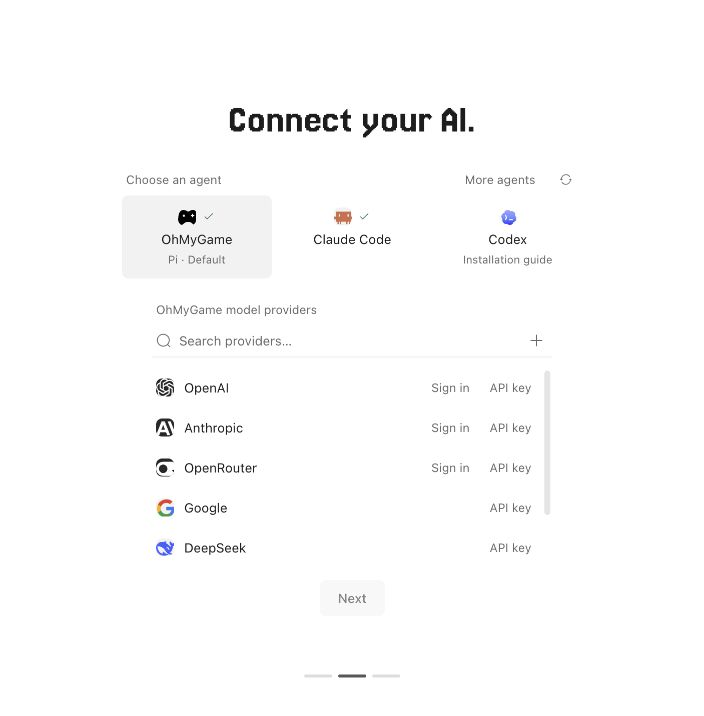

<div align="center">


**あなただけのひとりゲームスタジオ。** AI でゲームを作るために必要なものが、すべて 1 つのアプリにそろっています。

**ゲームを作って、どこにでも届けて、収益を得ましょう。**

<p>
  <a href="https://ohmygame.ai/download/mac"></a>
  <a href="https://ohmygame.ai/download/windows"></a>
</p>

<p>
  <a href="#仕組み"></a>
  <a href="#どんなモデルでも自分のキーで"></a>
  <a href="LICENSE"></a>
  <a href="https://discord.gg/TkrgvGQ2Zc"></a>
  <a href="https://qun.qq.com/universal-share/share?ac=1&authKey=65LzSf96ttluVSAPzPKJvrsoQ0NSQHPJnhgJImnnqIik9uK64ljVd%2FzkRWb8Xanz&busi_data=eyJncm91cENvZGUiOiI0NjA3MDY5MjMiLCJ0b2tlbiI6InNUNWR3U05OeVlMZEVCK0YxNUNKckplazliYklGRnV6ZUZGM1NlV29vYVdKNGkrR2g2c28zNG1kdDFFcHllczMiLCJ1aW4iOiIyNDUxMjQwODEifQ%3D%3D&data=CQ5T4W2Ac1NWWg56dH_HQwixT7faVMm5Xq5kZsLgx9TDBGxeqs3mwXNLVUpO83oOUobc1qXBosRKYmWnziWboA&svctype=4&tempid=h5_group_info"></a>
</p>

<p>
  <a href="README.md">English</a> · <a href="README.zh-CN.md">简体中文</a> · <b>日本語</b>
</p>

https://github.com/user-attachments/assets/4d5805fe-92a2-40b4-a232-c7452f9a796a

</div>

> [!NOTE]
> 🚧 OhMyGame はベータ版です。粗削りな部分もあります。一緒に作っていきましょう！

## ニュース

<!-- Keep at most three entries, newest first, and only major releases.
Updated during release preparation; see docs/maintaining.md. -->

- **2026-10 · beta 5**
  ([リリースノート](https://github.com/WhiteTowerAI/ohmygame/releases/tag/v0.0.0-beta.5.0))
  - **インタラクティブストーリーに対応:** ビジュアルノベル、インタラクティブ映画、
    ストーリーゲームを作れます。各画面は、あなたの説明をもとにエージェントが作る
    Web ページで、動画、会話、選択肢、さらにはミニゲームも入れられるため、
    ストーリーが固定のノードタイプに縛られることはありません。
  - **自分のエージェントを使える:** Claude Code、Codex、OpenCode で会話を
    進めることも、OhMyGame をそれらのエージェントから使うこともできます。
  - **プラグイン:** Godot、Unity、Unreal Engine、Cocos Creator で開発し、
    Blender、Aseprite、Tiled でアセットを作り、WeChat ミニゲーム、Douyin
    ミニゲーム、TapTap に配信して、
    [ゲームで収益を得られます](#-公開して稼ぐ1-つのリンクまたはプレイヤーが支払うプラットフォームへ)。

## OhMyGame とは

ゲームを作るには、企画書、2D アート、3D モデル、動画、コード、そして完成したものを
置く場所が必要です。現状、それらは 5 つも 6 つもの別々のツールに分かれています。
OhMyGame はそれらを 1 つのアプリにまとめます。作りたいゲームを説明すると、エージェントが
設計し、アセットを作り、ゲームを構築し、実際にプレイして動作を確認し、共有できる
リンクに公開します。

その中心には 2 つの設計思想があります。

1. **すべてがキャンバスの上にある。** 企画書、コンセプトアート、3D モデル、動画が
   1 つのボード上に並びます。1 枚のキャラクタースケッチから、さらなるアートや動画、
   リグ付きの 3D モデルへと発展させることができ、どれもそのままゲームで使えます。
2. **作業するのはエージェント。** エージェントはあなたと同じようにキャンバスを操作します。
   企画書を書き、キャラクタースケッチをリグ付きの 3D モデルに変え、コードを書き、
   できあがったものをテストプレイします。

オープンソースで、Pi を通じて Anthropic や OpenAI から DeepSeek、Qwen まで
40 以上のモデルプロバイダーに対応しています。キーはあなたのマシンに保存され、
実行ごとのクレジット課金はなく、作ったものはあなたのものです。

## 機能

### 🤖 エージェント：キャンバスを操作し、ゲームを作ってプレイする

エージェントはあなたと同じようにキャンバスを操作します。企画書を書き、ボードを
レイアウトし、その上にアセットを生成します。企画書を読んでコードを書き、ライブ
プレビューでゲームを動かします。さらに、あなたが見守れるウィンドウでゲームを開いて
プレイします。リアルタイムの Canvas や WebGL のゲームにも対応しています。問題を
見つけると修正を試み、もう一度プレイします。その過程で、画像、動画、3D モデル、
音声の生成、Web 検索、MCP サーバーやプラグインの利用も行えます。

<!-- Playtesting is open loop for now: the agent plans a batch of inputs, runs
them, then looks at the result. It has no real-time reflexes yet. -->

**▶ エージェントがデスクトップとモバイルで新しいアイテム機能をテストプレイし、
見つけたことを報告する様子 (4 倍速)。**

https://github.com/user-attachments/assets/3cb982e8-a4a8-4715-bf3c-df4e41e7855b

### 🎨 キャンバス：企画書、アート、動画、3D、音声を 1 つのボードに

各ゲームプロジェクトにはデザインスペースがあります。メインの企画書と、企画書・画像・
動画・3D モデル・音声が並ぶボードです。ノード同士を互いの参照として使えるため、
1 つのキャラクターデザインから、さらなる画像、動画、ボイス、リグとアニメーション付きの
3D モデルへとつなげられます。成果物はゲームから使える共有のアセットライブラリに
まとめられます。

https://github.com/user-attachments/assets/5a35964d-87b3-4153-8b1b-fc6deced5bb3

### 🔗 公開して稼ぐ：1 つのリンク、またはプレイヤーが支払うプラットフォームへ

サインインして公開すると、OhMyGame がゲームをビルドし、誰でもブラウザでプレイできる
リンクを発行します。再公開しても同じリンクが更新されます。公開されたゲームはアプリ内の
Community に掲載されます。そこでは他の人が作ったゲームをプレイしたり、新着順・閲覧数順・
いいね順に並べ替えたり、クリエイターのプロフィールを見たり、気に入ったゲームに
いいねしたりできます。

ひとりスタジオは自分で稼げるべきです。Community だけでなく、プラグインを使えば
プレイヤーがお金を払うプラットフォームにもゲームを届けられます。

| 配信先                               | 収益源                     | 方法                                                                         |
| ------------------------------------ | -------------------------- | ---------------------------------------------------------------------------- |
| WeChat ミニゲーム、Douyin ミニゲーム | 広告、アプリ内課金         | [プラットフォームプラグイン](#-プラグインさらに多くのゲーム開発ツールと連携) |
| TapTap                               | ダウンロード、アプリ内課金 | TapTap Maker プラグイン                                                      |
| Steam などのストア                   | 販売                       | Godot や Unity からそれぞれのプラグインでエクスポート                        |
| itch.io、Poki、CrazyGames            | 販売、広告収益の分配       | Web Game のビルドをアップロード                                              |

**あなたのゲーム、あなたの収益。** OhMyGame はゲームの収益から手数料を一切取りません。

### 🧑‍💻 自分のエージェントを使う

すでに Claude Code、Codex、OpenCode を使っていますか？モデルピッカーで選ぶと、
そのエージェントが自身のサインインで会話を進めます。キャンバス、メディア生成、
テストプレイ、プラグイン、Undo といったスタジオのすべてを使え、履歴は OhMyGame に
保存されます。詳しくは [コーディングエージェント](docs/coding-agents.md) を参照してください。

### 🔌 Claude Code、Codex などのエージェントから OhMyGame を使う

すでに別のコーディングエージェントで作業していますか？**Settings → MCP Server** を
オンにし、そこに表示されるコマンドで OhMyGame を Claude Code や Codex に追加してください。
それらのエージェントは、あなたのプロバイダーを使った OhMyGame のメディア生成、キャンバス、
テストプレイに加え、ワークフローを説明する Skill も利用できます。DeepSeek Harness や
その他の MCP クライアントは、そこに表示される `ohmygame-studio` コマンドを追加できます。
詳しくは [外部エージェント](docs/external-agents.md) を参照してください。

### 🧩 プラグイン：さらに多くのゲーム開発ツールと連携

プラグインを使うと、エージェントはあなたが使い慣れたエンジンやツールで作業できます。

- **エンジン:** Godot、Unity、Unreal Engine、Cocos Creator。
- **プラットフォーム:** TapTap Maker、WeChat ミニゲーム、Douyin ミニゲーム。
- **アセット:** Blender、Aseprite、Tiled。

**Plugins** でオンにするか、Plugin Builder で自作できます。エンジンプラグインは
各エンジンのエディターとツールを使うため、先にそれらをインストールしてください。
詳しくは [プラグイン](docs/plugins.md) を参照してください。

## 作れるもの

私たちのチームが OhMyGame で作った 3 つのゲーム:

<table>
  <tr>
    <td width="33%"></td>
    <td width="33%"></td>
    <td width="33%"></td>
  </tr>
  <tr>
    <td align="center">インタラクティブ映画</td>
    <td align="center">島づくり</td>
    <td align="center">デッキ構築ローグライク</td>
  </tr>
</table>

### 🎮 Web ゲーム

**最初の一歩に最適です。** Three.js、React Three Fiber、Phaser で作る、ブラウザ向けの
2D・3D ゲームです。エージェントは完全な Web ゲームのワークフローに沿って進めます。
企画書、主要画面のモックアップ、本番用のアート、プレイ可能なコアループ、そしてライブ
プレビューでのテストプレイです。ゲームはどんなウィンドウサイズにも合わせて表示され、
タッチ操作に対応し、共有可能なリンクに公開できます。プロジェクトは普通の Web
プロジェクトなので、どのエディターでも開けます。

### 🎬 インタラクティブストーリー

インタラクティブ映画、ビジュアルノベル、ストーリーゲームです。各画面は独自の画像、
動画、コードを持つ自由な Web ページで、メインメニュー、事件ファイル、会話、パズルなど
何にでもなります。それらをグラフ上でつなぐと、ランタイムが状態、セーブ、音楽、
画面遷移を処理します。ストーリーは独立した Web ページとして動作し、ランタイムも
プロジェクトの一部なので、エージェントは遊び方のあらゆる部分を変更できます。
アーキテクチャと制作モデルは [Playable Nodes](docs/playable-nodes/README.md) に
まとめられています。

### 🎲 汎用ゲーム：あらゆるエンジンや技術スタック

**General Game** は特定のエンジンや技術スタックを前提としません。アイデアから始めることも、
任意のエンジンのプロジェクトを持ち込むことも、ゲーム用のツールやコンテンツを作ることも
できます。Game Studio プラグインがエンジンをまたいで設計、本番用アート、実装、検証を
調整し、[エンジンプラグイン](#-プラグインさらに多くのゲーム開発ツールと連携)
があなたの使うエンジンの中で作業します。Godot の場合は、サイドバーから **Godot**
プロジェクトを開始してください。

出力が Web ページの場合、プレビュー、テストプレイ、公開は Web ゲームと同じように
機能します。ネイティブゲームではそのエンジン自身のツールを使います。詳しくは
[General Game の詳細](docs/runtime.md#agent-game-use) を参照してください。**ブラウザ
ゲームを作るなら Web Game を選んでください。** ブラウザ向けに最適化されています。

## 仕組み

全体を支えている考え方は、1 つのエージェントがスタジオのあらゆる部分を動かすということです。

**1 · GUI を備えた完全な Pi エージェント。** OhMyGame は
[Pi](https://www.npmjs.com/package/@earendil-works/pi-coding-agent) を、その
完全なツールセットと永続セッションとともに動かします。GUI は差分を読むためではなく、
結果を見るために作られています。アプリを閉じて戻ってきても、プロジェクト、会話、
コンテキストはそのまま残っています。あなたは説明し、確認し、方向づけをします。
手で編集することもいつでもできますが、それはメインの使い方ではありません。

**2 · すべてのワークスペースはファイル。** Web ゲームは普通の Web プロジェクトです。
企画書は Markdown で、ボードとアセットキャンバスは 1 つの JSON ノードモデルを共有します。
インタラクティブストーリーはディスク上のノードグラフです。それぞれに `AGENTS.md` と
JSON スキーマが付いているため、エージェントはコードと同じ方法でそれらを編集し、
ビジュアルエディターも同じファイルを読み書きします。

**3 · ゲームはツール呼び出し。** ゲームのプレイ (`game_use`)、メディアの生成、
ストーリーノードのチェックは、コーディングツールと並ぶ普通の Pi ツールです。だから
エージェントはそれらを連携させられます。企画を書き、アートを作り、コードを書き、
結果をプレイするまでを 1 つの会話で行えます。

## どんなモデルでも、自分のキーで

OhMyGame は 1 つのモデルに縛ることも、実行ごとに課金することもありません。

- **40 以上のプロバイダーのコーディングモデル**を Pi 経由で使えます。Anthropic、
  OpenAI、Google、DeepSeek、Qwen、Kimi、GLM、MiniMax、xAI、Mistral、Groq、
  OpenRouter、Amazon Bedrock、Vercel AI Gateway などです。
- **すでに契約しているサブスクリプションでサインイン**できます。ChatGPT Plus/Pro や
  GitHub Copilot などに対応しているほか、API キーを貼り付けることもできます。
  <!-- TODO(legal): check each provider's terms before naming more subscriptions -->
- **すでに使っているコーディングエージェント**: Claude Code、Codex、OpenCode が
  自身のサインインで会話を進め、OhMyGame は履歴、Undo、キャンバス、メディアツール、
  プラグインを管理します。Settings で有効にしてください。CLI 本来の権限制限が
  適用されます。詳しくは [コーディングエージェント](docs/coding-agents.md) を参照してください。
- **メディアモデル**: 画像、動画、3D、音声を OpenAI、Codex、OpenRouter、
  Volcengine Ark / BytePlus ModelArk、MiniMax、Meshy、Tripo、Hyper3D、
  Doubao Speech / Seed Audio で生成できます。
- **カスタムプロバイダーとモデルエイリアス**: 言語、画像、動画、3D の用途、
  プロトコルテンプレート、生成のデフォルト設定を選べます。
  詳しくは [カスタムモデルの設定](docs/custom-models.md) を参照してください。

キーはローカルのデーモンに保存されます。エージェントのワークスペース、ゲーム、
レンダラーに渡ることはありません。

## クイックスタート

### ダウンロード

上部のボタン、または [Releases](https://github.com/WhiteTowerAI/ohmygame/releases)
からインストーラーを入手してください。macOS (Apple silicon) と Windows (x64) 向けの
ビルドを提供しています。Windows ビルドはまだコード署名されていないため、インストール時に
Windows が SmartScreen の警告を表示する場合があります。

各リリースの変更点は [変更履歴](CHANGELOG.md) を参照するか、アプリ内の
**Settings → About → Changelog** を開いてください。

### 初回起動



OhMyGame にはモデルが同梱されていません。初回起動時に、セットアップを案内します。

1. **はじめに。** 言語と外観はシステムの設定に従います。Settings でいつでも
   変更できます。
2. **AI を選ぶ。** 組み込みの OhMyGame エージェントをモデルプロバイダーとともに使う
   (サインインまたは API キーの貼り付け) か、すでに持っている Claude Code、Codex、
   OpenCode の CLI を使います。**+** でカスタムまたはローカルのエンドポイントを
   追加できます。**Skip this step** を押すと、モデルなしで次に進みます。

   言語モデルだけでもゲームの設計と構築はできます。メディアを生成するには対応する
   プロバイダーが必要で、**Settings → Providers** で接続します。

   | 作るもの                            | 接続するもの                                                                                               |
   | ----------------------------------- | ---------------------------------------------------------------------------------------------------------- |
   | 企画書、コード、テストプレイ        | 任意の言語モデルプロバイダー                                                                               |
   | 画像とスプライト                    | Codex CLI (ローカルのサインイン)、OpenAI (API キー)、OpenRouter、または Volcengine Ark / BytePlus ModelArk |
   | 動画                                | OpenRouter、Volcengine Ark / BytePlus ModelArk、または MiniMax                                             |
   | 3D モデル、リギング、アニメーション | Meshy、Tripo、または Hyper3D (機能はプロバイダーによって異なります)                                        |
   | ボイス、効果音、音楽                | Doubao Speech と Seed Audio (Volcengine)                                                                   |

   ChatGPT のサインインは OpenAI の画像 API には適用されません。OpenAI プロバイダーの
   **Image models** セクションで別途 API キーを追加してください。**Codex CLI** の画像
   プロバイダーは、代わりにローカルの Codex サインインを使います。詳しくは
   [OpenAI の画像接続](docs/custom-models.md#openai-image-connections) を参照してください。

3. **始め方を選ぶ:** ホーム画面のプロンプトボックスでゲームを説明するか、空の
   プロジェクトを始めるか、手元にあるフォルダーをインポートします。

Web 検索は設定なしで使えます。ローカルでゲームを作るのにアカウントは不要で、
サインインが必要なのは公開するときだけです。このセットアップは
**Settings → About → View getting started** から再度開けます。

### ソースから実行

ツールチェーンには Bun 1.4.2 以降、デーモンには Node.js 22.19 以降が必要です。

```bash
git clone --branch main https://github.com/WhiteTowerAI/ohmygame.git
cd ohmygame
bun install --frozen-lockfile
bun run dev            # web renderer + local daemon
# or
bun run dev:desktop    # Electron app
```

これはリリースブランチを使います。開発に貢献する場合は、
[CONTRIBUTING.md](CONTRIBUTING.md#fork-and-create-a-branch) に従って `dev` から始めてください。
ローカル開発はクラウドの設定なしで始められます。オプションの連携については
[CONTRIBUTING.md](CONTRIBUTING.md#configuration) を参照してください。

## プライバシー

プロジェクトとキーはあなたのマシンに保存されます。プロンプトと生成リクエストは、
あなたが選んだモデルプロバイダーに直接送信されます。公開には OhMyGame アカウントが
必要で、アップロードされるのはゲームの静的ビルドだけです。リリースビルドはアップデートを
確認し、利用データとクラッシュレポートを送信します。利用データはサインイン時に
アカウントと紐づけられ、**Settings → About** でオフにできます。
ソースからのビルドはテレメトリーを送信しません。
デスクトップアプリはマスキング済みのログをマシン上に保存します。ログが外部に出るのは、
**Settings → About → Diagnostics** からエクスポートしてファイルを共有した場合だけです。
詳しくは [ログと診断](docs/diagnostics.md) を参照してください。

## ロードマップ

わかりやすい言葉でのテストプレイレポート、Community のゲームのリミックス、
Intel Mac / Linux ビルドに取り組んでいます。今後の予定は
[Issues](https://github.com/WhiteTowerAI/ohmygame/issues) を参照し、
大切だと思うものに 👍 で投票してください。手伝ってみたい方は
[`help wanted`](https://github.com/WhiteTowerAI/ohmygame/labels/help%20wanted)
の Issue を探してみてください。

## コントリビュート

Issue や PR を歓迎します。コントリビュート用のブランチは `dev` から作成し、
通常の PR は `dev` に向けてください。`main` はリリースを受け取ります。
セットアップ、チェック、レビューについては [CONTRIBUTING.md](CONTRIBUTING.md) を、
中国語での簡単な紹介は [中文快速指引](docs/contributing.zh-CN.md) を、
モジュールのガイドは [ドキュメントの目次](docs/README.md) を参照してください。
セキュリティの問題は [SECURITY.md](SECURITY.md) に従って報告してください。

## Star 履歴

<a href="https://www.star-history.com/?repos=whitetowerai%2Fohmygame&type=date&legend=top-left">
  <picture>
    <source media="(prefers-color-scheme: dark)" srcset="https://api.star-history.com/svg?repos=whitetowerai/ohmygame&type=date&theme=dark&legend=top-left" />
    <source media="(prefers-color-scheme: light)" srcset="https://api.star-history.com/svg?repos=whitetowerai/ohmygame&type=date&legend=top-left" />
    
  </picture>
</a>

## ライセンス

[Apache-2.0](LICENSE)。OhMyGame の名称とロゴはこのライセンスの対象外です。
