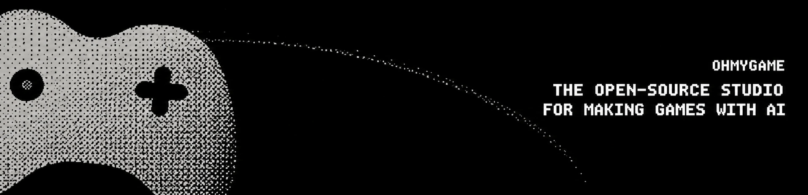
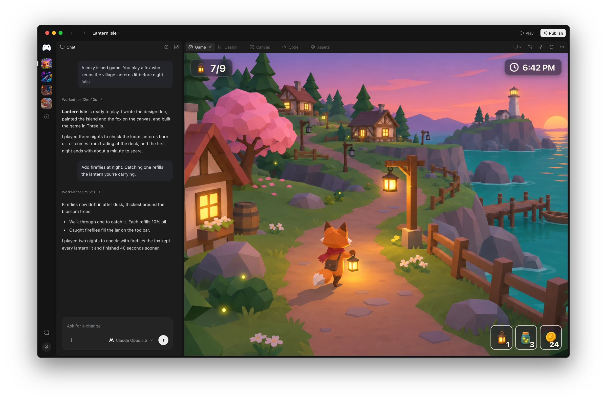
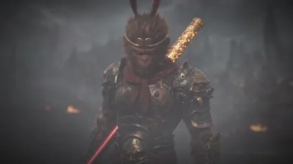
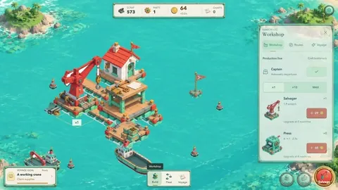
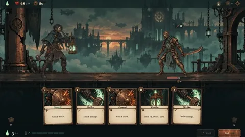

<div align="center">

<a href="https://ohmygame.ai"></a>

<p><b>The open-source studio for making games with AI.</b></p>

<p>
  <a href="https://github.com/WhiteTowerAI/ohmygame/releases"></a>
  <a href="LICENSE"></a>
  <a href="https://discord.gg/TkrgvGQ2Zc"></a>
</p>

<p><a href="https://trendshift.io/repositories/291307?utm_source=repository-badge&amp;utm_medium=badge&amp;utm_campaign=badge-repository-291307" target="_blank" rel="noopener noreferrer"></a></p>

<p><b>English</b> | <a href="README.zh-CN.md">简体中文</a> | <a href="README.ja.md">日本語</a></p>

<p>
  <a href="https://ohmygame.ai">Website</a> ·
  <a href="https://ohmygame.ai/docs/">Docs</a> ·
  <a href="https://ohmygame.ai/community/">Community games</a> ·
  <a href="CHANGELOG.md">Changelog</a>
</p>

<p><a href="https://ohmygame.ai"></a></p>

</div>

Describe a game, and the agent designs it, makes the art, writes the code,
plays it to check it works, and publishes it to a link anyone can open.
Design docs, images, video, 3D, and audio live on one canvas next to the code,
instead of across five different apps.

> [!NOTE]
> OhMyGame is in beta. Expect rough edges, and tell us what breaks.

## Download

| Platform              | Download                                                   |
| --------------------- | ---------------------------------------------------------- |
| macOS (Apple silicon) | [OhMyGame for Mac](https://ohmygame.ai/download/mac)       |
| Windows (x64)         | [OhMyGame for Windows](https://ohmygame.ai/download/windows) |

Older builds and release notes are on [Releases](https://github.com/WhiteTowerAI/ohmygame/releases).
The Windows build isn't code-signed yet, so SmartScreen may warn on first install.
Intel Mac and Linux are [on the roadmap](https://github.com/WhiteTowerAI/ohmygame/issues).

OhMyGame ships without a model. On first launch, connect a provider or a
coding agent you already use: [first run](https://ohmygame.ai/docs/first-run/).

## Features

- **Let the agent build the game.** The agent drafts the design doc, writes the
  code, runs the game in a live preview, then plays it and tries a fix when something breaks.
- **One canvas for every asset.** Generate images, video, 3D models, animation,
  voices, sound effects, and music with AI, and keep them organized on one
  canvas, ready to use in your game.
- **Publish to a link.** Anyone can play it in the browser, and it shows up in
  the [Community](https://ohmygame.ai/community/). A multiplayer game's rooms,
  and its players' sign-in, saves, and leaderboards, come with it.
- **Extend it with plugins.** A plugin can teach the agent new skills, give it
  new tools, and add panels and project types to the app. Bundled plugins cover
  Godot, Unity, Unreal Engine, Blender, Aseprite, Tiled, and platforms like
  WeChat and Douyin Mini Games. Or
  [make your own](https://ohmygame.ai/docs/plugins/make/).
- **Bring your own agent.** Run OhMyGame on Claude Code, Codex, or OpenCode, or
  on any of 40+ model providers with your own keys. No per-run credits. It
  works the other way too: use the canvas, media generation, and playtesting
  from your agent over MCP. [Models](https://ohmygame.ai/docs/models/) ·
  [External agents](docs/external-agents.md)

## What you can make

Three games our team made with OhMyGame:

<table>
  <tr>
    <td width="33%"></td>
    <td width="33%"></td>
    <td width="33%"></td>
  </tr>
  <tr>
    <td align="center">Interactive film</td>
    <td align="center">Island builder</td>
    <td align="center">Deckbuilding roguelike</td>
  </tr>
</table>

**Web games** (Phaser, Three.js, React Three Fiber) are the best place to
start. **Interactive stories** cover visual novels, interactive films, and
story games. **General games** work with any engine or stack.
Web games can be **multiplayer**, from board and card games to realtime arenas,
played online with friends with no server of your own. See
[Multiplayer](docs/multiplayer.md).
[Play what others made](https://ohmygame.ai/community/).

## Documentation

Guides for using OhMyGame are at **[ohmygame.ai/docs](https://ohmygame.ai/docs/)**:
[install](https://ohmygame.ai/docs/install/),
[first run](https://ohmygame.ai/docs/first-run/),
[models](https://ohmygame.ai/docs/models/), and
[plugins](https://ohmygame.ai/docs/plugins/).

Technical references live in this repo under [`docs/`](docs/README.md), such as
the [runtime](docs/runtime.md), [coding agents](docs/coding-agents.md),
[custom models](docs/custom-models.md), and the
[plugin contract](docs/plugins.md).

## Build from source

Requires [Bun](https://bun.sh) 1.4.2+ and Node.js 22.19+.

```bash
git clone https://github.com/WhiteTowerAI/ohmygame.git
cd ohmygame
bun install --frozen-lockfile
bun run dev            # web renderer + local daemon
bun run dev:desktop    # or the Electron app
```

Builds from source send no telemetry. For branches, checks, and optional cloud
setup, see [CONTRIBUTING.md](CONTRIBUTING.md).

## Privacy

Your projects and API keys stay on your machine, and prompts go straight to the
providers you choose. You only need an account to publish. Release builds send
usage data and crash reports, which you can turn off in **Settings → About**.
See [logs and diagnostics](docs/diagnostics.md).

## Contributing

Issues and pull requests are welcome. Branch from `dev` and open PRs against
`dev`; `main` holds releases. Read [CONTRIBUTING.md](CONTRIBUTING.md), pick up a
[`help wanted`](https://github.com/WhiteTowerAI/ohmygame/labels/help%20wanted)
issue, and report security problems privately through [SECURITY.md](SECURITY.md).

## Community

[Discord](https://discord.gg/TkrgvGQ2Zc) ·
[QQ group 460706923](https://qun.qq.com/universal-share/share?ac=1&authKey=65LzSf96ttluVSAPzPKJvrsoQ0NSQHPJnhgJImnnqIik9uK64ljVd%2FzkRWb8Xanz&busi_data=eyJncm91cENvZGUiOiI0NjA3MDY5MjMiLCJ0b2tlbiI6InNUNWR3U05OeVlMZEVCK0YxNUNKckplazliYklGRnV6ZUZGM1NlV29vYVdKNGkrR2g2c28zNG1kdDFFcHllczMiLCJ1aW4iOiIyNDUxMjQwODEifQ%3D%3D&data=CQ5T4W2Ac1NWWg56dH_HQwixT7faVMm5Xq5kZsLgx9TDBGxeqs3mwXNLVUpO83oOUobc1qXBosRKYmWnziWboA&svctype=4&tempid=h5_group_info) ·
[Issues](https://github.com/WhiteTowerAI/ohmygame/issues)

## Star History

<a href="https://www.star-history.com/?repos=whitetowerai%2Fohmygame&type=date&legend=top-left">
  <picture>
    <source media="(prefers-color-scheme: dark)" srcset="https://api.star-history.com/svg?repos=whitetowerai/ohmygame&type=date&theme=dark&legend=top-left" />
    <source media="(prefers-color-scheme: light)" srcset="https://api.star-history.com/svg?repos=whitetowerai/ohmygame&type=date&legend=top-left" />
    
  </picture>
</a>

## License

[Apache-2.0](LICENSE). The OhMyGame name and logo are not covered by the license.
