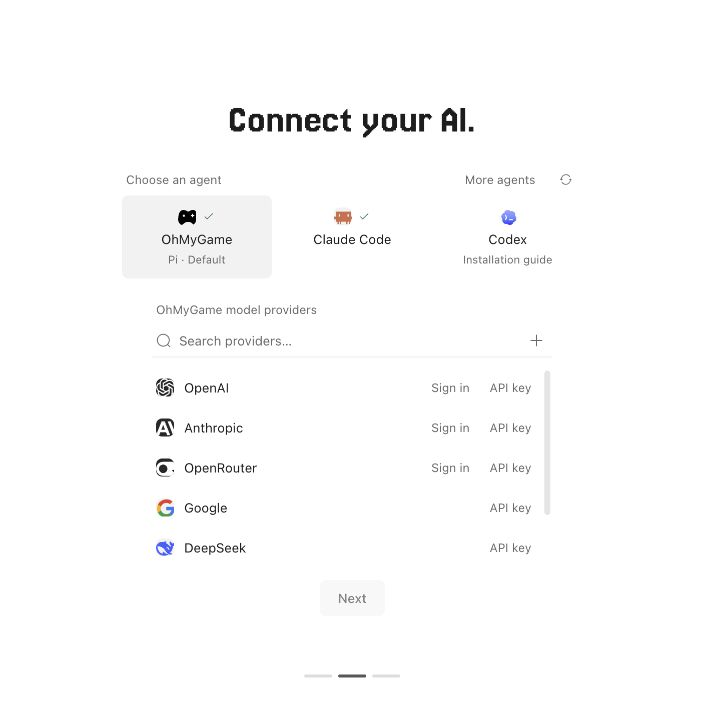

<div align="center">


**Your own one-person game studio.** Everything you need to make games with AI, in one app.

**Make a game. Ship it everywhere. Earn from it.**

<p>
  <a href="https://ohmygame.ai/download/mac"></a>
  <a href="https://ohmygame.ai/download/windows"></a>
</p>

<p>
  <a href="#how-its-built"></a>
  <a href="#any-model-your-keys"></a>
  <a href="LICENSE"></a>
  <a href="https://discord.gg/TkrgvGQ2Zc"></a>
  <a href="https://qun.qq.com/universal-share/share?ac=1&authKey=65LzSf96ttluVSAPzPKJvrsoQ0NSQHPJnhgJImnnqIik9uK64ljVd%2FzkRWb8Xanz&busi_data=eyJncm91cENvZGUiOiI0NjA3MDY5MjMiLCJ0b2tlbiI6InNUNWR3U05OeVlMZEVCK0YxNUNKckplazliYklGRnV6ZUZGM1NlV29vYVdKNGkrR2g2c28zNG1kdDFFcHllczMiLCJ1aW4iOiIyNDUxMjQwODEifQ%3D%3D&data=CQ5T4W2Ac1NWWg56dH_HQwixT7faVMm5Xq5kZsLgx9TDBGxeqs3mwXNLVUpO83oOUobc1qXBosRKYmWnziWboA&svctype=4&tempid=h5_group_info"></a>
</p>

<p>
  <b>English</b> · <a href="README.zh-CN.md">简体中文</a>
</p>

https://github.com/user-attachments/assets/4d5805fe-92a2-40b4-a232-c7452f9a796a

</div>

> [!NOTE]
> 🚧 OhMyGame is in beta. Expect rough edges. Join us and let's build it together!

## News

<!-- Keep at most three entries, newest first, and only major releases.
Updated during release preparation; see docs/maintaining.md. -->

- **2026-10 · beta 5**
  ([release notes](https://github.com/WhiteTowerAI/ohmygame/releases/tag/v0.0.0-beta.5))
  - **Now with interactive stories:** make visual novels, interactive films,
    and story games. Every screen is a web page the agent builds from your
    description, with video, dialogue, choices, or even a mini-game, so your
    story isn't limited to fixed node types.
  - **Bring your own agent:** Claude Code, Codex, or OpenCode can run the
    conversation, or you can bring OhMyGame to them.
  - **Plugins:** build in Godot, Unity, Unreal Engine, or Cocos Creator; make
    assets in Blender, Aseprite, or Tiled; ship to WeChat Mini Games, Douyin
    Mini Games, or TapTap, and
    [earn from your game](#-publish-and-earn-one-link-or-the-platforms-where-players-pay).

## What it is

Making a game takes design docs, 2D art, 3D models, video, code, and somewhere
to put it when it's done. Today those live in five or six different tools.
OhMyGame puts them in one app: describe your game, and the agent designs it,
makes the assets, builds it, plays it to check it works, and publishes it to a
link you can share.

Two core design ideas shape it:

1. **Everything lives on a canvas.** Design docs, concept art, 3D models, and
   video sit side by side on one board. One character sketch can grow into more
   art, a video, or a rigged 3D model, and everything is ready to use in your
   game.
2. **The agent does the work.** It drives the canvas the way you would:
   drafting the design doc, turning a character sketch into a rigged 3D model,
   writing the code, and playtesting the result.

It's open source and works with 40+ model providers through Pi, from Anthropic
and OpenAI to DeepSeek and Qwen. Your keys stay on your machine, there are no
per-run credits, and what you make is yours.

## Features

### 🤖 Agent: drives the canvas, builds and plays the game

The agent works the canvas the way you would: it drafts the design doc, lays
out boards, and generates assets on them. It reads the design doc, writes the
code, and runs the game in a live preview. Then it opens the game in a window
you can watch and plays it, including real-time canvas and WebGL games. When it
finds a problem, it tries a fix and plays again. Along the way it can generate
images, video, 3D models, and audio, search the web, and use MCP servers and
plugins.

<!-- Playtesting is open loop for now: the agent plans a batch of inputs, runs
them, then looks at the result. It has no real-time reflexes yet. -->

**▶ The agent playtesting a new item feature on desktop and mobile, then reporting
what it found (sped up 4×).**

https://github.com/user-attachments/assets/3cb982e8-a4a8-4715-bf3c-df4e41e7855b

### 🎨 Canvas: design docs, art, video, 3D, and audio on one board

Every game project has a design space: a main design doc plus boards where
the doc, images, video, 3D models, and audio sit side by side. Nodes can use
each other as references, so one character design can lead to more images, a
video, a voice line, or a rigged and animated 3D model. Results go into a shared Asset Library that
your games can use.

https://github.com/user-attachments/assets/5a35964d-87b3-4153-8b1b-fc6deced5bb3

### 🔗 Publish and earn: one link, or the platforms where players pay

Sign in and publish: OhMyGame builds your game and gives it a link anyone can
play in the browser. Republishing updates the same link. Published games are
listed in the in-app Community, where you can play what others have made,
sort by latest, most viewed, or most liked, visit creators' profiles, and like
the games you enjoy.

A one-person studio should pay for itself. Beyond the Community, plugins take
your game to the platforms where players pay.

| Ship to                                 | Earn from                | How                                                            |
| --------------------------------------- | ------------------------ | -------------------------------------------------------------- |
| WeChat Mini Games, Douyin Mini Games    | Ads, in-app purchases    | [Platform plugins](#-plugins-connect-with-more-game-dev-tools) |
| TapTap                                  | Downloads, in-app purchases | TapTap Maker plugin                                         |
| Steam and other stores                  | Sales                    | Export from Godot or Unity with their plugins                  |
| itch.io, Poki, CrazyGames               | Sales, ad revenue share  | Upload your Web Game build                                     |

**Your game, your revenue.** OhMyGame takes no cut of what your game earns.
<!-- TODO(confirm): no revenue share; ads/IAP setup in the mini-game plugins. -->

### 🧑‍💻 Bring your own agent

Already use Claude Code, Codex, or OpenCode? Choose it in the model picker and
it runs the conversation with its own sign-in. It gets the whole studio: the
canvas, media generation, playtesting, plugins, and Undo, with your history
kept in OhMyGame. See [coding agents](docs/coding-agents.md).

### 🔌 Use OhMyGame from Claude Code, Codex, and other agents

Already working in another coding agent? Turn on **Settings → MCP Server →
Allow other agents to use OhMyGame** and connect Claude Code or Codex with one
click.
They get OhMyGame's media generation with your providers, the canvas, and
playtesting, plus a Skill that explains the workflow. DeepSeek Harness and
other MCP clients can add the `ohmygame-studio` command shown there. See
[External agents](docs/external-agents.md).

### 🧩 Plugins: connect with more game dev tools

Plugins let the agent work in the engines and tools you already know:

- **Engines:** Godot, Unity, Unreal Engine, and Cocos Creator.
- **Platforms:** TapTap Maker, WeChat Mini Games, and Douyin Mini Games.
- **Assets:** Blender, Aseprite, and Tiled.

Turn them on in **Plugins**, or build your own with Plugin Builder. Engine
plugins use each engine's own editor and tools, so install those first. See
[Plugins](docs/plugins.md).

## What you can make

Three games our team made with OhMyGame:

<table>
  <tr>
    <td width="33%"></td>
    <td width="33%"></td>
    <td width="33%"></td>
  </tr>
  <tr>
    <td align="center">Interactive film</td>
    <td align="center">Island builder</td>
    <td align="center">Deckbuilding roguelike</td>
  </tr>
</table>

### 🎮 Web games

**The best place to start.** 2D and 3D games for the browser, built with
Three.js, React Three Fiber, or Phaser. The agent follows a complete web game
workflow: a design doc, key-screen mockups, production art, a playable core
loop, and playtesting in the live preview. Games fit any window size, support
touch, and publish to a shareable link. The project is a normal web project you
can open in any editor.

### 🎬 Interactive stories

Interactive films, visual novels, and story games. Each screen is a free web
page with its own images, video, and code: a main menu, a case archive, a
dialogue, a puzzle. You connect them on a graph, and the runtime handles state,
saves, music, and navigation. The story plays as its own web page, and the
runtime is part of the project, so the agent can change anything about how it
plays. The architecture and authoring model are documented in
[Playable Nodes](docs/playable-nodes/README.md).

### 🎲 General games: any engine or stack

**General Game** doesn't assume an engine or stack. Start from an idea, bring a
project in any engine, or make tools and content for your game. The Game Studio
plugin coordinates design, production art, implementation, and verification
across engines, and the [engine plugins](#-plugins-connect-with-more-game-dev-tools)
work in the engine you use. For Godot, start a **Godot** project from the
sidebar.

When the output is a web page, preview, playtesting, and publishing work as
they do for Web games; native games use their engine's own tools. See
[General Game details](docs/runtime.md#agent-game-use). **Making a browser
game? Choose Web Game**: it is tuned for the browser.

## How it's built

The idea that holds this together: one agent drives every part of the studio.

**1 · A full Pi agent with a GUI.** OhMyGame runs
[Pi](https://www.npmjs.com/package/@earendil-works/pi-coding-agent) with its
full toolset and persistent sessions, in a GUI built for watching results
rather than reading diffs. Close the app, come back, and the project,
conversation, and context are still there. You describe, review, and steer;
editing by hand is always possible, but it is not the main path.

**2 · Every workspace is files.** A web game is a normal web project. A design
doc is Markdown, and boards and the Asset Canvas share one JSON node model. An
interactive story is a node graph on disk. Each comes with an `AGENTS.md` and
JSON schemas, so the agent edits them the same way it edits code, and the
visual editors read and write the same files.

**3 · Games are tool calls.** Playing the game (`game_use`), generating media,
and checking story nodes are ordinary Pi tools, next to its coding tools. That
is why the agent can chain them: draft a design, make the art, write the code,
and play the result in one conversation.

## Any model, your keys

OhMyGame does not lock you into one model or charge per run.

- **Coding models from 40+ providers** through Pi, including Anthropic,
  OpenAI, Google, DeepSeek, Qwen, Kimi, GLM, MiniMax, xAI, Mistral, Groq,
  OpenRouter, Amazon Bedrock, and Vercel AI Gateway.
- **Sign in with a subscription you already have**, such as ChatGPT Plus/Pro or
  GitHub Copilot, or paste an API key.
  <!-- TODO(legal): check each provider's terms before naming more subscriptions -->
- **Coding agents you already use**: Claude Code, Codex, and OpenCode run a
  conversation with their own sign-in, while OhMyGame keeps its history, Undo,
  canvas, media tools, and plugins. Enable them in Settings; native CLI
  permission limits apply. See [coding agents](docs/coding-agents.md).
- **Media models** for images, video, 3D, and audio through OpenAI, Codex,
  OpenRouter, Volcengine Ark / BytePlus ModelArk, MiniMax, Meshy, Tripo,
  Hyper3D, and Doubao Speech / Seed Audio.
- **Custom providers and model aliases** with selectable language, image, video
  and 3D uses, protocol templates and generation defaults.
  See [custom model configuration](docs/custom-models.md).

Keys stay in the local daemon. They never reach the agent's workspace, your
game, or the renderer.

## Quick start

### Download

Grab the installer from the buttons at the top or from
[Releases](https://github.com/WhiteTowerAI/ohmygame/releases). Builds are
available for macOS (Apple silicon) and Windows (x64). The Windows build is
not code-signed yet, so Windows may show a SmartScreen warning during install.

See [the changelog](CHANGELOG.md) for changes in each release, or open
**Settings → About → Changelog** inside the app.

### First run



OhMyGame ships without a model. On first launch, it walks you through setup:

1. **Connect your AI.** Sign in to a model provider or paste an API key, or use
   a Claude Code, Codex, or OpenCode CLI you already have. Use **+** to add a
   custom or local endpoint. **Skip and start** enters without setup.
2. **Add creative tools (optional).** Connect image, video, 3D, and audio
   providers now or later in **Settings → Providers & Models**. A language
   model alone can design and build a game. Generating media needs a
   corresponding provider:

   | To make                       | Connect                                                             |
   | ----------------------------- | ------------------------------------------------------------------- |
   | Design docs, code, playtests  | Any language model provider                                         |
   | Images and sprites            | Codex CLI (local sign-in), OpenAI (API key), OpenRouter, or Volcengine Ark / BytePlus ModelArk |
   | Video                         | OpenRouter, Volcengine Ark / BytePlus ModelArk, or MiniMax          |
   | 3D models, rigging, animation | Meshy, Tripo, or Hyper3D (capabilities vary by provider)              |
   | Voice, sound effects, music   | Doubao Speech and Seed Audio (Volcengine)                           |

   ChatGPT sign-in doesn't cover OpenAI's image API; add a separate API key in
   the OpenAI provider's **Image models** section. The **Codex CLI** image provider
   uses your local Codex sign-in instead. See
   [OpenAI image connections](docs/custom-models.md#openai-image-connections).

3. **Pick a model and describe your game** in the prompt box on the home screen.

Web search works without setup. Making games locally needs no account; sign in
only to publish. Reopen this setup from **Settings → About → View getting started**.

### Run from source

Requires Bun 1.4.2 or newer for the toolchain and Node.js 22.19+ for the daemon.

```bash
git clone --branch main https://github.com/WhiteTowerAI/ohmygame.git
cd ohmygame
bun install --frozen-lockfile
bun run dev            # web renderer + local daemon
# or
bun run dev:desktop    # Electron app
```

This uses the release branch. For development contributions, start from `dev`
using [CONTRIBUTING.md](CONTRIBUTING.md#fork-and-create-a-branch).
Local development can start without cloud configuration; see
[CONTRIBUTING.md](CONTRIBUTING.md#configuration) for optional integrations.

## Privacy

Your projects and keys stay on your machine. Prompts and generation requests go
directly to the model providers you choose. Publishing requires an OhMyGame
account and uploads only your game's static build. Release builds check for
updates and send anonymous usage events (PostHog, no session recording) and
crash reports (Sentry, no personal data). Builds from source send no telemetry.
The desktop app keeps redacted logs on your machine; they leave it only if you
export them from **Settings → About → Diagnostics** and share the file. See
[logs and diagnostics](docs/diagnostics.md).

## Roadmap

We're working on plain-language playtest reports, remixing
games from the Community, and Intel Mac / Linux builds. See
[Issues](https://github.com/WhiteTowerAI/ohmygame/issues) for what's next, and
vote with 👍 on what matters to you. Want to help? Look for
[`help wanted`](https://github.com/WhiteTowerAI/ohmygame/labels/help%20wanted)
issues.

## Contributing

Issues and PRs are welcome. Start contribution branches from `dev` and target
ordinary PRs at `dev`; `main` receives releases. See
[CONTRIBUTING.md](CONTRIBUTING.md) for setup, checks, and review,
[中文快速指引](docs/contributing.zh-CN.md) for a short Chinese introduction, and
[the documentation index](docs/README.md) for module guides.
Report security issues using [SECURITY.md](SECURITY.md).

## Star History

<a href="https://www.star-history.com/?repos=whitetowerai%2Fohmygame&type=date&legend=top-left">
  <picture>
    <source media="(prefers-color-scheme: dark)" srcset="https://api.star-history.com/svg?repos=whitetowerai/ohmygame&type=date&theme=dark&legend=top-left" />
    <source media="(prefers-color-scheme: light)" srcset="https://api.star-history.com/svg?repos=whitetowerai/ohmygame&type=date&legend=top-left" />
    
  </picture>
</a>

## License

[Apache-2.0](LICENSE). The OhMyGame name and logo are not covered by the
license.
