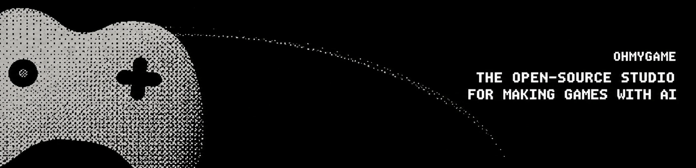
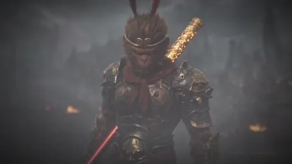
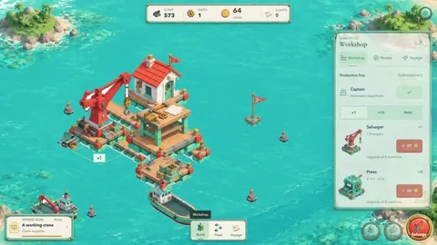
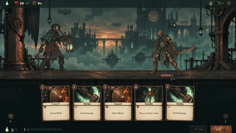

<div align="center">



**你的一人游戏工作室。** 用 AI 做游戏需要的一切，都在一个应用里。使用你自己的模型密钥。

<p>
  <a href="https://ohmygame.ai/download/mac"></a>
  <a href="https://ohmygame.ai/download/windows"></a>
</p>

<p>
  <a href="#实现原理"></a>
  <a href="#任意模型自带密钥"></a>
  <a href="LICENSE"></a>
  <a href="https://discord.gg/TkrgvGQ2Zc"></a>
  <a href="https://qun.qq.com/universal-share/share?ac=1&authKey=65LzSf96ttluVSAPzPKJvrsoQ0NSQHPJnhgJImnnqIik9uK64ljVd%2FzkRWb8Xanz&busi_data=eyJncm91cENvZGUiOiI0NjA3MDY5MjMiLCJ0b2tlbiI6InNUNWR3U05OeVlMZEVCK0YxNUNKckplazliYklGRnV6ZUZGM1NlV29vYVdKNGkrR2g2c28zNG1kdDFFcHllczMiLCJ1aW4iOiIyNDUxMjQwODEifQ%3D%3D&data=CQ5T4W2Ac1NWWg56dH_HQwixT7faVMm5Xq5kZsLgx9TDBGxeqs3mwXNLVUpO83oOUobc1qXBosRKYmWnziWboA&svctype=4&tempid=h5_group_info"></a>
</p>

<p>
  <a href="README.md">English</a> · <b>简体中文</b>
</p>

https://github.com/user-attachments/assets/4d5805fe-92a2-40b4-a232-c7452f9a796a

</div>

> [!NOTE]
> 🚧 OhMyGame 目前处于 Beta 阶段，难免还有粗糙的地方。欢迎加入我们，一起把它做好！

## 这是什么

做一款游戏，需要设计文档、2D 美术、3D 模型、视频、代码，做完还要有地方发布。
现在这些工作分散在五六个不同的工具里。OhMyGame 把它们放进了一个应用：描述你想做的游戏，
Agent 会设计它、制作素材、搭建游戏、亲自试玩确认能正常运行，再发布成一个可以分享的链接。

它围绕两个核心设计理念：

1. **一切都在画布上。** 设计文档、概念图、3D 模型和视频并排放在同一块画板上。
   一张角色草图可以延伸出更多美术图、一段视频，或者一个绑好骨骼的 3D 模型，
   而且全部可以直接用在你的游戏里。
2. **活由 Agent 来干。** 它像你一样操作画布：起草设计文档，把角色草图变成绑好骨骼的
   3D 模型，编写代码，再试玩检验结果。

OhMyGame 是开源的，通过 Pi 支持 40 多家模型服务商，从 Anthropic、OpenAI 到 DeepSeek、
通义千问。密钥留在你自己的电脑上，没有按次计费的点数，做出来的东西归你所有。

## 功能

### 🤖 Agent：操作画布，搭建并试玩游戏

Agent 像你一样使用画布：起草设计文档，排布画板，并在上面生成素材。接着它阅读设计文档、
编写代码，在实时预览中运行游戏。然后它会在一个你可以旁观的窗口里打开游戏并亲自试玩，
包括实时渲染的 Canvas 和 WebGL 游戏。发现问题时，它会尝试修复，然后再玩一遍。
在这个过程中，它还可以生成图片、视频和 3D 模型，搜索网络，并使用 MCP 服务器，
或者你已经在用的 Codex 和 Claude Code 插件。

<!-- 目前试玩还是开环的：Agent 先规划一批输入，执行完再看结果，还没有实时反应能力。 -->

**▶ Agent 在桌面端和移动端试玩一个新道具功能，然后汇报发现的问题（4 倍速）。**

https://github.com/user-attachments/assets/3cb982e8-a4a8-4715-bf3c-df4e41e7855b

### 🎨 画布：设计文档、美术、视频和 3D 同在一块画板

每个游戏项目都有一个设计空间：一份主设计文档，加上若干画板，文档、图片、视频和 3D 模型
在画板上并排摆放。节点之间可以互相引用，所以一个角色设计可以衍生出更多图片、一段视频，
或者一个绑好骨骼、带动画的 3D 模型。生成结果会进入共享的素材库（Asset Library），
供你的游戏使用。

https://github.com/user-attachments/assets/5a35964d-87b3-4153-8b1b-fc6deced5bb3

### 🔗 发布：一个链接，随处可玩

登录后即可发布：OhMyGame 会构建你的游戏，并生成一个任何人都能在浏览器里打开就玩的链接。
重新发布会更新同一个链接。发布的游戏会出现在应用内的社区（Community）里，
你也可以在那里玩到别人做的游戏。

## 你可以做什么

我们团队用 OhMyGame 做的三款游戏：

<table>
  <tr>
    <td width="33%"></td>
    <td width="33%"></td>
    <td width="33%"></td>
  </tr>
  <tr>
    <td align="center">互动电影</td>
    <td align="center">海岛建造</td>
    <td align="center">卡牌构筑 Roguelike</td>
  </tr>
</table>

### 🎮 网页游戏

**最推荐的起点。** 运行在浏览器里的 2D 和 3D 游戏，使用 Three.js、React Three Fiber 或 Phaser 构建。
Agent 会走完一整套网页游戏流程：设计文档、关键画面 mockup、正式美术、可玩的核心循环，
以及在实时预览中试玩。做出来的游戏适配任意窗口尺寸，支持触屏，并能发布成一个可以分享的链接。
项目本身就是一个普通的 Web 项目，可以用任何编辑器打开。

### 🎬 互动故事

互动电影、视觉小说和剧情游戏。每个画面都是一个自由的网页，拥有自己的图片、视频和代码：
主菜单、案件档案、一段对话、一个谜题。你在图上把它们连起来，运行时负责状态、存档和跳转。
架构和创作模型见 [Playable Nodes](docs/playable-nodes/README.md)。

<!-- TODO(asset): 截图或 GIF，展示节点图和两个用 OhMyGame 做好的画面。
有真实素材之前先不放。 -->

### 🎲 General Game：任意引擎与技术栈

**General Game** 不预设引擎和技术栈。你可以从一个想法开始，导入用任何引擎做的项目，
或者为游戏制作工具和内容。Game Studio 插件负责在不同引擎之间协调设计、正式美术、开发实现和验证。

如果产出的是网页，预览、试玩和发布都和网页游戏一样可用；原生游戏使用各自引擎的工具。
详见 [General Game 说明](docs/runtime.md#agent-game-use)。**想做浏览器游戏？请选 Web Game**，
它专门为浏览器调优过。

## 实现原理

把这一切串起来的思路是：一个 Agent 驱动工作室的每个部分。

**1 · 带图形界面的完整 Pi Agent。** OhMyGame 运行的是
[Pi](https://www.npmjs.com/package/@earendil-works/pi-coding-agent)，带有完整的工具集和持久化会话，
界面专为查看结果而设计，而不是让你读 diff。关掉应用再回来，项目、对话和上下文都还在。
你负责描述、审阅和把控方向；随时可以手动编辑，但那不是主要的用法。

**2 · 每个工作区都是文件。** 网页游戏就是一个普通的 Web 项目。设计文档是 Markdown，
画板和素材画布（Asset Canvas）共用同一套 JSON 节点模型。互动故事是存在磁盘上的节点图。
每种工作区都附带 `AGENTS.md` 和 JSON Schema，所以 Agent 编辑它们的方式和编辑代码一样，
可视化编辑器读写的也是同一批文件。

**3 · 游戏操作就是工具调用。** 试玩游戏（`game_use`）、生成媒体、检查故事节点，
都是普通的 Pi 工具，和它的编程工具放在一起。所以 Agent 能把它们串起来：
在一次对话里起草设计、制作美术、编写代码，再试玩结果。

## 任意模型，自带密钥

OhMyGame 不会把你绑定在某一个模型上，也不按次收费。

- **40 多家服务商的编程模型**，通过 Pi 接入，包括 Anthropic、OpenAI、Google、DeepSeek、
  通义千问（Qwen）、Kimi、智谱 GLM、MiniMax、xAI、Mistral、Groq、OpenRouter、
  Amazon Bedrock 和 Vercel AI Gateway。
- **直接登录你已有的订阅**，例如 ChatGPT Plus/Pro 或 GitHub Copilot，也可以粘贴 API 密钥。
  <!-- TODO(legal): 列出更多订阅前，先确认各服务商的条款 -->
- **媒体模型**：图片、视频和 3D 生成，可通过 OpenAI、OpenRouter、火山方舟 / BytePlus ModelArk
  和 Meshy 接入。
- **自定义服务商和模型别名**：可以选择语言、图片、视频和 3D 用途，配置协议模板和生成默认值。
  详见[自定义模型配置](docs/custom-models.md)。

密钥只保存在本地守护进程里，永远不会进入 Agent 的工作区、你的游戏或渲染进程。

## 快速开始

### 下载

点击页面顶部的按钮，或者前往 [Releases](https://github.com/WhiteTowerAI/ohmygame/releases)
下载安装包。目前提供 macOS（Apple 芯片）和 Windows（x64）版本。Windows 版暂时还没有代码签名，
安装时 Windows 可能会弹出 SmartScreen 警告。

### 首次运行

OhMyGame 不内置模型。发送第一条提示词之前，请先连接一个：

1. **打开 Settings → Providers & Models**，为 Agent 连接一个服务商。可以登录你已有的订阅，
   例如 ChatGPT Plus/Pro 或 Anthropic，也可以粘贴 API 密钥。OpenRouter 上手最快：
   一个密钥就能覆盖语言、图片和视频模型。
2. **按需添加媒体服务商。** 只用语言模型，Agent 就能设计和搭建游戏。生成美术、视频或 3D
   需要另外连接对应的服务商：

   | 想做的东西              | 需要连接                                                       |
   | ----------------------- | -------------------------------------------------------------- |
   | 设计文档、代码、试玩    | 任意语言模型服务商                                             |
   | 图片和精灵图            | OpenAI（API 密钥）、OpenRouter，或火山方舟 / BytePlus ModelArk |
   | 视频                    | OpenRouter，或火山方舟 / BytePlus ModelArk                     |
   | 3D 模型、骨骼绑定、动画 | Meshy                                                          |

   用 ChatGPT 账号登录不包含图片生成。要使用 GPT Image，请用 API 密钥连接 OpenAI。

3. **选择模型，描述你的游戏。** 在首页的输入框里选择模型，然后描述你想做什么。

网页搜索无需配置即可使用。只有想发布游戏时才需要在 **Account** 里登录；在本地做游戏不需要账号。

### 从源码运行

工具链需要 Bun 1.4.2 或更高版本，守护进程需要 Node.js 22.19 及以上。

```bash
git clone --branch main https://github.com/WhiteTowerAI/ohmygame.git
cd ohmygame
bun install --frozen-lockfile
bun run dev            # 网页渲染端 + 本地守护进程
# 或者
bun run dev:desktop    # Electron 桌面应用
```

这里用的是发布分支。如果要参与开发，请按照 [CONTRIBUTING.md](CONTRIBUTING.md#fork-and-create-a-branch)
从 `dev` 分支开始。本地开发不需要任何云端配置即可启动；可选的集成配置见
[CONTRIBUTING.md](CONTRIBUTING.md#configuration)。

设计空间和素材画布共用 `canvas/` 目录下的画板、Markdown 文档和本地媒体文件。
文件约定和离线迁移说明见 [Canvas workspace](docs/canvas-agent.md)。

## 隐私

你的项目和密钥都留在你自己的电脑上。提示词和生成请求直接发送给你选择的模型服务商。
发布游戏需要 OhMyGame 账号，并且只上传游戏的静态构建产物。正式版会检查更新，
并发送匿名使用数据（PostHog，不录制会话）和崩溃报告（Sentry，不含个人数据）。
从源码构建的版本不发送任何遥测数据。

## 路线图

我们正在做首次运行引导、通俗易懂的试玩报告、从社区 Remix 游戏，以及 Intel Mac / Linux 版本。
接下来的计划见 [Issues](https://github.com/WhiteTowerAI/ohmygame/issues)，
你可以给关心的功能点 👍 投票。想参与的话，可以看看标有
[`help wanted`](https://github.com/WhiteTowerAI/ohmygame/labels/help%20wanted) 的 Issue。

## 参与贡献

欢迎提交 Issue 和 PR。贡献分支请从 `dev` 拉出，普通 PR 也提交到 `dev`；`main` 用于发布。
环境搭建、检查和评审流程见 [CONTRIBUTING.md](CONTRIBUTING.md)，
中文简介见[中文快速指引](docs/contributing.zh-CN.md)，各模块的说明见[文档索引](docs/README.md)。
安全问题请按照 [SECURITY.md](SECURITY.md) 报告。

## 许可证

[Apache-2.0](LICENSE)。OhMyGame 的名称和标志不在该许可证的授权范围内。
