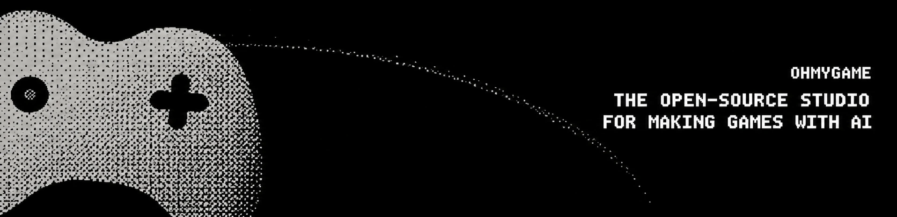
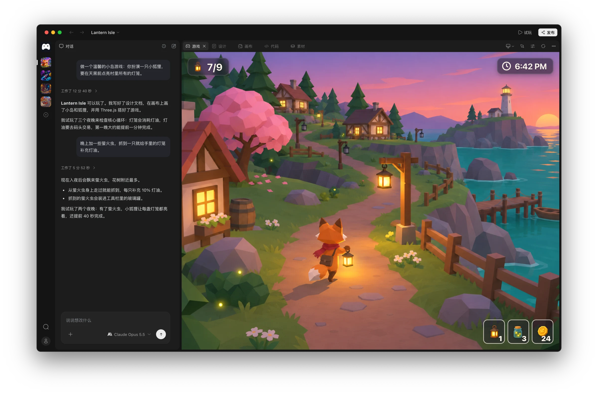
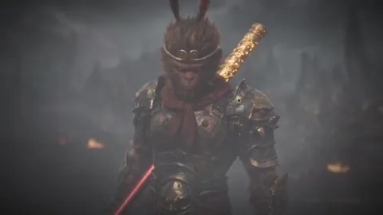
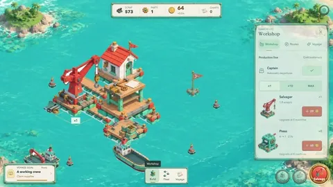
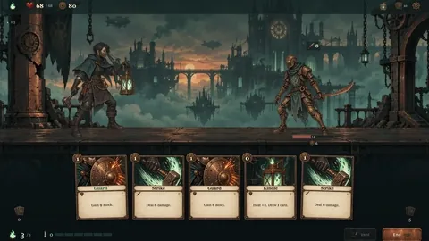

<div align="center">

<a href="https://ohmygame.ai/zh/"></a>

<p><b>用 AI 做游戏的开源工作室。</b></p>

<p>
  <a href="https://github.com/WhiteTowerAI/ohmygame/releases"></a>
  <a href="LICENSE"></a>
  <a href="https://discord.gg/TkrgvGQ2Zc"></a>
</p>

<p><a href="https://trendshift.io/repositories/291307?utm_source=repository-badge&amp;utm_medium=badge&amp;utm_campaign=badge-repository-291307" target="_blank" rel="noopener noreferrer"></a></p>

<p><a href="README.md">English</a> | <b>简体中文</b></p>

<p>
  <a href="https://ohmygame.ai/zh/">官网</a> ·
  <a href="https://ohmygame.ai/docs/">文档</a> ·
  <a href="https://ohmygame.ai/zh/community/">社区游戏</a> ·
  <a href="CHANGELOG.md">更新日志</a>
</p>

<p><a href="https://ohmygame.ai/zh/"></a></p>

</div>

描述你想做的游戏，Agent 会写设计文档、做美术、写代码，亲自试玩确认能跑通，再发布成一个谁都能打开的链接。设计文档、图片、视频、3D 和音频都和代码放在同一块画布上，不用在五六个工具之间来回切换。

> [!NOTE]
> OhMyGame 目前处于 Beta 阶段，难免有粗糙的地方。遇到问题欢迎告诉我们。

## 下载

| 平台                  | 下载                                                    |
| --------------------- | ------------------------------------------------------- |
| macOS（Apple 芯片）   | [下载 Mac 版](https://ohmygame.ai/download/mac)         |
| Windows（x64）        | [下载 Windows 版](https://ohmygame.ai/download/windows) |

历史版本和更新说明见 [Releases](https://github.com/WhiteTowerAI/ohmygame/releases)。Windows 版暂未做代码签名，首次安装时可能会弹出 SmartScreen 警告。Intel Mac 和 Linux 版本已在[计划中](https://github.com/WhiteTowerAI/ohmygame/issues)。

OhMyGame 不内置模型。首次启动时，连接一个模型服务商，或者选择你已经在用的编程 Agent：见[首次运行](https://ohmygame.ai/docs/first-run/)。

## 功能

- **会自己试玩的 Agent。** 它起草设计文档、编写代码、在实时预览里运行游戏，然后亲自上手玩，发现问题就尝试修复。
- **所有素材在一块画布上。** 一张角色草图可以延伸出更多美术图、一段视频、一句配音，或者一个绑好骨骼的 3D 模型，都能直接用进游戏。
- **发布成一个链接。** 任何人都能在浏览器里玩，游戏也会出现在[社区](https://ohmygame.ai/zh/community/)里。重新发布时链接不变。
- **插件连接你熟悉的工具。** Godot、Unity、Unreal Engine、Cocos Creator、Blender、Aseprite、Tiled，以及 TapTap、微信小游戏和抖音小游戏等平台。也可以[自己做插件](https://ohmygame.ai/docs/plugins/make/)。
- **任意模型，自带密钥。** 通过 [Pi](https://www.npmjs.com/package/@earendil-works/pi-coding-agent)
  支持 40 多家服务商，也可以用你已有的订阅，或者让 Claude Code、Codex、OpenCode 来当 Agent。不按次收费。见[模型](https://ohmygame.ai/docs/models/)。
- **也能在别的 Agent 里用。** 打开 MCP 服务后，Claude Code 或 Codex 就能用上 OhMyGame 的画布、媒体生成和试玩能力。见[外部 Agent](docs/external-agents.md)。

## 你可以做什么

我们团队用 OhMyGame 做的三款游戏：

<table>
  <tr>
    <td width="33%"></td>
    <td width="33%"></td>
    <td width="33%"></td>
  </tr>
  <tr>
    <td align="center">互动电影</td>
    <td align="center">岛屿建造</td>
    <td align="center">卡牌构筑 Roguelike</td>
  </tr>
</table>

**网页游戏**（Phaser、Three.js、React Three Fiber）最适合入门。**互动故事**适合做视觉小说、互动电影和剧情游戏。**General Game** 不限引擎和技术栈。[去玩玩别人做的游戏](https://ohmygame.ai/zh/community/)。

## 文档

使用指南在 **[ohmygame.ai/docs](https://ohmygame.ai/docs/)**：[安装](https://ohmygame.ai/docs/install/)、[首次运行](https://ohmygame.ai/docs/first-run/)、[模型](https://ohmygame.ai/docs/models/)和[插件](https://ohmygame.ai/docs/plugins/)。

技术文档在本仓库的 [`docs/`](docs/README.md) 下，比如[运行时](docs/runtime.md)、[编程 Agent](docs/coding-agents.md)、[自定义模型](docs/custom-models.md)和[插件规范](docs/plugins.md)。

## 从源码构建

需要 [Bun](https://bun.sh) 1.4.2+ 和 Node.js 22.19+。

```bash
git clone https://github.com/WhiteTowerAI/ohmygame.git
cd ohmygame
bun install --frozen-lockfile
bun run dev            # 网页渲染端 + 本地守护进程
bun run dev:desktop    # 或者 Electron 桌面应用
```

从源码构建的版本不发送任何遥测数据。分支、检查和可选的云端配置见 [CONTRIBUTING.md](CONTRIBUTING.md)。

## 隐私

你的项目和 API 密钥都留在本机，提示词直接发给你选择的服务商。只有发布游戏时才需要账号。正式版会发送使用数据和崩溃报告，可以在 **设置 → 关于** 中关闭。见[日志与诊断](docs/diagnostics.md)。

## 参与贡献

欢迎提 Issue 和 PR。从 `dev` 拉分支，PR 也提到 `dev`；`main` 只用于发版。先读 [CONTRIBUTING.md](CONTRIBUTING.md)，可以从 [`help wanted`](https://github.com/WhiteTowerAI/ohmygame/labels/help%20wanted) 的 Issue 入手。安全问题请按 [SECURITY.md](SECURITY.md) 私下报告。

## 社区

[Discord](https://discord.gg/TkrgvGQ2Zc) ·
[QQ 群 460706923](https://qun.qq.com/universal-share/share?ac=1&authKey=65LzSf96ttluVSAPzPKJvrsoQ0NSQHPJnhgJImnnqIik9uK64ljVd%2FzkRWb8Xanz&busi_data=eyJncm91cENvZGUiOiI0NjA3MDY5MjMiLCJ0b2tlbiI6InNUNWR3U05OeVlMZEVCK0YxNUNKckplazliYklGRnV6ZUZGM1NlV29vYVdKNGkrR2g2c28zNG1kdDFFcHllczMiLCJ1aW4iOiIyNDUxMjQwODEifQ%3D%3D&data=CQ5T4W2Ac1NWWg56dH_HQwixT7faVMm5Xq5kZsLgx9TDBGxeqs3mwXNLVUpO83oOUobc1qXBosRKYmWnziWboA&svctype=4&tempid=h5_group_info) ·
[Issues](https://github.com/WhiteTowerAI/ohmygame/issues)

## Star 历史

<a href="https://www.star-history.com/?repos=whitetowerai%2Fohmygame&type=date&legend=top-left">
  <picture>
    <source media="(prefers-color-scheme: dark)" srcset="https://api.star-history.com/svg?repos=whitetowerai/ohmygame&type=date&theme=dark&legend=top-left" />
    <source media="(prefers-color-scheme: light)" srcset="https://api.star-history.com/svg?repos=whitetowerai/ohmygame&type=date&legend=top-left" />
    
  </picture>
</a>

## 许可证

[Apache-2.0](LICENSE)。OhMyGame 的名称和标志不在许可证授权范围内。
