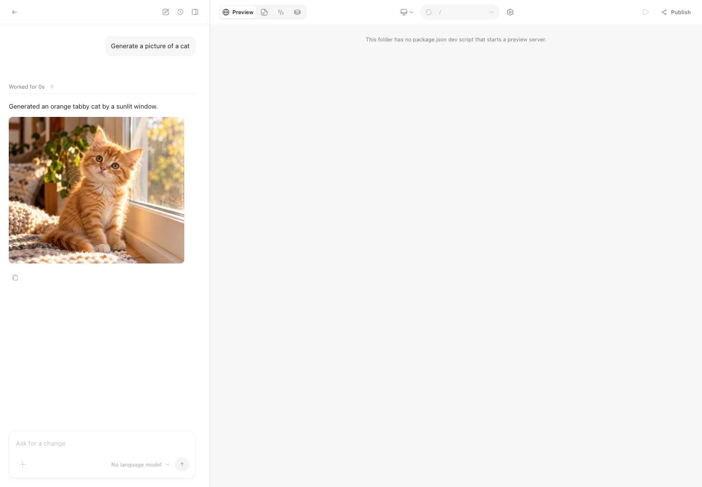

# Agent Runtime integration specification

Native runtimes are optional and disabled by default. This document records
the architecture and the accepted design decisions. The implementation guide is
[coding-agents.md](coding-agents.md); shared types and tests remain the source
of truth for individual protocol fields.

## Decisions and ownership

- A Provider represents a model service, authentication, catalog, and API
  protocol. An Agent Runtime owns an agent loop, native context, permissions,
  and, for external CLIs, a process.
- Pi remains the default Direct Runtime for existing conversations, API
  providers, and local models. Claude Code, Codex, and OpenCode are optional
  Native Runtimes using their own sign-in and model semantics.
- `AgentManager` remains the sole conversation/turn orchestrator. A
  `NativeCodingSession` implements the existing `CodingSession` boundary;
  protocol drivers implement transport and translate events.
- Conversation files, checkpoints, plan state, queues, errors, and public
  events retain their existing owners. Do not add a second conversation
  database, run/event store, or execution supervisor.
- The CLI process layer owns spawn, pipes, cancellation, process groups,
  ownership records, and private directory cleanup. Its journal stores process
  identities for orphan recovery, never conversation state.
- Image, video, 3D, canvas, preview, and plugin behavior stays in daemon services.
  Adapters reuse those services through a tool bridge.

```text
Renderer: existing model picker, timeline, approvals, context/usage
  │ HTTP + SSE / RuntimeEvent / ThreadItem
  ▼
AgentManager: turns, queues, checkpoints, errors, cancellation
  ├── existing Pi CodingSession
  └── NativeCodingSession: shared transcript, native context lifecycle
       ├── Claude Code driver: stream-json/control requests
       ├── Codex driver: App Server JSON-RPC
       └── OpenCode driver: local HTTP + SSE
            │
            ├── CLI process ownership and private runtime files
            └── ToolBridge → existing tools, canvas/media/preview, plugin MCP
```

The reverted implementation placed this in `src/daemon/agent-runtimes/`, with
public types in `src/shared/agent-runtimes.ts` and `src/shared/contracts.ts`.
These are module boundaries, not a requirement for a new generic framework. A future SDK may
replace a driver's transport without changing orchestration or persistence.

## Selection, settings, and discovery

Configure CLIs under **Settings → Agents**, next to OhMyGame's own agent, and
choose native models in the existing conversation model picker. Agents is its
own settings section rather than a group in Providers & Models: a provider
supplies models and credentials for every capability, while an agent runs the
conversation with its own install, account, configuration and sandbox. Do not add a competing
runtime selector or runtime-specific conversation settings route.

The existing `ModelRef { provider, id }` identifies both the runtime and its
native model. Runtime provider IDs are `claude-code-cli`, `codex-cli`, and
`opencode-cli`; the suffix avoids collisions with ordinary Pi providers, such
as `opencode`. These are not `ProviderSummary` records and are not inserted
into the Provider language catalog. A separate persisted `runtime` field would
create another source of truth and is unnecessary.

`ConversationAgentSettings.model` retains this shared reference. Pi
`reasoningLevel` keeps its existing enum; native effort/variant values are
stored separately as `nativeReasoningLevel` and validated against that native
model's advertised values. A native model lists no Pi reasoning levels, and
routes that take a default or a new conversation's level accept
`nativeReasoningLevel` for it and reject Pi's `reasoningLevel`. Neither value
is coerced into the other. Preserve stored native effort while discovery is pending,
including when a conversation is reopened after daemon restart.

The selected conversation model wins. New conversations reuse the project's
recent model selection, then configured defaults/available models. Global
native defaults retain model and effort together. An explicitly different
model does not inherit an incompatible effort. Existing conversations with no
native selection continue through Pi.

`agent-runtimes.json` stores per-runtime `enabled` (default false),
`permissionMode` (default standard), optional absolute `binaryPath`, and optional
`defaultModel`. It contains no credentials. Damaged settings fall back to safe
defaults.

| API                                                       | Contract                                                                       |
| --------------------------------------------------------- | ------------------------------------------------------------------------------ |
| `GET /models`                                             | Pi/API language models and Pi default; unchanged for one-off generation        |
| `GET /models?runtimes=1`                                  | Conversation catalog including enabled native models; reports loading runtimes |
| `PUT /models/default`                                     | Save the selected default; retain native effort with a native model            |
| `PUT /projects/:p/conversations/:c/model`                 | Change the conversation model and derive its runtime                           |
| `PUT /projects/:p/conversations/:c/reasoning`             | Validate Pi reasoning or native effort for the selected model                  |
| `GET /agent-runtimes`                                     | Discovery/status; `?recheck=1` refreshes probes                                |
| `PATCH /agent-runtimes/:id`                               | Enablement, permissions, executable override                       |
| `POST /agent-runtimes/:id/recheck`                        | Refresh one runtime                                                            |
| `POST /agent-runtimes/:id/login`                          | Return the CLI's login URL or terminal command                                 |
| `POST /projects/:p/conversations/:c/approvals/:requestId` | Answer a pending approval                                                      |

Discovery is lazy; Pi requests do not wait for it. An explicit executable wins.
Otherwise choose the newest installed SemVer among PATH, login-shell PATH,
common install directories, and known bundled copies. Resolve the executable
to an absolute path and deduplicate real paths. Version/probe caches are
bounded, expire failed results, honor Recheck, and discard in-flight catalog
results after configuration changes. Paginated native catalogs must be read
completely. A successful model listing is not proof of account entitlement;
billing/auth sources that cannot be established remain unknown.

## Shared transcript and native context

Every production native session uses a persistent Pi `SessionManager` at the
existing conversation session path. Conversation listing, branch navigation,
Undo, plan state, prompt details, errors, and restart recovery depend on it.
An optional interface property for Pi test doubles does not make production
native persistence optional.

Native messages/tool results are display and recovery records in that file.
Adapters must not reconstruct native hidden context or promise lossless replay
into another runtime. Native compaction and terminal approval decisions use
versioned custom entries when ordinary messages do not represent them.
Reloading approval history never restores permission grants.

### Account configurations

The runtime settings store owns Claude Code and Codex account names, directory
references and new-chat defaults under `accountProfiles` in `agent-runtimes.json`.
Branch-local `ohmygame-account-profile` entries store `{ version: 1, runtime,
profileId }`. Missing selections mean System default; changing the new-chat
default does not change existing chats.

The service passes `CLAUDE_CONFIG_DIR` or `CODEX_HOME` to login, discovery and
inference. Explicit Claude profiles omit ambient OAuth tokens. Managed Codex
homes are created with file-backed credentials; imported homes keep their native
settings. Credentials remain CLI-owned. Each profile records `managed` ownership;
only directories directly inside the runtime's reserved account folder may be
deleted. Removing a profile resets its new-chat default, stops idle sessions and
pending sign-ins, waits for probes to finish, and erases its caches. A managed
directory is signed out with the CLI's logout command in that directory's
environment before it is removed, since Claude keys its macOS Keychain entry to
the directory; failures do not block removal. Imports reject the directory System
default resolves to. Running
sessions refuse removal. Conversation reads resolve deleted IDs to System default
without writing, including after branch restoration; the deleted account's ready
marker no longer matches, so its native session is not resumed.

Caches and quota reports are keyed by runtime and profile. Login invalidates only
that profile; executable changes invalidate the runtime. Warm catalogs bypass
auth probing, and native usage reads never initialize a session. The existing
Codex server key includes environment and staged Skills, so different homes need
no additional process pool. Image-provider and external MCP setup independently
use System default.

Native ready markers include the profile ID, and the account selection writes no
marker of its own. Changing accounts creates a context from the bounded history
handoff; it cannot resume another account's native session. Returning to an
account before any turn on another one resumes that account's session, since its
marker is still the latest. Compacting is refused until the handoff has been
sent, so an empty context is never compacted and then resumed as the chat's. Busy changes are refused, and choosing the current account is a no-op.
When the target account's readable catalog lacks the chat's model, the same
replacement persists a model it offers (the new-chat default first) and the route
returns it. The existing tool policy protects connected
credential directories. Tests cover persistence, directory creation, account
isolation, shared servers within one home and switching without extra probes.
Real sign-in and model turns require acceptance beyond simulated protocol tests.

Native resume metadata is also a session-tree custom entry, not a sidecar:

```ts
interface StoredNativeSession {
  version: 2;
  runtime: AgentRuntimeId;
  state: "active" | "ready" | "invalid";
  sessionId?: string;
  profileId?: string;
}
```

Only the latest matching `ready` marker on the current branch may resume.
Write `active` before native work and `ready` only after successful completion;
crashes, failed turns, cancellation, and interrupted writes cannot reuse a
previous ready context. Invalidate on every rewind/edit/restore, even if the
native ID is unchanged, and after intervening Pi work, incompatible model
changes, or legacy metadata.

When context is absent or invalid, start fresh with a deterministic, bounded
handoff: recent visible turns, changed files, the structured plan, and restore
notices. Exclude private prompt context and do not make another model call.
An explicitly expired/not-found native resume receives one fresh-context retry,
without appending the user message twice. Other failures remain visible.
Moving back to Pi uses the shared messages; native hidden state is not imported.
Native turns are replayed to Pi as text (`replay.ts`): the agent's words, each
tool it used with bounded arguments, and bounded results, merged per turn,
without reasoning. Replaying them as tool calls taught Pi the CLI's tool names
and argument shapes; in a probe the text form made the next Pi turn call no
foreign tools and cut the replayed history by about a third.

### Chat branches

Chat branching copies the active session path through a completed assistant
message into an independent file using `SessionManager.createBranchedSession`.
It preserves inline images, compaction and settings metadata and resets active
plan state. The final assistant message makes copied native markers stale; the
new header records the source session, so no additional invalidation or
provenance entries are needed. Both chats use the project's current files.

Live branch points are attached by persisted message identity after `message_end`
through existing item events, without text matching or another history request.
Tests cover exact cutoffs, repeated reply text, image and settings preservation,
source immutability and independent native context. Branching needs no account
configuration feature.

## Checkpoints, queues, and cancellation

Extract/reuse `recordCheckpoint` at the existing Pi checkpoint boundary:
immediately before storing/delivering each user message. Pi keeps its extension;
`NativeCodingSession` calls the same helper. Moving all checkpoint logic into
`AgentManager` is unnecessary if queued deliveries preserve this invariant.
This is a deliberate adjustment to the review's proposed core refactor.

Every queued native message gets its own snapshot before delivery. Native
**Next** messages wait for the active turn, then run FIFO before ordinary
follow-ups. They are not concurrent mid-turn injection. Pi retains its own
steering behavior. The UI must describe the supported queue behavior instead
of claiming steering parity across CLIs.

A CLI idle for ten minutes is stopped and its replacement resumes the ready
native session with the next message, so open conversations do not each keep
a process. Codex conversations with the same executable, environment and
staged Skills share one app server, routed by thread: thread configuration,
permission profiles, dynamic tools and turns are per thread, and Skill roots
are the one server-wide setting. A conversation that leaves interrupts its
own turn and releases the server, which stops with the last. OpenCode keeps
one server per conversation: it registers MCP servers for the whole instance,
so a shared server would offer every conversation the others' OhMyGame tools,
and its configuration is per process. Check abort before spawning and again before delivery. Interrupt waits are
bounded and fall back to stopping the process group. A turn must settle on
spawn failure, close, transport loss, timeout, and cancellation, including
startup races. Ignore late callbacks/results after settlement.

Register children with desktop lifecycle management and persist verified
owner/child process identities for standalone orphan recovery. Reclaim only
verified orphans; preserve other live daemons' processes and directories.
Delete generated configuration and Skills after the child stops. Process-group
cleanup cannot reclaim unidentifiable processes or children that escape the
group; it is not an OS-wide process supervisor or resource scheduler.

## Runtime transports and compatibility

| Runtime     | Interactive transport and tools                                                        | Real acceptance version |
| ----------- | -------------------------------------------------------------------------------------- | --------------------- |
| Claude Code | Long-lived stream-json stdin/stdout; control requests and MCP tool callbacks           | 2.1.302               |
| Codex       | App Server JSON-RPC; native `dynamicTools`, approval responses, thread/turn lifecycle  | 0.163.0               |
| OpenCode    | Private authenticated `serve --stdio`; v2 HTTP API, SSE events, daemon MCP endpoint | 2.1.0 |

These versions record real acceptance, not minimum versions or certification of
all later releases. Discovery checks required protocol capabilities; real drivers
retain their startup checks. OpenCode supports the v2 API generation from 2.1.0
and does not run v1 or assume a future major version has the same contract.
Outside that explicit API boundary, only a documented feature that cannot be verified
through the protocol uses a conditional version requirement: Claude
`sandbox.failIfUnavailable` (2.1.83+) when Standard permissions rely on its OS
sandbox. See [compatibility checks](coding-agents.md#compatibility-and-real-acceptance).
Check required capabilities and refuse unsafe fallbacks. Direct protocols keep
the installed executable. The Claude Agent SDK was evaluated (0.3.302) and not
adopted: its platform package bundles a full Claude Code binary of about
268 MB per platform, it adds three peer dependencies, and each SDK release is
built for one CLI release, while OhMyGame drives whichever supported CLI the
person installed. Reconsider when the SDK can drive an installed CLI across a
version range without its bundled binary; a driver's transport can change
without changing orchestration or persistence.

Claude's permission controls use both `PreToolUse` and `can_use_tool`; validate
control callbacks, planning restrictions, and allowed MCP calls. Planning runs in
Claude's default permission mode, not its plan mode, so Claude records the plan
with `update_plan` rather than its own plan file. Background tasks and scheduled
prompts are disabled, because their reports would arrive after the turn ends.
Bridge tools are marked always loaded so tool search does not hide them. Discover
models from `initialize` or `list_models` as supported; expose failed/empty
catalogs as diagnostics. A sole callback path is not a sufficient assumption.

Codex requires named permission profiles and verifies `activePermissionProfile`
before delivering input. Do not silently fall back to legacy `workspaceWrite`,
which permits reads outside the workspace. Use native scoped permission
requests; disable unrestricted command/patch escalation. Planning gets a
read-only profile and cannot grant writes. Disable shell snapshots and rebuild
the tool environment without native authentication tokens.

OpenCode must establish the SSE connection before sending a prompt; HTTP calls
have timeouts and stream loss fails/stops the active turn. Permission paths use
the v2 session location and search metadata, not an assumed Git root. Verify child
session ancestry through the API before handling its approval; unrelated
sessions cannot inherit authority.

The first batch uses interactive pipes or HTTP/SSE. A future one-shot plain-text
adapter may use a private `0600` prompt file and close stdin after consumption.
Never apply that lifecycle to JSON-RPC or stream-json, which need later input.
`codex exec --json` and `opencode run --format json` are not the implemented
interactive transports or a permission fallback.

## Tools, plugins, and Skills

Expose one daemon-owned OhMyGame tool surface using `createAgentTools` and the
existing canvas/media/preview services. Proxy active plugin MCP through the
existing plugin adapter, hosted in a model-less Pi session. It does not run a
second model loop. Effective plugin capabilities and project-type rules remain
the source of truth, and plugin credentials stay in the daemon.

Claude uses its control/MCP callbacks, Codex uses dynamic tools, and OpenCode
uses a private loopback MCP endpoint. Any network bridge capability is scoped
to the current turn, permits multiple calls during that turn, and is revoked
permanently on completion, failure, cancellation, or disposal. Rotate it for
every later turn. Pass abort signals to tools and discard late results. Never
reuse the daemon token or write `.mcp.json`/credentials into a workspace.

Stage enabled Skills in a private session directory outside the workspace.
Copy regular files only, omit symbolic links, and require a regular `SKILL.md`.
Permit reads only within that session's staged roots; writes and neighboring
app data stay protected. Executing staged scripts still needs command approval.
Remove staged files only after the CLI stops.

New plugin capabilities must be expressible as Skills or MCP. Pi extensions are
not portable. Native canvas file edits still need `canvas_check`; media jobs,
artifacts, retries, defaults, and cancellation reuse their existing handlers.
A native language model is not an image, video, or 3D model.

Codex also has a separate `codex-cli` image provider with the logical model
`codex-image`. It follows the installed CLI's saved sign-in independently of
conversation enablement, without a separate image-capability probe. Image access
and compatibility errors are reported when generating.
`ProviderImages` dispatches it without an HTTP API source; canvas jobs, image
defaults, Library registration and cancellation use the ordinary media flow.
Each job runs a private ephemeral thread and reads completed images through
the same bounded decoder as native imports. No dynamic media tools are
registered in the image thread, preventing recursive `generate_image` calls.

Codex can also return images from its own built-in image generation. The
adapter imports completed `imageGeneration` items through the same project
generated-asset and Library pipeline as `generate_image`, and records a file
artifact in the conversation. Chat displays that artifact outside the tool
details, including after reopening the conversation; the game Preview still
shows only the running game. Imports finish before turn-end checkpoints are
recorded. Duplicate completion events are imported once per turn, and a failed
generation or import is reported as a failed tool and turn rather than a
successful text-only response. Planning turns do not import generated files.

Inline PNG, JPEG, and WebP results are accepted up to 32 MiB. If Codex returns
only a saved path, it must resolve inside that native thread's
`$CODEX_HOME/generated_images/<threadId>/` directory (or
`$HOME/.codex/generated_images/<threadId>/`). Images are copied into the project;
chat does not depend on the continued existence of Codex's source file. The
adapter does not scan other conversations or download image URLs.



## Permission and configuration boundary

Approvals ship with each adapter, including exact command/path/access/network
information and `allow`, `allow-session`, or `deny`. Keep terminal outcomes in
the timeline; deny pending requests on stop and allow retry after an HTTP error.
Cache conversation grants in OhMyGame, widening them only to the reviewed
command or read-folder scope shown on the card. Do not issue broad native
command-prefix grants.

The shared policy resolves symlinks and missing descendants, accounts for
custom CLI credential roots, and denies direct requests for credential homes,
OhMyGame data, other projects, or ancestors that expose them. Workspace file
operations and a small set of simple read commands may proceed; external paths,
builds, interpreters, Git, compound commands, and unknown scopes need approval.
A runtime whose commands all run in its OS sandbox (`sandboxedCommands`, Claude
Code where its sandbox starts) asks only for commands that publish or escalate
and for paths outside the workspace; planning keeps the strict rule. Codex's
requests are escalations out of its sandbox and keep the strict rule too.
A person may give an agent full access (`permissionMode: "full"`,
`fullAccess` in the policy): every request the policy would ask about is
allowed and the CLI runs without its sandbox (no Claude sandbox settings,
Codex's `:danger-full-access` profile). Protected roots a request names are
still denied, and planning uses `planningPolicy`, which is strict whatever the
mode. `approvalScope` widens a conversation approval only to a repeatable publish
(`git push`, `npm publish`) and to read folders, and only where writes stay
confined.
Globs, brace expansion, and recursive link-following options (`grep -R`,
`rg -L`, `ls -LR`) are unknown scopes: they reach paths the command text does
not name. A native agent's own tools that touch no file and run no command,
such as Claude Code's task list, Skill loading, subagents and web research,
run without approval; their subagents' tool calls are still checked.
Explicit permission grants must contain understood, concrete roots; reject
root-filesystem grants, globs, unknown forms, and protected paths.

This policy decides what to ask about; an OS sandbox is the boundary behind
it. Codex command execution has a native OS sandbox with minimal
runtime/workspace/private-temp/Skill access and explicit protected-root
denials. Claude Code's commands run in its native sandbox (Seatbelt on macOS,
bubblewrap on Linux), enabled through flag settings: protected roots are
unreadable, the workspace and staged Skills stay readable, commands cannot opt
out, and the network stays open for installs. Hosts without the required
sandbox dependencies use the strict approval policy. When approvals rely on
the sandbox, startup must fail if it cannot initialize; Claude cannot fall
back to unconfined commands. OpenCode has no command sandbox, and
its status and settings say so. Each runtime reports `commandSandbox` as `os`
or `none`; Windows is `none` until established. The CLI parent processes still
use their native auth and configuration, and sandboxes do not cover every
plugin or MCP server a person adds. Strong credential confidentiality across
all runtimes needs isolated credentials as well; that is deferred work.

Build the child environment from an allowlist: PATH, HOME, locale, temp,
proxy/certificate settings, and the runtime's own configuration directories.
Claude may retain its subscription `CLAUDE_CODE_OAUTH_TOKEN`; do not forward
ambient provider API keys, the daemon token, or unrelated `OHMYGAME_*` values.
An explicit environment API-key profile is not implemented. Native stored
provider credentials may still determine billing; display only what is known.

All runtimes inherit the person's CLI configuration. The removed
`isolateUserConfig` setting is ignored on load and no longer persisted or
accepted by the update API. The UI explains inheritance without a toggle.
OhMyGame still supplies tools, project instructions, staged Skills and the
selected permission policy. Claude Code and Codex suppress only the external
`ohmygame-studio` MCP connection to avoid recursion; personal MCP servers and
notification hooks remain enabled. Codex's workspace-root override remains part
of its permission profile, because denied parent-folder instructions otherwise
prevent startup. See [configuration behavior](coding-agents.md#environment-and-isolation)
for the runtime details.

OpenCode v2 adds callback rules, instructions and staged Skills in memory/private
files. Its v2 MCP registration disables code mode to preserve tool names and
results, and explicitly connects and verifies the bridge before sending a prompt.

OpenCode supports 2.1.0 or newer in the 2.x API generation. Startup uses the
JSON address announcement and the same v2 server checks as model discovery;
configuration transforms may finish after the server begins listening, so the
agent callback check waits briefly before declaring incompatibility. Prompts
start only after session permissions are reapplied and verified. CLI saved
permissions for the project override native `ask` rules: fail explicitly if
present, without deleting the user's grants. User plugins are trusted CLI code.
The native session ID is marked `opencode-v2:`; legacy v1 IDs use the existing
expired-session handoff instead of being resumed across protocol generations.

## Events and UI

Map native events into the existing `AgentSessionEvent`, `SessionEntry`,
`ThreadItem`, and `RuntimeEvent` path. Shared contracts are authoritative;
examples include `agent.*`, `item.*`, `plan.mode.changed`, and `prompt.*`.
Do not introduce a parallel native SSE/event family or untyped metadata bags.
Unknown tool output or measurements remain unknown rather than invented.

Show native model/effort, approvals, compaction, and context usage in the existing
controls. Use native context windows when reported. Account quota windows
(Codex's rate limits, Claude Code's subscription windows) belong to the agent,
not a conversation: they are cached per runtime, persisted, and shown in
Settings → Agents rather than in the composer. Add UI text in both English
and Chinese; prompts sent to agents remain English.

## Scope and release gate

The three adapters have Full integration scope: OhMyGame tools, approval UI,
resume/rebuild, manual/native compaction, queued continuation, usage where
reported, and checkpoint recovery. Full describes implemented scope, not a
promise of identical native features or completed platform acceptance. There
is no generic Basic tier: adding a declarative entry alone cannot run another
CLI.

Fixture coverage, accepted CLI versions, and the live acceptance workflow are
listed in [coding agent acceptance](coding-agents.md#compatibility-and-real-acceptance).
Linux/Windows real CLI acceptance, Electron-specific native lifecycle
acceptance, paid media/game-playtest flows, and universal OS confinement are not
established by those checks. Keep native runtimes opt-in and require real
acceptance on a target platform before advertising it as validated.

Deferred work includes a generic Basic adapter, stronger cross-runtime OS
isolation, explicit API-key environment profiles, and maintenance/migration of
version-specific transports. New runtime support needs a driver plus protocol
and real acceptance tests. CLI wire protocols and capability floors remain
maintained compatibility code.

## Related contracts

- [Agent/session orchestration](../src/daemon/agent.ts)
- [Shared model and runtime events](../src/shared/contracts.ts)
- [Agent tools](../src/daemon/agent-tools.ts)
- [Checkpoint and Undo contract](checkpoints.md)
- [Plugin package and portability contract](plugins.md)
- [Runtime and trust boundary](runtime.md)
- [Contribution checks](../CONTRIBUTING.md#make-and-check-your-change)
