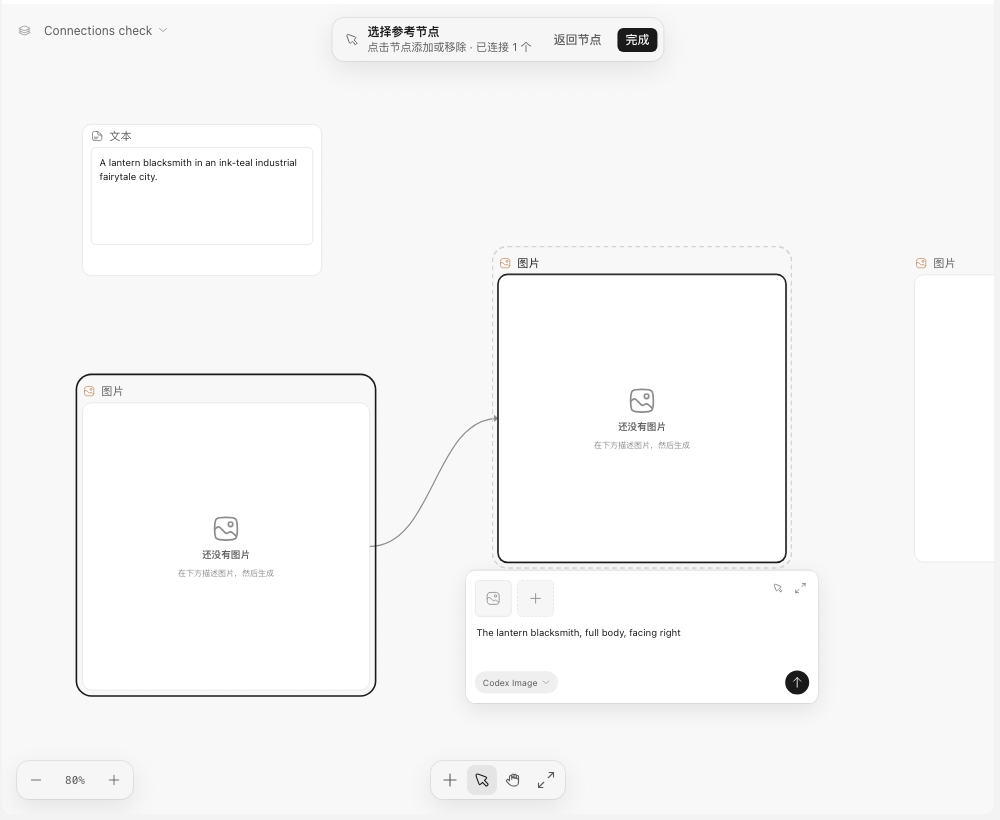

# Canvas And The Agent

Design and Asset Canvas share a project directory the agent edits with its ordinary file tools.
The canvas renders those files and autosaves user edits into the same sources.
A workspace or board GET accepts an optional `knownRevision` from its previous
response. When disk contents match, the daemon returns HTTP 204. A changed
resource returns its current contents and revision, including external edits.

The agent can initialize a canvas when design or asset work needs it, without
requiring the user to open Design first.
The agent shows final media deliverables on the relevant board, reusing existing
nodes and asset IDs. Local media can reference existing project-relative paths.

New Asset Canvas boards start empty. Home's Asset templates section, below
Explore, groups character, creature, animation, scene, terrain, object, and skin
presets.
Choosing a template first asks for one pixel density (the last choice is
remembered), then creates a new canvas with one group for that density, filled
with the category's generators or workflow. Character outfits &
skins adds two image inputs and a linked output directly to the group, without a
nested frame. Each new category template also adds an introduction above the group.
It explains the intended game use of every output, including the distinction
between static animation sheets that need frame splitting and storyboard panels.
These text nodes use `pixel-asset-template:<category>` to render localized guidance;
their saved text also preserves the introduction for file-based readers.
The bottom-toolbar picker adds one generator outside any density group, with
the density in its title; outfits & skins adds one standalone workflow frame.

Template example images are served from
`https://assets.ohmygame.ai/template-examples/pixel/` rather than bundled; covers
stay in the app. The editor keeps a copy of each example it shows or uses on the
device, so templates still open and generate from examples they have used before
without a connection. An example never loaded before reports that it could not
be loaded.

Pixel density sets the prompt's logical design size and palette budget, then
requires uniform nearest-neighbor enlargement. Coarse pixels use oversized
clusters and minimal features; classic pixels use medium clusters; fine pixels
use a finer grid and controlled secondary detail. Their shading budgets are
respectively 1–2, 2–3, and 4–6 hard-edged tones per major material, within shared
palettes of 8, 16, and 48 colors plus one plain background color or transparency.
Each density has separate character, creature, environment, object, and animation
detail rules. Environment and object prompts do not receive human facial rules.
References supply subject design and essential colors, even when the source is
already pixel art; the selected density determines rendering complexity.
Portraits and reference-sheet close-ups retain that density's pixel scale and
detail budget.

Subject consistency means retaining the hairstyle or head silhouette, body
proportions, main costume shapes, primary color blocks, essential equipment,
and a few defining markings. It does not require copying every facial detail,
accessory, seam, or pattern. Reuse the density-appropriate simplifications across
views, action frames, and close-ups. Pixel construction takes priority over detail
reduction at every density: silhouettes, diagonals, curves, and internal color
boundaries use visible square-pixel clusters and stepped contours. Simplifying
features must not turn them into smooth flat vector shapes; detailed features
must also remain visibly pixel-built. These are prompt instructions, not
additional provider controls or image post-processing.

Prompts distinguish each cell's logical size from the complete sheet. Animation
uses four columns and three rows of 32×32, 64×64, or 192×192 cells; creature sheets
use four by four, and item sheets four by three. Nine-scene sheets use a square
three-by-three composition with 96×96, 160×160, or 480×480 panels. Reference sheets
use a complete 16:9 logical canvas and separate full-body sprite budgets. Explicit
tile sizes and atlas layouts override density defaults. Visible pixel block size
comes from the complete logical canvas and actual output dimensions, with plain
margins if needed to preserve square pixels, rather than fixed output-width hints.

New preset image nodes store `data.pixelStyle` alongside their expanded prompt.
When expanding an unprepared preset, generation uses that explicit density, then
the nearest ancestor density group, then classic. Saved, expanded prompts stay as
edited; create a new preset node to use the updated defaults. Empty optional
requests use reference-based instructions instead of unresolved placeholders;
custom continuous actions still require an action description before generation.
These are prompt targets:
image generation does not enforce palette limits or guarantee logical dimensions.
The animation presets include idle, walk, run, attack, hurt, and down. Walk and
run specify one complete two-step cycle across 12 chronological frames, facing
screen-right with consistent near/far leg identities. Walk fixes the head, torso,
and hips while the arms and legs animate around them. Run adds grounded landing
compression, knee passing, and brief low flight. Both alternate the limbs in the
second half and avoid duplicating the first frame.
Custom actions retain a fixed camera and scale while allowing the body movement
required by jumps, rolls, crouches, or falls. Only inherently repeating actions
need to connect the last frame to the first.

Older boards are not migrated. Existing introduction nodes using
`asset-canvas-template:<id>` and `asset-canvas-template:free-image:<style>` remain
readable, and groups without `data.pixelStyle` keep their existing meaning.
Saved prompts and node references stay as stored. During desktop development,
schema changes require rebuilding the host and restarting the desktop app because
renderer hot reload does not update the daemon's validation schema.

```text
canvas/
  AGENTS.md
  README.md
  index.json
  boards/<board-id>.json
  documents/<document-id>.md
  tables/<table-id>.json
  assets.json
  editor/<board-id>.json
  schemas/{index,board,layout,assets,table}.schema.json
  jobs.json
assets/
```

`index.json` names boards, documents and optional tables. A board contains stable node IDs,
optional `title` and `description`, content, and references. Markdown bodies
are shared between document nodes. Connections for prompts and media are
derived from `promptSource`, `images`, `references`, and `source`.

Boards may also contain `group` nodes with `data.name` and the optional pixel
density marker `data.pixelStyle`. A grouped node stores
`parentId` pointing to a group on the same board, and its layout position is
relative to that parent. Groups can be nested, but parent chains cannot form a
cycle. Group frames have width and height in `editor/<board-id>.json`. The editor
supports grouping selected nodes, ungrouping, dragging nodes between groups,
copying group trees, and undo/redo. Deleting a group deletes its descendants.
Media toolbars move below the node when there is insufficient room above it.
When the generation form is open, the lower toolbar sits after the form and
follows its height and canvas zoom so it does not cover the inputs.
Select two or more nodes and use Group in the floating selection toolbar or Cmd/Ctrl+G to group them;
selecting one group shows a toolbar beside its frame with Run group (starts generation
for executable descendants, including nested groups) and Ungroup. The floating toolbar
also shows Ungroup when multiple selected nodes include a group.
Run group executes up to three ready nodes concurrently, including text nodes.
Nodes wait only for their own generation references; media jobs must finish and
their saved outputs must be synchronized before dependent nodes can start.
Failed or cancelled nodes cause their dependents to be skipped; independent nodes
still run. Circular generation references prevent the batch from starting.
Text nodes use their own selected model, falling back to the default text model.
Each canvas job records `upstream`, what every node it read gave when it
started (`asset:<id>`, or a hash of the text). A node whose last finished run
read something that has changed since, and every node after it that made
something, shows **Out of date**; clicking that, which first asks and says how
many generations can run, or **Regenerate from here** in the node's menu, runs
the node and the nodes after it one at a time in the daemon
(`POST …/boards/:boardId/nodes/:nodeId/regenerate`, 202 with the planned node
ids). The first node runs again; the rest reuse their output when nothing they
read changed. A failure stops the chain before what reads it. On an image with
something after it that runs, **Run with several images…** picks 2 to 10 PNG,
JPEG or WebP Library images, its button saying how many generations can run,
and copies the chain once per image, each in
its own group below the original named after the image (keeping the pixel
density its groups gave each image), then runs every copy. A chain doesn't
write text, so neither Regenerate from here nor Run with several images is
offered, and the route answers 409, while a Text node a model writes or a
Document sits between the node and something that runs after it, or while the
nodes after it read each other in a loop.
Shift+Cmd/Ctrl+G ungroups selected frames. Double-click a group heading to name
it, and drag the heading to move its entire tree. The empty frame interior
allows marquee selection of its children. Dropping a node with its center
inside a frame adds it to the deepest containing group; dropping completely outside
removes it from that group. A frame expands after a child is moved across its
edge, up to the 4096 × 4096 layout limit. Frames also support manual resizing.
Shrinking a frame stops at the bounds of its children; resizing from the top or
left keeps the children fixed in canvas coordinates.

Generation nodes use these semantic board fields (runtime state and visual size
do not belong in the board file):

- `audio`: `prompt`, optional `promptSource`, `model`, the model's audio
  settings (such as `voiceId` and `speed`), `durationSeconds`, `loop`,
  `instrumental`, and generated `assetId`.

One audio node makes speech, sound effects and music; the model decides which.
For a text-to-speech model, `prompt` is the line to speak word for word; for
the others it describes the audio. Options the model doesn't take are left
out of the request. Boards saved with the older `speech`, `sound-effect`,
`music` or `audio-scene` nodes open as audio nodes, and canvas_check asks for
them to be saved that way.

Text and Document nodes accept up to 14 connected Text, Document, Image or image
Asset nodes in `references` (`{ "type": "node", "nodeId": "..." }`). These
connections supply source material to AI generation. Connecting an image to a
Document adds a generation reference; use Insert image to put it in the Markdown.
Generation saves the current board and documents first, then reads the referenced
nodes' saved text, Markdown and actual image output from the workspace. A run
starts unless what its own node reads changed during the request; edits elsewhere
on the board don't stop it, so parallel chains don't stop each other. Image
references require a language model that accepts images. A node cannot reference
itself or, for Document nodes, another node pointing to the same document.

Positions, zoom and the width/height of text, document, table and group nodes live in
`editor/`. Media and generation nodes size to their content: the editor ignores
a width/height on them and canvas_check reports it. New nodes get positions
automatically.
The agent usually edits only the semantic files. Deleting a board or node
keeps its documents, tables and media.

Table nodes reference `tableId`; the JSON table is shared across boards. Each
column has a stable ID, title, type (`text`, `number`, `boolean`) and optional
width. Each row has a stable ID and `cells` keyed by column ID. Missing cells
and `null` mean empty. Keep IDs stable when changing data. Tables support up to
1,000 rows and 100 columns. Different cells merge independently; competing
cell edits, deletion versus editing, or incompatible type changes require a
version choice. Invalid or removed files preserve unsaved local table drafts.

The editor supports wrapping cells, fixed headers, column resizing, table
undo/redo, CSV import/export and rectangular TSV paste from spreadsheets. CSV
imports replace the contents and keep values as text to preserve leading zeros;
change column types explicitly when needed. Table undo is separate from board
layout undo. Text, document and table nodes can be resized in pointer mode,
reset to their default size, or opened for expanded editing.

Table cards show a read-only preview with the same header, reading frame and
footer as document nodes. Edit opens the expanded spreadsheet; Expand opens a
larger preview with an edit toggle. Selected nodes and expanded tables share an
AI instruction composer and model settings. Complete, validated AI output is
applied only when the saved source is unchanged. Otherwise it remains a candidate
for explicit adoption. Invalid or incomplete output preserves the table, and AI
instructions and valid candidates survive reloads. Adopting an AI draft is one
table undo step.

In the Select tool, left-drag on empty canvas draws a selection box; dragging a
node moves the selection. Shift-click, Cmd-click or Ctrl-click toggles a node in
the selection.
Middle-drag or hold Space and left-drag to pan without changing the active tool.
The hand tool also pans with a left drag. Right-click opens the context menu.
Space in fields, editors, buttons and media controls keeps its normal behavior.
Wheel panning and trackpad pinch zoom are available in either tool.

Canvas generation prompts use Enter to generate and Shift+Enter for a new line.
Enter confirms an active input-method composition or a video `@` reference
suggestion before it can generate. Text and document content keep ordinary
multiline editing.

`assets.json` maps asset IDs to readable names and project-relative paths.
Descriptions describe purpose; prompts record generation instructions.
Neither is a verified description of image pixels. The agent reads local
images when it needs to inspect appearance. The shared canvas reference type
`library` resolves through this project manifest; `libraryAssetId`
records the origin of an imported or generated file.

Canvas media downloads use the node's custom `title` as the filename, falling
back to the original asset name when the title is blank or unusable. The preview
and context menu use the same name. Downloads retain the asset extension, remove
unsafe filename characters, handle reserved device names and limit the full name
to 200 UTF-8 bytes. Renaming a node does not rename the workspace file or shared
Library asset; adding the asset to another project still uses its asset name.

The editor supplies the current board path and selected node IDs as a
removable chat context. The agent reads current files before making changes.
Concurrent edits to different fields merge; competing edits require the user
to choose a version. A node type change is adopted as a whole when the other
version of that node is unchanged; competing edits during a type change require
a version choice. If combined edits create invalid node references, the editor
also requires a version choice and preserves the local recovery draft.
Invalid external edits leave the last valid canvas
visible with diagnostics. External node changes enter the canvas undo history.

Asset Canvas has **Canvas** and **Code** navigation. Code shows the workspace
files and stays accessible when canvas loading or saving fails. Switching
views keeps the canvas session, document generation state and local drafts.

Missing media files do not prevent the workspace from opening or the board
from being saved. The affected node keeps its ID and references, shows the
missing path, and can check the file again. Restoring the file also refreshes
its preview automatically. Generation, image insertion and export validate
the files needed for that operation; unrelated missing assets do not block it.
Deleting a node keeps the resource registration and file for reuse and undo.
An unused registration for a missing file does not block the editor. Remove
such a registration only after checking other boards and document links.
`canvas_check` still reports missing files as diagnostics.

While a canvas is open, the daemon watches `canvas/` and `assets/` and batches
file notifications for 75 ms. Connected editors re-read the affected workspace,
board or generation history. Reconnecting and returning to a visible window
both reconcile current versions. A visible editor also checks every 60 seconds
to catch missed notifications and changes to referenced files outside these
directories. Each refresh uses the same draft and conflict handling as a manual
sync.

Loading, background synchronization and saving have separate recovery actions.
An initial load failure can reload the canvas. A failed background read keeps
the last valid board interactive and retries synchronization. A failed save
keeps the local recovery draft and can retry saving. Competing edits show
version choices without covering the canvas; choosing a version runs through
the same serialized storage session as saving and synchronization. Missing
document files or index entries also preserve unsaved Markdown drafts until
their sources are restored.

Document AI generation saves complete output only when the source document has
not changed. Truncated or interrupted text stays in an editable candidate draft,
with the specific failure reason, and never replaces the document automatically.
Candidates can be copied, discarded or explicitly adopted through the normal save
flow. Instructions, model settings and candidates are kept locally across reloads.
Retrying keeps the current candidate until another text result arrives; retry
results also require review. Responses with no document text preserve the document
and instruction and allow retrying or choosing another model. Thinking and tool
output are never used as document Markdown.

Three tools supplement ordinary file editing:

- `canvas_initialize` creates the file contract and an empty board on demand,
  preserving existing content. It is unavailable in planning mode.
- `canvas_check` validates schemas, document/table references, asset paths and media
  types. It is read-only and available in planning mode.
- `generate_canvas_media(boardId, nodeIds)` executes the saved settings of up
  to eight nodes when generation is requested, including necessary media for a
  game-creation request unless the user limits its scope. Listed nodes generate
  at once, except that a node using another listed node's output starts after
  that output is saved; it is skipped if that node fails. It shares canvas jobs, cancellation and
  history, materializes output in the project, and writes the output ID back
  to the node. Changing a file does not start generation. When the node is
  already generating, for example after the user pressed Generate, the call
  waits for that job instead of failing. Stopping the agent ends only its wait:
  a run already started finishes on the canvas, since the provider may already
  be charging for it, and a listed node still waiting for another's output
  does not start. When the node's current output came
  from identical resolved settings, it returns that output without another paid
  run; `regenerate: true` asks for a new variation. The canvas Generate button
  always starts a new run.

Both editors share nodes, documents, metadata, generation, history, clipboard,
file uploads and external file synchronization. Asset Canvas starts with one
board and supports additional boards for separate asset workflows. The main
home page, below Recent Projects, and the Asset Canvas home show examples for
Game Assets, Character Sequences, and Character Action Set. Opening one creates a board
without starting image generation. Each board has a guide and editable
generation nodes. The Game Assets board lays out ten pixel-style generators,
and Character Sequences lays out its continuous-frame and consistent-scene
generators beside a shared character reference. Every node is present when the
board opens; the guide examples only explain the output formats. Model, size,
and prompt settings remain in each generator and its form follows normal node
selection. The result is
a static image grid that can be split into frames and composed as a GIF. Character
Action Set uses one reference image across six separate sprite-sheet image nodes.
These outputs are static images and require an image provider that supports
references. A selected image can start either action workflow on a new board in
the same project. Asset Canvas retains automatic covers and sending assets to
projects. Game projects expose multiple boards and an optional main game design
document.

Dropping, pasting or uploading files imports Markdown and text files as
documents (up to 1 MB) and CSV or TSV files as tables (up to 4 MB). Images
(PNG, JPEG, GIF, WebP, AVIF, SVG), video (MP4, MOV, WebM), audio (MP3, WAV,
Ogg, M4A) and GLB models go to the Library as asset nodes, up to 200 MB each;
`src/shared/media-files.ts` lists the media types, and the daemon checks each
file's data against its type. Any other file, such as a source file, font,
archive or editor project, is copied into the project under `assets/files/`
(a repeated name gets a `-2` suffix) and shown as a file node whose
`data.path` is that project-relative path. File nodes stay in their project:
pasting one into another project is refused. `canvas_check` reports a file
node whose file is missing. System files such as `.DS_Store`, `__MACOSX` and
hidden entries inside a dropped folder are left out.

Dropping or pasting a folder asks first, because a folder is easy to drop by
mistake. **Import folder** copies it into `assets/files/<folder>/` with its
structure intact, so files that refer to each other by relative path (a glTF
with its textures, a sprite atlas, an engine asset pack) keep working, and adds
one folder node (`data.directory: true`). A repeated folder name gets a `-2`
suffix. Folder imports take up to 5,000 files and 2 GB at a time.
**Import files separately** imports each file as above, and **Cancel** imports
nothing.

Hold Option (Alt on Windows and Linux) when starting a node drag to pull out
copies. Copies keep node content and Library resources, use new IDs, and drop
all connections, including connections within a copied selection. The originals
stay in place. Releasing at the starting position cancels the copies; a completed
drag is one board undo step. If the copies would exceed the 2,000-node limit,
the editor rejects the drag and keeps the originals in place.

## Connecting And Editing Nodes

Canvas ports appear beside a node while it is hovered or is the only selected
node, and when a port has keyboard focus. Each port keeps the same on-screen size
at any zoom and has a larger pointer area than its icon. Connections end at the
node's left and right edges, independently of the outside port icons. Drag from
either an input or an output to connect compatible nodes. Click a port, or focus
it and press Enter or Space, to add a compatible context or continuation node.
Creating that node also establishes its reference as one undo step; it does not
start model generation. A plugin's node ([Canvas nodes](plugins.md#canvas-nodes))
has one input port per input it declares.

Choose **Pick from canvas** in a node's instruction editor, or in its input port
menu, to select sources on the current board. Compatible nodes stay readable and
show an outline on hover, linked references have a solid ink outline, the target
has a dashed outline, and incompatible nodes fade. Clicking an existing
reference removes it. The selection bar shows how many references are linked.
**Return to node** brings the target back into view; **Done** or Escape ends
selection and restores its panel. Connection type, duplicate and model-capacity
checks also apply here.



Hover over a connection to highlight it; after a short pause, a scissors button
appears. Clicking it removes the underlying reference. A selected connection
also exposes this button, and Delete/Backspace and board undo/redo remain
available. Running target nodes keep their inputs protected until generation
finishes.

Text instructions and media prompts have a wider editor centered below the node.
Its corner holds **Pick from canvas** and **Expand prompt editor**, so neither
adds a row above the prompt. The expanded editor retains references, model
settings and generation controls. Escape returns to the canvas and restores
focus. Prompt keyboard shortcuts and input-method composition behave the same in
both views; video reference suggestions handle Enter and Escape before the
editor does.
