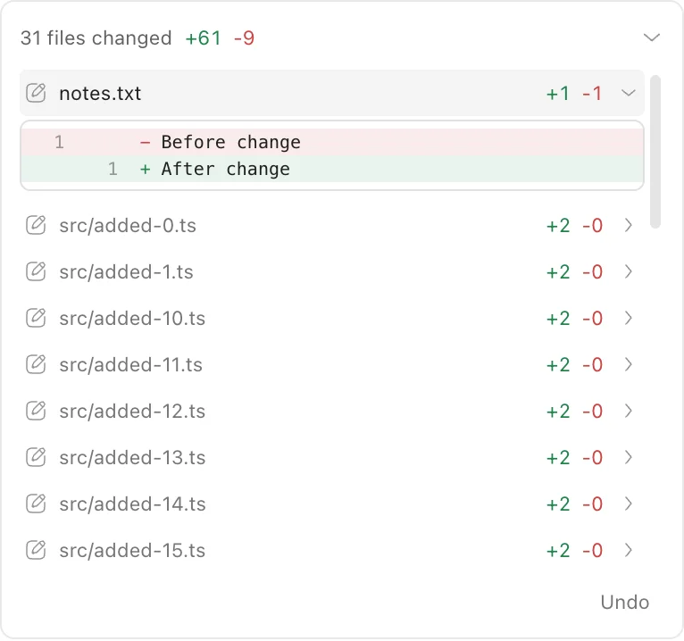
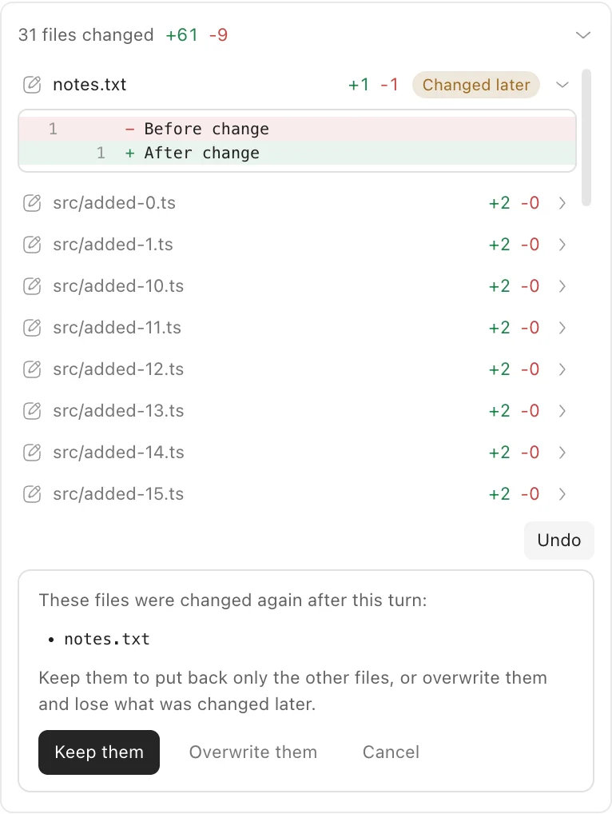

# Turn file changes, Undo and Reapply

Each consumed user message has a checkpoint before model/tool execution. Its
turn ends at the next consumed message's checkpoint, or at the final snapshot
when the run settles. A compact summary below each finished turn shows the file
count and green/red added/removed line counts in a subtle bordered panel,
collapsed by default. Select the summary or its right-hand arrow to expand the
file list and reveal **Undo** / **Reapply** below it. Long lists scroll within
280px; select anywhere on a file row, including its counts or arrow, to open or
close its diff. Hover and keyboard focus highlight the whole row.
Added text files show `+N -0`; the response copy button and timestamp follow
the panel. Failed and cancelled turns also capture their partial file changes.
If either checkpoint fails, the range is unavailable; a failed before checkpoint prevents inference
and tool execution.

Tool groups expand into an internally scrolling list capped at 280px. Successful
`edit` and `write` calls show their own line counts immediately after the tool
label, when available. The expand arrow appears to the right of the label and
counts on hover or keyboard focus. Counts match the label color at rest and
turn green/red on hover or keyboard focus.
They appear as soon as that call completes, while the rest of the turn can still
be running. Expanding the call shows its actual Diff with the same green/red
view as the turn summary. Tool previews retain up to 300 lines and 32,768 text characters;
truncation does not reduce the full line counts. Pi's unified patch and older
numbered Diff records are supported in both live events and history. An executing
or failed call does not show successful change counts or a completed Diff.
These counts describe individual calls; the turn summary describes the net file
changes, including changes made outside tools during the turn. Counts are saved
with the turn end, so showing history does not scan the current workspace. Older
sessions without saved summaries automatically load their statistics even while
collapsed; these immutable summaries stay visible across workspace refreshes.
The expanded list also loads each path's current state. Binary and oversized
files show a dash in place of unavailable line counts; they do not invent counts.

**Edit message** changes the conversation branch and sends the replacement
prompt using the current workspace. It preserves files. **Undo** is a
separate, explicit action that preserves the conversation. It saves the current
editor first, stops the preview, restores the selected turn's changed paths,
and reloads workspace editors. The model receives a persistent notice to inspect
the current files before continuing. Ordinary Undo runs directly; only conflicts
require a choice. **Reapply** restores the files actually undone to their exact
contents immediately before Undo, including later edits that were explicitly
overwritten. It preserves the conversation and files left alone by Undo. After
Reapply, Undo is available again. Partial Undo and **Undo the rest** keep a
separate pre-undo snapshot target for each affected path, so Reapply can restore
both operations together. Repeating Undo on a file/folder replacement updates
related paths to the latest pre-undo structure. Targets persist across daemon
restarts.

## Later edits and running work

Undo compares current files with the turn's after checkpoint. If a changed path
has later edits, the first attempt reports conflicts without writing any files.
The user can keep those paths and undo the others, or explicitly overwrite the
conflicts. Overwrite names the conflict paths the user was shown; new conflicts
require another confirmation. **Undo the rest** handles paths kept by a partial
undo. A turn can also be undone again if its changes were brought back by a later
restore. Its original Diff remains available. Reapply compares undone paths with
the
turn's before checkpoint and uses the same keep/explicit overwrite choices if
files changed after Undo. Keeping Reapply conflicts leaves those paths available
for a later attempt; paths already at their target are cleared without writes.

**Restore to before this message** independently restores the whole workspace and
rewinds only the selected conversation to before that message. This action
requires confirmation. Editing a message always preserves the workspace.

Undo and Reapply are unavailable while agents, generation jobs, or publishing
are running in the project. Agent turns in different conversations of one project run one at a
time. Queued and steering messages get their before checkpoint when consumed,
not when enqueued. Each range is linked by checkpoint entry IDs, which remain
the same when the live conversation is reloaded from disk.

Checkpoint boundaries drain daemon HTTP handlers and canvas generation callbacks,
including callbacks whose job already reports cancellation. They temporarily
stop preview processes and resume an existing active preview afterward. Explicit
Undo and Reapply leave the preview stopped until the user resumes it.

Daemon project requests use `x-workspace-version`. Undo and Reapply change this
version and emit `workspace.restored` with the version and changed paths. These events are
sent after the workspace lock is released, so editors can remount and read the
restored files; delayed writes carry the version of the editor that
created them and receive `409 workspace_stale` after restoration. Unsaved canvas
recovery drafts use that version in their local storage keys, so an old draft
cannot silently reappear after Undo or a daemon restart. Generation instructions
and candidate history remain available for explicit adoption.

External editors and commands outside the daemon remain independent. Checkpoint
file signatures and content checks detect conflicting changes during restoration;
an operation rolls back when possible rather than silently overwriting them.

## Storage and file scope

The store currently retains all snapshots without garbage collection; file modes
retain only whether a file is executable.

The daemon stores Git-compatible objects in the project's storage directory at
`checkpoints/`, outside its workspace. The workspace does not need Git; its
`.git`, branches, index, and `.gitignore` are untouched. This is internal snapshot
storage rather than a user-facing Git workflow.

Snapshots include creative project files and workspace asset metadata. They
exclude `node_modules` and `.git` anywhere, and these paths at the workspace root:
`dist`, `build`, `out`, `.godot`, `.ohmygame`, `.ohmygame-install-pending`,
`.data/agent-attachments`, and `canvas/jobs.json`. The global asset Library,
generation history, and conversation session files are preserved. Snapshot
metadata uses `ohmygame-checkpoint`, `ohmygame-turn-end`, and
`ohmygame-checkpoint-undone` entries in the Pi session. These are the single
record format used by the agent, API, and UI. Undo records optionally carry a
`reapply` map from path to its pre-undo snapshot; an empty map marks a completed
Reapply. Legacy Undo records without this map can reapply only turn paths still
at their before contents, using the earliest recorded pre-undo snapshot. Paths
edited after a legacy Undo cannot be reliably identified and are left alone.

The Diff lists binary and large files, but text preview is limited to UTF-8 files
without NUL bytes and up to 256 KiB per side, with a truncation notice. The limit is enforced while
decompressing stored blobs. Chat diff views render at most 2,000 lines; truncation
does not reduce saved line counts. Immutable previews remain cached when the
workspace changes; only current path states refresh. File Undo still works for
these files.

## Interrupted restoration

The store records the workspace state immediately before mutating files. If a
restore and its rollback cannot finish, it retains an unfinished-operation
marker. The project shows **Recover files** and refuses creative writes and
initializing canvas/playable/preview reads until recovery completes. Recovery
restores only the recorded pre-operation state and keeps the conversation.

For **Restore to before this message**, the marker remains until the conversation
rewind is persisted. If that fails, the original conversation branch is selected
again and the files roll back inside the same store operation. A failed file
rollback keeps the original recovery target and is reported instead of hidden.

The durable `workspace-restore-notice.txt` beside the checkpoint store is written
before mutation and updated after restoration. It preserves the workspace version
across daemon restarts. Every later model request reads this notice into its
system prompt, so all conversations receive the current workspace context without
appending duplicate messages to their histories.

## Code and verification

- Storage: `src/daemon/checkpoints.ts`, `src/daemon/checkpoint-objects.ts`.
- Boundaries and persistence: `src/daemon/agent.ts`, `src/daemon/checkpoint-extension.ts`.
- HTTP coordination and recovery: `src/daemon/project-writes.ts`,
  `src/daemon/checkpoint-routes.ts`, `src/daemon/workspace-notice.ts`.
- UI: `src/renderer/turn-changes.tsx`, `src/renderer/project-shell.tsx`,
  `src/renderer/workspace-version.ts`.
- Tests: `test/checkpoints.test.ts`, `test/turn-checkpoints.test.ts`,
  `test/checkpoint-routes.test.ts`, and the canvas storage suites.

The routes under `/projects/:projectId` are:

- `GET conversations/:conversationId/checkpoints/:checkpointId/changes`
- `GET conversations/:conversationId/checkpoints/:checkpointId/file?path=...`
- `POST conversations/:conversationId/checkpoints/:checkpointId/undo`
- `POST conversations/:conversationId/checkpoints/:checkpointId/reapply`
- `POST conversations/:conversationId/checkpoints/:checkpointId/restore`
- `GET checkpoints/unfinished` and `GET checkpoints/unfinished/changes`
- `POST checkpoints/unfinished/restore`

Undo and Reapply accept `{ conflicts?: "keep" | "overwrite", expected?: string[] }`;
`expected` is required for overwrite. Responses include `changed`, `conflicts`,
`undone` (whether reversible paths remain), and `kept` (turn paths still outside
the before state while Undo remains active). `workspace.undone` and
`workspace.reapplied` update the selected turn without reloading the
conversation. `workspace.restored` carries the new workspace version and changed
paths to every editor; a conversation ID and checkpoint ID additionally identify a
conversation rewind. Unreadable paths are recorded in snapshots and stay outside
Diff and restoration, including descendants and case variants. A malformed or
unreadable recovery record is an error that blocks creative writes.
