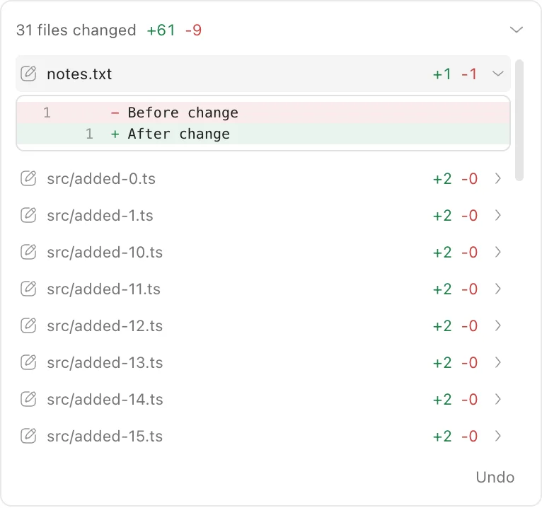
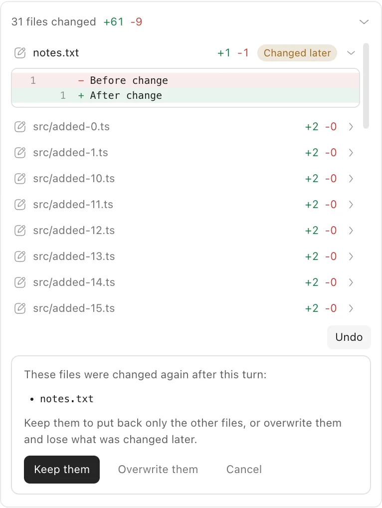

# Turn file changes, Undo and Reapply

Each consumed user message has a checkpoint before model/tool execution. Its
turn ends at the next consumed message's checkpoint, or at the final snapshot
when the run settles. A compact summary below each finished turn shows the file
count and green/red added/removed line counts in a subtle bordered panel,
collapsed by default. Select the summary or its right-hand arrow to expand the
file list and reveal **Undo** / **Reapply** below it. Long lists scroll within
280px; select anywhere on a file row, including its counts or arrow, to open or
close its diff. Hover and keyboard focus highlight the whole row.
Added text files show `+N -0`; the response copy button and timestamp follow
the panel. Failed and cancelled turns also capture their partial file changes.
If either checkpoint fails, the range is unavailable; a failed before checkpoint prevents inference
and tool execution.

Tool groups expand into an internally scrolling list capped at 280px. Successful
`edit` and `write` calls show their own line counts immediately after the tool
label, when available. The expand arrow appears to the right of the label and
counts on hover or keyboard focus. Counts match the label color at rest and
turn green/red on hover or keyboard focus.
They appear as soon as that call completes, while the rest of the turn can still
be running. Expanding the call shows its actual Diff with the same green/red
view as the turn summary. Tool previews retain up to 300 lines and 32,768 text characters;
truncation does not reduce the full line counts. Pi's unified patch and older
numbered Diff records are supported in both live events and history. An executing
or failed call does not show successful change counts or a completed Diff.
These counts describe individual calls; the turn summary describes the net file
changes, including changes made outside tools during the turn. Counts are saved
with the turn end, so showing history does not scan the current workspace. Older
sessions without saved summaries automatically load their statistics even while
collapsed; these immutable summaries stay visible across workspace refreshes.
The expanded list also loads each path's current state. Binary and oversized
files show a dash in place of unavailable line counts; they do not invent counts.

**Edit message** changes the conversation branch and sends the replacement
prompt using the current workspace. It preserves files. **Undo** is a
separate, explicit action that preserves the conversation. It saves the current
editor first, stops the preview, restores the selected turn's changed paths,
and reloads workspace editors. The model receives a persistent notice to inspect
the current files before continuing. Ordinary Undo runs directly; only conflicts
require a choice. **Reapply** restores the files actually undone to their exact
contents immediately before Undo, including later edits that were explicitly
overwritten. It preserves the conversation and files left alone by Undo. After
Reapply, Undo is available again. Partial Undo and **Undo the rest** keep a
separate pre-undo snapshot target for each affected path, so Reapply can restore
both operations together. Repeating Undo on a file/folder replacement updates
related paths to the latest pre-undo structure. Targets persist across daemon
restarts. A turn whose file history was cleared shows a notice in place of its
file list and has no Undo or Reapply; see
[Clearing the file history](#clearing-the-file-history).

## Later edits and running work

Undo compares current files with the turn's after checkpoint. If a changed path
has later edits, the first attempt reports conflicts without writing any files.
The user can keep those paths and undo the others, or explicitly overwrite the
conflicts. Overwrite names the conflict paths the user was shown; new conflicts
require another confirmation. **Undo the rest** handles paths kept by a partial
undo. A turn can also be undone again if its changes were brought back by a later
restore. Its original Diff remains available. Reapply compares undone paths with
the
turn's before checkpoint and uses the same keep/explicit overwrite choices if
files changed after Undo. Keeping Reapply conflicts leaves those paths available
for a later attempt; paths already at their target are cleared without writes.

Chat has no action that rewinds the conversation and the workspace together.
Editing a message always preserves the workspace, and Undo is the only way to
take files back. The daemon keeps the conversation restore route below, and still
reads conversations that an earlier version rewound with it.

Undo and Reapply are unavailable while agents, generation jobs, or publishing
are running in the project. Agent turns in different conversations of one project run one at a
time. Queued and steering messages get their before checkpoint when consumed,
not when enqueued. Each range is linked by checkpoint entry IDs, which remain
the same when the live conversation is reloaded from disk.

Checkpoint boundaries drain daemon HTTP handlers and canvas generation output
saves, including saves whose job already reports cancellation. A generation
still waiting for its provider holds nothing: when it finishes, it saves its
output as a workspace write, which waits for a snapshot under way and is drained
by the next one. Its output belongs to whichever side of a turn's checkpoints
the save lands on, like an editor save. An output saved after the turn that
started it ended is not part of that turn; undoing the turn reports the board
and asset files it changed as later changes. Ordinary snapshots
keep preview servers and pages running, including while a server is starting;
chatting or opening a turn's file changes does not restart the game. Source edits
use the development server's HMR or the static preview's file refresh. Explicit
Undo, Reapply and Restore stop the preview until the user resumes it.

Requests that arrive during a checkpoint wait or go on depending on what it
does to the files. A snapshot only reads them: project reads go on, and
writes wait for it to end. Undo and Reapply replace them: reads wait for the
restored files, and writes are refused. A request that waits more than two
minutes gets `409 workspace_busy`.

Daemon project requests use `x-workspace-version`. Undo and Reapply change this
version and emit `workspace.restored` with the version and changed paths. These events are
sent after the workspace lock is released, so editors can remount and read the
restored files; delayed writes carry the version of the editor that
created them and receive `409 workspace_stale` after restoration. Unsaved canvas
recovery drafts use that version in their local storage keys, so an old draft
cannot silently reappear after Undo or a daemon restart. Generation instructions
and candidate history remain available for explicit adoption.

External editors and commands outside the daemon remain independent. Checkpoint
file signatures and content checks detect conflicting changes during restoration;
an operation rolls back when possible rather than silently overwriting them.

## Storage and file scope

The daemon stores Git-compatible objects in the project's storage directory at
`checkpoints/`, outside its workspace. The workspace does not need Git;
snapshotting never writes its `.git`, branches, index, or `.gitignore` files.
Explicit Undo, Reapply and Restore can restore `.gitignore` alongside other
project files. This is internal snapshot storage rather than a user-facing Git
workflow. File modes retain only whether a file is executable.

Snapshots include creative project files and workspace asset metadata. They
exclude `node_modules` and `.git` anywhere, and these paths at the workspace root:
`dist`, `build`, `out`, `.godot`, `.ohmygame/local`, `.ohmygame/build`, the
project's cover and logo in `.ohmygame/`, `.ohmygame-install-pending`, and
`canvas/jobs.json`.

Snapshots also leave out what the workspace's `.gitignore` files ignore, at any
depth, with Git's rules: the deepest `.gitignore` that matches a path decides,
`!` patterns re-include, and nothing below an ignored folder is read. This works
without a Git repository. `.git/info/exclude` and global Git excludes are not
read, because they differ between machines. Two kinds of path are always
recorded whatever a `.gitignore` says: `.ohmygame/` and `canvas/` at the
workspace root, which OhMyGame keeps together with the assets they describe, and the
`.gitignore` files themselves. So the plugins a project carries, in
`.ohmygame/plugins/`, are in its snapshots, apart from any `node_modules`. A `.gitignore` that is not a regular file, cannot
be read, or is larger than 1 MiB ignores nothing.

Each directory's `.gitignore` is recorded before its other entries, and its
stored content supplies the rules for that snapshot, also if an external editor
changes the file during the scan. Because every snapshot holds the `.gitignore`
files that applied when it was taken, Diff, Undo, Reapply and Restore leave out
any path that the `.gitignore` files of any snapshot they compare ignore. A turn
that adds `cache/` to `.gitignore` therefore neither lists nor takes back the files in `cache/`, and
a turn that stops ignoring `*.log` does not list the logs it then writes.
Ignored files are never written or removed, and a file that must come back
where a folder holds ignored files is refused, as with excluded files. Undo and
Reapply name a file of the turn that the current `.gitignore` ignores as one
they cannot put back, so the user can keep it and undo the rest. These conflicts
count as kept files even though they are omitted from the current Diff. Snapshots
taken before this rule existed may hold files that are ignored now; Restore
does not put these back either. Ignored generated assets, such as images
matched by `*.png`, are not recorded, so Undo cannot bring them back.

A snapshot lives as long as something names it. After a completed run, at most
once a day, the daemon removes the stored objects that no snapshot it keeps
needs. It keeps every snapshot named by an OhMyGame entry on any branch of any
of the project's session files, read as text so that no file is rewritten; a
line that is not JSON is passed over, as Pi passes it over. It also keeps the
newest snapshot, the recovery target of an unfinished restore, every snapshot
handed out while the prune runs, and everything written in the last 24 hours
with all it needs: the snapshot that closes a turn is recorded only when the
run ends. Concurrent cleanup requests for the same project share one running
pass. What the named snapshots need is worked out beside other operations;
object enumeration, final reachability checks and removal run in the project's
checkpoint queue. That phase is left for a later run when an agent, Undo,
Reapply, Restore or project removal is under way. A named object that exists but
cannot be read stops the prune before anything is removed.

Conversations cannot be deleted, so pruning only frees snapshots that no entry
ever named, such as those taken to show current file states or left by failed
runs. Turns stay undoable for as long as their conversation exists, and the
store keeps every version of every file that a turn boundary recorded, until
the user clears the file history. Commits
keep their parent links, so Git tools reading the store stop at a pruned
parent.

### Clearing the file history

**Project settings → General → File history** shows how much disk the
project's file history takes, and **Free up space…** removes the older part of
it. The project's files and conversations are not changed. The dialog offers
7 days, 30 days, 90 days, 1 year or a date, and reads what that choice frees
and how many turns would lose their Undo before the clear button, which
names the size it frees, can be chosen. It stays off while that is unknown and
when there is nothing to remove. A custom date can be today at the latest. A clear waits while agents, generation jobs, publishing or a workspace
operation are under way.

A turn belongs to the cleared time when the entry of its checkpoint was
written before the chosen time; that entry is written when the message is
consumed. The time of a turn's own entry is used rather than that of its
snapshot, because a turn begins with the snapshot the turn before ended with,
which is older. What an entry from the chosen time on names stays whole, and
so does what the last 24 hours wrote. A turn that began before the chosen
time can no longer show its file list, be undone or reapplied, also after a
restart: the conversation shows **The file history of this turn was cleared**
in place of the list and its buttons, and the routes answer `404` with
`checkpoint_cleared`. The count of files it changed stays, and Reapply of an
earlier Undo is gone with it. A store that lost a snapshot for another reason
still answers with its own error.

A plugin change is judged the same way, by when it was made: one made from
the chosen time on stays undoable although it may begin with an older
snapshot, since a snapshot of an unchanged workspace is reused. One made
before shows that its file history was cleared in **Plugin changes** and has
no Undo.

The store records the time of the last clear in `ohmygame-cleared.json`,
before it removes anything, so a clear that stops partway still shows those
turns as cleared. A file another program holds open, as a virus scanner can on
Windows, is tried again a few times and otherwise left for the next clear or
prune.
Clearing again for an earlier time removes nothing and leaves the record as it
is; a time ahead of now is refused. Clearing by hand does not change when the
automatic prune next runs. What the last 24 hours kept from a clear is removed
by the next automatic prune, which leaves out what a clear took as well.

### Clearing the file history automatically

**Settings → General → File history → Clear old history automatically** is
off by default. Set to 7 days, 30 days, 90 days or 1 year, it clears every
project's file history from before that long ago, as a clear by hand would.
Turning it on, or choosing a shorter time, asks for confirmation first. The
choice is kept in `file-history-settings.json` in the data folder, as
`{ "version": 1, "autoClearDays": n }`; a file that cannot be read clears
nothing and is left as it is until the user fixes or removes it.

Choosing a time clears each project in turn at once. After that, the clear
goes with the automatic prune: after a completed run, and for every project
when the daemon starts, at most once a day each, it removes the history from
before that many days before now. Like a clear by hand, it records the time
first, waits while agents, generation jobs, publishing or a workspace
operation are under way, and tells an open conversation through
`history.cleared`. The cleared time only moves forward: a later clear by hand
or a longer setting does not bring cleared turns back. Project settings say
when a project's history is cleared automatically.

The global asset Library,
generation history, and conversation session files are preserved. Snapshot
metadata uses `ohmygame-checkpoint`, `ohmygame-turn-end`, and
`ohmygame-checkpoint-undone` entries in the Pi session. These are the single
record format used by the agent, API, and UI. Undo records optionally carry a
`reapply` map from path to its pre-undo snapshot; an empty map marks a completed
Reapply. Legacy Undo records without this map can reapply only turn paths still
at their before contents, using the earliest recorded pre-undo snapshot. Paths
edited after a legacy Undo cannot be reliably identified and are left alone.

The Diff lists binary and large files, but text preview is limited to UTF-8 files
without NUL bytes and up to 256 KiB per side, with a truncation notice. The limit is enforced while
decompressing stored blobs. Chat diff views render at most 2,000 lines; truncation
does not reduce saved line counts. Immutable previews remain cached when the
workspace changes; only current path states refresh. File Undo still works for
these files.

## Interrupted restoration

The store records the workspace state immediately before mutating files. If a
restore and its rollback cannot finish, it retains an unfinished-operation
marker. The project shows **Recover files** and refuses creative writes and
initializing Canvas and preview reads until recovery completes. Recovery
restores only the recorded pre-operation state and keeps the conversation.

For a conversation restore, the marker remains until the conversation
rewind is persisted. If that fails, the original conversation branch is selected
again and the files roll back inside the same store operation. A failed file
rollback keeps the original recovery target and is reported instead of hidden.

The durable `workspace-restore-notice.txt` beside the checkpoint store is written
before mutation and updated after restoration. It preserves the workspace version
across daemon restarts. Every later model request reads this notice into its
system prompt, so all conversations receive the current workspace context without
appending duplicate messages to their histories.

You can remove a project directly from the project list after undoing or
restoring files.

## Code and verification

- Storage: `src/daemon/checkpoints.ts`, `src/daemon/checkpoint-objects.ts`.
- Boundaries and persistence: `src/daemon/agent.ts`, `src/daemon/checkpoint-extension.ts`.
- HTTP coordination and recovery: `src/daemon/project-writes.ts`,
  `src/daemon/checkpoint-routes.ts`, `src/daemon/workspace-notice.ts`.
- UI: `src/renderer/turn-changes.tsx`, `src/renderer/project-shell.tsx`,
  `src/renderer/workspace-version.ts`, and `src/renderer/project-file-history.tsx`
  for clearing the file history, by hand and automatically;
  `src/daemon/file-history-settings.ts` keeps the automatic choice.
- Tests: `test/checkpoints.test.ts`, `test/turn-checkpoints.test.ts`,
  `test/checkpoint-routes.test.ts`, `test/checkpoint-references.test.ts`,
  `test/preview-checkpoints.test.ts`, and the canvas storage suites.

The routes under `/projects/:projectId` are:

- `GET checkpoints/history`, and with `?before=<milliseconds>` also what
  clearing before that time would free and the turns that lose their Undo
- `POST checkpoints/history/clear` with `{ before }`

The app setting is `GET /settings/file-history` and `PUT /settings/file-history`
with `{ autoClearDays }`, which is 0, 7, 30, 90 or 365.

- `GET conversations/:conversationId/checkpoints/:checkpointId/changes`
- `GET conversations/:conversationId/checkpoints/:checkpointId/file?path=...`
- `POST conversations/:conversationId/checkpoints/:checkpointId/undo`
- `POST conversations/:conversationId/checkpoints/:checkpointId/reapply`
- `POST conversations/:conversationId/checkpoints/:checkpointId/restore`
- `GET checkpoints/unfinished` and `GET checkpoints/unfinished/changes`
- `POST checkpoints/unfinished/restore`

Undo and Reapply accept `{ conflicts?: "keep" | "overwrite", expected?: string[] }`;
`expected` is required for overwrite. Responses include `changed`, `conflicts`,
`undone` (whether reversible paths remain), and `kept` (turn paths still outside
the before state while Undo remains active). `workspace.undone` and
`workspace.reapplied` update the selected turn without reloading the
conversation. `workspace.restored` carries the new workspace version and changed
paths to every editor; a conversation ID and checkpoint ID additionally identify a
conversation rewind. Unreadable paths are recorded in snapshots and stay outside
Diff and restoration, including descendants and case variants. A malformed or
unreadable recovery record is an error that blocks creative writes.
