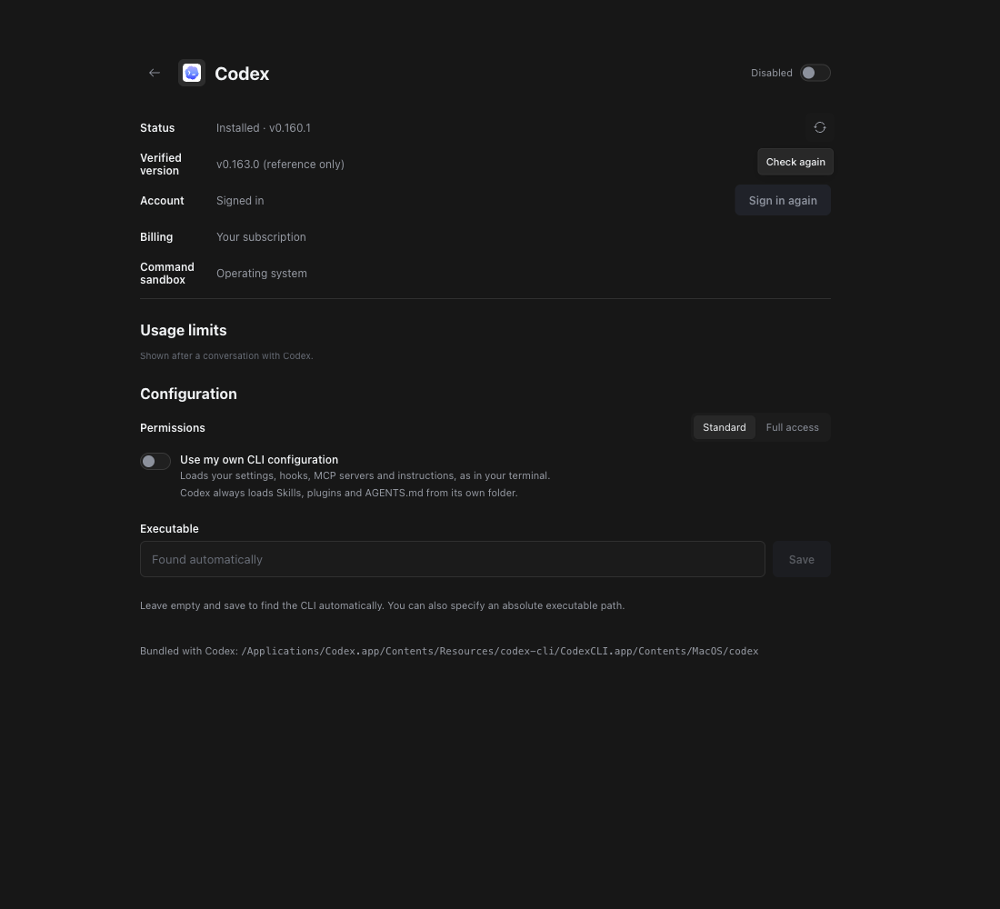
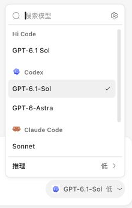
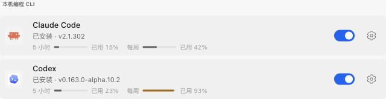
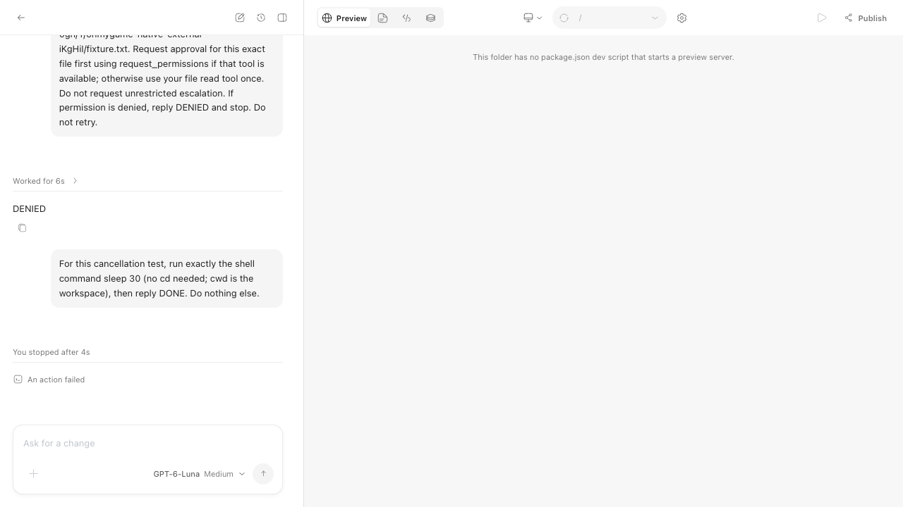
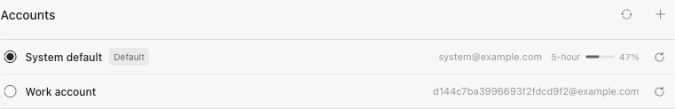
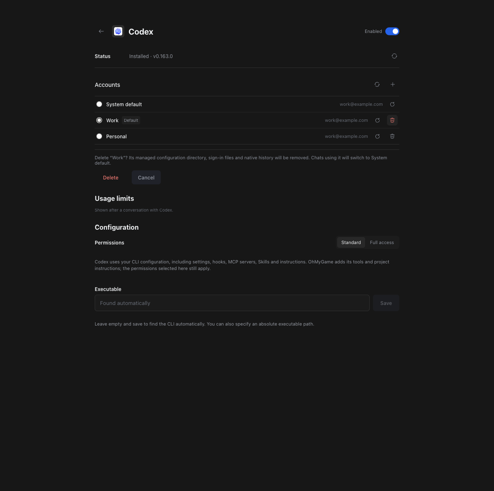
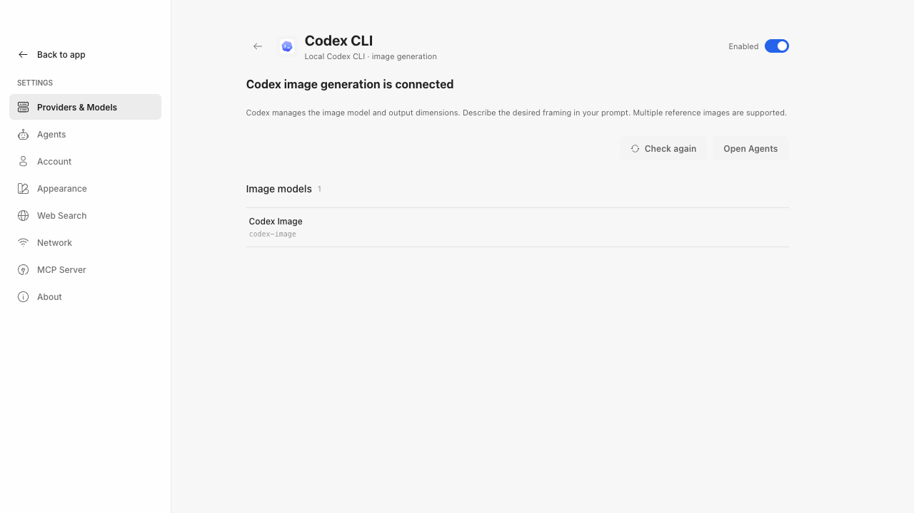
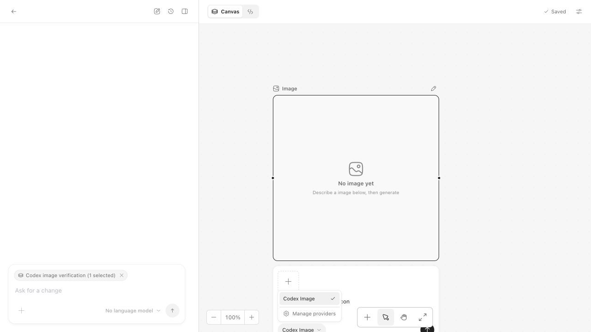
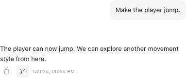
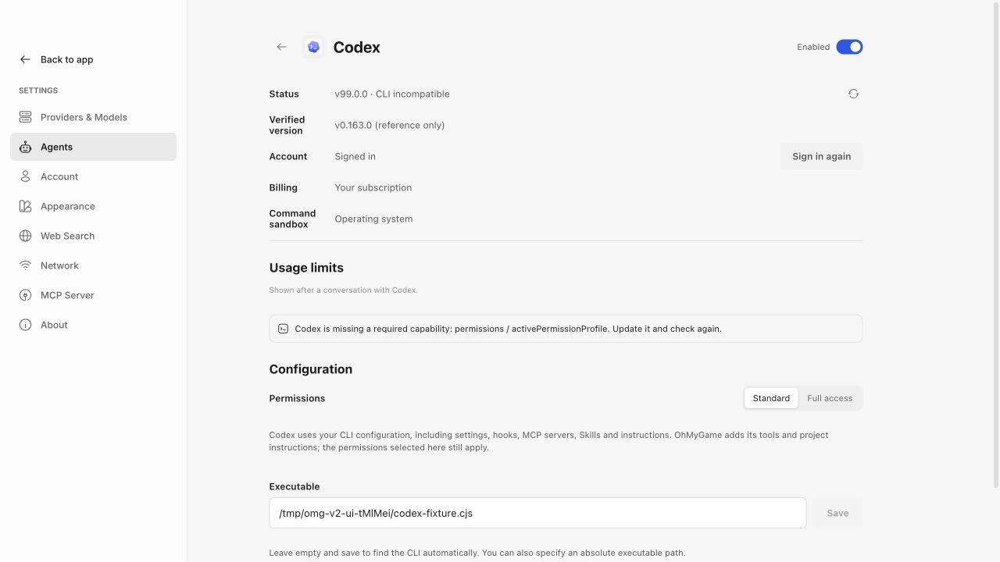

# Coding agents

A conversation can run on a coding agent CLI that is already installed on the
computer: Claude Code, Codex, or OpenCode 2.1.0 or newer in the 2.x series.
OpenCode v1 is no longer supported. The CLI runs the agent loop with its
own sign-in and model. OhMyGame keeps the conversation, checkpoints and Undo,
its canvas, media, game and plugin tools, and the approval decisions.

The [integration specification](agent-runtimes.md) records the architecture,
accepted tradeoffs, and validation limits.

## Using one

First-run setup also offers Claude Code, Codex, and OpenCode in one
horizontally scrolling row. Select an agent after installation and sign-in, choose its model
on the same connection screen, then save with **Next** and continue to optional
creative tools. Switching agents retains each selection until it is saved. OhMyGame
(Pi) is always enabled and uses connected model providers. Discovery alone never
enables a CLI.

**Settings → Agents** lists who can work in a conversation. OhMyGame's own
agent comes first: it uses the models set up in Providers & Models, and its row
links there. The coding agent CLIs follow, under **Coding agent CLIs on this
computer**; **Rescan** checks for them again. Each row shows whether the CLI
was found and its version; the detail page provides account and permission
controls. The agent whose model new conversations start with is marked **Default**.
Agents are off by default. Enabling the switch offers their models in the conversation model picker; the
detail page signs in, checks again, chooses the executable and permissions, and
explains that the CLI loads the person's existing configuration.

On macOS, discovery includes the CLIs bundled with Codex and ChatGPT in
`/Applications` and `~/Applications`, as well as PATH, the login shell's PATH
and usual CLI install folders. The detail page shows the resolved executable
and where it was found. With several installations, the newest version wins;
equal versions keep discovery order. A manually selected executable takes
precedence even when another installation is newer.

On Windows, discovery also checks Codex's versioned desktop installations under
`%LOCALAPPDATA%/OpenAI/Codex/bin` and the native executable inside npm installations
on PATH or in the usual npm folder. Selecting an npm `codex.cmd` or `codex.ps1`
path resolves its adjacent package's native executable; the shell shim is never
executed. Both current platform packages and older `vendor/` layouts are supported.
Other `.cmd`, `.bat`, and `.ps1` scripts are rejected before settings are saved.
A Codex shim whose native package is missing is reported as an unavailable
manual installation and is never executed or replaced with another installation.

An undetected CLI is not necessarily uninstalled. Choose its absolute executable
path for a custom installation, or leave the path field empty and save to restore
automatic discovery. An unavailable manual path is reported explicitly rather
than silently switching installations. **Rescan** and **Check again** refresh the
login shell's PATH and probe caches, so installing a CLI or changing shell setup
does not normally require restarting OhMyGame. Discovery, CLI startup, protocol
compatibility and sign-in are separate checks; finding a bundled CLI does not
guarantee that its version supports OhMyGame's integration.

If Codex is found and signed in but offers no models, check the diagnostics on
its detail page. Model discovery first verifies the permission profile by
starting an ephemeral thread without a prompt. On Windows, the probe,
conversations, and image generation use `:root` read access because the elevated
sandbox rejects `:minimal` access. Protected paths remain explicitly denied.
If thread creation still reports `elevated Windows sandbox requires effective
:root read access`, OhMyGame identifies a compatibility failure before requesting
the model catalog; update Codex and check its sandbox configuration.
Windows' legacy `unelevated` sandbox can also reject filesystem read restrictions.
OhMyGame reports this as a Windows sandbox compatibility issue and links to the
[Codex Windows sandbox guide](https://learn.chatgpt.com/docs/windows/windows-sandbox).
For the legacy sandbox error, configure the `elevated` sandbox in Codex
(including its administrator-approved setup), or use MXC with a supported device
and CLI, then choose **Check again**.
OhMyGame does not change the saved sandbox configuration. The Windows profile
permits general filesystem reads while preserving explicit protected-path denies
and workspace write restrictions. A successful model probe still
requires a real conversation test on the target Windows installation.



The model picker lists each agent's models in a group named after the agent.
Each CLI group shows its brand icon; the conversation's model button keeps the
same icon beside the selected model name.
Choosing one runs the conversation on that agent. A model reference names both:
its provider is the agent's ID (`claude-code-cli`, `codex-cli`, `opencode-cli`),
its ID is the agent's own model name, such as `sonnet` or
`anthropic/claude-sonnet-5`. The `-cli` suffix keeps these apart from Pi
providers of the same name; Pi has its own `opencode` provider.



`GET /models` lists Pi's models only, for canvas text and other one-off
generation. Conversation pickers ask for `GET /models?runtimes=1`, which adds
the enabled agents' models. An agent that is slow to list them is named in
`loadingRuntimes`, and the picker asks again shortly. A new conversation in a
project keeps the coding agent the person was using; with no model provider
connected, the first conversation starts with the first agent that is set up.

Native effort/variant strings are exposed as `nativeReasoningLevels` and stored
separately from Pi's reasoning enum. Saving a native default keeps both model
and effort as `defaultModel` in `agent-runtimes.json`; it applies while that
agent is enabled and offers the model. Choosing a Pi default clears it. Plain
`GET /models` continues to report Pi's default for one-off generation.
An explicitly chosen different model does not inherit an incompatible effort.
Context usage uses the native context window when reported. Stored assistant
messages record the latest model request's usage, as Pi's own messages do,
rather than a turn's or thread's running total, so a conversation that moves
back to Pi does not look larger than it is. Missing measurements remain unknown
rather than being inferred from token totals.

An account's quota windows show in **Settings → Agents**: a bar per window in
each agent's row (5-hour, weekly), labeled as used. The detail page adds reset
times. In a conversation they stay out of the composer and appear only
under the commands when `/` is typed, with compact percentages and a tooltip
on each window stating the share used. A conversation shows the account's latest
report, so it has them before its own first turn. Codex reports them whenever its
models are checked and while it works; Claude Code reports them during a
conversation (its `rate_limit_event`), so they appear after its first one.
The latest report is kept in `agent-runtimes/limits.json`, and a window whose
reset time has passed shows as empty. OpenCode bills each model provider and
has no quota of its own.

When a turn stops at a usage limit (such as Claude Code's "You've hit your
session limit") and an exhausted window reports its reset time, the composer
shows that time with **Continue after reset**. Opting in sends one English
`Continue where you left off.` 30 seconds after the last exhausted window
resets. That time is fixed when you opt in. Sending a message yourself,
choosing **Cancel**, or the conversation starting another turn clears it. The
schedule lives in the open conversation only, so OhMyGame must stay open, and
it never retries on its own.






## Account configurations (Claude Code and Codex)

Both CLIs support a separate configuration/state directory for each sign-in:

| Agent | Official environment setting | What stays separate |
| --- | --- | --- |
| Claude Code | `CLAUDE_CONFIG_DIR` | CLI configuration, sign-in and native history |
| Codex | `CODEX_HOME` | CLI configuration, credential store, sessions and state |

In **Settings → Agents → Claude Code/Codex → Accounts**, click **+**, enter a
name and click **Add** to create a private configuration and start the official
sign-in flow. **Use an existing directory** expands an optional import field for
an absolute configuration path; importing does not start another sign-in.
System default's own directory (`CLAUDE_CONFIG_DIR` or `~/.claude`, `CODEX_HOME`
or `~/.codex`) cannot be imported: naming it explicitly would give Claude a
separate Keychain entry and global configuration file while sharing its settings.
A managed Codex directory is created before its CLI starts and uses
`cli_auth_credentials_store = "file"` in its own `config.toml`. The directory is
private, and Codex manages its sign-in in `auth.json`. Imported configurations
keep their own native credential-storage settings. OhMyGame stores profile names
and directory references; it never copies tokens between accounts or implements
its own OAuth flow. Each account row has a sign-in action. Use the refresh icon
after the official browser flow completes if the status has not updated.
The sign-in action starts the CLI's official login flow directly; OhMyGame does
not log out first, delete the account configuration or clear conversation history.
Completing authorization lets the CLI update credentials in that configuration.



**System default** retains the existing CLI environment and sign-in. New profiles
have independent CLI settings, hooks, MCP servers, Skills and native history.
Select an account row's radio button to make it the default for new chats. Existing chats retain
their own selections; switching between Claude Code and Codex in a chat retains
each agent's selection. With multiple profiles, the chat header offers an account
menu showing the selected account name. Picking another account switches it
without an additional confirmation. Wait for the current request to finish before switching.
Choosing the account the chat already uses changes nothing. When the selected
account's model catalog does not offer the chat's model, the chat moves to the
new-chat default model if that account offers it, otherwise to the first model
the account lists, and the timeline records the model change. A catalog that
cannot be read in time leaves the model unchanged. The next
message creates a context for the selected account, with a bounded history
handoff if it has not seen this chat; switching back before a message on the
other account resumes the earlier context instead. `/compact` waits for that
first message on the selected account. Other chats keep their accounts. No automatic
rotation at usage limits is provided.

Use an account row's delete action to remove a profile after confirmation. The
confirmation states whether its files will be removed: app-created profiles delete
their managed configuration directory (including sign-in and native history),
while imported profiles only disconnect from OhMyGame and keep their files.
System default cannot be deleted. Deleting the new-chat default resets it to
System default. Existing chats, including restored branches, fall back to System
default when next read and discard the deleted account's native resume context;
the shared conversation history remains available for a fresh handoff. Deletion
is refused during a turn or session startup; finish or cancel the work first.
Idle sessions and pending sign-in processes stop before managed files are removed.
A managed profile is then signed out with the CLI's own command (`claude auth
logout` or `codex logout`) in its directory, so Claude's macOS Keychain entry for
that directory does not outlive it; a missing CLI or failed sign-out does not keep
the directory. Imported profiles are not signed out.



Switching saves the selection locally and reads previously reported usage without
creating a native session. It reads the selected account's model catalog to check
the chat's model. Model catalogs are cached per account for ten minutes;
a valid catalog is returned without another auth probe. A cold or expired catalog
can query the CLI for models, account information and limits, which may contact
the provider. Switching does not start sign-in, force a token refresh or send a
model turn; the CLI session is created when it is needed for a message.

Authentication, models and usage caches are separate per runtime and profile.
Codex app servers may be shared only when executable, environment (including
`CODEX_HOME`) and staged Skills match. Different account homes never share a
server. Explicit Claude profiles omit an ambient `CLAUDE_CODE_OAUTH_TOKEN` so it
cannot override the selected sign-in. Codex Image and external MCP client
configuration continue using System default independently of chat selections.

See the official [Claude account configuration guide](https://code.claude.com/docs/en/authentication#log-in-with-multiple-accounts),
[Codex state directory reference](https://learn.chatgpt.com/docs/config-file/environment-variables)
and [Codex credential storage reference](https://learn.chatgpt.com/docs/auth).
Directory isolation does not establish whether combining subscription allowances
is permitted by a provider's terms.

## Codex as an image provider

**Providers & Models → Codex CLI** exposes one image entry, **Codex Image**,
using the installed CLI and its saved sign-in. Its image switch is independent
of the Codex conversation-agent switch in Agents. Any chat agent can use it
through `generate_image`; canvas image nodes and global/project image defaults
use the same provider. Choose the global image default in the Providers & Models
overview. The Codex CLI detail page shows its image status and model without a
default-model selector. Closing a terminal does not disconnect the provider.





The image connection follows the installed CLI's saved sign-in. A signed-in
account exposes **Codex Image** without a separate image-capability probe or
inference request. Missing CLI or sign-in keeps the entry visible with a
diagnostic. The detail page offers **Sign in** only when the CLI reports a
signed-out account. **Check again** refreshes the saved sign-in, including when
image generation is disabled. Image access, compatibility and usage-limit errors
are reported by the generation request, without switching providers or
retrying inference automatically.

The provider list and first-run setup return the last known sign-in status
without waiting for the CLI. Enabled image providers refresh that status in the
background; disabled ones do not start a check.

Each generation starts its own ephemeral app-server thread, with no OhMyGame
dynamic tools, external MCP servers, shell tools or subagents. The process is
started on demand and stopped on completion, failure or cancellation. Multiple
reference images are passed in order as inline image inputs, without staging
reference files; the app's shared 16-image limit applies. Codex manages the
actual image model and dimensions, so the canvas hides resolution and
aspect-ratio controls for this provider. Built-in Codex chat generation remains
a separate native path; the image provider does not force a Codex chat to stop
using its own tools.

Validation includes simulated canvas-to-Library generation, image-toggle
persistence, failure/cancellation fixtures, and a real image generation with
Codex 0.163.0-alpha.10.2 on macOS while its conversation agent was disabled.

## Branch in new chat

A completed agent response has **Branch in new chat** immediately to the right
of Copy. After confirmation, OhMyGame opens a new chat containing the source
chat's current history through that response, inclusive. Later messages are not
copied. The source chat is unchanged, and either chat can continue independently.
This applies to Pi and all supported coding agent CLIs.



Both chats use the same project's current files. Branching a chat does not
restore older files or create a separate workspace. The new chat receives the
model and settings recorded at the branch point, clears active
plan state, and creates its own native CLI context from a history handoff.

## What OhMyGame keeps

A coding agent session (`NativeCodingSession`) implements the same
`CodingSession` interface as Pi, so `AgentManager` runs it unchanged: queues,
plan mode, cancellation, errors and events are the same code.

- **Conversation record.** Every user message, answer, reasoning block and tool
  result is stored as a Pi message in the conversation's session file, so the
  conversation list, history, message edits and restarts work as for Pi. These
  messages are a record; the CLI keeps its own context.
- **Checkpoints.** The workspace snapshot is taken before each user message is
  stored, exactly where Pi's checkpoint extension takes it, through the shared
  `recordCheckpoint`. Turn changes and Undo therefore cover whatever the CLI
  changed.
- **Native session.** The CLI's own session or thread ID is stored as an
  version-2 `ohmygame-native-session` custom entry on the branch. Only a
  `ready` marker resumes; `active` marks an unfinished turn and `invalid`
  requires a rebuild. The next message
  continues it (`--resume`, `thread/resume`, the OpenCode session). Every edit
  or restore invalidates context, even when the native ID is unchanged. Later
  Pi messages/model changes, cancellation, failure, legacy metadata and
  interrupted writes also invalidate it. An expired native session triggers
  one fresh-context retry with handoff rather than silently losing history.
- **Handoff.** When an agent joins a conversation it has not seen, its first
  message carries a summary built from the stored record: recent turns and the
  files the earlier agent worked on, the structured plan, and restore notices.
  It asks no model, and private context such
  as file references is left out. Moving back to Pi needs no summary; Pi reads
  the stored messages. A native turn reaches Pi as text: what the agent said,
  the tools it used with their arguments, and bounded results. Its tool calls
  are the CLI's own (Skill, subagents, Codex's path-only `edit`), so replayed
  as calls they would read as examples of Pi's tools; its reasoning is left
  out because no other model can verify it.

Terminal approval decisions and native compaction results are custom entries
in the same session file. Reload restores their history without restoring
permission grants. No second conversation manager or event database is needed.

## How each agent is driven

| Agent       | Transport                                                        | OhMyGame tools                                          | Approvals                                            |
| ----------- | ---------------------------------------------------------------- | ------------------------------------------------------- | ---------------------------------------------------- |
| Claude Code | `claude -p` with stream-json in and out; one process per session | In-process MCP server answered over the same pipe       | PreToolUse hook plus `can_use_tool` control requests |
| Codex       | `codex app-server` JSON-RPC; one thread per conversation         | The thread's dynamic tools, answered over the same pipe | App server approval requests                         |
| OpenCode    | `opencode serve` on loopback with its own password               | Remote MCP on the daemon with a turn token              | `permission.asked` events, answered on the server    |

Each stdin stays open for the session. A CLI that no message has used for ten minutes is stopped; the next message starts a new process that resumes the same native session. Codex conversations with the same executable, environment and staged Skills share one app server, routed by thread; it stops with its last conversation. OpenCode keeps a server per conversation because its MCP servers, and so OhMyGame's tools, are registered for the whole instance. Native queue prioritization means
**Next**: after the current turn, before ordinary follow-ups. Mid-turn native
injection is excluded because concurrent file writes cannot provide an
independent checkpoint before delivery. Processes run in their
own process group, are registered with the desktop app for crash cleanup, and
are stopped when the daemon closes.

Cancellation checks before/after startup prevent late input delivery. Interrupt
waits are bounded, then the CLI is stopped. HTTP calls time out and loss of
OpenCode's SSE stream fails the pending turn. Standalone startup also reclaims
verified orphan process groups from `agent-runtimes/processes`, checking both
the daemon and child's executable/birth identity before killing anything.
Private folders carry the daemon's ownership identity as well: startup reclaims
verified orphans while preserving another live daemon's folders. Identity queries
run asynchronously, one at a time, and concurrent requests for the same PID share
a query. Ownership records are written in the background so starting a CLI or
image job does not wait for PowerShell. Startup recovery still waits for identity
checks before reclaiming anything. A crash before records are written can leave
unrecorded folders or processes that startup recovery preserves.
Removing a private folder cancels a pending lease and waits for an active write.
Configuration and Skills are removed only after the CLI stops. Unverifiable
identities and subprocesses that escape their group cannot be reclaimed this way.

OhMyGame's tools are the handlers Pi uses (`createAgentTools`), offered through
`ToolBridge`. Plugin MCP servers reach the agent through the same `mcp` tool
Pi uses, run in a model-less session in the daemon, so plugin settings,
switches and credentials stay in the daemon. Codex registers bridged tools with
an `ohmygame_` prefix to avoid reserved names such as `mcp`; dispatch and the
conversation timeline retain the original tool names. Skills (plugin Skills and
OhMyGame's own) are copied into a private folder for the session and handed to
the CLI: a session plugin for Claude Code, `skills/extraRoots/set` for Codex,
the `skills` array for OpenCode v2. Staging copies regular files and omits symbolic
links, so it cannot copy an external credential through a Skill's link. The
policy permits reading only this session's staged Skill roots, while their
writes and adjacent app data remain protected. Running a staged script still
requires command approval. Nothing is written to the workspace.

The OpenCode tool endpoint, `POST /agent-runtime-bridge/mcp`, takes the
turn's token instead of the app's. It is revoked permanently on completion,
cancellation, failure or disposal; each later turn gets a new token. Bridged
tools receive the turn's abort signal and late results do not enter its timeline.

New plugin capabilities must be expressible as Skills or MCP servers; Pi
extensions do not reach coding agents.

## Approvals and limits

Each agent's detail page has a **Permissions** setting:

- **Standard** (default): the rules below. Commands run in the CLI's OS
  sandbox where it has one.
- **Full access**: no sandbox and no questions, as with OhMyGame's own agent.
  Claude Code runs without its sandbox settings, Codex uses its own
  `:danger-full-access` profile, and OpenCode's requests are all allowed.
  Requests that name a protected root, such as a CLI sign-in folder, are
  still refused, and planning stays read-only.

Changing permissions or the executable path lets go
of the agent's idle open conversations. A running turn keeps its setting and
is released when its run closes. The next run restarts the CLI with the new
settings and resumes its session, including when settings change during startup.

In the project folder an agent works without asking, as OhMyGame's own agent
does. `judgeApproval` decides each request first:

- **Deny** anything that reaches a CLI sign-in folder (`~/.claude`,
  `~/.codex`, OpenCode's folders, `~/.pi`), `~/.ssh` and similar, OhMyGame's
  data folder, OhMyGame's own agent folder (`pi-agent`, which holds provider
  keys and sign-ins and sits beside the data folder in the desktop app), or
  another project. Paths resolve symlinks, including missing descendants,
  and include custom CLI credential homes. A command reaches a folder when it names it or a folder
  that holds it, including quoted paths containing spaces and paths with
  backslash-escaped spaces.
- **Allow** workspace file requests and a small set of simple read commands.
  Claude Code's own tools that touch no file and run no command (`TodoWrite`,
  `Skill`, `Task`, `WebSearch`, `WebFetch` and its background-shell and MCP
  resource readers) also run without asking; a subagent's tool calls are
  checked like any other.
- **Ask** the person for paths outside the workspace and other commands,
  including build scripts, interpreters, Git, compound commands, globs and
  recursive link-following (`grep -R`, `rg -L`). Where Claude Code runs its
  commands in its OS sandbox, which keeps their writes in the workspace and
  protected folders unreadable, only commands that publish or escalate
  (`git push`, `npm publish`, `sudo`, `curl … | sh`) and commands naming paths
  outside the workspace are asked about; installs, builds, Git, pipes and
  compound commands run. Planning still allows only the simple read commands. A request
  Codex makes to leave its sandbox always asks, because Codex only makes one
  when its sandbox would stop the command.

OpenCode's subagents, todo list, Skill loading and web research are allowed in
the same way. Planning turns are read-only on every path: they accept file reads
and the simple read commands the policy allows, and refuse everything else with
feedback naming what is allowed, so the agent adjusts instead of stopping; a
bare OpenCode rejection would end its loop. Native agents are told that
OhMyGame's tools, including `update_plan`, come from its `ohmygame` tool server
under their CLI's MCP names. Claude's `ExitPlanMode` is
declined with a pointer to `update_plan`, because OhMyGame reviews plans itself.
Codex registers every OhMyGame tool when its thread starts, since a thread that
begins in planning continues after the plan is approved; tools the current mode
does not allow are refused when called.

Claude Code runs with background tasks and scheduled prompts disabled
(`CLAUDE_CODE_DISABLE_BACKGROUND_TASKS`, `CLAUDE_CODE_DISABLE_CRON`): a
background subagent or shell would report after the turn's result, with no turn
to receive it. OhMyGame's tools are marked always loaded so Claude's tool search
does not hide them. Planning uses Claude's default permission mode instead of
its plan mode, which would write a plan file and call `ExitPlanMode`.

A request the policy leaves to the person appears as an approval card above the
composer: Allow, Allow for this conversation, or Deny. Answered requests stay
in the timeline. Stopping the turn denies every request still waiting.

Explicit permission grants show all read/write roots and network access.
Codex grants only understood concrete paths that were reviewed, for one turn.
Allowing for the conversation covers the exact request, with two exceptions
the card names: a sandboxed `git push` or package publish covers that command
whatever its remote or package, and a read outside the workspace covers its
folder (never the home folder or the disk root). A sandboxed command naming an
outside path covers reads in that folder, since its sandbox keeps writes in the
workspace. Escalations such as `sudo` and `curl … | sh` are asked each time. OpenCode read/edit/search/shell requests are mediated,
with file patterns resolved from its reported Git root rather than assuming
that it equals the application workspace. Search metadata identifies the actual
search directory. Child-session permission requests are admitted only after
verifying their ancestry through the native API; they cannot be dropped merely
because their session ID differs from the parent.

Shell syntax checks cannot resolve globs, brace expansion or links, so a
command a person allows could still name a protected file indirectly. Codex and
Claude Code therefore also run commands in their own OS sandbox (Seatbelt on
macOS, bubblewrap on Linux); the settings page says which agents have one.
When the approval policy relies on that sandbox, Claude Code must stop at
startup if it cannot enable it; it cannot silently fall back to unconfined
commands. This requires Claude Code 2.1.83 or newer. Where the required
dependencies are absent, the strict command approval policy applies instead.
OpenCode has none, so its approvals are its only boundary. Each CLI's parent
process runs as the signed-in OS user and is not confined. Strong
confidentiality isolation requires a separate process/container sandbox and
isolated credentials.

Codex requires named permission profiles and checks that its app server actually
activated the requested profile before delivering a prompt. The legacy
`workspaceWrite` policy is not a fallback: it permits reads outside the project.
The profiles allow runtime files, this workspace and private temporary/Skill
folders, plus the person's toolchains: each folder on the commands' PATH and
the installation it belongs to (an fnm or nvm Node, Homebrew, Bun) and, on
macOS, the command-line developer tools, whose own programs come before the
`/usr/bin` shims. The home folder itself and `~/.local` as a whole are never
granted. Package caches (npm, Bun, Yarn, XDG) live in the session's temporary
folder, Git reads a private configuration holding only the person's name and
email (`~/.gitconfig` may name credential helpers), commands run without a
login shell, and the workspace's `.git` stays read-only. Credential roots, app
data, other projects and the shared `/tmp` and `/var/tmp` folders (which
Codex's minimal access would otherwise read) are denied. Unlisted
paths require a scoped permission request. Unrestricted command/patch sandbox
escapes are refused. Planning uses a read-only profile and cannot accept write
grants. The native `request_permissions` tool is enabled explicitly, with grants
limited to the current turn. Shell snapshots are off and the shell environment
is rebuilt from the same allowlist, without CLI authentication tokens.

Claude Code's sandbox is turned on through flag settings, which apply whether
or not the person's own configuration loads. Protected roots are unreadable,
the workspace and the session's staged Skills stay readable, commands cannot
opt out of the sandbox, approvals still go through OhMyGame, and the network
stays available for installs. Package caches live in the session's temporary
folder, which commands may write. Where the sandbox cannot start (Windows, or
Linux without bubblewrap and socat), Claude Code runs commands without it and
the settings page says approvals are the boundary.

## Environment and isolation

A CLI gets an environment built from an allowlist: PATH, HOME, locale,
temporary folders, proxies, certificates, and that CLI's own configuration
folder variable. API keys are left out, so an ambient key never moves a
subscription to metered billing; Claude Code keeps `CLAUDE_CODE_OAUTH_TOKEN`,
which is a subscription sign-in. The daemon's token and `OHMYGAME_*` variables
never reach a CLI. The executable is resolved to an absolute path from the
person's choice, PATH, the login shell's PATH, usual install folders, and known
bundled copies such as ChatGPT's Codex. On Windows only native `.exe` programs
are started; supported Codex npm shims resolve to the packaged executable because
Node cannot start `.cmd`/`.bat` shims without a shell. An
explicit path wins; automatic
discovery chooses the newest SemVer, including prerelease ordering, and retries
failed version probes. Recheck also invalidates successful probes. Catalog
refreshes honor their TTL and discard results from a superseded configuration.

All three runtimes load the person's existing CLI configuration, including
settings, hooks, MCP servers, Skills and instructions supported by that CLI.
There is no configuration-isolation switch. Stored `isolateUserConfig` values
from earlier versions are ignored and dropped when settings are next saved.
OhMyGame adds its tools, project instructions and staged Skills, and the selected
permission mode still applies. A configured external `ohmygame-studio` MCP
connection is disabled inside Claude Code and Codex to avoid reconnecting to the
same app recursively. Other user MCP servers and notification hooks remain enabled.

Codex keeps the workspace as its project root (`project_root_markers = []`):
parent-folder instructions may live in app data denied by the permission profile
and otherwise prevent thread startup. Its own configuration-folder instructions,
Skills and plugins still load. Configuration inheritance does not remove the
permission profile, shell environment controls or read-only planning.

OpenCode v2 adds callback permission rules, staged Skills and an instruction file
in its private session directory. Its MCP bridge disables code mode so native
calls retain their tool names and structured app results. It waits for the MCP
connection and catalog before sending a prompt. No configuration file is written
to the workspace. Custom `OPENCODE_CONFIG_DIR` and `OPENCODE_CONFIG` paths are
retained and protected from native file/shell access, alongside XDG roots.

Discovery probes may suppress external MCP servers and hooks while inspecting
protocol compatibility and model catalogs; they do not send inference prompts.

## Settings and API

`agent-runtimes.json` in the data directory stores, per agent, `enabled`
(default off), `permissionMode` (`standard`
or `full`, default `standard`), an optional absolute
`binaryPath`, and an optional native model/effort `defaultModel`. A damaged file falls
back to the defaults. Credentials remain in the CLI's own store.

| Route                                                     | Purpose                                                                |
| --------------------------------------------------------- | ---------------------------------------------------------------------- |
| `GET /agent-runtimes`                                     | Status of every agent; `?recheck=1` probes again                       |
| `PATCH /agent-runtimes/:id`                               | `enabled`, `permissionMode`, `binaryPath`         |
| `POST /agent-runtimes/:id/recheck`                        | Probe one agent again                                                  |
| `GET /agent-runtimes/:id/profiles`, `POST /agent-runtimes/:id/profiles` | List or add Claude Code/Codex account configurations |
| `DELETE /agent-runtimes/:id/profiles/:profileId` | Remove an account; managed files are deleted, imported files kept |
| `PUT /projects/:p/conversations/:c/account-profile` | Select an account for the conversation |
| `POST /agent-runtimes/:id/login`                          | Start the CLI's sign-in; returns a browser URL or a command            |
| `PUT /projects/:p/conversations/:c/reasoning`             | Select a native effort/variant string                                  |
| `PUT /models/default`, `POST /projects/:p/conversations`  | Take `nativeReasoningLevel` for a native model, never `reasoningLevel` |
| `POST /projects/:p/conversations/:c/approvals/:requestId` | Answer an approval request: `allow`, `allow-session` or `deny`         |

Status and models are probed only when asked for and cached by executable
signature. Conversation model discovery does not start disabled CLIs; the
image catalog independently probes Codex when checking image providers.

## Adding an agent

1. Add its ID to `AGENT_RUNTIME_IDS` and a definition to
   `AGENT_RUNTIME_DEFINITIONS` (binaries, version arguments, tested version,
   sign-in command).
2. Teach `probeAuth` and `probeModels` how to ask it who it is and what models
   it has.
3. Write a `NativeDriver` that runs a turn and reports through the
   `NativeTurnSink`, and create it in `AgentRuntimeService.createSession`.
4. Add an icon to `PROVIDER_ICONS` and test the driver against a fake process
   (`setAgentProcessSpawner`), as `test/agent-runtime-drivers.test.ts` does.

The Provider, media, canvas, checkpoint and plugin code does not change.

## Compatibility and real acceptance

Compatibility follows the capabilities the adapter needs, rather than a CLI
being older than the version used for acceptance. Settings records Claude Code
2.1.302 and Codex 0.163.0 as reference acceptance versions. OpenCode uses the
v2 server contract, records 2.1.0 as its real acceptance version, and requires
2.1.0 or newer in the 2.x series; the version
check selects that supported API generation, and runtime checks still apply.
Enabling or rechecking an agent uses the same discovery checks as its model
catalog; incompatible agents do not offer models. Results are cached by the
executable signature and invalidated when settings change or **Check again** is
used. Temporary failures remain probe/catalog errors and retry after the short
failure cache expires; they are not classified as unsupported capabilities.

- Codex discovery starts an ephemeral thread with a dynamic tool, OhMyGame's
  approval policy and a named permission profile, and checks the returned
  `activePermissionProfile`. It sends no model turn. The real driver checks the
  profile again on start/resume. Codex 0.162.0-alpha.17.2 has passed this protocol
  probe; that alone is not a full inference or sandbox acceptance run.
- Claude discovery registers the SDK tool server and PreToolUse callback during
  its control handshake, and accepts catalogs from `initialize` or `list_models`.
  Standard permissions on a platform where approvals rely on its OS sandbox
  require `sandbox.failIfUnavailable`, introduced in
  [Claude Code 2.1.83](https://github.com/anthropics/claude-code/blob/main/CHANGELOG.md#2183).
  This documented feature requirement does not apply to Full access or platforms
  using the strict command approval policy without an OS sandbox. An unknown
  version cannot establish that sandbox requirement and remains a probe failure.
- OpenCode discovery starts `serve --stdio --hostname 127.0.0.1 --port 0` with
  a private password and reads its JSON address announcement. It establishes
  `/api/event`, checks `/api/info` and `/api/location`, waits for the agents'
  permission transformations, and lists `/api/model`. This creates no session
  and sends no inference. Real sessions create or reapply a wildcard `ask`
  permission rule and read it back before sending a prompt. Child-session
  requests must have verified ancestry and the same workspace location; file resources resolve relative to
  that session's location rather than the Git root. Saved CLI grants for the
  project can override callback rules, so discovery/startup and each prompt
  refuse them with a diagnostic; OhMyGame never deletes those grants. Remove
  them in OpenCode before retrying. User plugins remain trusted CLI code.

OpenCode v2 native session IDs carry an `opencode-v2:` marker in OhMyGame's
session record. A v1 marker or missing v2 session triggers the existing fresh
session and conversation-history handoff; v1 context is never resumed as v2.

Missing optional quota or reasoning metadata stays unavailable. Local CLI
compatibility failures have their own chat error presentation and CLI details.
Being signed in and seeing a model does not guarantee account entitlement.



This screenshot uses a simulated CLI reporting `99.0.0` that ignores the
requested permission profile. A higher version cannot bypass the capability
check, and the verified version remains a reference.

The direct adapters preserve the installed executable and shared host services.
The Claude Agent SDK was evaluated and not adopted: it bundles its own Claude
Code binary (about 268 MB per platform) and each release targets one CLI
release, while OhMyGame drives the CLI the person installed. See
[agent-runtimes.md](agent-runtimes.md#runtime-transports-and-compatibility).
Claude's direct control protocol and Codex's experimental dynamic tools need
compatibility tests when their CLIs change. A generic Basic CLI adapter is not
implemented; each new CLI needs discovery, a driver, and acceptance tests.

Run public checks from [CONTRIBUTING](../CONTRIBUTING.md). Focused fixtures cover
branch invalidation, expired resume, queue checkpoint ordering, startup/interrupt
cancellation, bridge token revocation and abort, SSE loss, quotas, model
dialects/defaults, stale discovery results, catalog pagination, planning write
grants, child-session approvals, persisted approvals/compaction and verified
orphan recovery.

Real inference is opt-in and consumes the provider's quota:

On macOS, Codex's command profile includes read-only access to the system
`/System/Library/OpenSSL/openssl.cnf` file so Node/npm can initialize TLS.
This does not grant access to the rest of the system Library.

```bash
bun run test:agent-runtimes:live opencode-cli opencode/mimo-v2.6-flash-free
bun run test:agent-runtimes:live codex-cli YOUR_AVAILABLE_MODEL
bun run test:agent-runtimes:live claude-code-cli YOUR_AVAILABLE_MODEL
```

Choose a currently listed model with a working account. The script uses isolated
app data and a disposable workspace, grants only scoped test requests, and saves
evidence under ignored `.runtime/`. It checks writes, an OhMyGame tool call,
continuation, daemon restart, compaction, editing a later message, checkpoint
restore, denial of external dummy files, approval persistence, cancellation
during an executing shell tool, running the toolchain (Node, `npm install` over
the network and Git), loading a staged Skill without approval, and a
planning turn that records its plan with `update_plan` and changes no file.
Claude Code refuses a standalone `sleep`, so its cancellation step runs an
equivalent `node` command.

Earlier acceptance passed on macOS with Claude Code 2.1.302 / `sonnet` and
Codex 0.163.0 / `gpt-6-luna`. OpenCode 2.1.0 with
`opencode/deepseek-v4.1-flash-free` passed the full live
acceptance on macOS: file edits, direct app tools, native continuation and daemon
restart, compaction, message revision, Undo, denied external reads, an approved
Node/npm/Git toolchain command, cancellation, staged Skills without an approval,
and structured read-only planning. Image request parameters and native effort
selection are covered by protocol fixtures; this run did not send an image.

Historical v1 acceptance used OpenCode 1.18.33 with
`opencode/mimo-v2.6-flash-free` on macOS; that run does not establish v2 acceptance. In Claude's `-p` mode
it has no `TodoWrite`, `Glob`, `Grep` or `LS` and searches with `Bash`, so
planning turns accept the read commands the policy allows without asking. Keep a runtime opt-in until real acceptance
passes on the target platform; fixture success alone is insufficient.

An optional final argument selects an absolute executable path, for example
`bun run test:agent-runtimes:live codex-cli MODEL /absolute/path/to/codex`.
The test continues other checks after a protected-read failure, saves each
boundary failure and exits unsuccessfully. A missing denial record is not a
persistence regression when the runtime never requested approval at all.
