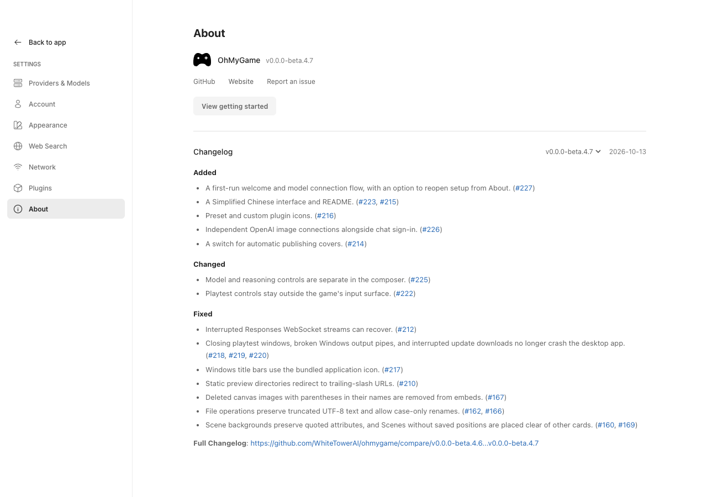

# Desktop releases

OhMyGame uses `electron-updater` with a generic HTTPS update feed. Release
artifacts are built by GitHub Actions and copied to a public, read-only
Cloudflare R2 custom domain, so updates do not depend on GitHub.

## Update feed

Create an R2 bucket and expose the release prefix through a custom domain. The
URL must not require browser cookies or an embedded cloud credential. For
example, with the prefix `desktop`:

```text
https://updates.ohmygame.ai/desktop/latest.yml
https://updates.ohmygame.ai/desktop/latest-mac.yml
https://updates.ohmygame.ai/desktop/OhMyGame-0.1.0-x64.exe
```

The workflow uploads versioned installers and blockmaps with immutable cache
headers. It uploads `latest.yml` and `latest-mac.yml` last with caching disabled,
so clients never observe a manifest before its referenced files exist.

Configure these GitHub Actions repository variables:

| Variable                   | Example                               | Purpose                                             |
| -------------------------- | ------------------------------------- | --------------------------------------------------- |
| `DESKTOP_UPDATE_URL`       | `https://updates.ohmygame.ai/desktop` | Public feed URL embedded in the app                 |
| `R2_ACCOUNT_ID`            | Cloudflare account ID                 | Builds the R2 S3 endpoint                           |
| `R2_BUCKET`                | `ohmygame-releases`                   | Destination bucket                                  |
| `R2_DESKTOP_UPDATE_PREFIX` | `desktop`                             | Destination key prefix, without surrounding slashes |

Configure these repository secrets:

| Secret                        | Purpose                                          |
| ----------------------------- | ------------------------------------------------ |
| `R2_ACCESS_KEY_ID`            | R2 API token access key with object write access |
| `R2_SECRET_ACCESS_KEY`        | R2 API token secret                              |
| `CSC_LINK`                    | Base64-encoded Apple Developer ID certificate    |
| `CSC_KEY_PASSWORD`            | Apple certificate password                       |
| `APPLE_ID`                    | Apple account used for notarization              |
| `APPLE_APP_SPECIFIC_PASSWORD` | Apple app-specific password                      |
| `APPLE_TEAM_ID`               | Apple Developer team ID                          |

The R2 credentials belong only in GitHub Secrets. Do not include GitHub, R2,
or code-signing credentials in the application or the public update bucket.

## When the app checks

A packaged build checks once after its main window opens, then every four hours,
and again on window focus or reveal when the previous check is more than thirty
minutes old. A failed check retries twice, after one and five minutes, then waits
for the next focus or periodic attempt. Background failures are silent and keep
the previous update status; a failed manual check remains visible so the user
can retry it. Scheduled checks never run while a release is already available,
downloading, ready, or installing, so they cannot discard the update the sidebar
is offering. **Settings → About → Check for updates** bypasses that throttle
and remains available in every state.

Development builds never reach the feed: `DesktopUpdater.check` reports the
current version as installed unless `app.isPackaged`.

## Publishing

Prepare the release version in `package.json` and its notes in
[CHANGELOG.md](../CHANGELOG.md) through a PR into `dev`, then
merge the reviewed release from `dev` into `main` with a merge commit. Create
the matching `v*` tag on that `main` commit. See
[the maintainer workflow](maintaining.md#release-preparation) for verification,
synchronization, and urgent fixes.

Pushing the tag starts `.github/workflows/release-desktop.yml`, which:

1. Checks that the tag matches `package.json` and validates the changelog before
   either platform builds.
2. Builds the Windows NSIS installer and macOS DMG/ZIP, without Windows code
   signing and with macOS signing/notarization.
3. Uploads the packages and blockmaps to R2.
4. Publishes the platform manifests and verifies them through the public URL.
5. Creates a GitHub pre-release with the Windows installer and macOS DMG/ZIP,
   extracting the matching changelog section from the same tag as its description.

Re-running the release job updates the existing GitHub release assets and
restores its description from the same tag's changelog. Do not re-push a published
tag just to repair its GitHub Release page. A changelog edit on `dev` does not
change an already published tag or its release description.

Windows builds are unsigned, so Windows may show an unknown-publisher or
SmartScreen warning during download and installation. The update manifest still
provides the SHA-512 digest used by `electron-updater` to validate downloads.

For a local package build, export `DESKTOP_UPDATE_URL` before running
`bun run package:mac` or `bun run package:win`. Development builds do not use
the update feed.

TypeBox is pinned to the same version as Pi so the desktop daemon shares one
installation. The `beforePack` hook bundles its public runtime entry points
into `.runtime/typebox`, which replaces the original ESM files in the packaged
app while preserving TypeBox's package metadata and declarations.

Pi AI is a direct, pinned runtime dependency because the daemon imports its
patched diagnostic helper. The `afterPack` hook checks that the packaged helper
and adapters match the installed patch, then starts the packaged daemon with
temporary data and verifies its authenticated API on native platform builds.
An incomplete or unpatched dependency therefore fails packaging before an
installer is created.

### Release notes

Maintainers update `CHANGELOG.md` only when preparing a release. Summarize
user-visible changes from the merged PRs since the previous version, combine
related fixes, and link the relevant PRs with full URLs. Use English to match the
existing product documentation. Internal refactors, test changes, and routine CI
maintenance generally do not need entries.

Add the new version above the existing releases, using this structure. Replace
`VERSION` with the exact `package.json.version` (without a `v` prefix) and
`YYYY-MM-DD` with the release date:

```markdown
## [VERSION] - YYYY-MM-DD

### Added

- Describe a new capability and link its PR.

### Changed

- Describe a change to existing behavior and link its PR.

### Fixed

- Describe the resolved problem and link its PR.
```

Omit empty categories; use `Removed`, `Deprecated`, or `Security` when needed.
Each release needs a valid date, a unique SemVer version, and nonempty notes.
Use inline links rather than reference links defined outside the release section,
so extracted notes also work on GitHub. Earlier releases remain available in
[GitHub Releases](https://github.com/WhiteTowerAI/ohmygame/releases).

After updating the version and notes, run:

```bash
bun run changelog:check
bun run release:notes v0.0.0-beta.4.7 # substitute the version being prepared
```

`changelog:check` validates the changelog and checks that the current package
version has a release section. `release:notes` prints that section's body as
Markdown; its optional version or tag argument must match the package version.
To save the notes to a file, use `--output` (parent directories are created):

```bash
bun run release:notes --output /tmp/ohmygame-release-notes.md v0.0.0-beta.4.7
```

CI checks the changelog on ordinary PRs as well, so a version bump and its notes
must land together. Release validation runs in a separate job before packaging
and does not need dependencies or release credentials. The publishing job checks
out the same tag and writes the extracted notes to a temporary file outside the
R2 update packages.

### In-app changelog



**Settings → About → Changelog** shows the installed release and lets users
select previous releases included in `CHANGELOG.md`. A version picker appears
only when multiple releases are available. Notes are rendered directly on the
page, with the version and date beside the Changelog heading. Vite embeds the
parsed entries in the renderer, so these notes work offline in both the browser
and desktop app. The build and release CLI share `src/shared/changelog.ts`; the CLI
uses Node.js 22.19+ directly without installing dependencies.

`build:desktop-app` extracts the current notes into `.runtime/release-notes.md`
before building. The `releaseInfo.releaseNotesFile` setting in
`electron-builder.yml` includes those notes in `latest.yml` and `latest-mac.yml`.
The updater passes the available version and its notes through the existing
update state, and the Changelog panel selects that release when it is detected.
Users can still select the installed release while downloading or retrying an
update.

An older update manifest may have no notes. Updates still work, and the panel
links to that version's GitHub Release instead. About also links to the project's
GitHub repository, website, and issue tracker. Raw HTML in release notes is not
executed.

## Rollback

Do not overwrite versioned installers. To roll back a bad release, restore the
previous `latest.yml` and `latest-mac.yml` manifests, or publish a newer patch
version containing the reverted code. Existing clients only install versions
newer than their current application version.
