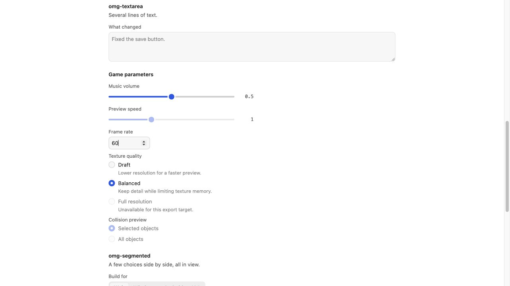
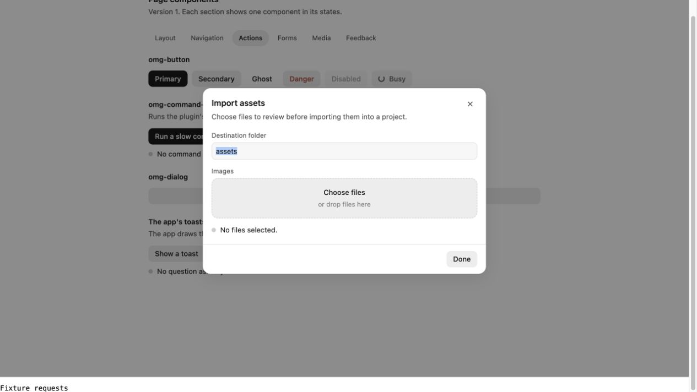

# Plugins

A plugin is a package with a manifest at `.ohmygame-plugin/plugin.json`. It can
add Skills, MCP servers, tools, commands, panels and project types. Every
plugin is on or off in each project. Its switch on the Plugins page turns it on
in every project it suits, and a project can still turn it off or on for
itself; see [Plugins for every project](#plugins-for-every-project). A plugin
runs only once the person has allowed what it asks for.

Plugins come preinstalled with the app from pinned, signed GitHub releases, from
the [Plugin Builder](#making-a-plugin), from [Add plugin](#adding-a-plugin), or
from the [plugin market](#the-plugin-market).

## Browse plugins

The Plugins page reads `GET /plugin-store/plugins` and has three tabs, kept in
the route as `#/plugins?tab=discover|installed|mine`, **Discover** first and by
default. Tabs show no counts; **Installed** has a dot when an installed plugin
has an update. `src/renderer/plugin-catalog.tsx` holds what Discover and
Installed share for category navigation, plus the market sorting, cards,
overview and plugin dialog.

Plugins are sorted into the [categories](#more-manifest-fields) they declare.
A plugin is listed in each category it names, and one with none is under
**Other**. Search reads a plugin's name, description, id and
[keywords](#more-manifest-fields), and the titles of its model providers and
agents, so "Gemini" finds the plugin that adds Gemini CLI. Installed search
also reads skill names and shows the plugins that provide them. A plugin's page
lists its keywords. Picking a keyword searches across every category. Under
**Model providers**,
Discover adds a row of what the providers make (language, image, video), and
each provider's card shows those as small tags; they come from the manifest,
so a plugin can't claim a kind it doesn't implement. An
installed plugin without an icon shows its first letter on a colour its id
picks (`PluginMonogram`), and `ohmygame-plugin check` warns about it.

The marks beside a plugin's name are defined once (`src/renderer/plugin-marks.tsx`).
**Official** is the only icon: a solid blue seal on OhMyGame's own plugins,
bundled, from its `@ohmygame` npm scope, or released from a `WhiteTowerAI/`
repository. Everything else is a quiet text
label (**Beta**, **Included**, **In development**, **Update available**), red
only when it needs the person (**Stopped**, **Blocked**, a development build
that failed). Discover and Installed display each publisher as `@publisher`,
including `@ohmygame`.

- **Installed** opens a plugin list alongside its details. Select a plugin to
  see its overview, skills, settings, and management actions. In a narrow
  window, open the details from the list and use **Installed** to go back.
  Switching plugins keeps the last detail tab and any unsaved settings for
  each plugin while the page is open. The **Official** seal appears beside the
  plugin name. Each row shows the installed version and publisher underneath.
  The list header shows counts for **All**, **On in every project**, and
  **Updates**. In **All**, enabled plugins that default to on show **Every
  project** after the publisher. Use the menu beside search to filter by category.
  The switch in the plugin details sets the default for compatible projects.
  Projects can override it.
  Update a plugin directly from the list, or choose **Update all** under
  **Updates** with an empty search. Updates that ask for new permissions need
  individual review.
- **Discover** lists the [plugin market](#the-plugin-market)'s plugins, browsed
  from a side list as in an app store (`MarketRail`): **Overview**, **All
  plugins**, each category with how many plugins it has, and two filters,
  **Official** and **Source verified**. The counts follow the search and
  filters, and a category nothing is in is left out. On a narrow window the
  side list becomes a row above the cards.
  - **Overview** with more than twelve plugins is the same few rows however
    many there are (`marketFront`): **Featured** (picked by the index),
    **Recommended** (the market's order, below, taking the best of each
    category first, so the row shows what kinds there are rather than a run
    of one kind), **New** (first published in the last 90 days) and
    **Recently updated**. Each plugin shows once, in the first row that takes
    it, and each row has **View all**. A search or filter shows one list
    instead.
  - Any other view is one list with its count, a **Contains** filter and an
    order: **Recommended**, **Newest**, **Recently updated** or **Name**. It shows 48 cards at a time and mounts the next 48 as the list's end scrolls into view.
  - A card is one button. It shows the plugin's icon, or its first letter,
    then its name, **Installed** when it is, and its description. **Official**
    and **Beta** are on the plugin's page: nearly every plugin listed is both,
    so on cards they said nothing. Its last line has the publisher at the
    left, cut short if long, and the version at the right.
  - A card opens the plugin's page, the same page whether it's installed or
    not. One not installed is drawn from the index alone
    (`MarketPluginPage`): its name, marks, description and **Get** at the top;
    a row of its numbers, as an app store shows them (stars, version, size,
    when it was updated); its screenshots, long description, what it adds and
    asks for; and at the side its publisher (after their GitHub avatar),
    categories, keywords, project types, first publish and repository, with
    whether its source is verified.
    It doesn't load the package's README: that is written for developers,
    often only in English, and would need its Markdown and pictures made safe;
    the manifest's localized `longDescription` and screenshots are the page,
    and the repository link leads to the README. **Get** opens [Add plugin](#adding-a-plugin)'s review at
    the listed version; once added, the page becomes the installed one. A
    link to a plugin that isn't installed opens the same page. Back returns
    to the list where it was scrolled to.
- **Mine** is for making plugins: **Create a plugin with AI** across the top,
  then **Your plugins**, a card for each plugin the person makes, as projects
  are (`MinePlugins` in `plugin-builder.tsx`). A plugin made with AI
  (`personal/<name>`) opens its AI workspace without a dialog, and a draft not
  installed yet is a card too; each says whether it's installed, and when its
  workspace was last changed. One developed from a folder opens its page. A
  package added from a folder or file is someone's release, so it's only under
  Installed, where every plugin is switched on and off. A card's menu opens the
  plugin's page, any earlier workspace of the plugin, or deletes its workspace,
  which keeps the installed plugin.

A project's **Plugins** sheet, from the project menu, lists every plugin that
suits the project in one list, each with its switch for this project and how
many are on, as described in [Routes](#routes). One on in every project is
on here and says so; switching it off is saved in the project. The type's own
plugin stays on. **Manage all plugins** opens the Plugins page.

A plugin's page has its main action at the top, as **Get** is for one not
installed: **Update to …** when there's a newer version, and **Try now** for
one with examples. Below are **About** (the long description and Try it prompts),
**Skills**, and **Settings** tabs, beside a **Management** card with the
**Every project** switch, version, source, and other actions. A plugin that stopped
after crashing shows **Restart** there. A Try it prompt turns the plugin on in
the project it starts in and mentions it.

## Files

- **Manifest:** `.ohmygame-plugin/plugin.json` in the package, checked by
  `src/shared/plugin-manifest.ts`. The JSON Schema is
  `schemas/plugin-2.json`, and `ohmygame.json`'s is `schemas/project-1.json`
  (`bun run plugin:schema` rebuilds both; a test fails when one is out of
  date). Each file's `$schema` names it on the website,
  `https://www.ohmygame.ai/schema/…`, which serves `schemas/` from this
  repository's `main` branch (a rewrite in the `ohmygame-web` repository), so
  a release publishes it. Ids are
  `publisher/name`. `engines["ohmygame-api"]` must allow the plugin API of
  the running app, `PLUGIN_HOST_API_VERSION` in that file: its minor grows when
  a manifest field or something else a plugin can use is added, so a plugin
  that needs one asks for `^2.1.0`, say. Adding a plugin the app is too old for
  says so and, in the desktop app, offers the update, even if the rest of the
  manifest uses values this app rejects. A plugin made for an API this app has
  left says its author needs to update it. That range alone decides
  whether a plugin needs a newer app. `validatePluginManifest` leaves out a
  field, a `categories` or `contributes.hooks` value, or a theme token this app
  doesn't know, lists it as `ignored`, and checks the rest. A plugin that uses
  something newer as a nice-to-have still installs on an older app, without it.
  The app reads its installed plugins' packages again when its API version
  changes, so updating the app brings those fields in.
  A value whose form can't be told apart, such as an unknown key in a choice of
  objects, is still refused, and so are names in a map, which stay the
  plugin's own. `ohmygame-plugin check` warns about each ignored entry, so a
  typo doesn't go unnoticed, and the Plugin Builder treats them as errors. See
  [API versions](#api-versions).
- **Project file:** `ohmygame.json` at a project's root names its type and how
  its plugins differ from the person's choice for every project
  (`src/shared/project-file.ts`): an exact version, `true` (the newest, for a
  plugin that asks for nothing) or `false` (off here). The type's plugin is
  always listed at a version. It asks for plugins; it never allows them.
  Every project has one, and its type is the project's: see
  [runtime persistence](runtime.md#persistence). Publishing a game leaves it
  out.
- **App data,** under `<data>/plugin-store/`:
  - `index.json`: installed packages, with their tool schemas;
  - `origins.json`: where packages added from the market, GitHub or, before, npm came from;
  - `market-index-<hash>.json`: the last [plugin market](#the-plugin-market)
    index read from each address, named by a hash of the address;
  - `grants.json` (`schema` 3): per plugin what the person allowed and their
    choice for every project (`everyProject`). Older files are upgraded where
    they load. Schema 2's per-folder approvals (`projects`) are dropped. Schema
    1 also gets: a plugin stopped everywhere becomes off in every project and
    asks again where a project turns it on, and what the other installed
    plugins ask for is allowed, since adding them now allows it;
  - `configuration.json`: settings values, readable only by the person;
  - `packages/<publisher>/<name>/<version>/`: installed releases;
  - `data/<publisher>/<name>/`: the plugin's data folder, shared by its
    versions and projects, made private on first use and deleted with its
    last version.
- **Project data,** in the project's storage folder: `plugin-changes.json`
  (changes plugins made outside a turn) and `plugin-storage/` (plugin pages'
  storage).
- **Preinstalled:** `config/preinstalled-plugins.json` pins the market's signed
  GitHub releases of [ohmygame-plugins](https://github.com/WhiteTowerAI/ohmygame-plugins).
  Preparation supplies verified archives; startup installs managed copies that
  can be updated and removed normally. Existing settings and switches survive
  relocation. `packages/plugin-ui/` remains the host's `@ohmygame/plugin-ui`.

## API versions

The leading `2` is the plugin format, the manifest's shape (`schemas/plugin-2.json`),
not a release count: it changes only when a format-2 plugin can no longer load,
and the format of an older major is then upgraded where it loads, as
[compatibility](compatibility.md) asks. Within a format, the API only grows:

- Something a plugin can declare or call that the running API lacks raises
  the minor; a fix that leaves what plugins see unchanged raises nothing.
- The minor rises at most once per app release. Every addition between two
  releases shares that one version, so a plugin's `^2.x.0` names a release
  that has all of it. `bun run plugin-api:check` compares the version with
  the newest release tag, and CI runs it; an addition made after the version
  already rose goes in that version's row.
- A plugin made for an older minor keeps working; one asking for a newer
  minor than the app's is refused with "update OhMyGame".
- A new row goes in the table below in the same PR as the bump, with the
  manifest fields or calls it adds; the sections that describe them name
  the version too.

| API | Adds |
| --- | --- |
| 2.0.0 | Plugin format 2: `.ohmygame-plugin/plugin.json`, capabilities and grants, native code in extension hosts. |
| 2.1.0 | `ui.major`: the [page components](#page-components) major a plugin's pages use. |
| 2.2.0 | Page components version 1 stable, loaded without `ui.preview`. |
| 2.3.0 | Hooks, publish menu items, canvas nodes, `capabilities.game`, `gameUse`, `projectFiles`, preview devices and filters, gamepad maps, coding agents. |
| 2.4.0 | `categories`, `screenshots`, and manifests that ignore a field this app doesn't know instead of refusing the plugin. |
| 2.5.0 | [App sessions and persistent connections](#app-sessions-and-persistent-connections) (`capabilities.sessions`), static `contributes.instructions`, `tool.beforeCall` and `tool.afterCall`, `keywords`, provider `media` (with `discoverModels` and a model's `data`) and agent `icon`, [Library sources](#library-sources) (`contributes.assetSources`), [Browser shortcuts and opening pages](#browser) (`contributes.browserShortcuts`, `browser.open`), and the command slots `home.starters`, `project.toolbar`, `project.layout`, `game.more`, `canvas.add` and `canvas.node`. |
| 2.6.0 | Conversation model and reasoning settings through `context.sessions`, and turn-scoped stop. |
| 2.7.0 | Host-managed, revocable target consent for `tool.beforeCall` (`remember`); media video `imageAspectRatios` and `frameAspectRatios`; disclosure, overlay, searchable choice, table, pagination, slider and radio-group page components, file picking/drop zones, custom-content dialogs and numeric input constraints. |
| 2.8.0 | Media video models can declare up to 30 reference images; frame mode remains limited to two. |
| 2.9.0 | Media adapters can use `host.submit(id, url, init)` for durable paid-step submissions across checks and restarts. |
| 2.10.0 | 3D providers can opt into host-owned input files, multipart uploads and JSON data-URL placeholders. |
| 2.11.0 | 3D processing connections support retexture and remesh, declared controls and defaults, and result orientation. |
| 2.12.0 | 3D processing supports recoverable animation, bounded batch merging, source orientation and read-only action lists. |
| 2.13.0 | Recoverable 3D animations can share durable paid prerequisites through `host.reuse`, with read-only validity checks and independent waiter cancellation. |
| 2.14.0 | 3D providers can declare a read-only account balance hook, shown in provider settings independently of generation or processing models. |
| 2.15.0 | 3D model face-count declarations support 48–2,000,000 faces; requests and saved plugin selections retain low-poly counts while each model enforces its own range. |
| 2.16.0 | Opt-in 3D model editing preserves manual versions and preset defaults, with explicit generation modes passed as `input.modelSettings`. |
| 2.17.0 | Audio models declare speech rate, language and per-format sample rates, fractional duration limits and up to 40,000 text characters. |
| 2.18.0 | Audio providers opt into read-only, paginated account voice discovery with approved HTTPS previews and explicit voice selection. |
| 2.19.0 | Paid audio responses can be saved as host-owned binary files and resumed without another submission. |
| 2.20.0 | Audio models can transcribe host-owned audio uploads through a bounded, synchronous adapter step. |
| 2.25.0 | Audio models declare supported channel counts; explicit requests are validated before submission and checked against the resulting file. |
| 2.26.0 | Recoverable audio responses support hexadecimal encoding and bounded nested JSON field paths, alongside existing Base64 responses. |
| 2.27.0 | Dedicated image background removal capability, separate model catalog and resumable processing jobs that preserve source dimensions and colors. |
| 2.28.0 | Media adapter requests and output downloads permit HTTP on localhost or 127.0.0.1 with an explicitly approved host:port grant. |
| 2.29.0 | Image providers can opt into single-output durable jobs and bounded queue waits; retries require an existing receipt and local stop preserves the remote task. |
| 2.31.0 | Import bounded JSON settings and pin declared image settings to recoverable jobs; workflow-owned image dimensions. |
| 2.32.0 | Pin declared non-secret audio settings to durable generation jobs. |
| 2.33.0 | Image models can declare `promptOptionalWithReference`, so the Image node runs without text once a reference image is connected; the adapter receives an empty `prompt`. |
| 2.34.0 | Image models can declare `animationFrames`; only those models may return ordered multiple outputs for host-side GIF composition, bounded to 100 validated frames. Native code and commands can open a page in the Browser panel with `context.browser.open`. Any plugin with native code can show a Settings status section (`settings-status`), not only connection plugins. MCP servers can declare `setup` and `docs`, and their Settings tab tests them. |
| 2.35.0 | Commands can go in the Game panel's `game.start` slot, which shows when the panel has no web build to play, such as an engine's project. Library sources can declare `collections`, their own ways to browse them, and `cacheSeconds`, how long their browses are shown again; audio results can carry a `preview` to listen to before adding, and any result an `embed` page from a host the plugin lists in `capabilities.network`, which its details load on request. [Tools a panel's page answers](#page-tools-and-context) (`tools[].panel`, `host.tools.handle`), and what a page says the person is looking at for the next message (`context.set`, with `composer`). A page's writes and deletes under the plugin's `projectFiles` wait while an agent works instead of being refused. Pages and native code ask the language models the person set up ([AI models](#ai-models): `capabilities.models`, `host.models`, `context.models`). Pages import the project's modules from the folders `ui.projectModules` names ([project modules](#project-modules), `host.modules.import`). Commands, pages (`host.panels.open`) and native code (`context.panels.open`) open a panel with a `state` its page hears ([opening a panel](#opening-a-panel): `host.opened`, the `open` event). Pages add what they make to the person's Library ([adding to the Library](#adding-to-the-library): `capabilities.library`, `host.library.add`). Pages `fetch` their own plugin's files ([plugin pages](#plugin-pages)). A panel's assistant runs the person's model with the plugin's tools and keeps its conversation ([panel assistant](#panel-assistant): `host.assistant`). |
| 2.36.0 | Plugins could give project templates (`contributes.templates`). Since removed: the app ignores the field, and a plugin that has it loads without it. |
| 2.37.0 | A panel can wait to be opened with `opens: "onRequest"` ([in the app](#in-the-app)). Pages reach the hosts in `capabilities.network` with `net.fetch` ([plugin pages](#plugin-pages)). `context.game` opens a path in the preview (`path`), plays several sessions at once (`actTogether`), reloads a web game page and takes it offline and back (`reload`, `setOnline`, `networkControl`). |
| 2.38.0 | Pages make images and audio with the models the person set up ([images and audio](#images-and-audio): `capabilities.media`, `host.media`). Image models can declare `params`, settings of their own the Image node shows and the adapter receives as `input.params`, and `referenceImageLabels` for their reference slots ([media provider plugins](media-provider-plugins.md)). A select setting's option, of a canvas node or a model, can be `{ value, title }`. Encoded audio responses support an explicit error-only status field for single JSON objects. A canvas preset can give a `preview` picture; presets moved from the add menu to Asset presets. A project type's `cover`, its picture on Home and in the new project dialog. Project plugins can open a [native editor](#native-editor-sessions). |
| 2.30.0 | Image models declare required references and a reference size limit; image adapters can return GIF and key-authenticated result downloads. |
| 2.24.0 | Speech providers can bind their default voice to a non-secret plugin setting; explicit voices and prompt-audio reference choices remain independent. |
| 2.23.0 | Recoverable audio can decode bounded JSON/JSON-lines Base64 responses, retain metadata/usage and generate request IDs only at the actual send boundary. |
| 2.22.0 | Audio models opt into speaker, pitch, volume, style, SSML and shared speech options; declared options reach their sandboxed adapter. |
| 2.21.0 | Audio outputs retain a bounded provider request ID; media adapters can read the redacted `request-id` response header. |

## Agent instructions

`contributes.instructions` (API 2.5.0) is a static string of 1–8,000 characters
with at least one non-whitespace character. It is displayed in full in the
add/update review and the plugin's page, as plain text. It cannot name a file,
run code, interpolate settings or use localized `%keys%`.

Only active plugins in the project contribute instructions. Pi and coding
agents receive them after the app's built-in instructions and before the
person's own instructions, each attributed to its plugin. The current request
and the person's instructions take precedence. A session keeps its starting
instructions; plugin changes invalidate idle sessions for the next message.
The conversation's instructions view includes these paragraphs.

```json
{ "contributes": { "instructions": "Keep the project's existing naming conventions." } }
```

## Browser

Plugin API 2.5.0 adds shortcuts to the desktop app's built-in
[Browser panel](runtime.md#browser-panel):

```json
{
  "contributes": {
    "browserShortcuts": [
      { "id": "docs", "title": "Documentation", "url": "https://example.com/docs" }
    ]
  }
}
```

Each shortcut has a unique `id`, a `title` of at most 60 characters (or a
`%key%` from the plugin's locales), and a valid HTTPS `url` of at most 500
characters without credentials. Only plugins active in the project contribute
shortcuts. They appear separately from the person's editable shortcuts, and
people can hide or restore them on the new-tab page.

A visible plugin panel in a project can open an HTTP(S) page in a new tab and reveal Browser:

```js
await host.request("browser.open", { url: "https://example.com/docs" });
```

The address must be at most 4,000 characters and contain no credentials.
The request resolves to `null` once the app accepts it; loading errors appear
in Browser. It fails outside plugin panels in the desktop app, from hidden pages, or
after five requests in ten seconds across a plugin's panels. No additional
capability is needed: this only opens a page and grants no access to its DOM,
cookies, history or scripts. The browser allows at most 20 tabs per project.

Since Plugin API 2.34.0, native project commands can open the same Browser
panel from the extension host:

```js
export function activate(context) {
  context.registerCommand("open-docs", async () => {
    await context.browser?.open("https://example.com/docs");
  });
}
```

The project host provides `context.browser`; the app-wide host omits it.
`open` rejects outside the desktop app, for invalid addresses, or when the
agent is operating the project's Browser. Installed plugins share their
five-per-ten-second limit across native code and all their panels.
`context.panels.open` (API 2.35.0) shows the plugin's own panels the same
way; see [opening a panel](#opening-a-panel).

## Native code

A native entry exports `activate(context)` (types in
`src/shared/extension-host-protocol.ts`). It runs in an extension host, a
Node child process per project (`src/daemon/extension-hosts.ts`), never in
the daemon. `context.project.folder` is the project and
`context.dataFolder` the plugin's data folder; each call gets `signal`,
`progress`, `turn` and `configuration`. Only tools, commands and project
type hooks the manifest declares can be registered. A tool, native command
or MCP server may set `timeoutSeconds` (up to 3600) for calls that
download or build. A native command with `changesFiles: false` runs
without the project's write lock and leaves no change to undo. One with
`build: "web"` gets `build.folder`: the game's web build, made as Export web
build makes it and under the same rules (not while the agent works, a web
export or a publish runs, nor for a project without a web build), removed
once the call ends. Only making the build holds up an export or a publish,
not the plugin's own upload that follows.
`progress(message, { url })` carries an https link the person needs, such
as a device sign-in page; it is never dropped as frequent updates are. For a
command the app runs, every message arrives as `plugin.command.progress`;
the project offers to open a link after showing its host, and the plugin's
own pages get the message as their `progress` event. An agent's tool call
shows it in the call's progress.

### Native editor sessions

In a project, `await context.nativeSessions.start({ executable, args })`
launches an editor and keeps the extension host awake until the editor exits.
Pass the executable and its argument list separately. Set `cwd` to override
the project working directory and `label` to name the editor in the error
shown if the same plugin tries to start a second editor. After the editor
exits, the plugin can start another. The handle's `stop()` stops only that launch.

OhMyGame asks you to save and close the editor before removing its project or
Plugin Builder workspace, quitting the desktop app, or restarting its service. Switching projects leaves
the editor open. Unloading the plugin or losing its host still terminates the
editor process tree.
Plugins supporting older hosts can check for `context.nativeSessions`.

### App sessions and persistent connections

API 2.5 adds `capabilities.sessions: true` for native plugins. The install/enable
review asks separately to read conversations across projects, send text and stop
agents. Turn the plugin on for every project to start its app activation; a
project-only grant never enables this interface. Legacy consent migration does
not grant it. Native code remains fully trusted Node code, not a sandbox.

The app host activates these plugins after startup even with no project open,
keeps them alive past the idle timeout, and retries disconnected hosts every two
seconds. Repeated crashes quarantine the loaded session plugins. Activation
failures back off up to 30 seconds. Configuration changes deactivate and reactivate
the plugin; package reloads restart its host. Disable, uninstall, safe mode and
Quit stop it. Register connection cleanup with `context.onDispose`, and return
from `activate` after starting the connection; do not await its entire lifetime.
Closing a project does not end an app connection. Desktop close-to-background
remains the person's separate opt-in setting.
A plugin's Management section offers to enable it when that app-wide session
plugin is enabled and granted access. Dismissing the prompt leaves the setting
unchanged; it is also available in Settings. Quit and computer sleep still interrupt connections.

`context.project` is absent in the app host. `context.configuration` contains the
activation's settings (including secrets only when granted); per-call
`call.configuration` remains available. `context.sessions` is absent in project
hosts and plugins without the grant. The daemon checks current grants and host
generation on every request, after waits and immediately before mutations.

```js
export async function activate(context) {
  if (!context.sessions) return; // This entry may also activate in a project.
  const { projects } = await context.sessions.request({ operation: "projects" });
  // Connect your service here; close it in context.onDispose().
}
```

Types live in `src/shared/plugin-sessions.ts`. `sessions.request(request,
{ signal? })` accepts:

| Operation | Input besides `operation` | Result |
| --- | --- | --- |
| `projects` | none | `projects: [{ id, name }], truncated` |
| `conversations` | `projectId` | `conversations: [{ id, title }], truncated` |
| `create` | `projectId` | New conversation `id`; empty conversations are not saved across app restarts |
| `read` | `projectId, conversationId` | `messages, truncated, status, needsApproval, cursor` |
| `send` | `projectId, conversationId, text` | Accepted `turnId`, before execution completes |
| `stop` | `projectId, conversationId, turnId?` | `stopped`; API 2.6 optionally requires the exact active turn, so a stale button cannot stop a later one |
| `settings` (2.6) | `projectId, conversationId` | `models: [{ provider, id, name, providerName, levels }], model?, level?, busy, loading, truncated` |
| `model` (2.6) | `projectId, conversationId, model: { provider, id }` | `changed: true` after applying a configured, visible model |
| `reasoning` (2.6) | `projectId, conversationId, model: { provider, id }, level` | `changed: true`; the model must still be selected and support the level |
| `events` | `projectId, after?, waitMs?` | `cursor, reset, events` with types, conversation/turn IDs and timestamps |

API 2.6 model settings use the conversation's account profiles, not new-chat
account defaults. The catalog excludes disabled/hidden models, returns at most
500, and reports loading/truncation. Changes share desktop transitions and
persistence, refuse busy projects, recheck the grant before mutation, and emit
`conversation.settings.changed` so an open desktop conversation updates. They
change only that conversation, never global defaults. A lost mutation reply
must not be retried automatically; re-read `settings` first. Reasoning requests
include the model shown by the control to reject stale choices.

Text messages are 1–32,000 characters. Lists return at most 500 entries; reads
return the latest 200 user/assistant messages, at most 32,000 characters per
message and 256,000 total, with explicit truncation. They exclude binary
attachments, reasoning and raw tool payloads. Assistant messages include their
status and, on failure, an error message (at most 2,000 characters) and optional
code, including empty cancelled/failed responses after event history expires.
Messages carry structured
`source: { plugin }` when supplied by a plugin; this attribution also appears in
the app and survives history reload. The source row uses the installed plugin's
name and icon, falling back to its ID if unavailable. Feishu delivery markers
appear in source details instead of the message body, copy text or edit draft;
the stored text and session reads retain the marker for reconciliation.
The agent receives an external-source notice. Editing a plugin message in the app creates human input without that
attribution. The optional source field extends stored prompt details version 1;
older histories remain readable and no existing records are rewritten.

Plugins with native code can use `contributes.settings` for their Settings tab. Its
`field` rows select configuration fields to show, and a `{ "widget": "status" }`
row adds a section that reads the plugin's status: Connection for a plugin with
`capabilities.sessions` (pairing, accounts), Status for any other (what it needs
on this computer, such as an engine's executable and export templates). Declare
a `settings-status` native command and action rows referencing other declared
native commands. A status row without native code and that command is ignored,
and `plugin check` warns about it. These commands
must set `changesFiles: false` and cannot request builds. They run only through
the app's settings routes in the app activation, with `{ locale }`
(`en` or `zh-CN`); they are excluded from project command lists and execution.
A connection plugin's status and actions run once it is on in every project;
any other plugin's run once the person has allowed everything it asks for, so a
plugin turned on per project can show its status too, and its app activation
stays up for work its actions started while it remains allowed. Every call rechecks enablement and grants. Calls have a
10-second limit: start long work, such as a download, from an action and report
its progress from status reads, which the tab makes every two seconds while
it's visible. Builds before API 2.34.0 show this section only for connection
plugins.

Status and action handlers return `{ message, detail?, code?, link?, actions }`.
`message` is 1–500 characters, optional `detail` is 1–2,000; `actions` lists at
most ten declared action IDs currently available. Optional `code` is
`{ text, expiresAt }`: 1–200 characters to copy and a positive epoch millisecond
deadline. API 2.6 also accepts `link: { title, url, expiresAt }`: a 1–100 character
title, HTTPS URL up to 8,192 characters without embedded credentials, and a positive
epoch millisecond deadline. Only a new link returned by an explicit action opens
a browser automatically; status polling never opens one. The page also provides
a button to reopen it. Unknown fields are discarded and invalid responses fail visibly.

An explicit settings action may additionally return private
`configuration: { [field]: string | boolean | null }`. The host validates at most
100 declared, visible settings fields (strings up to 4,096 characters); secret
fields require the plugin's `secrets` capability. It rechecks grants and the
activation/configuration fingerprint, then compares the starting configuration
inside the serialized save to reject concurrent changes. Saving uses the normal
configuration/restart pipeline. The renderer receives only the sanitized status
and host-generated `configurationChanged: true`, never this patch or secret
values. `settings-status` cannot write configuration. Plugins own temporary
authorization credentials until this explicit save and must dispose them on
cancellation, expiration or activation shutdown.

The visible tab reads status every two seconds; hiding it cancels that read,
not plugin-owned pairing. Reads must not create or renew challenges. Plugins
own account persistence, code expiry, cancellation and rebinding; action replies
return the resulting status. A saved account must not depend on the page lifetime.

Send rejects busy projects and planned, archived or unready conversations. It
uses the conversation's selected model or the app default; it never adds an
implicit follow-up or changes a person's selected model. Pending dangerous-action
approvals still require the person in OhMyGame. There is deliberately **no plugin
approve/deny operation**. A future authenticated human approval transport must
use the app's existing approval domain, not interpret bot text as consent.

Read a snapshot first, then pass its cursor to `events`. Omitted `after` returns
the current baseline. `waitMs` is 0–25,000; events wake promptly and contain
metadata only, so re-read for content. A daemon restart or overflow of the
existing 1,000-event buffer returns `reset: true`: re-read the snapshot and use
its cursor. Repeated events are possible; missing history is never silently
accepted as a complete replay. Each host permits at most 64 in-flight session
requests, each with a 30-second client timeout.

Cancellation, plugin disable or a disconnected host cancels waiting requests,
**not an accepted agent turn**. Stop is explicit. A send reply confirms admission,
not successful execution; observe subsequent state/events. Delivery is not
exactly-once: after a lost acknowledgement, inspect conversation history and
reconcile external message IDs before deciding whether to send again. Never
blindly retry a send or create request. External connections own their durable
deduplication, reconnection and credentials in the plugin's data folder; the
session API does not persist a delivery queue.

With `capabilities.game` (API 2.3.0), a project's context has `game`: the
project's game as the agent's [`game_use`](runtime.md#agent-game-use) plays
it, through the same runtime and so within the same session limits.
`game.open()` returns a session whose methods (`inspect`, `act`, `capture`,
`captureFrame`, `recordStart`, `recordStop`, `close`) each take a `signal`.
The host asks the daemon (`game` and `game-reply` messages,
`src/daemon/plugin-game-bridge.ts`), which checks on every request that the
plugin is on in the project and asks for `game`. Its sessions are its own and
end when it is unloaded or its host stops. A recording goes to the Library
named for the plugin, for at most 60 seconds. The plugin that runs a native
type's game can't play it this way.

API 2.37.0 adds what testing a multiplayer web game needs.
`game.actTogether([{ session, actions }, …])` plays two to four of the
plugin's own sessions at once, as `game_use`'s `actTogether` does, and
returns a snapshot per player. `game.open({ path })` opens a path, query or
hash within the game's preview, as `game_use`'s `path` does.
`session.reload()` reloads the page as a
player refreshing it, keeping its storage. A session opened with
`game.open({ networkControl: true })` takes `session.setOnline(false)`,
which ends every connection the page has open, WebSockets included, and
refuses new ones until `setOnline(true)`: the game's server sees the
player drop, as with a lost network. The window reaches the network
through a SOCKS5 proxy of its own on the loopback address
(`src/desktop/playtest-network.ts`), because throttling the page alone
leaves the browser answering WebSocket heartbeats. Reloading and the
network are the web runtime's; a native type's game refuses them. Like every capability, `game` is the
person's say for code they trust; it doesn't contain native code that
ignores it.

Native code isn't sandboxed: the [security model](plugin-security.md) says what
that means and what the person approves. Wherever `native` is allowed (adding a
plugin, turning it on, creating a project that turns it on) the app warns that
its code runs with the person's own access (`NativeCodeWarning`).

### Hooks

`contributes.hooks` lists the events a plugin's native code hears about in
a project, and `context.registerHook(event, handler)` registers a handler
for one; the entry can't register an event the manifest doesn't list.
What each handler receives is `PluginHookInputs` in
`src/shared/plugin-hooks.ts`, and `src/daemon/plugin-hooks.ts` runs them.
Only plugins that are on in the project hear anything, in its extension
host, and the add review and the plugin's page list the events.

| Event | When | Input |
| --- | --- | --- |
| `asset.added` | A generated asset is saved in the project, or a Library asset is added to it | `path`, `origin` (`generated` or `imported`), `prompt` |
| `turn.completed` | A run's turns are closed, however the run ended | `conversationId`, `status`, `changes` (each file once, at most 500) |
| `build.started`, `build.completed` | Around packing the project for export or publishing | `purpose`, then `status` with `bytes` or `error` |
| `files.changed` | Files changed, in OhMyGame or outside it | `paths` (at most 200 every half second), `truncated` |
| `tool.beforeCall` | Before a hosted tool executes (API 2.5.0) | `callId`, `tool`, `args`, `source`, optional `server` |
| `tool.afterCall` | After an executed tool succeeds or fails (API 2.5.0) | The same call identity and arguments, `status`, `text`, optional `truncated` |
| `image.beforeGenerate` | Before an image is generated in the project, by an agent, the canvas or the app | `prompt`, `imageModel`, `size` or `resolution` and `aspectRatio`, `transparentBackground`, `references` |

Every hook but `image.beforeGenerate` and `tool.beforeCall` only hears: nothing waits for it,
and it can't stop or change what happened. It may return
`{ notice, tone }`, which the project shows as a toast under the plugin's
id (at most 300 characters, five in ten seconds); `tone` is `default` or
`danger`. A hook that fails or takes over 30 seconds goes in the plugin's
[log](#when-a-plugin-misbehaves) and nothing else happens; so does an
`image.beforeGenerate` answer the app can't use. `.git`, `node_modules` and `.ohmygame` aren't
watched, and a project's files are watched only while it is open and one
of its plugins hears `files.changed` or has a page with `project.files`.

`tool.beforeCall` runs in project order and must return one of:

```js
context.registerHook("tool.beforeCall", (call) => {
  if (call.source === "mcp" && call.server === "desktop") {
    return { decision: "ask", reason: "This action controls your desktop." };
  }
  return { decision: "allow" };
});
// Or: { decision: "deny", reason: "Desktop control is disabled." }
```

A deny/ask reason is required and is at most 300 characters. Arguments cannot
be changed; returning additional fields is an error. Each native handler has
10 seconds to answer. An invalid reply, error, timeout, unreadable project or
cancellation blocks the call. The plugin's error and identity reach the agent.
Each `ask` opens the existing approval card for this single call, showing the
plugin, tool, exact JSON arguments and reason. API 2.7 adds an optional
`remember: { key, label }` to `ask`. The host offers **Allow and remember**,
**Allow once**, and **Deny**. Only the first persists consent; a plugin cannot
save consent itself. Keys use 1–200 ASCII letters, digits, `._:/ -`, starting
with a letter or digit. Labels are nonempty text of at most 200 characters.

Remembered consent is app-wide, tied to plugin content digest, target key and
label, and remains through restarts. The hook still runs on every call and
must enforce the target identity itself. A changed plugin requires consent
again. **Plugins → plugin → Settings → Remembered access** lists and revokes
saved targets. Uninstalling the last version also clears consent unless the person
chooses to keep plugin data. Revoking also invalidates pending approvals, but cannot undo
an action already dispatched. The daemon owns the versioned
`plugin-tool-approvals.json` in its data directory; it refuses unreadable or
future data and preserves unknown fields. No migration exists yet (version 1).
External clients without an active conversation cannot consume these grants.
Arguments whose formatted JSON exceeds 8,000 characters cannot be approved:
the agent must split the operation. The human's waiting time does not consume
the handler timeout. Stopping the turn cancels unanswered requests. If the set
or version of gates changes during approval, the call must be retried.

The boundary covers Pi tools (including built-in file/shell tools), OhMyGame
and plugin tools exposed to coding agents, and project tools on the external
MCP endpoint. `source` is `agent`, `external` or `mcp`. Individual MCP calls
(including direct tools, scripts, resources and MCP app calls) use `mcp`, the
server name and the original tool name. Their proxy does not cause a second
approval. The adapter's own approval rules still apply after the host gate,
even if the adapter cached a grant. External MCP calls have no active app
conversation to approve in, so `ask` is refused with an explanation.
Native coding agents' own file/shell tools and plugins' own native code are
outside this boundary; their existing permissions still apply.

`tool.afterCall` observes executed calls, not denied calls. It runs independently
and cannot change the result. Its `text` contains at most 8,000 characters of
text output, with `truncated: true` when cut; binary/image data and structured
results are not included. `status` is `succeeded` or `failed`. MCP callbacks
observe the individual RPC outcome before the adapter formats it. Like other
notification hooks, it may return a bounded notice, and failures only get logged.

The pinned `pi-mcp-adapter` patch keeps the host gate ahead of cached approvals,
preserves its refusal reason and emits per-RPC results. Remove these patch
hunks when an upstream version provides the same host contract and the
`plugin-mcp-host` regressions pass against it.

`image.beforeGenerate` may return the fields it changes: `prompt` (at most
8,000 characters), `imageModel` (`{ provider, id }`), `transparentBackground`,
and `size`, or `resolution` and `aspectRatio`, in the kind the request
already uses. It can't add or remove reference images. Plugins run in the
project's order, each seeing the one before's changes, before the image's
model is resolved; one that fails, takes over 10 seconds, or answers with
a field or value it can't set changes nothing. The Library keeps the
prompt as it was generated, with `requestedPrompt` and `pluginChanges`
(which plugin and version changed which fields), and shows them on the
asset; the agent's result says which plugins changed the request and the
prompt used.

## When a plugin misbehaves

- **Log.** `PluginLogs` (`src/daemon/plugin-logs.ts`) keeps each plugin's
  last 500 lines since the app started, in memory: what its native code
  printed through `console` while it ran (the host tags it with the plugin,
  so one host's plugins stay apart), its failed tools, commands and hooks,
  its host stopping under it, a failed call to its MCP service from an
  agent, and its panels' uncaught errors, which the page bridge sends and
  the app posts to `POST /plugin-store/:publisher/:name/log`. `GET` on the
  same route returns it with the plugin's saved secrets, and what looks like
  a key, token or URL password, replaced by `[redacted]`, so what the app
  shows or copies has been through that. A failed tool's or command's error
  loses the plugin's saved secrets the same way before it reaches a toast, a
  page or an agent (`PluginServices.callTool`, `runCommand`). A failed command's toast and a
  panel's first error offer **View log**; the log has **Turn off** and
  **Copy log**.
- **Quarantine.** A plugin blamed for three host crashes or hangs within
  five minutes is quarantined (`ExtensionHosts`): its calls are refused, its
  page and card say it stopped, and it stays so until **Restart** on its page
  (`POST /plugin-store/:publisher/:name/restart`) or the app restarts.
- **A panel that stops answering.** While a page with the bridge shows, the
  app pings it every five seconds and the bridge answers by itself. After
  fifteen seconds without an answer the app offers to wait, reload the
  panel, or turn the plugin off.
- **Safe mode.** Started with `--safe-mode`, or restarted with plugins off
  from the service-stopped notice, the service (`OHMYGAME_SAFE_MODE=1`)
  reads every plugin as off (`PluginGrants`): nothing native, no MCP
  service, no panel, no plugin type. Saved choices don't change, plugins
  can't be turned on, and the Plugins page offers to restart normally.
  Electron can't tell a key held at launch without native code, so there
  is no Shift shortcut.

## Canvas nodes

`contributes.canvasNodes` adds nodes to the Asset Canvas add menu, under
**Plugins**, one submenu per plugin with more than one node. A node lists up
to 8 `inputs` (`{ id, title, accepts, multiple?, optional? }`, where
`accepts` is `image`, `text`, `audio`, `video` or `model`), up to 16 `params`
(`text`, `number` with `minimum`/`maximum`, `boolean`, or `select` with
`options`, each with an optional `default`; since API 2.38 an option can be
`{ value, title }`), one `output` of the same kinds,
and `run.native`, a command the native entry registers with
`registerCommand`. Canvas nodes came in API 2.3.0, so a plugin with them asks
for `^2.3.0`. Titles take `%key%` locale strings.

```json
"canvasNodes": [{
  "id": "pixelate",
  "title": "%pixelate.title%",
  "inputs": [{ "id": "image", "title": "%pixelate.image%", "accepts": "image" }],
  "params": { "size": { "type": "number", "title": "%pixelate.size%", "default": 8, "minimum": 2, "maximum": 64 } },
  "output": "image",
  "run": { "native": "pixelate" }
}]
```

On the board the node is `type: "plugin"` with `data.node`
(`publisher/name:id`), `data.params`, and `data.inputs`, a list of references
per input id. Each input has its own port; a drop elsewhere fills the first
input that takes that kind and has room. Text and Document nodes give
`text`, image, video, audio and 3D nodes and Library assets give their file,
and another plugin node gives its output.

Running the node starts a canvas job (`toolId: "plugin-node"`). The command
gets `{ params, inputs, output }`: every param with its default filled in,
each input as `[{ type: "text", text }]` or
`[{ type, path, contentType }]`, and `output`, an empty folder for the
result. It returns `{ text }` for a `text` output (up to 100,000
characters), or `{ file }`, a regular file inside `output` whose kind
matches the node's output, up to 512 MB. The app adds that file to the
Library and sets `data.assetId`. A missing required input, a param that
doesn't fit, or a plugin that is off fails the job with a message. Rerunning
with the same params, inputs and output reuses the last result. A node whose
plugin is off stays on the board with its links and last output, and says
so; it runs again when the plugin is turned back on. Plugin nodes take part in
[out-of-date marking, Regenerate from here and batch runs](canvas-agent.md)
like the app's own nodes.

`contributes.canvasPresets` offers ready-made workflows in **Asset presets**,
the board's preset picker, as a pack named after the plugin. A preset is meant
to be several nodes that work together, such as a character, its turnaround
and its walk cycle; a model on its own already shows in the Image node's model
list. Each preset is
`{ id, title, description?, board, preview? }`, where
`board` is a JSON file in the package holding `{ nodes, edges }` in the
board's own node format. A preset holds up to 200 nodes of the kinds that
stand alone (text, image, video, audio, 3D, group and plugin nodes) and no
outputs or Library assets (no `assetId` anywhere). Installing and
`plugin:check` refuse one that breaks these rules or links to a node it
doesn't hold. Adding a preset gives its nodes new ids, keeps the links
between them, and puts them in a new group named after it where the view is;
a preset of one node, or of one group, lands as it is, a lone node titled
after the preset unless the file gives it a title. Since API 2.38,
`preview` is a PNG, GIF, JPEG or WebP picture of what the preset makes, at
most 1 MB, shown on its card; small pictures are enlarged with hard pixel
edges. Presets are no longer listed in the add menu, which keeps to nodes.

## Modules

| Area | Code | Tests |
| --- | --- | --- |
| Manifest, index, `when` | `src/shared/plugin-manifest.ts`, `src/shared/plugin-when.ts`, `src/daemon/plugin-index.ts` | `test/plugin-manifest.test.ts` |
| Project file and decisions | `src/daemon/project-plugins.ts` | `test/project-plugins.test.ts` |
| Hosts and native calls | `src/daemon/extension-hosts.ts`, `src/daemon/extension-host-process.ts`, `src/daemon/native-plugins.ts` | `test/extension-hosts.test.ts`, `scripts/test-node-runtime.mjs` |
| Hooks and file watching | `src/shared/plugin-hooks.ts`, `src/daemon/plugin-hooks.ts`, `src/daemon/project-file-watch.ts` | `test/extension-hosts.test.ts`, `test/tools.test.ts`, `test/agent.test.ts` |
| Plugins for every project, preinstalled packages, packaging Skills | `src/daemon/plugin-services.ts`, `src/daemon/preinstalled-plugins.ts`, `src/daemon/plugin-conversion.ts`, `scripts/prepare-preinstalled-plugins.ts` | `test/bundled-plugins.test.ts`, `test/preinstalled-plugins.test.ts`, `test/plugin-runtime.test.ts` |
| Godot | `@ohmygame/godot` | `test/plugin-manifest.test.ts`, `test/project-plugins.test.ts`, `test/godot-plugin.test.ts` |
| TapTap Maker | `@ohmygame/taptap-maker` | `test/taptap-maker.test.ts` |
| Services, tools, commands, settings | `src/daemon/plugin-services.ts`, `src/daemon/plugin-values.ts` | `test/extension-hosts.test.ts`, `test/external-mcp.test.ts` |
| MCP host | `src/daemon/plugin-mcp-host.ts`, `src/daemon/mcp-definitions.ts` | `test/plugin-mcp-host.test.ts` |
| Project types and web builds | `src/daemon/project-types.ts`, `src/daemon/preview.ts` | `test/extension-hosts.test.ts`, `test/preview.test.ts` |
| A native type's game for `game_use` | `src/daemon/plugin-game-runtime.ts`, `src/daemon/project-types.ts` | `test/plugin-game-runtime.test.ts`, `test/extension-hosts.test.ts`, `test/playtest-tools.test.ts` |
| Writes outside a turn | `src/daemon/plugin-writes.ts` | `test/checkpoints.test.ts` |
| Plugin pages | `src/daemon/plugin-ui-server.ts`, `src/shared/plugin-ui-protocol.ts`, `src/renderer/plugin-frame.tsx`, `src/daemon/plugin-page-storage.ts`, `src/daemon/plugin-files.ts`, `packages/plugin-ui/` | `test/preview-static.test.ts`, `test/plugin-ui-components.test.ts`, `test/plugin-files-api.test.ts` |
| Plugins page | `src/renderer/plugin-catalog.tsx`, `src/renderer/plugin-store.tsx`, `src/renderer/plugins.tsx` | `test/plugin-store.test.tsx`, `test/plugin-catalog-view.test.tsx`, `test/plugin-catalog-api.test.ts` |
| Plugin Builder | `src/daemon/plugin-setup.ts`, `src/daemon/plugin-draft.ts`, `src/daemon/plugin-authoring.ts`, `src/renderer/plugin-builder.tsx`, `src/renderer/plugin-builder-overview.tsx`, `src/renderer/plugin-summary.tsx`, `src/renderer/project-shell.tsx` | `test/plugin-builder.test.ts`, `test/plugin-builder-ui.test.tsx`, `test/plugin-mcp-host.test.ts`, `test/agent-tools.test.ts`, `test/pi-agent.test.ts` |
| Workspace panels, commands, changes | `src/renderer/project-plugin-contributions.tsx`, `src/renderer/project-shell.tsx`, `src/renderer/workspace-layout.ts`, `src/renderer/composer-context-menu.tsx` | `test/project-shell-checkpoints.test.tsx`, `test/workspace-layout.test.ts`, `test/composer-context-menu.test.ts`, `test/project-plugins-sheet.test.tsx` |
| Preview devices, filters, gamepad maps | `src/daemon/plugin-services.ts`, `src/shared/preview-filter.ts`, `src/shared/preview-input.ts`, `src/daemon/preview-proxy.ts`, `src/renderer/coding-workspace.tsx`, `src/renderer/project-settings-dialog.tsx`, `src/renderer/web-game-host.ts`, `src/desktop/web-game-player.ts` | `test/extension-hosts.test.ts`, `test/coding-workspace.test.ts`, `test/app.test.ts`, `test/web-game-player.test.ts`, `test/plugin-manifest.test.ts`, `test/game-tuning-bridge.test.ts`, `test/preview-proxy.test.ts` |
| Model and media providers | `src/daemon/plugin-model-providers.ts`, `src/daemon/plugin-media-providers.ts`, `src/daemon/plugin-media-sandbox.ts` | `test/custom-providers.test.ts`, `test/plugin-media-providers.test.ts`, `test/plugin-media-sandbox.test.ts` |
| Signed releases | `src/daemon/plugin-releases.ts` | `test/plugin-manifest.test.ts` |
| Icons | `src/shared/plugin-icons.ts`, `src/daemon/plugin-icons.ts`, `src/daemon/plugin-svg.ts`, `src/renderer/plugin-icons.tsx`, `src/renderer/plugin-icon-picker.tsx` | `test/plugin-builder.test.ts`, `test/plugins-protocol.test.ts` |
| Adding a plugin | `src/daemon/plugin-sources.ts`, `src/daemon/archive-extraction.ts`, `src/renderer/plugin-add-dialog.tsx` | `test/plugin-sources.test.ts`, `test/plugin-add-dialog.test.tsx`, `test/plugin-catalog-api.test.ts` |
| Plugin market | `src/daemon/plugin-market.ts`, `src/renderer/plugin-catalog.tsx`, `src/renderer/plugin-store.tsx`, `src/renderer/plugins.tsx` | `test/plugin-market.test.ts`, `test/plugin-sources.test.ts`, `test/plugin-catalog-view.test.tsx`, `test/plugin-catalog-api.test.ts` |
| Canvas nodes | `src/shared/canvas-plugin-nodes.ts`, `src/daemon/canvas-plugin-runner.ts`, `src/daemon/canvas-workspace.ts`, `src/renderer/canvas-plugin-node.tsx` | `test/plugin-canvas.test.ts`, `test/canvas-node-references.test.ts` |

## Routes

- Types: `GET /project-types`; `POST /projects` with `projectType` creates a
  typed project in an empty folder or adopts a folder that holds one.
- Tools reach every agent through the session's tool list and external MCP.
  Agents and commands both call them through `PluginServices.callTool`, which
  checks the input and the result against the manifest's schemas.
- Skills of a project's active plugins load in its agent sessions, both
  OhMyGame's agent and the coding agents.
- MCP servers (`contributes.mcpServers`) of a project's active plugins start
  in its agent sessions beside the person's [connections](#connections), through
  the same MCP host (`PluginServices.mcpServers`). A server runs a `command` listed in
  `capabilities.processes`, from the plugin's folder or its `cwd`, or is an
  HTTP server at a `url`, with optional `headers` (see below).
  The app sets `OHMYGAME_PLUGIN_DATA_DIR` in its `env` to the plugin's data
  folder; the manifest can't set that name itself.
  Its `args` and `env` may name settings as `${config.field}`; a server waits
  until those are filled in, and a secret needs `capabilities.secrets`.
  Agents see only the `tools` it lists. Servers start lazily, on a session's
  first call to one of them. The adapter would read the app's environment
  variables into `args` and `cwd`, so those can't name one (`${VAR}`,
  `$env:VAR`, `{env:VAR}`), in the manifest or once settings are filled in;
  `env` is passed as written. A session keeps the servers it started with,
  so once one of them is turned off or changed, the session's MCP calls are
  refused until its next message (`McpGuard`). The guard is asked before
  each of the adapter's tools runs and again by the adapter's approval
  request before each MCP call, including calls a script makes. A script
  already running can still start a server that hadn't started, but every
  call to it is refused. When an HTTP server reports an expired session, the
  adapter reconnects and resends a call it already approved without asking
  again, so that one call can still finish after the change.
- An HTTP MCP server's `url` must be https, or http on this computer
  (`127.0.0.1`, `localhost`), carry no user name or password, and be on a
  host `capabilities.network` lists: an entry names a host with any port, or
  `host:port` for one port. Its `url` and `headers` may name settings; a URL
  can't carry a secret, and a header's secret needs `capabilities.secrets`.
  The manifest check tries the URL with its settings' defaults, saving a
  setting refuses a value that would move the URL outside those hosts, and a
  server whose URL is still outside them (a value saved by hand) is left out.
  The app hands the adapter (`pi-mcp-adapter`, patched in
  `patches/pi-mcp-adapter@2.27.0.patch`) the URL's origin as
  `allowedOrigins`: every request stays on it, redirects are refused, the
  URL and headers are used as written (no `${VAR}` or `!command`), and OAuth,
  header commands and the failure probe are off.
- An MCP server can say how to get it running: `setup`, plain text up to
  1,000 characters (`%key%` for a translation), and `docs`, an https page.
  Neither is part of how it starts. The plugin's Settings tab lists its
  servers with that guide and a **Test connection** button: the app starts
  or connects to the server with the saved settings, as a session would,
  and shows its tool count, or why it failed, with the plugin's secrets
  redacted. A server that can't start says which settings to fill in or
  which rule its URL breaks. Testing runs only once the person has allowed
  everything the plugin asks for, as testing a process server runs it
  (API 2.34.0).
- A typed project's preview follows the plugin version its `ohmygame.json`
  pins; the app updates what it recorded when that file changes and at
  startup. A `native` preview runs outside the app, so the project has no
  web preview and can't be published to Community.
- A project type's `ready` names a native command without input and a panel.
  Before each prompt the app runs the command (up to 20 seconds); when it
  answers `{ ready: false, message? }`, the prompt route answers 409 with
  `code: "project-not-ready"` and the panel, which the project opens, and a
  new project's first message goes back into the composer. A `%key%` message
  comes from the plugin's locale files in the language the prompt request
  names (`?locale=`). A failed or missing check lets the prompt through.
- A `native` type with a native entry may declare `gameUse` (API 2.3.0):
  the game [`game_use`](runtime.md#plugin-game-runtimes) opens through the
  type's native `gameUse` hook. `operations` lists what it does besides
  `open` and `close`: `inspect`, `act` (with the `input` it takes:
  `pointer`, `keyboard`, `touch`, `resize`), `capture` (the session's
  current frame) and `captureFrame` (a fresh run from the start, captured at
  a `frame` up to `maxFrame`). The hook gets `GameUseHookInput`
  (`src/shared/extension-host-protocol.ts`), one request at a time per
  session: `open` names the plugin's own session, and a capture writes a PNG
  or JPEG to the `output` path the app chose and may return the `frame` it
  kept and `notes` about it.
- Commands and changes: `GET`/`POST /projects/:id/plugin-commands`
  (`{ command, input? }`; `PluginServices.runCommand` runs it),
  `GET /projects/:id/plugin-changes`,
  `POST /projects/:id/plugin-changes/:changeId/undo`.
- Canvas nodes: `GET /projects/:id/plugin-canvas?locale=` lists the
  [canvas nodes](#canvas-nodes) and presets of the project's active plugins;
  `GET /projects/:id/plugin-canvas/presets/:publisher/:name/:preset` gives a
  preset's nodes and edges. A node runs through the canvas
  `POST …/nodes/:nodeId/generate` route.
- Pages: `GET /projects/:id/plugin-panels`,
  `GET`/`PUT /projects/:id/plugin-storage/:publisher/:name/:key`, and a
  page's [project files](#plugin-pages) under
  `/projects/:id/plugin-files/:publisher/:name`: `GET ?path=&recursive=`
  lists, `GET`/`PUT content?path=` reads and writes the bytes
  (`application/octet-stream`), `DELETE ?path=` deletes, and `POST folder`
  (`{ path }`) and `POST move` (`{ from, to }`). They answer a plugin the
  project uses, with a panel and the level of `project.files` the route needs.
- Adding: `POST /plugin-sources/inspect` and `/plugin-sources/install` take a
  source as JSON; `POST /plugin-sources/file/inspect` and
  `/plugin-sources/file/install?digest=` take a `.tgz` as `application/gzip`.
- Market: `GET /plugin-market?locale=` gives the
  [listing](#the-plugin-market); installing uses the Adding routes.
- Themes: `GET /plugin-themes?locale=` lists the themes of the plugins that
  are on, each from its newest version.
- Store: `GET /plugin-store/plugins` (each with `everyProject`),
  `POST /plugin-store/releases`,
  `PUT /plugin-store/:publisher/:name/every-project` (`{ on }`, which allows
  what it asks for when turning it on),
  `POST /plugin-store/:publisher/:name/restart` (starts a stopped one again),
  `GET`/`PUT /plugin-store/:publisher/:name/configuration`,
  `DELETE /plugin-store/:publisher/:name/:version`.
  API 2.31 adds configuration `type: "json"`: a JSON object string of at most
  256 KiB (UTF-8), imported from a user-selected file or edited in a textarea.
  Arrays, scalars, malformed JSON and oversized imports are rejected. It is a
  non-secret setting; do not put credentials in workflows. The existing typed
  settings store preserves the source string and unknown metadata. `null`
  clears a setting back to its default; the string `"null"` is invalid JSON
  configuration. Older apps refuse to rewrite a store containing this new type.
  Native code receives the source string; image adapters receive a parsed object
  only through [declared image configuration](media-provider-plugins.md#saved-image-workflows).
  In an installed plugin's Settings, a configuration `description` stays plain
  text. Its first paragraph is the visible hint; paragraphs after a blank line
  are expandable help, with HTTPS URLs made clickable. Keep essential constraints
  in the first paragraph. Older apps display the full description as a hint.
- A project's plugins: `GET /projects/:id/plugins` lists the enabled plugins
  that suit the project, and the type's own, with the version the project
  uses (none when off), its status, whether it is on in every project, what
  it asks for, and whether the person allowed that.
  `PUT /projects/:id/plugins/:publisher/:name` with `{ on, version? }` turns
  one on or off there. Without a version it gives the newest installed
  version that works in the project, the `version` the list shows; a
  version moves the project to another installed one, which is both an
  update and a rollback. It writes only what differs
  from the every-project choice, and turning one on allows it for the
  folder. A project without `ohmygame.json`, from before every project had
  one, gets one the first time it needs one, typed `general`, or its own core
  type. Turning one on allows what it asks for. The type's plugin can't be
  turned off.
- A plugin's page reads `GET /plugin-store/plugins`: its icon, long
  description, `examples` (Try it), `appliesTo`, Skills and homepage. Its icon,
  Skill contents and folder come through their own routes
  (`/plugins/:id/icon`, `/skill-content`, `/skill-file`, `/directory`), with the
  id `publisher/name` encoded and its newest version read; a bundled plugin's
  folder isn't offered.
- A plugin's `appliesTo` names the project types it works in (none means
  all); the type's own plugin always works in it. It is matched against the
  project's own kind, which the app records (`web-game`, `asset-canvas`,
  `general`, `godot-game`), or its plugin project type
  (`appWidePluginSuits`), not the type in `ohmygame.json`, where a Web game
  or Asset Canvas is `general` too. So a plugin for `general` doesn't suit a
  Web game. The sheet leaves out one that doesn't suit the project; turning
  it on is refused, and one the file asks for anyway resolves as
  `not-applicable`, so it doesn't run.
- `activation` says where a plugin is on before the person decides
  (API 2.34.0). `appliesTo` is where it can work; `activation` is where it
  should. Without it, a plugin that only adds Skills is on in every project
  it suits, and one added from the market, GitHub or a file is turned on for every
  project. With `"project"`, it's on only in projects that turn it on. With
  `{ "files": [...] }`, it's also on by itself in a project whose folder has
  any of those files: a path from the project root, or `*.ext` for a file at
  the root in any letter case (files only, not folders), such as `ProjectSettings/ProjectVersion.txt` for Unity or
  `*.uproject` for Unreal. Such a plugin that asks for no capabilities (Skills,
  prompt commands) is simply on there; one that asks for some shows in the
  project's plugins asking to be allowed. Either way the project's plugins
  mark it `detected` ("Found in folder"). Turning it off there writes
  `false` to the project's file, and turning it on again removes that and
  allows its capabilities in that folder. A project whose file turns it off,
  and the person's own choice for every project, always win. Whether a folder has the files
  is kept for five seconds. Adding a plugin with `activation` leaves the
  every-project switch to that. An older app ignores the field.
- Importing a folder without `ohmygame.json` starts the new-project dialog on
  the one plugin project type whose `recognize.files` it has, such as Godot
  for `project.godot`. A General project made in an existing folder starts
  with the web preview off when an installed plugin that is on and runs in
  this app recognizes it by its `activation.files` (or, for OhMyGame's own
  engine plugins from before `activation`, by the engine's project file),
  and it has no `package.json` or `index.html` at its root, so
  an engine's project doesn't report a missing dev script. Any other folder
  starts with it on. Setting its startup directory turns the web preview on,
  as for a dev server in a subfolder such as `apps/game`.
- Mentions: `@` offers the plugins that suit the project, marking those off
  there (`off`) with what they ask for that isn't allowed yet (`asks`).
  Picking one that is off turns it on in the project first; a prompt that
  mentions a plugin not on in its project gets a 409.
- Home: the composer's type menu lists the app's types, then plugins' types
  from `GET /project-types` (with what each type's plugin `asks` for), then
  a link to the plugins that add types (`#/plugins?adds=projectType`). There
  is no plugin menu: the type's plugin and those on in every project are on
  in the new project. `@` offers the plugins that suit the chosen type,
  except those that add types, which are picked as the type. The new-project
  dialog turns on the mentioned plugins that are off and work in the type it
  creates, going by the prompt and type it ends with. It shows itself only
  when the types failed to load or the type it would create isn't Home's.
- A project type's `cover` (API 2.38.0) is its picture on its Home card and
  the new project dialog's banner: a PNG, JPEG or WebP in the package, up to
  1 MB like a screenshot. The card shows it on its right two thirds, cropped
  to fill and dissolving in from the left, where the type's name and line sit on
  the card's own surface; 3:2 at about 1500 by 1000 fits best. Keep the
  subject right of centre and away from the edges, and leave out text. `GET
  /project-types` marks a type that has one `cover: true`, and the app reads
  it from `/plugins/:id/project-types/:type/cover`. Without one, the card
  shows the app's picture for plugin types. An older app ignores the field.

## Plugins for every project

The person's choice for every project is `grants.json`'s `everyProject`. Until
they make one, a plugin that only adds Skills, with no native entry, settings
or capabilities (`isAppWidePlugin`, judged on its newest version), is on in
every project, unless its ID is in `BUNDLED_PLUGINS_OFF`
(`src/daemon/plugin-services.ts`); any other plugin is off (`onInEveryProject`).
The choice is live: changing it changes every project that hasn't set the
plugin itself in `ohmygame.json`.

`resolveProjectPlugins` (`src/daemon/project-plugins.ts`) lists a project's
plugins from the plugins its `ohmygame.json` names, then those on in every
project that it suits and doesn't turn off, at their newest version. Adding a
plugin or turning it on, in every project or in one, allows what it asks for;
preinstallation grants no native capabilities. What was allowed holds in
every project, so a plugin a project's file turns on, even a file from someone
else, runs at once when the person allowed what it asks for, and otherwise
waits for **Allow** in the project's Plugins sheet (`needs-consent`).
`PluginServices.everyProject`
and `everyProjectSkills` give the plugins on in every project, and their Skills,
for a kind of project. A project's Skills come in order: the type's plugin,
then the others by id. They have no per-Skill switches. Mentions keep
`{name, marketplaceId}`, with the publisher as `marketplaceId`, so
`plugin://web-game-studio@ohmygame` names a preinstalled one.

A project that names an older version keeps running it, in place of the newest.

### Preinstalled packages

`config/preinstalled-plugins.json` is a build-time lock. A reviewed npm entry has
`type: "npm"`, a stable `pluginId`, a unique `releaseId`, the plugin `id`, its
`@ohmygame/<name>` `package`, an exact `version`, and the published tarball's
`sha512-…` `integrity`. Read those values from the actual npm release; do not
invent checksums or use version ranges. Only the official npm registry is used.
The existing pinned GitHub Skills entries remain supported.

A signed GitHub release has `type: "release"`, the same `pluginId` and
`releaseId`, the `repository` (a `WhiteTowerAI/` one), its `tag` and 40-hex
`commit`, the asset's `github` URL when the release attaches one, and the
market's signed `release` record (`{ id, version, url, size, sha256, key,
signature }`) copied from the market index. Preparation checks the signature
with the market key the app ships (`MARKET_RELEASE_KEYS`), downloads the
mirror's copy or else GitHub's, checks its size and SHA-256, and checks that it
holds that `ohmygame/` id and version. The prepared entry is marked `signed`,
with the GitHub origin `{ repository, commit, release: tag }`, and installs
through `PluginSources.installPreinstalled` like an npm one. An `@ohmygame/*`
package from npm and a WhiteTowerAI release count as one source
(`releaseJoins`), so switching an entry from npm to a release keeps the
plugin's settings, data, switches and grants, and a version declined under the
npm package stays declined. The shipped lock pins these releases; an npm entry
is still read, for a build that pins one.

`prepare:preinstalled-plugins` downloads and checks the pinned tarball, npm and
plugin identities, manifest and lifecycle-script policy. It keeps the original
npm bytes (including bundled dependencies and hidden template files), with a
SHA-256/size record in the prepared index. Startup needs no registry access and
runs no npm scripts. Extraction is bounded and restores templates' published
`gitignore` files to `.gitignore` through the normal npm installation path.

`PreinstalledPluginManager` validates identity before replacing anything, then
uses `PluginSources.installPreinstalled` to record the npm origin and copy the
package into `packages/<publisher>/<name>/<version>`. The host owns this path;
there is no plugin or agent API that can select a package for preinstallation.

A locked npm ID stops loading from the bundled folder, including after removal.
Moving the same ID/version into the store does not uninstall it, rewrite its
settings/secrets, grant capabilities, change global/project switches or modify
project version pins. Existing grants remain unchanged. Fresh declaration-only
plugins use their existing defaults; native plugins still require permission
when enabled. A managed version already present belongs to the person and the
updater: startup neither replaces it nor reinstalls an older seeded version.
Subsequent updates come from the market's signed releases under the normal
update policy, not the app lock.

The version-1 receipt keeps its existing shape and preserves unknown fields.
Removal writes serialize; the last-version uninstall records the removal under
the package mutation lock before deleting files. Failure to save the receipt
leaves the installed copy intact. Removed packages stay removed across restart
and later locks. Unreadable/future receipts and unreadable origins are never
replaced with empty state. A late seed receipt cannot undo removal.

Legacy GitHub seeds retain their existing release-replacement behavior. A seed
the app stops bringing is listed in `RETIRED`: its seeded version is removed once,
while independently installed versions remain. Explicit legacy bundled folders
remain supported for migration tests and custom hosts; the app ships none.

All current official plugins declare `beta: true`; the catalog, installed list
and details use the existing Beta badge. Installed older versions gain that
metadata through the normal plugin update flow. The app lock seeds beta versions
for fresh installations without overriding existing version choices or switches.

The lock activates the former bundled plugins and any additional reviewed npm
releases from their published packages.
Their source lives only in `ohmygame-plugins`; changes require a published version
and a reviewed lock update. Preparation also reconstructs disposable sources at
`.runtime/preinstalled-plugin-sources/` for host integration tests and panel
regressions, including on cache hits. This directory is not packaged. Tests use
the same verified releases that the desktop app installs offline.
Keep the same plugin IDs and versions for the initial relocation; a new native
version requires its normal review. Validate clean install, existing settings
and project pins, restart, uninstall, and independently updated versions in an
isolated data directory before shipping.

## Plugins a project carries

A project can carry its own copy of a plugin in
`.ohmygame/plugins/<publisher>/<name>/`, a whole package in the same format as
an installed one (`src/daemon/project-plugin-index.ts`). In that project the
copy replaces the installed plugin with its id, whole: its files, its manifest
and its version. Nothing is mixed from the two. `ohmygame.json` doesn't pin a
copy's version; the copy is on unless the file names the id as `false`. Other
projects keep the installed plugin. Deleting the folder goes back to it.

- **Read like an installed package.** Links are refused and the same size
  limits apply. A copy doesn't need an icon, since only the Plugins page shows
  one. A folder that isn't a usable plugin, or whose manifest id differs from
  its folder, shows as `invalid` in the project's Plugins sheet, with why. The
  installed plugin doesn't run in its place.
- **Shared by id.** Settings, secrets, the data folder and page storage are the
  installed plugin's.
- **Nothing to allow.** A copy is the project's own code, treated like its
  `dev` script. A project from elsewhere (opened or imported) loads no copy,
  as it starts nothing, until the person first presses Play or sends a
  message ([preview runtime](preview-runtime.md)). Safe mode loads none.
- **Project parts only.** Model and media providers, coding agents and
  `sessions` join the app itself. They come only from installed plugins;
  a copy's are left out, with a line in its log.
- **Edits apply.** `PluginServices` reads copies again when
  `.ohmygame/plugins/` changes. It restarts the project's extension host, and
  pages are served from the project at
  `/_copy/<project id>/<publisher>/<name>/<file>`, with the copy's digest in
  the address. Native code is checked against the copy, not the plugin index.
- **Older apps** ignore `.ohmygame/plugins/` and keep the installed plugin.

To make a copy, the agent calls `fork_plugin` with the plugin's id, or the
person picks **Copy to project** from a plugin's menu in the project's Plugins
sheet (`PluginServices.forkPlugin`, `POST
/projects/:projectId/plugins/:publisher/:name/fork`). It copies the version the
project uses, or else the newest installed one. Copying again replaces the copy
with the installed version, and `DELETE` on the same route deletes the copy.
Each runs as a plugin change that the Plugins sheet's [Change
history](#in-the-app) can undo, and waits for the agent like other plugin
changes. Inside a chat turn, the agent's `fork_plugin` is part of the turn
instead. A plugin that only adds app parts can't be copied, nor one that
bundles npm packages in `node_modules`, which undo and checkpoints leave out.
Neither can a copy go through a linked folder. The file browser shows
`.ohmygame/plugins/`, and `project_guide` topic `plugins` tells the agent how a
copy works and how to make a new `project/<name>` plugin.

The publisher `project` is reserved: no plugin added from outside can use it.
A plugin only one project needs is `project/<name>`, in
`.ohmygame/plugins/project/<name>/`. The agent writes one, after reading
`project_guide({ topic: "plugins" })`, and it runs once saved, with nothing to
allow. Errors a page of a plugin the project carries doesn't catch go to
`.ohmygame/local/plugin-errors/<publisher>__<name>.log` (`POST
/projects/:id/plugin-errors/:publisher/:name`), where the agent reads them.
A copy of an installed plugin also writes them to the plugin's log; a
`project/<name>` plugin has no plugin log.

**Make into a plugin for every project**, in the toolbar of a `project/<name>`
plugin's panel, starts a Plugin Builder workspace from it (`POST
/projects/:id/plugins/project/:name/builder`,
`src/daemon/project-plugin-to-plugin.ts`). Its package is copied whole as the
first free `personal/<name>`, with a plain icon when it has none. The draft
passes its checks and previews at once, and the workspace opens with a
request for its agent waiting in the composer, in English: give it a
description and an icon ([Making a plugin](#making-a-plugin)).

## Model providers

`contributes.providers` adds model providers to Settings → Providers: chat,
media (images, videos, audio and 3D models), or both under one key.
`PluginModelProviders` (`src/daemon/plugin-model-providers.ts`) puts each in
the model runtime as `plugin.<publisher>.<name>.<id>` while its plugin is
installed, runs in this app and isn't disabled everywhere; projects' plugin
switches don't apply. It follows installs, updates and setting changes.

- `api` and `baseUrl` say how to reach its chat, as for a provider the person
  adds. A provider that only makes media leaves both out, and doesn't join the
  model runtime: its key is all it needs.
  For `openai-completions`, the host sends instructions with the `system` role,
  including for reasoning models. Compatible endpoints need not support the
  OpenAI-specific `developer` role.
  `icon` is its mark in Settings and on the plugin's page, checked as the
  plugin's own icon is; without one it shows its first letter.
- `apiKey` names a `secret` configuration field. The provider joins once the
  person sets that key and leaves when it is cleared.
  The app reads the key itself; the plugin's native code still gets secrets
  only with `capabilities.secrets`. A provider without `apiKey` sends a
  placeholder key, for services that need none.
- `models` lists models; unless the app knows a model's id, it gets a 128K
  context and 16K output. With `discoverModels`, refreshing the catalog also
  reads the endpoint's model list, as adding a provider does, and skips models
  that only make media, and embedding, reranking and speech models: by what
  the list says (`model_type`, `metadata.tags`) or, in a list of ids alone,
  by name (`namedNotForChat`).
- When a model has only a `namespace/model` ID as its title, the model picker
  shows the namespace beside the short model name. The full ID remains searchable.
- Settings → Providers lists it like any provider. Its page has the key,
  base URL, switch and models, and the plugin's Settings tab shows the same
  rows, opening that page in a dialog; the key's field leaves the plugin's
  form, and its description shows under the key. Either place saves the key as the plugin's setting, and removing it
  clears that. Signing in another way, removing the provider or adding models
  is refused.
- `media` (API 2.5.0) adds what the provider makes besides chat, through a
  script in the package that translates OhMyGame's requests into the vendor's
  API, so a change on the vendor's side ships as a plugin update. The script
  runs in a sandbox and reaches only `capabilities.network`, which a provider
  with `media` must list; the app adds the key to the requests it marks.
  `PluginMediaProviders` (`src/daemon/plugin-media-providers.ts`) adds the
  models it lists under `image` and `video` to the image and video catalogs
  while the key is set and the provider is on. Until the key is set, the image,
  video and 3D catalogs list the provider with no models and the status
  `setup: "api-key"`, and the canvas model menu says to add its key in Manage
  providers. A video's task survives a restart for a retry to resume. A kind with `discoverModels` lists more of
  the vendor's models, which the person turns on in Settings.
  [Media provider plugins](media-provider-plugins.md) has the contract.

## Coding agents

`contributes.agents` (plugin API 2.3.0) adds coding agents that speak the
[Agent Client Protocol](https://agentclientprotocol.com) (ACP) to Settings →
Agents, such as Gemini CLI (`gemini --acp`). The plugin says how to start the
agent; OhMyGame starts it and drives it with one generic driver,
`AcpDriver` (`src/daemon/agent-runtimes/acp.ts`). An agent is
`agent.<publisher>.<name>.<id>` while its plugin is installed, runs in this
app and isn't disabled everywhere; projects' plugin switches don't apply.
`src/daemon/plugin-agents.ts` turns the manifest into the agent's definition.

- `command` is the program, found on PATH and in the usual install folders as
  the built-in agents are, and `args` start ACP on its stdio. `command` must
  be listed in `capabilities.processes`, as an MCP server's is, so the add
  review shows it; this covers only the program OhMyGame starts, not what the
  agent runs afterwards, which its own permissions decide. Like a built-in
  agent, it is off until the person turns it on in Settings → Agents, which
  first shows the whole command line; only its `--version` runs before that.
  `installUrl` and `loginCommand` are shown when it is missing or signed out.
- `icon` (API 2.5.0) is its logo in Settings → Agents and the model menu,
  served at `/plugin-agents/:id/icon` and checked as the plugin's own icon is;
  without one it shows a terminal, and its first letter in the model menu.
- Checking it runs `command --version`, then starts an ACP session in an empty
  folder to read its models and reasoning levels from the session's config
  options. An agent that answers `auth_required` shows as signed out. One
  that offers no choice of model gets a single model named after it.
- A conversation runs one process and one ACP session. OhMyGame offers no file
  system or terminal of its own, so the agent uses its own tools. Its tools
  reach the agent as an MCP server over HTTP when the agent supports one;
  their token lasts as long as the process but answers only while a turn runs.
  Its instructions go with the session's first prompt, with the Skills it can
  read. A later process loads the session again (`session/load`, or
  `session/resume`); an agent that can do neither starts a new session with a
  summary of the conversation.
- Its permission modes are **Its rules**, where what the agent asks becomes an
  approval card, and **Allow all**. Planning turns switch to the agent's `plan`
  or read-only mode when it has one and refuse whatever it asks.
- Stop sends `session/cancel`. Tool calls show with Pi's names where the ACP
  kind says which (`execute`, `read`, `edit`), and OhMyGame's own tools show
  what they returned.

## Library sources

`contributes.assetSources` (plugin API 2.5.0) adds a tab to the Library page
next to **Local**, for media a plugin can find: a stock or CC0 library, a
team's asset server, sounds made on request. The person searches it there
and adds what they pick; only an added item becomes a Library asset.
`src/daemon/library-sources.ts` checks what the plugin returns, and
`src/renderer/library-source-browser.tsx` shows it.

```json
"entrypoints": { "native": "./dist/index.mjs" },
"capabilities": { "native": true, "network": ["api.example.com"] },
"contributes": {
  "assetSources": [{
    "id": "sprites",
    "title": "%sprites%",
    "media": ["image"],
    "search": "searchSprites",
    "fetch": "fetchSprite"
  }]
}
```

- `search` and `fetch` name native commands the plugin registers; the
  manifest check asks for a native entry. `media` lists the kinds it offers
  (`image`, `video`, `audio`, `model`), and the tab filters by them when
  there is more than one. `timeoutSeconds` lengthens both calls. From API
  2.35.0, `cacheSeconds` (0 to 86400) says how long the Library shows a browse
  of it again, by kind and without search words, before asking `search`
  again: ten minutes when left out, never with 0. Searches with words always
  ask. A source with a request limit, or whose results rarely change, can
  keep them longer.
- From API 2.35.0, `collections` (2 to 12 of `{ id, title }`) are the
  source's own ways to browse it, shown in their order as one row of choices
  in place of the media kinds; the first is chosen at first and the Library
  remembers the last one. `search` gets the chosen `collection`, and a browse
  is kept per collection. A request naming a collection the source doesn't
  declare is refused.
- `search` gets `{ query, media?, cursor?, collection? }` and returns
  `{ items, next? }`: up to 100 items of `{ id, name, mediaType, thumbnail?,
  width?, height?, duration?, author?, license?, url?, preview?, embed? }`. `thumbnail`
  is an https URL or a `data:image/…;base64,` URL, `url` an https page about
  the item; other fields are dropped. A tile shows its thumbnail whole. From
  API 2.35.0, an audio item's `preview` is an https URL or a
  `data:audio/(wav|mpeg|ogg|mp4);base64,` URL of the sound, which its tile and
  details play before it is added; another kind's is dropped. A whole page of
  results stays under 8 MB, so a source that carries its sounds keeps them
  short. `next` is an opaque cursor for the next
  page, which the tab asks for when the end of its list scrolls into view. Results the Library can't read are an error, not a partial page.
- From API 2.35.0, an item's `embed` is a page that shows it, such as a 3D
  viewer with its animations, for its details to show in place of the
  thumbnail (`SourceEmbed` in `library-source-browser.tsx`). It is kept only
  when it is https, carries no user name, password or port, and its host is
  one the plugin's `capabilities.network` lists (as `host` or `host:443`),
  which the person saw when allowing the plugin; `GET /library/sources` gives
  them as the source's `embedHosts` (`src/shared/library-embeds.ts`). Any
  other `embed` is dropped and the item still shows. Nothing reaches the site
  until the person chooses **Load interactive preview**, which says the host.
  The frame is sandboxed (`allow-scripts allow-same-origin allow-popups`, no
  top navigation or forms), is handed no features (`allow=""`) and sends no
  referrer. In the desktop app the renderer names its origin to the window
  first (`allowLibraryEmbed`), and the window then refuses any navigation of a
  frame on that origin to another one, so the page can't become a different
  site inside the app; its new-window links open in the browser, as any
  page's do. The preload and the daemon's address and token stay with the
  window's own page, never a frame.
- `fetch` gets `{ id, mediaType }`, saves the file in `context.dataFolder`
  and returns `{ file, name?, author?, license?, url? }`, `file` relative to
  that folder. The Library takes the file only from inside the folder, checks
  its extension and first bytes as for an upload (200 MB at most), copies it
  in and deletes the plugin's copy. A plugin's adds run one at a time, so it
  may save every fetch under the same name. `author`, `license` and `url`
  stay with the asset as `sourcedFrom` and show in its details; each one
  `fetch` leaves out is taken from the result as its search showed it, so a
  source may name them in its results alone.
- Adding the same item again finds the same asset without fetching it again,
  and puts it back in the Library after a remove.
- These calls run outside any project, in an app-wide extension host, so a
  project's own plugin choices don't apply. A source is offered only while
  its plugin is installed, runs in this app, is on (its switch on the Plugins
  page) and has been allowed everything it asks for; the host stops when that
  ends.
- Agents search a source too, with
  [`library_search`](runtime.md#library): the same `search` call, whose words
  an agent writes, so a source's description should say when its queries
  reach another site. Its results reach the agent without `data:` thumbnails
  or previews. `library_use` adds one through the same `fetch` once the
  person allows it.

## Making a plugin

Agents make plugins with the `plugin-creator` Skill
(`src/daemon/plugin-authoring.ts`), which `src/daemon/pi-agent.ts` writes to
the Pi agent folder at startup and every coding agent gets with OhMyGame's
other Skills. Its `SKILL.md` holds what every plugin needs; each part (Skills,
panels, native code, MCP servers, project types) is a reference the agent
reads only when the plugin has that part. The references are built from what
the app already keeps up to date, so they can't fall behind it: examples from
the package [template](#tools-for-plugin-authors) (`pluginPackageFiles`, which
`test/pi-agent.test.ts` checks as personal plugins), every field's schema from
`PluginManifestV2Schema`, and the page APIs copied from `@ohmygame/plugin-ui`.
What they make is always `personal/<name>`: `PluginServices.installPersonal`
refuses any other publisher, so it can't replace what the app or a publisher
ships. `src/daemon/plugin-draft.ts` checks a draft with `indexPluginPackage`,
as any package is checked.

- A plugin has one AI workspace, as a game has one project: **Edit with AI**
  and its card open its newest workspace, however it began
  (`openPluginBuilder`), and that workspace's conversations are all about it.
  Deleting the workspace keeps the plugin; Edit with AI then starts a new one.
- Each AI workspace is a hidden project of type `plugin`, made with the
  workspace's folder (`PluginWorkspaceProjects` in `plugin-setup.ts`). Its
  conversations are the project's, so they run, queue, undo and pick models and
  coding agents as any project's do; `PluginSetupManager.agentTools` adds
  `plugin_manage` for that project in place of `install_plugin`, and
  `agent-prompts.ts` tells the agent to follow the Skill and hand drafts over
  with `plugin_manage prepare`. `GET /projects` leaves these projects out, and deleting the workspace
  deletes its project. A workspace from before this gets its project, with its
  conversation moved in, the first time it is read.
- Installing from the builder allows what the plugin asks for, since the person
  reviewed it and chose Install; a draft with native code shows the
  `NativeCodeWarning` first. `install_plugin`, which the agent calls in a
  game conversation, allows nothing: what it asks for is allowed when the
  person turns it on. A plugin that only adds Skills asks for nothing and
  applies right away.
- A new version replaces its older versions, whether it comes from the builder
  or is added again: one that only adds Skills replaces them all, and any
  other keeps only those a project still runs (`PluginServices`
  `projectFolders`). A newer version is never removed by installing an older
  one. When a project or its file can't be read, every older version is kept,
  since it might name one.
- A draft's panels run in its own workspace as a live preview, once the agent
  hands it over with `plugin_manage prepare` and while it passes its checks
  (`PluginSetupManager.draftRuntime`). They go by the plugin id
  `_draft/<workspace id>`, which no plugin can have, so a draft shares no log,
  page storage or quarantine with the plugin it may update. The plugin page
  server serves them from `/_draft/<workspace id>/`, with the same rules and
  CSP as an installed plugin's pages, and the panel list gives their address
  with the draft's digest, read again each time, so a changed draft loads
  again. Their project is the workspace's `playground/` folder, never the
  draft: a draft that holds the playground or sits in it has no preview, and
  neither has one whose playground is a link. Page file changes are checked
  against what the workspace's snapshots keep, its root `.gitignore`
  included, so each can be undone. A draft's pages hear that files changed,
  not which, as the workspace's paths aren't theirs. Errors a page doesn't
  catch go to the draft's log, even while the draft is broken, and
  `plugin_manage logs` reads it with the installed version's; `prepare`
  starts it again, and a page still running the earlier draft may add to it
  until it reloads. A draft's page runs the draft's commands as an installed
  plugin's page runs its own: the panel list gives them as `draftCommands`,
  the app runs a prompt, panel or link itself, and the draft's code runs
  through `POST /plugins/setup-sessions/:id/page-commands` once the person
  allowed it (see below), as one change they can undo unless the command says
  it never changes files. Allowing it changes its pages' address, and the
  workspace hears `project.plugins.changed`, so a page refused before loads
  again. Its Skills, instructions and hooks never apply to the workspace's
  own agent. The roadmap is #958.
- `plugin_manage preview` shows the workspace's agent a screenshot of one of
  the draft's panels (`PluginSetupManager.capture`). The daemon publishes
  `plugin.draft.capture` on the workspace's project events, naming the
  draft's revision and when it is too late to answer. Only a window that can
  capture answers, so a browser build never does, and a request past its
  time, as a replayed one is, is left alone. The workspace waits until its
  preview shows that revision and the panel's page has loaded, shows the
  panel, captures it with `captureElement` and answers at
  `POST /plugins/setup-sessions/:id/captures/:request`, with the image or
  why there is none; then it puts the person's layout back. With no answer in
  15 seconds, as when the workspace isn't open in the desktop app, the agent
  is told so. It sees the panel in the app's current theme and at its current
  size.
- A draft's native code runs in its workspace once the person allows it in
  the Overview (**Try its code**), for what it asks for now
  (`draftRunKey`); asking for more needs them again. `plugin_manage run`
  and `POST /plugins/setup-sessions/:id/run` run one of its tools, commands
  or hooks, a hook with a made-up event (`PluginServices.runDraft`,
  `NativePlugins.callDraft`). It runs as `_draft/<workspace id>` in a host
  scope of its own, `draft:<workspace id>`, with the playground as
  `context.project.folder`, a data folder in the workspace's own folder and
  no settings. Input and output are checked against the draft's schemas, as
  an installed plugin's are. A host keeps the modules it imported, so one
  that ran an earlier draft stops first, and `prepare` lifts a quarantine. A
  run the person starts is one change they can undo; what the agent runs is
  part of its turn. Each run returns what the draft logged meanwhile.
- Once the draft is the installed version, the Overview offers **Try in a
  project**: the plugin page's project picker (`useStorePluginTry`), which
  turns the plugin on in a project that suits it, or a new one, and starts a
  conversation with its first example, or with a prompt that names it. What
  only a real project shows, such as a project type, a preview device, a
  canvas node or a provider, is tried there rather than in the workspace. The
  `plugin-creator` Skill asks for `examples` for this.
- What the installed version gets wrong comes back to its workspace. The
  Overview says when it logged errors and opens its log, which its name menu
  opens too, and `plugin_manage logs` reads it. The log dialog's **Fix with
  AI**, for a plugin the person made, wherever the log is opened, puts a
  request in the workspace's composer, in English with the log's last lines
  (`fixPluginPrompt`), opening the workspace first when it isn't open
  (`openPluginBuilder(id, { prompt })`). The person sends it.
- A draft of an installed plugin says what installing it changes
  (`draftUpdate`, `PluginDraft.update`): its version, the grants it asks for
  that the installed version doesn't and those it no longer asks for, and the
  files it adds, changes and removes. A version that didn't change is pointed
  out. Updating to one that asks for more first asks the person to allow it,
  since installing from the builder allows what the draft asks for.
- A new workspace offers starters for a Skill, a panel, a tool, an MCP
  server, a hook, a project type and a theme, each the opening of a prompt.
- `bun run eval:plugin-builder [case…] [--keep] [--out file]`
  (`scripts/plugin-builder-eval.ts`) runs the builder's agent on a fixed set
  of requests against a running daemon (`OHMYGAME_DAEMON_URL`,
  `OHMYGAME_DAEMON_TOKEN`), with the model it is set up to use. It checks
  that each draft was prepared, passes its checks, is a personal plugin, gives
  examples and has what was asked for. It needs a real model, so it isn't in
  `bun run test` or CI: run it before and after changing the builder's prompt
  or the `plugin-creator` Skill, and compare.
- A draft has no settings of its own; they are saved for the installed plugin.
  A draft's MCP server can be tried with `PluginServices.draftMcpServer`, which
  gives it the saved settings only if it is the package its workspace installed.
- An MCP service that signs in with OAuth is a connection, not a plugin
  ([Connections](#connections)).
- **Export as a package** on a personal plugin's page, and in its Plugin
  Builder workspace's name menu once it's installed
  (`src/daemon/plugin-export.ts`, `POST /plugin-store/:publisher/:name/export`)
  copies it into `<folder>/<name>` as `<publisher>/<name>`, with the
  `package.json`, README and release workflow a new package gets from the
  [template](#tools-for-plugin-authors). Project type templates' `.gitignore` files
  go back to `gitignore`, as npm's packing rules need. Nothing installed changes.
- **Publish to GitHub**, in the workspace's name menu once the plugin is
  installed (`src/daemon/plugin-github.ts`, `PluginPublishDialog`), releases
  the installed version where [the market](#the-plugin-market) finds it, with
  no git needed:
  - The person signs in with GitHub's device flow (`POST
    /github/account/sign-in`; `GET /github/account` says when it finished) to
    WhiteTowerAI's OAuth App "OhMyGame Plugin Publisher", which asks for
    `public_repo` only. The token is kept with connections' secrets,
    encrypted ([Connections](#connections)). Signing out (`DELETE
    /github/account`) forgets it; GitHub keeps it valid until the person
    revokes the app in their GitHub settings. This sign-in is separate from
    the OhMyGame account.
  - `POST /plugin-store/:publisher/:name/publish-github` exports the plugin
    as the signed-in account's, `<login, lowercased>/<name>`, and commits what
    it publishes (`publishedFiles`) to the public repository `<login>/<name>`,
    making it if there is none, with the topic `ohmygame-plugin`. The commit
    replaces the package's own files, its README included, removes those the
    previous commit's `package.json` `files` listed that the package no longer
    holds, and keeps what the package never held, such as a license added on
    GitHub. The repository gets no workflow: new versions are published from
    the Builder again. Then it
    releases `v<version>` on that commit, with the package as the release's
    one `.zip` (`packRelease`, packed as the market packs one), named as the
    release workflow names it. A release an earlier publish made but couldn't
    attach the package to gets it when the person publishes again, if its
    commit holds the same files; otherwise the version counts as released.
  - It refuses a repository of that name that isn't this plugin (its
    manifest names another id, or it's a fork or private), a version already
    tagged, so a version is never released twice, and, when GitHub no longer
    takes the token, forgets it and asks the person to sign in again.
  - `personal/<name>` stays installed; once the market lists `<login>/<name>`,
    the person installs it and uninstalls their own.

## Tools for plugin authors

Authors outside this repository use the app's own checks through two npm
packages built from it by `bun run plugin-packages:build`
(`scripts/build-plugin-packages.ts`), versioned with `PLUGIN_HOST_API_VERSION`
like `@ohmygame/plugin-ui`:

- **`@ohmygame/plugin-cli`** (`packages/plugin-cli/`), the `ohmygame-plugin`
  command. `check [folder]` checks the files a release would include from a folder, by
  npm's packing rules;
  `pack [folder]` runs the author's `npm pack`, checks the `.tgz` unpacked as
  adding it would, and keeps it only without errors. Both run
  `src/daemon/plugin-check.ts`: `indexPluginPackage`, then the npm name and
  version adding from npm refuses (the scope must be the publisher, and
  `personal` is kept), then the page checks against the page
  components' contracts, which ship in the package. It also ships the manifest's
  JSON Schema as `plugin.schema.json`. It warns about a manifest without an
  `icon` and about fields this app ignores. In this repository, `bun run
  plugin:check <folder>` does the same as `check`.
- **`create-ohmygame-plugin`** (`packages/create-ohmygame-plugin/`), for
  `npm create ohmygame-plugin [folder]`. It writes `src/shared/plugin-template.ts`:
  a manifest, a `package.json` named `@publisher/name` with a `files` list,
  both locales, a README, a GitHub Actions workflow, and any of a Skill, a
  panel with a command, native code with a tool, a local MCP server and a
  project type. Every combination passes `check`. On a pushed tag
  `v<version>`, the workflow packs what `package.json` lists at the top of a
  `.zip` and attaches it to the tag's release, making the release if there
  isn't one, unless the release has a `.zip` already, as one published from
  the Plugin Builder does. The publisher is the GitHub user or organization
  that releases the plugin, lowercased.
- Each package carries the app's `LICENSE` and a README, and each bundle a
  `THIRD_PARTY_LICENSES.md` with the license of every package bundled into it;
  the build fails for a bundled package without a license file.
- **Examples** in `packages/plugin-examples/`, one for each part, made from the
  template under the publisher `example`.

What a folder publishes is chosen by `src/daemon/plugin-pack.ts` with
npm-packlist, npm's own rules: `files`, `.npmignore` or else `.gitignore`, the
files npm always keeps or drops, and declared `bundleDependencies`. A folder
without `package.json` leaves out what one would (`node_modules`, lockfiles).
Tests compare it with `npm pack --dry-run` where npm is installed.

## Adding a plugin

**Add plugin** on the Plugins page (`src/renderer/plugin-add-dialog.tsx`) adds a
package from GitHub or this computer, and a market card opens the same review
for its signed release. `src/daemon/plugin-sources.ts` reads each one into a
temporary folder and never runs anything in it. The person reviews what it
does, then adds it: adding reads the source again and refuses a package whose
digest isn't the one reviewed. The review lists what it asks for and what it
adds, the same `pluginAdds` rows as the plugin's page.

| Source | What's accepted | What's checked |
| --- | --- | --- |
| The market | A card's plugin id and exact version (`{ type: "market", id, version }`) | The market's signature over the release's id, version and SHA-256; the download's size and SHA-256; and that the package is that id and version. See [the plugin market](#the-plugin-market) |
| GitHub | A public repository's URL, optionally `/tree/<branch or tag>`, with the package at its top | Pinned to the commit that exact branch or tag is at, recorded as the plugin's origin. GitHub's general commit lookup isn't used, since it also reaches commits in the repository's forks |
| This computer | A folder, chosen on the desktop or typed as a full path, or an uploaded `.tgz` | As any package. A folder gives the files a release would include ([Tools for plugin authors](#tools-for-plugin-authors)) |

- **npm.** Plugins are no longer added from npm. A plugin added from npm before
  keeps working with its npm origin, but gets no updates from there: its page
  says to uninstall it and add it again from Discover or its GitHub repository.
  OhMyGame's own `@ohmygame/*` packages are the exception, as their releases on
  the market count as the same source (`releaseJoins`) and update them.
- Adding a package allows what its review showed it asks for, and turns it on in
  every project unless the person chose otherwise before. One that only adds
  Skills asks for nothing. A new version replaces older ones no project runs.
- A package joins an installed plugin only from the same source: the same
  GitHub repository, whether a branch or a release on the market, or for one
  added before, the same npm scope. A WhiteTowerAI release joins an
  `@ohmygame/*` package from npm or npmmirror. Approvals and settings belong to the id, so from
  anywhere else, and from this computer always, the person uninstalls it first,
  which clears them. Other contents under an installed version are refused; a
  new release needs a new version.
- A folder is copied to a private temporary folder before it's reviewed or
  installed, so it can't change between the two checks that matter.
- Choosing a folder or a `.tgz` only picks it, and picking one clears the other;
  **Continue** reads it, with **Development** as it is then. Changing either
  clears the last error. An `ohmygame/` package refused for coming from outside
  the market answers with the code `official-publisher`, and the dialog says to
  turn on Development for a folder.
- **Develop** adds a folder in development (`src/daemon/plugin-development.ts`):
  its origin is `{ type: "development", folder }`, and the app watches the
  folder (not `node_modules` or `.git`) and, 300 ms after a change, adds it again
  without a review, replacing its version in place. A new version keeps the old
  one for projects that name it. The hosts running its native code restart, as a
  host keeps the modules it imported; its panels reload, as a panel's address
  carries its package digest; Skills, manifest and MCP servers are read again
  with the sessions that changes restart. More than the person allowed still
  waits for them. An error, such as a broken manifest or another id, keeps the
  last copy and shows on the plugin's page until a change fixes it. It never
  shares an id with a plugin from elsewhere, even one with the same contents, nor
  with another folder. Uninstalling stops watching and never touches the folder.
  At startup each folder is added again for edits made meanwhile. A theme in
  use isn't refreshed: its new colours show after the app reloads.
- The publishers `ohmygame` and `personal` can't be added this way
  (`assertAddablePlugin`), so a package can't stand in for what the app or
  the Plugin Builder provides. OhMyGame's own plugins can: from a release of a
  `WhiteTowerAI/` repository on the market, and from a folder in development;
  never from a GitHub branch, a file or a plain folder.
- Archives come out through `extractTarball`, or a market release's zip through
  `unpackRelease`, which take only files and folders within the destination.
  The size and file limits are the release ones.
- npm leaves `.gitignore` files out of what it publishes, so a template ships
  `gitignore`, and packages from the market or a `.tgz` get it back as `.gitignore` in
  each project type's `template` folder, unless one is already there.
- Where a package came from is in `<data>/plugin-store/origins.json`, and shows on
  its page; a GitHub origin keeps the branch or tag it was added from.

### Updates

Adding a newer package is the update, with one exception: at startup, a
plugin from the market whose newer version needs nothing from the person
updates by itself (`PluginSources.updateQuietly`). A GitHub branch never does.
The version must pass the same rule as a newer app's preinstalled lock
(`#quietUpdate`):
- every installed version came from that source into the managed store;
- the new version is newer and runs on this app's plugin API;
- it runs no code outside the app's sandboxes (no native code or processes,
  which include MCP servers it starts);
- it asks for nothing not yet allowed;
- its chat model providers are unchanged, since where a provider sends
  prompts and its key isn't a capability, and so are the tools it offers
  agents, which a panel can answer without native code (`updatesWithoutAsking`).

It must also clear two checks of its own:
- **The market signed it.** Every market index has been read within the
  last minute rather than from the saved copy. The main index lists that
  version with a valid market signature, and no index turned it away
  (`PluginMarket.vouchedRelease`). Its SHA-256 is pinned by that signed
  record. Offline, with an index that can't be read, or for a version the main
  index doesn't list, it waits.
- **The person hasn't gone back from it.** It isn't at or below a version of
  that plugin the person removed, even its last one
  (`declined-updates.json` beside `origins.json`,
  `{ "version": 1, "plugins": { "<key>": ["<version>"] } }`). The key is the
  plugin's id for a market release, and the npm package for one from npm; an
  `ohmygame/` release also honours its `@ohmygame/` package's. Adding a
  version again forgets removed versions at or below it. A file that can't be
  read stops updates by itself rather than being replaced; removing a plugin
  still goes ahead, with a warning in the log. The preinstalled
  lock's update respects it too.

What still changes without asking is what runs inside the app's sandboxes
and the agent's context: Skills and their instructions, panel pages, media
adapters, themes and templates. All of them stay within what was allowed.
Switches, grants and projects' version pins don't change, and a failure is
logged. Everything else waits for the person, as below.

`GET /plugin-store/updates` (`PluginSources.updates`) looks where each
plugin's newest version came from, at startup and when the Plugins page opens,
reusing a check for five minutes. A market release, or an `@ohmygame/*` package
from npm, looks only at the market index: the version the main index lists for
the same repository, never GitHub's API. A version the market blocked or turned
away isn't offered, since adding it would be refused. A GitHub branch or tag
added by URL asks GitHub for the commit it is at, at most every six hours, as
GitHub limits requests without a sign-in. A plugin from npm has nowhere to
look. A plugin with an update says so, and its page
opens the same review as Add plugin, at that version or commit; the market's
own update comes first when it has one. A package from this computer has
nowhere to look, so its page says to add it again. Once a version or commit is
installed it isn't offered again, even before the next check.

**Update** on a plugin's card in Installed adds that update directly when it
asks for nothing new (`newAsks` empty), or opens its review dialog when it asks
for more. The **Updates** section offers this action on the full list. When
searching or filtering, the matching cards offer it in place. The switch for
all projects is available in the plugin's **Management** section.

**Update all**, beside **Updates**, adds each update in turn that asks for
nothing new. One that asks for more stays listed for its own review, and the
page says how many did.

- The review lists what the new version asks for and marks what the person
  hasn't allowed yet (`newAsks`); what was allowed stays with the plugin, so
  only that is asked again.
- A project that names a version keeps it. Its Plugins sheet moves it to any
  installed version that works there, newer or older, which is also how it goes
  back. One that follows the plugin for every project gets the newest.
- `GET /plugin-store/:publisher/:name/usage` names the projects using each
  version, and the plugin's page offers to remove older versions none uses.

## The plugin market

The market lists plugins released on GitHub. A job in the
[ohmygame-plugins](https://github.com/WhiteTowerAI/ohmygame-plugins) repository
finds the releases, runs the same package checks as the app, copies each
accepted release's zip to its own mirror, signs it, and publishes an index
file. `src/daemon/plugin-market.ts` reads it from
`https://plugins.ohmygame.ai/plugins/v2/index.json` (`PLUGIN_INDEX_URL`), on
Cloudflare R2. `OHMYGAME_PLUGIN_INDEX_URL` replaces that address. Set it empty,
or to one that isn't HTTPS (or HTTP on this computer), and there's no market and
nothing is read.

The version 2 index lists `versions`, each a GitHub release: its `repository`
(`owner/repo`), `tag`, `commit` and `version`; the `plugin` it holds; the
signed `release` record; and `github`, the asset's address on GitHub, when the
release attaches the zip. A version the index rejected or blocked has
`rejected` and loses `plugin` and `release`. `repositories` holds each
repository's `stars`, `avatar` and `createdAt`.

- **Sources.** The icon at the foot of Discover's side list, or the
  market-unavailable notice, opens **Plugin sources**, saved in
  `<data>/plugin-market-sources.json` (`src/daemon/plugin-market-settings.ts`,
  `GET`/`PUT /settings/plugin-market`). The person can read the main index from
  another address, such as a mirror, and add up to five more indexes in the same
  format. The main index decides first: a plugin it lists shows as it says, and a
  version it lists is allowed or refused as it says. Another index adds only the
  plugins the main one doesn't list, in order, and none of its marks are taken at
  its word: such a plugin is never featured or source verified and shows no
  stars, downloads or avatar, and its page says which index lists it. Its
  pictures are read from beside that index (`/plugin-market/images?source=`).
  Installing still needs the market's signature, whichever index listed the version.
  A version only another index lists can be added only while the main index (or
  its saved copy) can be read, so the main index's blocks can't be passed by.
  A block from any index is listed on installed plugins.
- **Download source.** Plugin sources also sets where a release downloads from
  (`download` and `proxy` in the same file): **Auto**, **GitHub**, the
  **OhMyGame mirror**, or a **proxy** prefix put before GitHub's address (HTTPS,
  ending in `/`, without a sign-in, query or fragment). Auto tries the mirror
  first when the app is in Chinese or the computer's time zone is in mainland
  China, otherwise GitHub first, and tries the other when the first fails. A
  chosen source is the only one tried, except that a release without a copy on
  GitHub always comes from the mirror. Every download goes through the app's
  network proxy. Older apps ignore the two fields.
- **How fresh it is.** The index job is scheduled every 30 minutes, but
  GitHub runs scheduled jobs late or skips them under load: in November 2026
  it ran only every 7–8 hours. With the app's read every 30 minutes, a new
  version can take some hours to show, as the `?` beside the sources icon
  says. A maintainer who needs it sooner runs the job by hand
  (`workflow_dispatch`).

- **Reading the index.** At most every 30 minutes the app reads the small pointer
  file, then the index it names if that changed, checks the index against the
  SHA-256 in its name and the schema, and saves it. A failure keeps the last index,
  says it may be out of date, and tries again after two minutes. The rest of the Plugins page doesn't wait for
  any of this.
- **Installing.** Opening a market plugin starts [Add plugin](#adding-a-plugin)'s
  review at that exact version, so there's no separate install path and it allows
  nothing. The app checks the release record's Ed25519 signature over
  `ohmygame-plugin-release:1`, its id, version and SHA-256 with the market key it
  ships (`MARKET_RELEASE_KEYS`, key id `ohmygame-market-1`, which signs for any
  publisher). The zip then comes from the download source and has to match that
  size and SHA-256 and hold that id and version, so neither the index's host,
  the mirror, GitHub nor a proxy can get a changed package installed; one that
  doesn't match is refused, or with Auto the other place is tried. A card's
  review and install both need that signed record, so one gone from the index
  is refused. The origin is the GitHub release: `{ type: "github", repository,
  commit, release: tag }`.
- **What the index does decide:** what's listed and how, the verified mark, and
  which versions are refused. A version it rejects or blocks can't be added this
  way. Add plugin can still add a GitHub repository the index doesn't list, pinned
  to a commit.
- **Source verified** means the main index lists it: the release comes from the
  repository it names. Stars, the owner's avatar and when it was first published
  come only from the main index's `repositories`. A repository's stars show,
  and count toward the order, only for a plugin that has the repository to
  itself: in one holding several, such as OhMyGame's own, they aren't any
  one plugin's. Nor is the day such a repository was made, so a plugin
  sharing one was first published with its earliest release in the index. The index has no download counts: GitHub counts only
  downloads from GitHub, not the mirror's.
- **Recommended order.** Featured plugins come first, in the index's order,
  then by `marketScore`, from 0 to 1: GitHub stars 0.4, on a log scale against
  the market's most; how recently it was updated 0.3, full within a month and
  none after a year; and its page 0.3, a quarter each for a verified source, a
  long description, screenshots and a category. A beta keeps 85%. So stars
  count most without deciding alone. Between equal scores, one with more
  releases in the indexes comes first, then by name.
- **After installing.** A plugin added from the market, or an `@ohmygame/*`
  one from npm, shows **Update available** when the market has a newer version
  from the same repository, in whichever index lists it; the update is the same
  review. Blocks name a repository, version and the plugin it holds, as a
  repository can hold several. A blocked version gets a badge and a warning on
  its page, and it stays on until the person uninstalls it.
- Browse shows each plugin's greatest version, a prerelease only when there's no
  release, and an open page picks up new answers every two minutes. The
  publishers `personal` and `project` aren't listed, nor is `ohmygame` from
  outside a `WhiteTowerAI/` repository, nor a version that isn't exact or
  whose signed record names another id or version.
- **What a listing shows.** Besides its name, description, grants and counts of
  what it adds, an index entry's `plugin` can carry `categories`, `appliesTo`,
  `beta`, a localized `longDescription`, localized `keywords`, `names` (the
  localized titles of the model providers and agents it adds, for search),
  `providerKinds` (what its model providers make: `language` for chat, and
  each `media` kind; kinds the app doesn't know are skipped), and
  the manifest's `icon` and `screenshots` (up to ten `{ path, caption? }`), as
  paths beside the index. A
  card's size is the release zip's. A repository's
  facts can carry `createdAt`, its first release, and `avatar`, the repository
  owner's `avatar_url` from GitHub's API. The app reads fields it doesn't know
  past, keeps only categories it knows, and passes over a path that leaves the
  index's folder and an avatar that isn't
  `https://avatars.githubusercontent.com/u/<id>`.
- **Market images.** The index job copies each version's icon and screenshots
  out of its package to the index's own storage, beside the index, named by
  their contents (`assets/<sha256>.<ext>`), and lists them by those paths. So
  wherever the market can be read, so can its pictures, with no setting of
  their own. A path is letters, digits, `.`, `_` and `-` in parts below the
  index's folder, never `..` or another host (`indexImage`).
  `GET /plugin-market/images?path=&role=icon|screenshot` serves only an image
  the current index lists in that role, without following redirects: an icon up to 1 MB, of
  the type its name says and checked like an
  installed plugin's (PNG, WebP or static SVG); a screenshot up to 1 MB as a
  PNG, JPEG or WebP. `GET /plugin-market/avatars/<id>` serves only an avatar
  the main index gives a repository, read from GitHub's avatar host
  at 96 pixels, up to 256 KB, without following redirects. Avatars show only
  in the dialog, so a card doesn't wait on GitHub.

## More manifest fields

A manifest can also give a `longDescription` and up to five `examples`, shown
on the plugin's page, and mark itself `beta`. `categories` sorts it on the
Plugins page, grouped under the first, in the order a game is made:
`engine` (engines and platforms), `templates` (starter games and presets),
`agent` (coding agents), `provider` (model providers), `art`, `3d`, `audio`,
`video`, `design` (game design and level tools), `story` (narrative, dialogue
and translation), `workflow`, `testing`, `publishing`, `online` (multiplayer,
leaderboards, saves, analytics, ads and purchases), `integration` (other apps
and services), `theme` and `learning` (tutorials and classes). `keywords`
(API 2.5.0) are up to eight words, each up to 30 characters and `%key%`
localizable, that search finds the plugin by and its page shows; spell out
what someone might type that the name and description don't say, such as a
service's other name. `screenshots` (API 2.4.0)
lists up to six PNG, JPEG or WebP files in the package, each up to 1 MB with
an optional `caption`, shown on its page through
`GET /plugins/:pluginId/screenshots/:index`. `projectFiles` (API 2.3.0)
names up to 20 files or folders, such as `./.maker/`, the plugin leaves in
projects: uninstalling lists them and leaves them in place, and its pages may
write and delete there while an agent works ([project files](#plugin-pages)). `contributes.themes` each give
values for the theme tokens (`THEME_TOKENS` in
`src/shared/plugin-manifest.ts`: the grey ramp, accent, category hues and
syntax colours) in `dark`, `light` or both. Settings › Appearance offers the
themes of the plugins the person has on (`GET /plugin-themes`) beside the
palettes; a chosen theme sets its values over the neutral greys, for the
appearances it covers, and its plugin's pages get them with the other page
tokens. The choice keeps the values, so it applies at launch, follows the
plugin's updates and falls back to the neutral palette once the plugin is
switched off or uninstalled. Themes set colours only: the app's own styles
don't read font, radius or spacing tokens throughout yet. `ui.preview` lets its pages
load page components still in preview, and `ui.major` says which major its
pages use, so an app without it can say which way to go (see
[Page components](#page-components)).

## Packaging a repository of Skills

`packageSkills` (`src/daemon/plugin-conversion.ts`) writes a package from a
repository of Agent Skills, without changing the source.
`scripts/prepare-preinstalled-plugins.ts` uses it for the plugins the app brings
along from other repositories, as `config/preinstalled-plugins.json` lists them.

- Every `SKILL.md` its Skills paths reach becomes `skills/<name>/`, copied with
  its folder. Paths can be one or several, each a folder searched to any depth
  or a single `SKILL.md`.
- A Skill nested in another's folder gets its own folder.
- Each name is the frontmatter name made a folder name, numbered when two
  match. The frontmatter is rewritten to that name, and gets the plugin's
  description when it has none.
- A file a `SKILL.md` links to outside its folder is copied into the Skill's
  `_shared/` folder, and the link is pointed there.
- The icon keeps its path, and a missing version becomes `0.0.0`.
- The result maps each Skill's old path to its new one.

## In the app

- **Plugins page:** `GET /plugin-store/plugins` has one row per installed
  version, newest first, with the plugin's settings fields and what it
  adds, MCP services included. A plugin's page switches it off everywhere, asks for what it
  hasn't been allowed, fills its `configuration` fields (a secret is only
  replaced or cleared), and uninstalls one version at a time. Preinstalled packages
  can be removed; their receipt prevents reinstalling them at startup.
- **Uninstalling** first reads `GET /plugin-store/:publisher/:name/:version/uninstall`:
  whether it is the last version, the saved settings and size of the data
  folder that go with the last one, the projects that use the version, and
  the manifest's `projectFiles`, which stay. The last version always takes
  what the person allowed; `?keepData=true` on the `DELETE` keeps its
  settings and data folder for a later install from the same source (the same
  GitHub repository, or npm scope for one added before). A package from anywhere else that takes the id, or one
  from this computer, starts without them (`PluginServices.forgetKeptData`).
  A project's Plugins sheet
  offers an installed version in place of an uninstalled one, and for an
  uninstalled plugin, finding it in Plugins or removing it from the project.
- **Panels** of a project's active plugins sit beside its own, in the area
  the manifest names, when their `when` holds. A panel opens the first time
  it is offered and stays closed once the person closes it, like the
  built-in ones. A panel with `"opens": "onRequest"` (API 2.37.0) waits
  instead until the person picks it in the panel menu, a command with
  `openPanel` runs, or the plugin opens it (`host.panels.open`,
  `context.panels.open`), such as from a `game.more` command in the Game
  panel's ⋯ menu; once open, it stays where the person keeps it.
- **Commands** show in the slots their manifest names, after the app's own
  entries, when the slot's `when` holds:

  | Slot | Where |
  | --- | --- |
  | `composer.slash` | The composer's "/" list, with every command that has a `slash` name. |
  | `composer.add` | The composer's + menu. |
  | `project.menu` | The project's name menu. |
  | `project.toolbar` | Buttons in the project's top bar, before Play; past three, a ⋯ menu. |
  | `project.publish` | The Publish menu. |
  | `project.layout` | The command menu (⌘K), beside the built-in layouts, as for a command that opens its panel. |
  | `panel.toolbar` | The toolbar of the command's own panel. |
  | `game.more` | The ⋯ menu of the game's preview. |
  | `game.start` | The Game panel when it has no web build to play: a General project with its web preview off, a folder with no web project, or a failed build. Commands show as buttons in the panel's middle, such as running the game in its engine (API 2.35.0). Where it has no web build, a plugin the folder's files turned on (`activation`) that has `game.start` commands and waits to be allowed is offered there to allow first, since its commands come only once it is on. |
  | `canvas.add` | The canvas's add menu. |
  | `canvas.node` | A canvas node's right-click menu. |
  | `home.starters` | Home, under the prompt box, from the plugins a new project starts with. Only prompt commands show, and they fill the box. |

  The Publish button opens for a
  project with no web build, such as a Maker game, once a plugin offers a way
  to publish it, and shows it publishing while a plugin's code runs. A prompt is sent, or
  put in the composer with `insert`; `openPanel` brings the panel forward,
  and its page hears the command's `state` (API 2.35.0,
  [opening a panel](#opening-a-panel));
  `openSettings` opens the plugin's page; a `url` opens after the person
  sees its host; tool and native commands run in the plugin, and a toast
  offers Undo when they changed files.
  From the canvas, a prompt goes with the board and its selection, as any
  message there does; a right-clicked node is selected. A native command whose `run.input` names a JSON Schema gets
  `{ boardId }` from `canvas.add`, and `{ boardId, nodeId, nodeType, assetId? }`
  from `canvas.node`; its schema must accept them. On Home, `when` sees
  `platform` and the plugins a new project starts with, but no project.
  In a project, `when` sees `project.type`, `project.plugin('<id>')`,
  `platform` and the game preview's `preview.status` (`waiting`, `starting`,
  `ready`, `stopped`, `error`).
  A plugin page's `command.run` may send `input`: a tool command passes it
  to the tool instead of the manifest's `input`, and a native command takes
  it only when its `run.input` names a JSON Schema for it. Both are checked
  before the plugin runs.
- **Preview devices** (`contributes.previewDevices`, API 2.3.0) of a
  project's active plugins follow the built-in sizes in the preview's device
  menu and in Project settings (`GET /projects/:id/plugin-preview`). A device
  is an `id`, a `title`, and a `width` and `height` from 240 to 4096, the
  same limits as `game_use`. It sets the game's viewport only and doesn't
  emulate the device. A project saves it as `publisher/name:device`; while its
  plugin is off or gone, the preview shows Fit.
- **Preview filters** (`contributes.previewFilters`, API 2.3.0) are colour
  matrices the person can turn on from the same menu, for that visit only,
  such as a colour-vision simulation. A filter gives a 3 × 3 `matrix` over
  red, green and blue, an optional `offset`, the `colorSpace` its coefficients
  are for (`linearRGB` or `sRGB`), and its `source` (where the coefficients
  come from, such as the paper, deficiency and severity), shown as the item's
  tooltip. Alpha is always kept. A filter only changes what the person sees:
  in the desktop app the game's host page draws it in Preview and Play, and it
  is off while the person records; no cover is taken while one is on; the
  agent's playtests and screenshots are never filtered.
- **Gamepad maps** (`contributes.inputMaps`, API 2.3.0) press keys for a game
  that only reads the keyboard. A map names a standard gamepad's `buttons`
  (`a`, `b`, `x`, `y`, `leftBumper`, `rightBumper`, `leftTrigger`,
  `rightTrigger`, `back`, `start`, `leftStick`, `rightStick`, `up`, `down`,
  `left`, `right`, `home`) and the `left` and `right` `sticks`' directions,
  each as a `KeyboardEvent.code`, and a stick's `deadZone` (0.1 to 0.9, 0.5 by
  default). Maps are off until the person picks one from the preview's device
  menu; the choice is kept per project on that device and sent with `PUT
  /projects/:id/preview/input-map`. The preview's bridge in each of the
  person's pages of the game (never an AI test's) polls the pad while the page
  has focus and sends key presses and releases there. It lets every key go on
  blur, on disconnect and when the map changes. A game that reads the gamepad
  itself stops the map, so the same input doesn't arrive twice. The events
  aren't trusted ones, so a game that checks `isTrusted` ignores them.
- **Change history**, in the project's **Plugins** sheet, lists `GET
  /projects/:id/plugin-changes`, each with its own Undo. A change is noted
  before it runs. If it can't be recorded afterwards (a full disk) or the app
  stops partway, the note stays and the list says it can't be undone yet. It
  is recorded when the list is opened and before the next plugin write or
  undo, a turn's snapshot or a checkpoint restore, marked as late, since edits
  saved in the meantime are part of it. It also waits while a file that could
  be read when it started can't be now. Those are refused, with nothing
  changed, while it can't be recorded, and a plugin write also while its own
  note can't be saved.

Releases install only when they are signed by a key the app trusts for
their publisher (`AppOptions.pluginReleaseKeys`). The app ships with none
yet. A release's package is checked before it is indexed and may hold what
a folder install can, dotfiles such as a template's `.gitignore` included;
only `.ohmygame-plugin/` must sit at the package's top. Uninstalling a
release deletes its folder.

## Plugin pages

A panel's page is served by its own server on the port the desktop app
picks, never the daemon's. Its frame has only `allow-scripts`, so its origin
is opaque; it gets one end of a MessageChannel on its first load and talks
through `@ohmygame/plugin-ui`. The page's CSP allows no inline scripts, so
its script is a module file next to it. Since API 2.35.0 a page may `fetch`
its own plugin's files, the ones the page server serves, and nothing else:
its panels' folders and `assets/`, such as presets or data that come with it,
`await fetch(new URL("./presets.json", import.meta.url))`. A panel whose page
is at the package's root serves only that page, so its data goes in
`assets/`. A fetch with headers of its own is answered after a preflight,
for reading only. The desktop app keeps the frame within its plugin
version's files (`src/desktop/window.ts`); a page that loads again is
replaced by a new frame at the panel's URL.

The frame has no border. It stays hidden until its page has the app's
theme: the bridge tells the app once it has applied it, a page without the
bridge shows half a second after it loads, and any page shows within three
seconds. A page that
links `/_ohmygame/plugin-ui.css` has a transparent root, so the panel's
surface shows through, and the app's type, colours and controls. When it
connects, and whenever the theme changes, the app sets the tokens in
`PAGE_TOKENS` (`src/renderer/plugin-frame.tsx`) on the page's `:root`. These
are the colours a theme sets, the roles the app's own components use
(`--color-surface`, `--color-text`, `--color-border`, `--color-ink`…), and
its type, radius, spacing and motion tokens. Until then the stylesheet holds
the app's defaults, and `test/preview-static.test.ts` keeps them equal to
`src/renderer/ui/tokens.css`. Pages may rely on these names: a release may
add tokens but not rename or remove one.

The app also draws around and over a page, with what a page can't change:

- **Brand colour.** The manifest's `ui.accent`, a `#rrggbb` colour or
  `{ "light": …, "dark": … }`, becomes `--omg-accent` on the page's `:root`,
  with `--omg-on-accent` for text on it. It marks the busy spinner, switches and
  checkboxes that are on, and links; buttons, the current step and progress bars
  stay ink. A colour with less than 3:1 contrast
  against the panel's surface in the current appearance gives way to the
  app's accent, as it does when there is none.
- **Toolbar.** Commands with the `panel.toolbar` slot show as buttons in the
  toolbar of the plugin's panels, in manifest order, beside the app's own
  controls, which a plugin can't hide. The first three are buttons and the
  rest go in a menu. A toolbar button gives no input, so a native command
  with an `input` schema isn't allowed there. They run as from a menu, with
  the app's toasts; the page hears a `command` event with `command`, and
  `result` or `error`, when one finishes.
- **Toasts and questions.** `host.request("ui.toast", { message, tone })`
  shows a toast under the plugin's id; `tone` is `default`, `success` or
  `danger`. `host.request("ui.confirm", { title, message, confirmLabel })`
  asks in a dialog that says which plugin asks, and resolves to whether the
  person agreed; it gives the page nothing but the answer. A page that isn't
  showing can't ask, one question waits at a time, and a plugin, across its
  panels, gets at most five toasts in ten seconds and five questions in a
  minute. Beyond that the request fails.
- **Network.** Since API 2.37.0 a page reaches the hosts its manifest lists in
  `capabilities.network`, which the person saw as `network:<host>` when adding
  the plugin, with `host.request("net.fetch", { url, method, headers, body })`.
  The daemon makes the request (`src/daemon/plugin-pages.ts`): HTTPS on the
  default port only, with no cookies, a redirect returned to the page rather
  than followed, a 30-second limit, and the answer's body as text of at most
  5 MB, with only its `content-type`, `content-length`, `etag`,
  `last-modified`, `location` and `retry-after` headers. The page's own
  `fetch` still reaches only its plugin's files.
- **Project files.** With `capabilities["project.files"]`, `read` or
  `write`, a page has `host.files` (`src/daemon/plugin-files.ts`):
  `list(path?, { recursive })`, `read(path)` as a Blob, `text(path)`,
  `url(path)` for ``, `<audio>` or `<video>` (a `blob:` address, which
  the page's CSP allows; `<omg-image file>` does this for a picture), and
  with `write` also `write(path, text | Blob)`, `createFolder`,
  `move(from, to)` and `delete`. Paths are relative to the project. A
  page never reaches a hidden file or folder, so neither `.env`
  nor an agent's or editor's settings, besides reading and listing
  OhMyGame's media in `.ohmygame/media/` (hidden only so builds leave it
  out; `asset.added` names files there). It follows no link, and reads no file
  that has another name (a hard link). It can't change `ohmygame.json`, an
  agent's instructions (`AGENTS.md`, `CLAUDE.md`, `GEMINI.md` and variants
  such as `AGENTS.override.md` or `CLAUDE.local.md`), or Canvas files, and a
  move never replaces anything. Each change is one the person can undo, as a
  plugin command's is, so a page changes only what the project's
  [snapshots](checkpoints.md) keep: not what a `.gitignore` leaves out, nor
  `node_modules` or root build output. A folder it moves or deletes may hold
  only such files, with no links, hidden files (besides `.gitkeep`, `.keep`
  and `.DS_Store`; a `.gitignore` decides what Undo keeps, so it stays) or
  agent instructions. A replaced file keeps its permissions. A change to a
  file that can't be read, has other names, isn't a plain file, or is in a
  folder that can't be listed is refused. Snapshots don't keep empty
  folders, so making or removing one isn't in the history. A recursive
  listing leaves out `build`, `dist`, `node_modules` and `out` and stops at
  10,000 entries; a write is at most
  200 MB. Neither a change nor its undo reloads the workspace, as a
  restore does: the page stays open, hears it as a `files` event, and open
  editors carry on, as for an agent's edit. The agent hears of each change, and while an agent, a job or
  publishing works in the project a change is refused, except a write or
  delete under the plugin's own `projectFiles` (API 2.35.0): that waits
  (`src/daemon/plugin-pending-writes.ts`). The page reads it back at once
  in `read`, `text`, `url` and `list`, and once the project is idle what
  waited lands as one change the person can undo, in the order it was made.
  It is kept in the project's data until then, so quitting doesn't lose it.
  What lands last wins: an agent's edit of the same file during its turn is
  replaced, the agent is told, and Undo brings it back, so `projectFiles`
  should name only the plugin's own folders. A write is refused at once for
  what it would be refused for later, a write a program holds open is tried
  a few times, and a plugin may have up to 256 MB and 1,000 changes
  waiting; `createFolder` and `move` still wait for the agent.
  A plugin that can no longer write to the project when it's idle, such as
  one turned off, has what waited dropped. The page hears a
  `files` event when the project's files may have changed: after an agent's
  turn or its own change, without `paths`, and when the app sees files
  change, in OhMyGame or outside it, with the `paths` and `truncated` that
  `files.changed` hooks get.
- **Composer.** With `capabilities.composer`,
  `host.request("composer.fill", { text, attachments })` puts text after
  what the composer holds and adds up to ten files, each
  `{ name, data, type }` with `data` a string or Blob, within the limits of
  files the person attaches. The person sends it; no page can. The same
  capability lets a page say what the person is looking at; see
  [page tools and context](#page-tools-and-context).
- **History and usage.** Read-only, each with its own capability.
  `capabilities["project.history"]` lets `host.request("history.list",
  { limit })` read the project's latest turns that changed files, newest
  first: the conversation, when and what the person asked (cut to 2,000
  characters), the files and whether they were undone; `limit` is 1 to 100,
  20 by default. `capabilities["project.usage"]` lets
  `host.request("usage.get")` read the project's tokens, turns and time by
  day and model, and nothing about other projects (`src/daemon/plugin-data.ts`).

### Opening a panel

API 2.35.0 lets whatever opens a plugin's panel say where to go in it, such
as which effect to show: a `state`, JSON of at most 16,000 characters. A
command has `run: { "openPanel": "main", "state": { "effect": "impacts/ricochet" } }`;
a page opens one of its plugin's panels, itself included, with
`await host.panels.open("main", { state })` while it shows; native code
in a project's host has `await context.panels?.open("main", { state })`, for
a plugin with panels, which shows it in the project's open windows and fails
when the project isn't open. Native and page opens share the Browser panel's
five-per-ten-seconds limit.

The page hears each opening once. One opened before its page loaded has the
state as `host.opened`; one opened again while loaded gets the `open` event:

```js
const show = (state) => state?.effect && selectEffect(state.effect);
show(host.opened);
host.on("open", ({ state }) => show(state));
```

A page that reloads doesn't hear it again, so it keeps where the person
went in `host.request("storage.set", …)` if that should last. The agent
opens a panel through the plugin's tools: a page tool opens its panel to
run, and a native tool can call `context.panels.open`, so the state keeps
the shape the plugin gives it.

### Page tools and context

API 2.35.0 lets the agent use what a panel does, and know what the person
has open in it, without a second copy of the panel's work in native code.

A tool in `contributes.tools` that names a `panel` is answered by that
panel's page instead of the native entry; a plugin whose tools all name a
panel needs no native code. Its `input` (and `output`) schemas are checked as
a native tool's are, and it reaches agents, commands (`run.tool`) and outside
agents under the same name.

```json
"tools": [{ "name": "show_effect", "description": "Shows an effect in the FX panel.", "input": "./tools/show-effect.json", "panel": "main" }]
```

```js
const host = await connect();
host.tools.handle("show_effect", async ({ id }, { signal, progress }) => {
  progress("Loading");
  await openEffect(id, signal);
  return { shown: id };
});
```

A call goes to the project's open windows as `plugin.page.tool`
(`src/daemon/plugin-page-tools.ts`), and each answers
`POST /projects/:id/plugin-page-tools/:request`. A window that can't take it,
such as one where the panel is hidden by its `when`, answers `{ declined }`
with why; the call fails with that once every open window has. One that can
claims it with `{ started: true }` before its page hears of it, so only one
window runs it. That window brings the panel forward, since the person
should see what the agent does there, hands the page the call once it has
connected (`connectPluginFrame`'s `tools`) and answers any `{ progress }`,
then `{ result }` or `{ error }`. A call fails at once when no window has
the project open, and after 15 seconds when none claims it. Once claimed,
the page has the tool's `timeoutSeconds`, or 60, which covers loading the
panel; its bridge waits up to ten seconds for `handle` to be called for a
tool it was called for, so a page can handle its tools once it has loaded
what they need. Stopping the caller aborts the handler's `signal`. A result
must be JSON of at most a million characters; one that can't be copied out
of the page is the tool's error, and the agent sees at most 100,000
characters, as of a native tool's. Plugin Builder drafts don't take tool
calls; try them in the panel's preview.

While one of its tools runs, that panel's [project file](#plugin-pages)
changes are part of whatever made the call, as a native tool's writes are:
the agent's turn, an outside agent's change or a command's change, which
holds the workspace for it. The window names the panel each change comes
from (`x-plugin-panel`), so the plugin's other panels' changes stay their
own; while an agent works they wait or are refused, as above. What the
plugin had waiting is made first, as part of the call, so it never lands on
top of what the call changed.

Tools a panel answers run no native code, but the agent reads their
descriptions and they may change files, so an update that adds or changes
any (their names, descriptions, schema files or panels) asks the person
first, as one with native code does
([updates](#updates)).

With `capabilities.composer`, `host.context.set({ label, text })` says what
the person is looking at: a label of at most 120 characters and text of at
most 8,000 for the agent. While the panel shows, the composer shows it as a
chip named after the panel (the panel's title shortened so the label fits
200 characters) and each message carries it, up to three panels and within
a message's twelve contexts, as a `plugin-panel`
prompt context (`PromptContext` in `src/shared/contracts.ts`), unless the person removes the chip; a new
context brings it back. `host.context.clear()`, or the page closing or
reloading, takes it away.

The agent, and [outside agents](external-agents.md), see a panel as the
person does with `panel_screenshot`, for any panel the project shows: its
plugins', project plugins included, and a Plugin Builder draft's. A
panel is named by plugin (`publisher/name`) and panel ID, either left out
when only one panel matches; otherwise the error lists the project's panels.
The request goes to the project's open windows as `plugin.panel.capture`
(`src/daemon/panel-screenshots.ts`), and each answers
`POST /projects/:id/plugin-panel-captures/:request`, as page tools' calls do
(`src/daemon/window-claims.ts` holds both). A window that can't capture, as
a browser can't, or doesn't show the panel once it has read its panels
again, answers `{ declined }` with why, and the agent hears every window's
reason once all have. One that can claims it with `{ started: true }`, shows
the panel, waits until its page has loaded and drawn, captures it with
`captureElement` in the app's current theme and size, and answers
`{ image }` or `{ error }`. It then puts the person's layout back, unless
something else changed it meanwhile; a window takes its captures one at a
time. It fails at once when no window has the project open, after 15
seconds when none claims it and 20 seconds after one did; then, or when the
agent stops, the window hears `plugin.panel.capture.cancel` and stops. Plan
mode may use it, since the panel only shows while it is captured.
`plugin_manage preview` stays the way to see the revision a draft just
prepared, since it waits for the preview to show it.

### Project modules

With `ui.projectModules` (API 2.35.0), a plugin whose pages have
`project.files` names up to 10 folders of the project, such as
`["./pixelfx/"]`, whose `.js` and `.mjs` files its pages may import:
`await host.modules.import("pixelfx/effects/ricochet.js")`. A module's own
relative imports work too, within those folders. This keeps what the person
makes with a plugin, such as effects written as code, in the project, where
the agent can edit it and Undo covers it, instead of in the plugin. A hidden
folder, such as `./.maker/`, can't hold them.

Its pages run whatever code is in those folders, including code the page
wrote there itself with `project.files: "write"`, so each folder is a grant,
`modules:<folder>`: the person sees them before the plugin is installed or
turned on, and an update that adds one asks again.

The app opens the panel's page with an unguessable `modules` token in its
address, one for each project and version of the plugin (or Plugin Builder
draft, whose modules are in its playground), and the page's CSP then allows
`/_modules/<token>/` on the page server (`src/daemon/plugin-ui-server.ts`)
besides its own files. The SDK reads the token as it loads, so a page may
change its address afterwards. The module route checks, at most once a second
for all of a token's requests, that the project still uses that version of
the plugin with `project.files`, and serves nothing while it doesn't; the page
itself still loads, and imports again once it may. Nothing else of the project
is served: no other folder or file type, no hidden path and no link, and only
a sandboxed page may read it. Each address carries a revision of the page's
own that changes when it loads and when a `files` event names a `.js` or
`.mjs` file (or doesn't say which changed), so the next import after a change
runs the module as it is now; modules a page already imported stay as they
were in it until it imports them again.

### Adding to the Library

With `capabilities.library` (API 2.35.0), a page puts what it makes in the
person's Library rather than offering a download, such as an effect rendered
as a sprite sheet:

```js
const asset = await host.library.add(blob, { name: "ricochet.png", prompt: "An impact that bounces" });
```

The file is a PNG, JPEG or WebP image, a sound, a video or a 3D model of at
most 200 MB, named with its type; a `File` keeps its own name unless given
one. Its data must be the type its name says, and SVG isn't taken, since it
can hold a script. `prompt`, at most 1,000 characters, says what it was made
from. It is saved in the Library as generated, with `addedBy` naming the
plugin, which the Library's details show; the person sees a toast as each
one comes. Only a page that shows adds, at most 2 at once and 20 a minute;
a Plugin Builder preview doesn't add to the person's Library
(`/projects/:id/plugin-library/:publisher/:name` in `src/daemon/app.ts`).

### AI models

API 2.35.0 lets a plugin ask the language models the person set up in
OhMyGame, such as a panel's own assistant, with `capabilities.models`
(`src/daemon/plugin-models.ts`). The person sees it before the plugin is
installed or turned on: each request runs on their providers and counts
toward their usage. A page has `host.models`, and native code
`context.models`, in the app host and project hosts alike:

```js
const models = await host.models.list(); // [{ provider, id, name, images, default? }]
const answer = await host.models.complete({
  system: "You write particle effect presets as JSON.",
  messages: [{ role: "user", text: "A blue spark burst", images: [{ data: blob }] }],
  json: true,
  maxTokens: 2048,
}, { signal });
// { text, json, model: { provider, id }, usage: { input, output }, stopReason }
```

`model` picks one of `list()`; without it the project's default model
answers, or the app's outside a project, or the first model when neither is
one of them. A request has at most 40 messages,
the last of them the user's, 200,000 characters of text in all and 8 images
(PNG, JPEG, WebP or GIF of at most 5 MB, sent as Blobs from a page), only to a model whose
`images` is true. `maxTokens` is 1 to 8,192, 2,048 when left out, and `json`
asks for JSON and fails the request when the answer isn't. Nothing is kept:
a conversation is the messages the plugin sends each time. Each plugin has
at most 3 requests running and 30 a minute, its pages and native code
together, and each has 2 minutes. Every request is written in the plugin's
log with the model and the tokens it used; a request refused before it
reaches a model doesn't count. A page starts a request only while its panel
shows, and `signal` or the page closing or reloading stops it. Native code's
request stops with the call it was made in.

### Panel assistant

With `capabilities.models`, an installed plugin's panel also has an
assistant (API 2.35.0): the person's model, run by the app in a loop with
the plugin's own tools (`contributes.tools`, native and
[page](#page-tools-and-context) ones alike), under their manifest names. The
page draws the conversation; the app runs the model, calls the tools, keeps
the conversation and counts what it used.

```js
const done = await host.assistant.run({ text: "Make ricochet bounce twice", system: "You edit pixel effects." }, {
  signal,
  onEvent: (event) => draw(event), // { type: "text" | "tool" | "tool.result", … }
});
// { text, model, usage: { input, output }, steps, stopped? }
const entries = await host.assistant.history(); // [{ role: "user" | "assistant", text, tools?, at }]
await host.assistant.clear();
```

A run takes the request a model does, as one user message (`text`, `images`,
`system`, `model`, `maxTokens`). Each step is one request to the model under
the plugin's model limits, and a run takes at most 8; it stops after them
with `stopped: "steps"`. Each tool call is a change of the plugin's the
person can undo, as a command's is, so it is refused while the project's
agent works, and the model hears why. While its tool is running, the panel
can list, read and edit project files within its existing `project.files`
capability. A tool's answer reaches the model cut to 20,000 characters.
The conversation is kept for each panel of each
project, apart from the project's chats, and never sent to them: the newest
80 entries and 300,000 characters, starting at one of the person's
messages. Images aren't kept; the model reads again that some were sent.
One run goes at a time in a panel, and it starts only while the panel
shows; `signal`, or the page closing or reloading, stops it, and keeps the
steps it finished, with a tool it stopped answering that it was stopped. A
conversation another version of the app kept and this one can't read is
never written over: running or reading it fails until `clear()`.

The window runs it at `POST /projects/:id/plugin-assistant/:publisher/:name`,
which streams each event as a JSON line and then `{ result }` or
`{ error }`; `GET` reads the conversation and `DELETE` clears it, each with
`?panel=` (`src/daemon/plugin-assistant.ts`). A Plugin Builder draft's
preview has no assistant.

### Images and audio

API 2.38.0 lets a page make images and audio with the models the person set
up in OhMyGame, with `capabilities.media` (`src/daemon/plugin-generation.ts`).
The person sees before the plugin is installed or turned on that this may
cost them. Each request is made the way the app's own generation makes it:
the project's default model, other plugins' image hooks, and the Library,
where each file is kept as generated and added by the plugin.

```js
const { default: chosen, models } = await host.media.models("image");
// models: [{ provider, id, name, aspectRatiosByResolution, supportsReferenceImage, ... }]
const { files } = await host.media.generate({
  media: "image",
  prompt: "A sprite sheet of a blue spark burst, eight frames",
  aspectRatio: "16:9",
  transparentBackground: true,
}, { signal });
// files: [{ name, type, data: Blob, assetId }]
const sound = await host.media.generate({ media: "audio", kind: "sound-effect", prompt: "A short electric zap", durationSeconds: 1 });
```

`host.media.models("audio", { kind })` lists the audio models that make that
kind (`speech`, `sound-effect` or `music`); each model says what it takes, as
the agent's `inspect_media_models` does, and `default` is the one a request
without `model` uses. An image request may give a `resolution` or an
`aspectRatio`, and the model's nearest fills the other; with `outputs` (1 to
4) or `images` to work from (up to 16 PNG, JPEG or WebP Blobs of at most
5 MB) it gives one of them. A model that lists `params` takes them as
`params`, `{ key: value }`, each it leaves out at its default. An audio request may give `kind`,
`durationSeconds`, `loop`, `instrumental` and `voiceId`. A page gets each
file as a Blob, to show, write with `host.files.write` or keep as it is; an
audio request gets the sound alone.

Each plugin sends at most 2 requests at once and 10 a minute, and each is
written in the plugin's log with its model, or why it failed. A page starts
one only while its panel shows, and `signal` or the page closing or
reloading stops it. A Plugin Builder preview can't, since the person hasn't
agreed to what the draft may spend; native code doesn't have it yet
(`/projects/:id/plugin-media/:publisher/:name` in `src/daemon/app.ts`).

### Page components

`/_ohmygame/ui/<major>/index.js` defines the app's page components, which
`packages/plugin-ui/ui/<major>/` holds. Each draws in its own Shadow DOM from
the tokens above, so a page customizes one only through its attributes, CSS
custom properties and `::part()`. `--omg-accent` is the plugin's
[brand colour](#plugin-pages).

Version 1 is stable and loads for every plugin; it became stable in plugin
API 2.2.0, so a plugin that uses it without `ui.preview` asks for `^2.2.0`,
and an older app that still has it in preview says so. A later major may first come
out in preview: then a page's policy loads it only when the manifest has
`"ui": { "preview": true }`. Featured and certified plugins won't use preview
components.

A stable major only grows. A change that would break a page waits for a new
major, and both are then served side by side: a replaced major goes in
`PLUGIN_UI_RETIRING` with the dates it was replaced and until which it stays,
at least `PLUGIN_UI_SUPPORT_MONTHS` (12) apart. The contract check wants that
much from the day it is listed, won't let the date move closer, and lets the
major go only once the date has passed.

To retire something inside a major, keep it working and mark it: `@deprecated
what to use instead` on a component, or `@deprecated attr name - what to use
instead` on one of its members (also `prop`, `method`, `fires`, `slot`, `part`,
`cssprop`). The same words go in the component's static `deprecated` and
`deprecatedAttributes`, which warn once in the page's console; a deprecated
attribute must stay in `observedAttributes` so setting it later warns too. It
can go in the next major.

Choose by responsibility: **Basics** provide layout, controls and feedback; **Composites** combine them for recurring tasks; **Plugin integration** connects controls to OhMyGame commands. These are usage groups, not separate packages. The gallery uses the same groups after its Overview.

#### Basics

Use these to build a panel's layout and interactions. Keep controls on host tokens; choose Section for content grouping and Card when a separate surface helps.

| Component | What it is |
| --- | --- |
| `omg-page` | The page's column, at most 720px wide, or the panel's width when `wide`. `heading`, `description`; slots `brand` and `actions`. |
| `omg-section` | A titled group. `heading`, `description`; slot `actions`. |
| `omg-stack` | A row or column. `direction`, `gap` (`0`, `1`, `2`, `3`, `4`, `6`; defaults to `4` for columns and `2` for rows), `align`, `justify`, `wrap`. |
| `omg-grid` | Equal columns, as many as fit at `min` pixels, or exactly `columns`. `gap`. |
| `omg-split` | A sidebar (slot `sidebar`) beside the content, stacked when narrow. `side`: `start`, `end`; `side-width`. |
| `omg-card` | A raised surface. `heading`, `description`; slot `actions`. |
| `omg-divider` | A line between groups. `label`. |
| `omg-tabs`, `omg-tab` | One view at a time. `value` names the open tab; each `omg-tab` has a `name`, a `heading` and maybe `disabled`. Fires `omg-tab-change`. |
| `omg-badge` | A short label. `tone`: `neutral`, `info`, `good`, `warning`, `bad`. |
| `omg-progress` | A bar, or a moving one without `value`. `value`, `max`, `label`. |
| `omg-status` | A state after a coloured dot, or a spinner. `tone`: `neutral`, `good`, `warning`, `bad`, `busy`. A live region. |
| `omg-banner` | A message across the page. `tone`: `info`, `good`, `warning`, `bad` (an alert); `heading`; slot `actions`. |
| `omg-empty` | What to show when there is nothing yet. `heading`, `description`; slots `icon` and actions. |
| `omg-popover` | Non-modal floating content (API 2.7.0). `label`, `open`, `disabled`, `placement`; optional `trigger` text/icon slot, default content slot. User changes fire `omg-toggle`. |
| `omg-menu` | Action menu (API 2.7.0). Same trigger attributes; `items` property with unique `value`, `label`, optional `description`, `disabled`, `danger`, `checked`; fires `omg-select` with `detail.value`. |
| `omg-tooltip` | Wrap one focusable control (API 2.7.0). Plain `content`, optional `placement`; immediate hover and keyboard focus; activation or Esc dismisses it. Never hide essential instructions here. |
| `omg-combobox` | Searchable `<option>` choice (API 2.7.0). Same field attributes as select, plus `placeholder`, `loading`, `loading-label`, `empty-label`, `manual-filter`. Read-only `query`; `omg-query` reports search text, `input`/`change` report committed choices. |
| `omg-disclosure` | Collapsible content (API 2.7.0). `heading`, `open`, `disabled`; default content slot. A transparent title row with a leading arrow, native Enter/Space activation, and indented content. Closing hides content without removing it and returns focus from inside to the trigger. `omg-toggle` fires for user activation with `detail.open`; setting `open` in code is silent. Parts: `button`, `heading`, `icon`, `body`. |
| `omg-button` | The app's button. `variant`: `secondary`, `primary`, `ghost`, `danger`; `disabled`; `busy`. |
| `omg-input`, `omg-textarea` | Text to type. `value`, `placeholder`, `readonly`, an input's `type`, a textarea's `rows`. Numeric inputs accept `min`, `max`, `step` and expose `checkValidity()` (API 2.7.0). |
| `omg-select` | The app's dropdown over its `<option>` children. `value`. |
| `omg-dialog` | Custom modal content within the plugin iframe (API 2.7.0). `heading`, `description`, `open`, `close-label`; default and `footer` slots. Cancelable `omg-close` reports user dismissal; setting `open` is silent. |
| `omg-slider` | Native range and numeric readout (API 2.7.0). `min` (0), `max` (100), `step` (1), numeric `value`; `input` while adjusting, `change` when committed. |
| `omg-radio-group` | Visible vertical choices (API 2.7.0), from `<option>` children with optional `data-description`. `value`; native arrow/Space navigation, option/group `disabled`. |
| `omg-segmented` | A few choices side by side, from its `<option>` children. `value`. |
| `omg-switch`, `omg-checkbox` | On or off. `checked`. A switch acts at once; a checkbox goes with the rest of a form. |
| `omg-path` | Read-only `path`; subdues directories and preserves the filename when space is narrow. The full path stays selectable and is available through the native title. Does not open files. |
| `omg-image` | A picture, on a raised surface until it loads and with a mark if it can't. `src`, or `file` for a picture in the project (with the `project.files` capability; set it again to show the file as it is now), `alt`, `ratio` (such as `16/9`) for a frame of that shape, `fit`: `contain`, `cover`; `pixelated`; `checker` behind transparent parts. Fires `load` and `error`. |

#### Composites

Use these for asset selection and inspection, record browsing, setup flows or build output. The plugin owns data loading and business transitions; file selection alone does not upload.

| Component | What it is |
| --- | --- |
| `omg-list`, `omg-list-item` | Rows. An item's `heading` and `description`, its content as a value at the end; slots `leading` (an `omg-image` there is a 40px thumbnail) and `actions`. |
| `omg-steps`, `omg-step` | A numbered flow. A step's `state` is `pending`, `current`, `done` or `error`; a current or failed step, or one that is `open`, shows its content. Slot `summary` always shows. |
| `omg-log` | Monospace output that scrolls. `empty` text; `follow` keeps the latest line in view; the `text` property. |
| `omg-table` | Semantic data table (API 2.7.0). `label`, `loading`, `empty-label`; `columns` and `rows` properties, stable unique keys. Text cells are escaped; Node cells stay mounted through unchanged updates. |
| `omg-pagination` | Controlled page navigation (API 2.7.0). `page`, `pages`, `disabled`, `label`, `previous-label`, `next-label`; `omg-page-change` requests `detail.page`, caller updates only after success. |
| `omg-file-picker` | Local file chooser and drop zone (API 2.7.0). `accept`, `multiple`, shared field attributes and localized `choose-label`, `drop-label`, `clear-label`, `rejected-label`. Read-only `files`, silent `clear()`, user `input`/`change` and `omg-reject` events. |
| `omg-image-preview` | Image button with `src`/`file`, `alt`, thumbnail `ratio`/`fit`, `pixelated` and `checker`. Opens the whole picture in the shared dialog; `label` names the trigger and `close-label` localizes its close button. `open` controls visibility; cancelable `omg-close` is forwarded from the dialog. Project images use the existing file bridge; the full image is loaded only while open. |
| `omg-tile` | A picture with its name, as a button to pick from a grid. `heading`, `description`, `badge`, `selected`, `disabled`, and the picture's `src` or `file`, `alt`, `ratio` (`4/3` by default), `fit`, `pixelated`, `checker`; slot `media` in place of the picture. |

#### Plugin integration

Use CommandButton when a manifest command owns the action and its progress/error handling. Use Button with caller-managed state for custom orchestration. Host toasts and confirmations are bridge APIs, not page components.

| Component | What it is |
| --- | --- |
| `omg-command-button` | Runs one of the plugin's commands by its manifest id. `command`, and `input` as JSON or a property. While running, it is busy, shows the command's progress, and other command buttons wait unless `concurrent`; a failure shows beside it unless `quiet`, and stays its `error` attribute until the next run, so a page that draws it again can pass it on. Events: `omg-command-start` (cancelable), `omg-command-result`, `omg-command-error` (cancelable). |

#### Shared style and panel design

Keep host typography, spacing, surfaces and control interactions. Express a plugin's
identity through its icon, content, brand accent and task-specific layout or visuals.
Group related fields, keep short values compact and make the primary action clear;
use cards only when a separate surface helps. Tools and panel actions should share
domain operations, with business state independent of panel visibility.

Spacing expresses grouping: labels and related content use 4–8px, complete fields
use 16px, and task sections use 24px. Section, Card, Grid, column Stack, Disclosure
content and Dialog content default to 16px between children; row Stack uses 8px.
Explicit `gap` values still win; use `gap="2"` for compact column groups. The page
stylesheet uses 16px outer padding below 720px and 24px at wider viewports.
Keep control sizes unchanged and let the containing layout own spacing instead
of adding margins to every child. Existing panels that need their previous compact
column spacing can set `gap="2"` or style the container's exposed body part.

The Plugin Builder and game conversations receive these conventions in the generated
plugin-creator Skill's `references/panels.md` (`src/daemon/plugin-authoring.ts`),
alongside the current component declarations. Before handover, inspect light/dark
themes, a narrow panel (about 400px), the intended workspace size, the primary flow,
failure recovery and keyboard focus. Package validation checks contracts; rendered
inspection is still needed to assess layout and usability.

Warning feedback components share [Radix Amber](https://github.com/radix-ui/colors):
step 11 for banner headings, badge text and status dots in each host color scheme;
step 9 for tinted surfaces. Banners retain 12% background opacity and badges 16%,
matching the other tones. Banner messages keep the normal text color.
Other tones keep the host colors.

Form controls also share `label` or `aria-label`, `hint`, `error` and `disabled`, and fire `change` and `input`.

Set `width` or `max-width` on the **component element**, so its label, control,
hint and error share the same width. The internal input fills that width, not
the whole page. Block/grid layouts stretch fields by default; short choices and
numbers can be compact. Fields keep `max-width: 100%` and allow shrinking in
narrow containers; select has no fixed minimum width.

```html
<omg-input label="Build number" type="number" style="width: 8rem"></omg-input>
<omg-select label="Channel" style="width: 10rem">
  <option value="draft">Draft</option><option value="online">Online</option>
</omg-select>
<omg-combobox label="Project" style="width: 18rem; max-width: 100%"></omg-combobox>
<omg-textarea label="Description" style="max-width: 36rem"></omg-textarea>
```

Mouse/touch focus does not add an outer ring to form controls. Selection controls
retain keyboard focus feedback; text inputs and textareas use their caret as
before. Do not add plugin-local `::part(...):focus-visible` outlines that
reinstate pointer rings. Error borders and selected states are independent of focus.






`omg-file-picker` uses the native file chooser and accepts file drops into the
same surface. `files` returns a copy of the local selection. Rejected types or
multiple files in single-file mode keep the previous selection and emit
`omg-reject`; cancelling the chooser also preserves selection. `accept` compares
filename extensions and MIME hints, not file contents. Callers validate file size
and content, then explicitly persist or upload files. With `project.files: write`,
a page can use `host.request("files.write", { path: "assets/image.png", data: file })`;
normal project-file protections, size limits and undo still apply. No native
absolute path or new filesystem permission is exposed by the picker.

`omg-dialog` stays inside the iframe and uses native modal focus handling.
Escape, the backdrop and the close button request dismissal; prevent the
cancelable `omg-close` event when edits need to be resolved first. Programmatic
`open` changes do not request confirmation. Content stays mounted while hidden,
and closing returns focus to the opener. For a specific initial field, call its
`focus()` after opening; automatic page autofocus is restricted in cross-origin
plugin frames. The body scrolls independently; use `::part(panel)` to set a custom
`max-width`. Simple confirmations still use host `ui.confirm`.

For game parameters, use `omg-slider` for bounded continuous adjustments and
`omg-input type="number"` for precise entry. Numeric input constraints use native
browser validation: `checkValidity()` returns false for out-of-range or off-step
values without overwriting the person's text. Set `error` when the flow needs to
explain invalid input; these fields do not automatically participate in native
form submission. Sliders normalize through the native range control. Setting a
value in code is silent; `input` supports live preview and `change` commits it.

Use `omg-radio-group` when choices benefit from remaining visible with a short
explanation; keep `omg-segmented` for a few compact choices. Both read `<option>`
children and preserve selection/focus when options refresh. Radio descriptions
are plain text in `data-description`, not HTML.

Floating components use the browser top layer within the plugin iframe. They
share positioning, viewport edge avoidance and topmost Esc/outside-click dismissal.
Popover content stays mounted. Its trigger accepts text or a decorative icon,
not another button. Menus move through enabled actions with arrows, Home/End and
typeahead. Tooltips preserve existing control descriptions across shadow roots.
These components do not open host-level windows or grant additional permissions.

Combobox search never commits arbitrary text: Escape or blur restores the chosen
option. Disabled/loading options cannot be selected. For remote search, set
`manual-filter`, handle `omg-query` (also sent when the list opens), and protect against stale responses in the
caller; changing options does not clear the selected value. Local search includes
option text, value and optional `data-keywords`. Supply localized status labels.

```js
const table = document.querySelector("omg-table");
table.columns = [
  { key: "version", heading: "Version" },
  { key: "status", heading: "Status" },
];
table.rows = [{ key: "v1", cells: { version: "1.0", status: "Draft" } }];
```

Table columns accept `align` and `width`; rows map column keys to text or Nodes.
Node cells are moved into slots, retaining their listeners and plugin styling.
Reuse the same Node to preserve input state and focus across updates; do not
share a Node between cells. The table owns mounted cell wrappers; caller owns
sorting, data loading and action handlers. Narrow views scroll within the table.
Pagination never fetches data or changes its own current page. While waiting,
set `disabled`, retain the old page/data on failure, then re-enable it.


The components connect to the app themselves, so a page may use them
without calling `connect()`.

Each component's doc comment is its contract: tags such as `@attr`,
`@prop`, `@readonly`, `@fires`, `@slot`, `@part` and `@cssprop` list what a
page may rely on, and anything else in its Shadow DOM may change in any release.
`bun run plugin-ui:contract` writes them to
`packages/plugin-ui/ui/<major>/custom-elements.json`, a
[Custom Elements Manifest](https://github.com/webcomponents/custom-elements-manifest)
that editors read, and to `index.d.ts`, with each element's type, its
attributes and its events for `HTMLElementTagNameMap`; `@ohmygame/plugin-ui`
exports both as `./ui/<major>`. `test/plugin-ui-components.test.ts` keeps
them up to date and matched to what each component observes, its parts,
slots and members. On a pull request, CI compares each major's contract
with the target branch's: a removed component, attribute, member, event,
slot, part or CSS property, or a changed type, fails for a stable major,
whose breaking changes wait for the next major, and so does a stable major
that stops being served or goes back to preview. An attribute that takes
more values is an addition. A preview major's changes are only listed.
`src/shared/plugin-ui-versions.ts` says which majors the app serves and
which are in preview.

`bun run plugin:check <folder>` (`scripts/plugin-check.ts`) tells an author
what would go wrong before anyone installs the plugin. It runs the checks every
install runs, then reads the pages. Errors, which also fail the command: an
inline or remote script, an inline event handler, components loaded without
`type="module"`, a major this
app doesn't serve, a preview major without
`ui.preview`, a component in a page's markup that doesn't exist, or components
with nothing loading them. Warnings: preview components, a major being retired,
`ui.major` missing or different from what the pages load, deprecated components
or attributes, a component named in a script that doesn't exist, attributes and
parts that don't exist, fixed colours, and custom properties that aren't the
app's tokens or the page's own.

`bun run plugin-ui:regression [--base <git ref>] [--out <folder>] [plugin folders]`
(`scripts/plugin-ui-regression.ts`) loads panels in Electron, in both
appearances, and fails on errors in the console or components that never
registered. It keeps a picture of each. With `--base` it first runs on that
ref's components, on the same machine, so only what is newly wrong fails, and
pictures that changed are listed without failing: a change in how things look
isn't a break. With no folders it runs this repository's panel plugins. Commands
fail there, so each panel shows how it takes that;
`scripts/plugin-ui-regression-scenarios.json` gives a plugin's commands results
for other states. CI runs it on macOS and Windows, with the pictures as an
artifact. Before a component changes, it can run on other plugins' folders too.

For a plugin maintained outside this repository, `plugin-ui:regression` accepts
`--scenarios <file>` before its plugin-folder arguments. The JSON uses the same
plugin-ID → scenario-name → command-results structure as the built-in fixtures.

The gallery opens on common examples; Basics, Composites and Plugin integration retain the full state catalog. Tooltip hints appear immediately on hover or focus and dismiss on activation or Escape, matching the host controls.

`packages/plugin-ui/gallery/` is a plugin, `demo/ui-gallery`, whose panel
shows every component in its states, with commands that report progress and
fail, a toolbar command, toasts and a question. It isn't
bundled: add it from that folder with **Add plugin**, allow
it, and turn it on in a project. `test/plugin-ui-components.test.ts` keeps it
valid and using only documented components.

## Project panels

Panels in `.ohmygame/panels/` no longer load, since a page a project needs is
the panel of a plugin it carries, `project/<name>`
([plugins a project carries](#plugins-a-project-carries)). Their folders stay
on disk, untouched, and the agent rewrites one as such a plugin when asked.

## Plugin icons

`icon` in the manifest is optional: a path to an image in the package, such as
`./assets/icon.png`. A plugin with panels needs one, for their tabs. The `@` and
Add context menus show it too, through the same authenticated image loading and
fallback as the plugin library.

Custom icons support PNG, WebP, and static SVG, up to 1 MB and 2048 × 2048.
SVG files must be UTF-8 with an explicit positive `viewBox` no larger than
2048 × 2048 units. The static subset accepts shapes, groups, gradients, clipping,
masks, and local fragment references. Scripts, event handlers, styles, embedded
images, external references, document types, and foreign namespaces are rejected.
Use presentation attributes such as `fill` and `stroke`, and export editor metadata
away before packaging. Keep pixel artwork as PNG instead of tracing it into SVG.

Paths start with `./`, stay inside the plugin root, and cannot use symbolic
links. Remote URLs and absolute paths are rejected. A square image with consistent
transparent padding is recommended. Installed images are served by the daemon using
authenticated requests in the desktop app. A package without an icon, or a missing
or failed image, shows the default package glyph. Package artwork should remain
readable in both themes, including inline references; any necessary backplate
belongs in the asset itself. Brand resources belong to their plugin packages; see
[logo sources and maintenance](plugin-logos.md).

Installed image responses use content-based ETags for private revalidation.
Successful raster decoding and SVG validation are reused by content hash; each
read still checks the current file and its path. SVG is served with its image MIME
type, `nosniff`, and a restrictive document CSP, and displayed through ``;
plugin SVG text is never inserted into the renderer DOM.

In Plugin Builder's Overview, click the icon beside the plugin name to upload an
image, pick one of the PNG, WebP or SVG images already in the package, or restore
the default (`src/renderer/plugin-icon-picker.tsx`). This editor is available
after a valid draft has been prepared. Changes save to the draft; use Install plugin
or Update plugin to apply them. Uploads use content-addressed filenames under
`assets/` and preserve existing package files. Icon edits refresh the content
revision and clear saved checks; stale icon saves and installations are rejected.
The package's thumbnails only read valid PNG/WebP/SVG files from that draft.

## Connections

MCP servers the person adds themselves are connections (Settings → **MCP
Connections**; `src/daemon/connections.ts`, `src/daemon/connection-routes.ts`,
`src/renderer/connections-settings.tsx`). The agent can use them in every
project, or only in the project types a connection is limited to.

- **Adding:** by URL, by command and arguments, or by pasting the
  `mcpServers` JSON another app uses (each server becomes a connection named
  after its key). Credentials in environment variables, headers, URLs and
  arguments are taken out of the definition into encrypted configuration; the
  definition editor shows `${config.*}` references in their
  place. Unlike a plugin's HTTP server, a connection may use OAuth and any
  other option the MCP adapter supports.
- **Storage:** `<data>/connections.json` lists them. Each connection's
  definition, values and secrets are in `<data>/plugin-configuration.json`, owned
  by `connection:<id>`. Secrets are encrypted with a private `0600` key file
  (`plugin-credentials.key`), so keep the data directory and key together when
  backing it up; OAuth uses the adapter's credential storage. Credentials are
  never returned by the configuration APIs.
- **Runtime:** a connection runs under a fixed runtime name
  (`connection-<id>`), which its OAuth
  sign-in is stored by. Project sessions start connections, then the project's
  plugins' servers. Any change restarts the sessions using them. A test uses an
  isolated temporary session, lists what the server offers, and closes without
  calling its tools. A pending OAuth sign-in expires after ten minutes.
- **API:** `GET`, `POST /connections`; `GET`, `PATCH`, `DELETE
  /connections/:id`; `GET`, `PUT /connections/:id/definition` and
  `/configuration`; `POST /connections/:id/test`, `/auth-start` and
  `/auth-complete`. `#/settings/connections` opens MCP Connections.

## Preinstalled engine workflows

Preinstalled plugins are maintained in
[ohmygame-plugins](https://github.com/WhiteTowerAI/ohmygame-plugins/tree/main/plugins).
Blender and Godot are marked Beta while their platform workflows are being
validated. Game Studio and Web Game Studio apply to every project they suit;
see [Plugins for every project](#plugins-for-every-project). The engine
plugins (Godot, Unity, Cocos Creator and Unreal Engine) declare
`activation.files`, so each is on by itself in a folder that has its
engine's project file, asking to be allowed there when it needs
capabilities. Blender, Aseprite, Tiled, WeChat and Douyin Mini Games and
TapTap Maker declare `activation: "project"`: they start off, and are turned
on in a project or for every project. See [TapTap Maker](#taptap-maker)
for that plugin.

- **Blender:** local Blender CLI/Python workflow for editable `.blend` sources,
  GLB delivery, and preview images. The export helper accepts an optional
  collection, excludes cameras/lights, and requires `--overwrite` to replace an
  existing output. It does not save the source file. Validate the exported asset
  in its target engine, including material appearance and animation playback.
  Inspect the rendered preview and refresh affected outputs after visual fixes;
  without a target runtime, reimport the GLB into a clean Blender scene and leave
  runtime validation pending. No editor bridge/add-on is required. Use
  `--apply-modifiers` for baked static geometry; keep it off for shape-key export.
- **Godot:** the `ohmygame/godot` plugin brings the Godot game type
  (played in the game panel as a web build), native tools (`godot_status`,
  `run_headless`, `export_web`), **Run in Godot**, a Godot Skill, and the
  pinned `@coding-solo/godot-mcp@0.1.1` as its MCP server. Godot game projects
  have it: creating one with the app's `godot-game` kind makes it the
  plugin's type while the plugin is on. A General project turns Godot on in
  its plugins.
  Keep Web preview off when using General for native Godot development. The
  **Godot executable** setting (`godotPath`) is an absolute path, or empty to
  look in `GODOT_PATH`, the PATH and the usual install folders. On Windows
  that includes Godot's release names (`Godot_v4.3-stable_win64.exe`, never
  its `_console` wrapper, newest first), WinGet and Scoop folders, and Godot
  Engine in every Steam library, on any drive. A download unpacked elsewhere
  still needs the setting.
  `native/godot.mjs` does that lookup for both the tools and the MCP server,
  which `native/mcp.mjs` starts through `npx` (Node.js with npx is needed).
  Check the actual engine version and import/run logs
  after testing. Viewport capture and gameplay input are not supplied by this
  MCP or the web `game_use` integration.

For a local Blender integration check, set `BLENDER_EXECUTABLE` to its absolute
executable path and run `bun run test -- test/blender-export.test.ts`. This
checks real GLB output, packed textures, transparency, hierarchy, skin animation,
morph targets, export scope, source preservation, and overwrite behavior;
it skips when Blender is not provided. Godot import/runtime still needs a local
Godot.

## TapTap Maker

TapTap Maker (`ohmygame/taptap-maker`, Beta) is a preinstalled plugin
that starts off; turn it on from **Plugins** in the main sidebar. It adds the
Maker project type, whose game runs in Maker's own native Runtime window, so
the project has no web preview and isn't published to Community.

- **Maker panel:** a flow of steps built from the page components, each
  folding to a summary once done. It prepares the pinned
  `@taptap/maker@0.0.39` CLI and its Python/Lua diagnostics once in the
  plugin's data folder (Python 3.8+ with venv/pip and Git are required),
  opens Maker's browser sign-in, creates or connects the Maker project, and
  starts, refreshes and stops the preview, with its logs. Sign-in stays in Maker's own store in the home folder. One
  project prepares the CLI at a time; a cancelled step stops Maker's
  processes.
- **Creating:** a new Maker project starts empty apart from `ohmygame.json`.
  Until it is connected, the type's `ready` check holds the first message and
  opens the panel. Creating and connecting keep the folder's files, unless
  the Maker project has files at the same paths, and refuse a folder that is
  already a Git repository, since Maker would replace its remote and branch.
  `ohmygame.json`, `.ohmygame/` and `canvas/` go in the repository's
  `.git/info/exclude`, so Maker's commits leave them out unless the
  project's own `.gitignore` un-ignores them. A failed checkout resumes the created project instead of creating
  another; when a create's outcome is unknown, the panel asks the person to
  connect the project instead. Connecting the same project again only checks
  it.
- **Agent:** the `maker` MCP server starts from the same pinned install with
  `TAPTAP_MAKER_DISTRIBUTION=ohmygame_plugin` and offers Maker's tools; tools
  take the project's absolute `target_dir`. The `maker_preview` tool controls
  the same preview as the panel. `game_use` captures frames of fresh runs
  (`preview validate --mode screenshot`), at the size the agent asked for or
  the preview window's. Opening a session starts nothing. A capture refuses
  while the preview runs, since only the person stops theirs, runs one at a
  time per project, and passes on Maker's word when the frame was still
  loading and Maker kept a later one. The Runtime gets 560 seconds within
  the host's 10-minute limit, enough for 30,000 frames at 60 FPS plus startup.
  A failed capture includes the Runtime log and invocation paths, with
  credentials removed. Local previews never submit remotely;
  `maker_build_current_directory` commits, pushes and builds the bound branch,
  leaving out the excluded files unless they are already tracked. The TapTap
  Release Skill uses the person's signed-in `taptap-cli` for the store page,
  Spark version binding and review, and asks before installing it and before
  each approval-gated write.
- **Publish menu:** in a Maker project, "Submit a build to Maker…" and
  "Release on TapTap…" put the request in the composer with its Skill, for
  the person to send.

See the [TapTap Maker](https://github.com/WhiteTowerAI/ohmygame-plugins/blob/main/plugins/taptap-maker/skills/taptap-maker/SKILL.md)
and [TapTap Release](https://github.com/WhiteTowerAI/ohmygame-plugins/blob/main/plugins/taptap-maker/skills/taptap-release/SKILL.md)
Skills. Authenticated Maker creation, preview, `game_use` captures, build and
publication still need a Maker account to check by hand.

## Additional Beta workflows

Cocos Creator, WeChat Mini Games, Douyin Mini Games, Unity, Unreal Engine,
Aseprite, and Tiled are preinstalled Beta plugins and default to **disabled**.
Open **Plugins** in the main sidebar and enable only the workflows needed for
the current project.
These packages reuse the existing runtime; they introduce no new project types,
client installers, custom MCP bridges, or automatic engine upgrades. All but
Unreal Engine only add Skills. Unreal Engine is a plugin with an HTTP MCP server, so once it is on, each General project
turns it on in its own plugins.

| Plugin | Project scope | Local integration and initial boundary |
| --- | --- | --- |
| Cocos Creator | General | Creator's own CLI and source workflow, initially targeting 3.8 LTS. Preserve the project's editor version and exported build configurations. |
| WeChat Mini Games | General | Engine exporter plus official WeChat DevTools. Simulator, device, test upload, review, and release are separate checks. |
| Douyin Mini Games | General | Engine exporter plus official game developer tools; the documented mini-game CLI entrypoint is `tt-minigame-ide-cli@2.1.1` / `tmg`. |
| Unity | General | Official Unity CLI and Pipeline package. Live Editor control requires Unity 6.0 LTS or later; the CLI is experimental. Existing older projects keep their own batch-mode workflows. |
| Unreal Engine | General | Official experimental Unreal MCP, documented for UE 5.8. Requires an Editor build containing the plugin, enabled toolsets, and a local server. Calls must be serial. |
| Aseprite | General, Web Game, Godot, Asset Canvas | Installed Aseprite CLI/Lua for editable source and PNG/JSON exports, followed by target-engine animation checks. |
| Tiled | General, Web Game, Godot, Asset Canvas | Installed Tiled editor/CLI for source maps, external tilesets, runtime exports, and target-engine checks. |

Engine and platform plugins compose: use Cocos Creator with WeChat or Douyin
rather than maintaining separate copies of the engine workflow. Unity platform
exports additionally require the platform's matching conversion SDK; a generic
WebGL build does not establish mini-game support. Use General with web preview
disabled for native editors and developer tools. Serve actual Web exports through
the browser workflow only after their build and serving command are known.

Only Unreal adds an MCP connection in this group. Its configurable endpoint
defaults to `http://127.0.0.1:8000/mcp` and connects lazily. It may only be on
this computer (`127.0.0.1` or `localhost`, any port), and the connection
follows no redirect. Start the official server in the intended Editor and
verify the actual project/level before editing. The default tool-search mode exposes three
meta-tools; listing them proves neither enabled toolsets nor a working scene
operation. Other packages use the agent's file/terminal tools and official local
applications. CLI executables may need absolute paths when absent from PATH.

The [manual acceptance checklist (中文)](plugin-beta-testing.zh-CN.md) gives
prerequisites, copyable prompts, hands-on checks, pass criteria, and a result
template for all seven packages. These real engine, account, and device loops
remain pending manual acceptance. Automated package and switch/scope
tests do not claim to verify them. Upload, review, and production publication
must follow the user's requested destination and scope.

## Validation

`test/plugin-mcp-host.test.ts` covers real STDIO and HTTP tool discovery and
execution, a simulated OAuth provider, the session guard, and a simulated model
making a real assistant tool call. `test/connections.test.ts` covers credential
isolation and masks. `test:node-runtime` also exercises MCP connection in the
compiled Node daemon.
