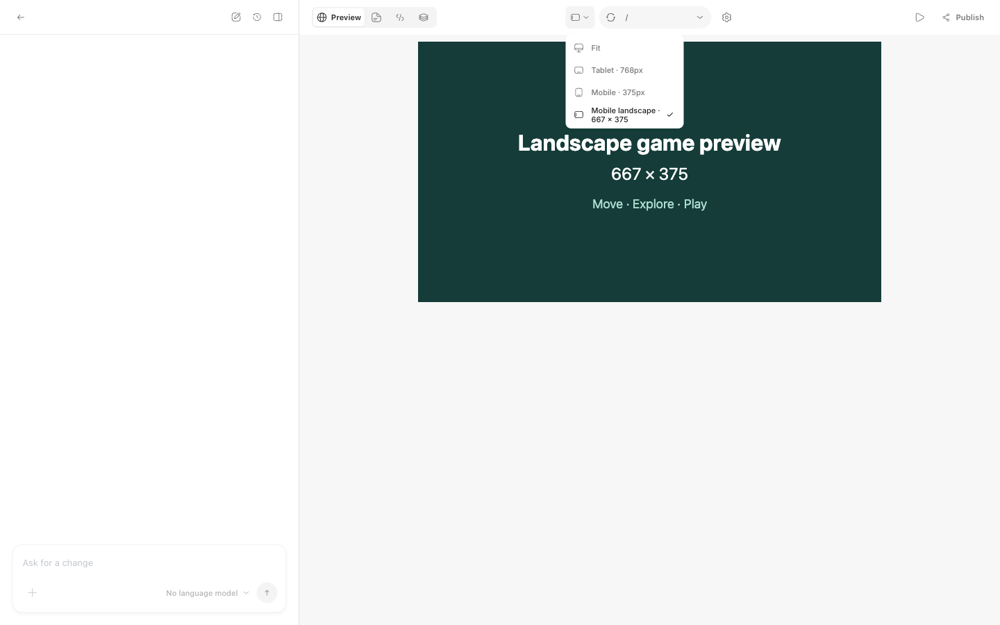

# Preview configuration and lifecycle

Web Game and newly created General Game projects have browser preview enabled,
except projects that select a plugin external preview.
New General projects open on Canvas; prompt-based creation also keeps chat open.
Existing General projects keep their saved switch, and older projects without a
switch remain disabled. **Project settings**, available from Canvas, Code and
Preview, controls Web preview, Play and Web playtesting. Canvas's separate
**Default models** button controls generation models. Neither setting selects
or installs a game engine.

## Startup configuration

Run settings are saved per project and copied when duplicating it. Startup
configuration and Playtest defaults are visible immediately, with aligned pairs
of fields. Infrequent port/argument and background cleanup controls are collapsed;
only fields relevant to the selected startup mode are shown. Configuration
inspection runs while the dialog is open and Web preview is enabled. Inactive
mode drafts do not block inspection or saving. Disabling Web preview preserves
the saved configuration and ignores disabled drafts.
**Startup directory** stays inside the workspace, including after resolving
symlinks. Preview modes are:

| Mode | Behavior |
| --- | --- |
| Auto | Run the configured package script when available; otherwise serve `index.html`. |
| Package script | Run the configured script, `dev` by default. |
| Static files | Serve the selected folder's `index.html` without installing dependencies. |
| Custom command | Run a local server command in the selected directory, without a Node dependency install. |

Static directory index pages redirect to a trailing-slash URL while preserving
the query string, so relative scripts and other assets resolve from that directory.
Directories without an index return 404; missing extensionless application routes
can still fall back to the root `index.html` when the request accepts HTML.
Static file media types are matched without regard to extension case, so module
scripts, stylesheets and WebAssembly also load with names such as `main.JS`,
`style.CsS` and `game.WASM`. This does not change filesystem path matching.
Static files support byte ranges on GET for media seeking. HEAD ignores Range
and returns the complete file's headers without a response body.

Custom commands can use `{host}` and `{port}`. The process also receives `HOST`,
`PORT` and `BROWSER=none`. Its server must listen on that port. Advanced settings
allow a fixed upstream port and a JSON array of package-script arguments, with
the same placeholders. Leaving arguments empty selects framework defaults;
`[]` explicitly disables them. Vite, Next, Astro, Nuxt and webpack receive their
own supported flags; unknown scripts receive the environment variables only.

Package-manager selection uses the explicit setting, `package.json.packageManager`,
lockfile, then npm. A pnpm workspace manifest also selects pnpm when there is
no lockfile. Settings display the detected manager and its source, and
check availability without running project code or installing dependencies.
Missing Bun/pnpm/Yarn remains an actionable configuration error rather than
silently changing managers. The packaged app includes Node/npm; other managers
must be available to the application. On macOS the packaged app also searches
the login shell's `PATH` after the bundled runtime and inherited `PATH`. Before
installation changes `node_modules`, the selected executable is checked against
the environment passed to the child.

Dependencies install at the owning workspace/lockfile root. Dependency manifests,
workspace definitions and lockfiles form a fingerprint; dependency or manager
changes reinstall, while changes only to scripts preserve installed modules.
Workspace dependency checks support hoisted packages. Discovery follows declared
package patterns and exclusions, with cancellation checks during inspection.
Package-manager selection and its displayed source come from the same resolution.
Known native launchers such as Electron, Tauri and Godot are not treated as Web
servers; configure a separate browser script or command for their Web output.
Failed or cancelled installs leave a pending marker for a clean retry.
**Reinstall dependencies and restart** forces that retry. Installation has a
two-minute limit; the server has
30 seconds to respond after launch. A timeout reports the URL OhMyGame probed
alongside recent server output so you can compare the listening address. The log panel shows phases, elapsed startup
time, directory, command, manager and the last 8 KiB of process output.

## Automatic policy and idle collection

**Automatic preview** defaults to on. Opening a project creates an editor lease
and starts a runnable preview. Files are observed while a project has users;
when output becomes runnable, automatic preview starts. Agent completion uses
the same policy and requires an observed file change. Checkpoint snapshots leave
running previews and unfinished launches alone, so a conversation without file
edits does not restart the game. Source edits use HMR or static file refresh;
for a server without hot reload, use **Restart preview service** after changing
its code. A failed startup does not repeatedly retry without a change. Before a
workspace has any project files (hidden entries, `node_modules`, `dist`, `build`
and the files Design keeps in `canvas/` do not count), an automatic check that finds nothing runnable stays
waiting without an error, so a new project shows the empty preview. Once files
exist, the waiting state keeps the reason, such as a
missing dev script; Start and Play always report it. Generated dependencies, hidden/build folders and common
runtime log/PID/temp files do not trigger retries.

**Stop preview** cancels installation/startup or stops the running service.
On Windows the daemon asks the process tree to exit. If Windows refuses the
entire request, the daemon immediately retries with forced termination. A tree
that accepts any part of the request still gets time to shut down.
That manual pause survives reopening the project during the current application
session; file changes and agent completion respect it. **Start preview** or Play
resumes it. Service recovery also pauses automatic startup until the user resumes.
Disabling automatic preview affects future starts, not an already running game.
Inspection and launch are one cancellable operation: stopping, disabling automatic
startup or losing the last lease cancels an unfinished automatic launch. An explicit
Start/Play request takes over that launch under manual policy. Reopening during idle
cleanup waits for the old server to close before starting again.
If the replacement fails configuration inspection, the closed preview remains
stopped and its old URL is cleared.

The device menu and Project settings offer **Mobile landscape** for horizontal
phone games. Preview fits a 667:375 landscape frame within the editor panel;
Play requests a 667 × 375 window. Set the preset in Project settings to save the default
for future visits and project copies; the toolbar menu changes the current preview.
Plugins can add more sizes to both menus
([preview devices](plugins.md#in-the-app)).

Saving viewport, default route, automatic policy or idle policy does not restart
the server. Changing effective launch settings restarts a currently active server.

The editor renews its lease every 20 seconds. Preview, Play, AI test and external
browser documents have separate leases, renewed by the browser bridge. Closing
a page or leaving a project releases its lease. Abandoned leases expire after
75 seconds, so a disappeared window cannot retain a server indefinitely.

**Stop unused preview after** defaults to one minute with no users. It can be
set to 1–60 minutes or **Keep running**. A live Play or test window keeps its
server running even after leaving the editor. Idle collection runs every ten
seconds; manually starting an unused server is subject to the same timeout.
At most one unused preview keeps running: leaving a project stops the preview of
the project left before it, so switching back to the last project stays instant
without servers piling up. Previews set to **Keep running** don't count toward
that limit, and neither does a preview an agent's playtest is opening: it holds
a short lease until the playtest page connects and keeps its own. Restarting a Web Game preview takes about a second, and the game page
reloads when you return either way.
Deleting a project immediately closes its watcher, proxy, refresh streams and
child processes.

## Pages, diagnostics and saved games

The project owns one loopback proxy. Its port is saved in `preview-origin.json`
outside the workspace, preserving the browser origin across normal restarts and
application relaunches. If another process occupies that port, an available port
is used and saved; browser storage at the previous origin cannot migrate
automatically. Duplicated projects receive a separate origin.

Page reload and server restart are separate controls. The Game panel's toolbar
leads with the preview's address, like a browser's: a dot for the preview's state
(running, starting, failed or not started), the current page, which opens the page
picker, and reload. The device, element picking, **AI playtest** and a **More**
menu (open in browser, restart the preview, project settings) follow;
in a narrow panel the address shrinks to its dot, the page picker's chevron and
reload.
The project's top bar keeps **Play** in the same place across views. For Web
previews it opens the game window directly, or focuses it with **Return to game**.
External previews instead reveal the Game panel. In Fit mode, Play requests
1280 × 720 independently of the preview panel's size or visibility. Device presets
keep their requested dimensions. Desktop windows scale down proportionally when
needed to fit within 85% of the editor display's work area (or the cursor's display
when no editor preview is attached). Window sizes are not remembered across closes.
Internal navigation updates the address without reloading the game. The desktop editor owns one human game
WebContentsView per project. Play moves that view into a separate native window;
closing Play returns it to Preview. Both directions preserve the same document,
current route, in-memory state, localStorage and IndexedDB. Refresh explicitly
recreates the game document at its current route. A minimal host page, with no
editor preload or daemon credentials, keeps the editor's top-level site so existing
Preview saves remain available. Older standalone Play saves stay in their separate
storage context and are not merged. Browser builds continue to use an iframe and
separate popup, which reload the game on switching. Static file changes reload
active pages through a local event
stream, while development servers retain their own HMR protocol. Changes that
can't affect the game don't reload or rebuild it: hidden folders, `node_modules`,
`dist`, `build`, logs and temporary files, and the files Design keeps in the
workspace's root `canvas/` folder, which it saves when it opens: its index,
asset and job lists and instructions, and the board, layout, document, table
and schema files directly inside `boards`, `editor`, `documents`, `tables` and
`schemas`. Other files under `canvas/`, such as a game's own scripts, still
reload it (`isPreviewSourceChange` in `src/daemon/preview.ts`).

HTTP readiness and content diagnostics are separate: a responding server can
still have compilation or runtime errors. The proxy forwards HTTP and HMR;
failed module responses and browser exceptions or rejected promises update
daemon-owned diagnostics through project events without stopping the server.

Desktop Preview and human Play share a client/document identity; the diagnostic
source follows the view's current window without reloading it. AI tests and external
pages have their own identities and storage contexts. The editor shows the active
human game's diagnostic. Errors from other windows remain available in the log
panel. Reports must match the proxy origin and current document. Successful module
responses, navigation, HMR success and close clear only that client's errors,
including when a broken module was removed. Late reports and module responses
from superseded documents are ignored. Diagnostic and document maps are bounded,
and each active document has at most one refresh stream. Automatic project-cover
capture pauses while an error is visible.

The proxy removes internal tracking parameters before forwarding requests.
Same-origin Origin/Referer and upstream redirects follow the proxy address;
foreign origins and external redirects retain their original semantics.
Uncaught JavaScript exceptions, rejected promises and compilation failures can
be copied or inserted into the Agent composer using **Ask Agent to fix**. This
preserves the draft and does not send a message. Source links open the relevant
workspace file when its path can be identified.

Browser diagnostics, static refresh and external-page leases depend on an external
classic script injected before project scripts into uncompressed HTML up to 2 MiB.
It preserves CSP, including an existing nonce, and uses its own function scope to
avoid project-global collisions. Larger or compressed pages retain their original
representation; restrictive CSP can block the bridge. Editor leases, service logs
and recovery controls remain available. This proxy is intended for local HTTP
development, not a full production reverse proxy.

Preview state is delivered through one `preview.updated` event containing the
complete runtime state. Browser reports use a typed message envelope for activity,
navigation, lifecycle and diagnostics; obsolete standalone diagnostic messages
are not accepted.

### Picking an element

The Game panel's pick button turns the page's next click into context for the
next message instead of game input. `PUT /projects/:id/preview/picking`
(`{ client, active }`) reaches that page's bridge over its refresh stream, which
works for the desktop view and the browser iframe alike. While picking, the
bridge outlines the element under the pointer in an overlay of its own, and
swallows pointer, mouse and touch input. A click reports the element as a
`pick` message: its tag, a shortened accessible name or text, a CSS path of at
most five steps, its box in page pixels, and the page. Escape, here or in the
editor, cancels. The daemon validates and bounds the report and publishes
`preview.picked`, and the chat adds it as a `preview-element` context chip. A
game drawn into one canvas only offers the `<canvas>` element.

## Native plugin preview

A plugin project type with `preview: "native"`, such as
[TapTap Maker](plugins.md#taptap-maker), runs its game outside the app. These
projects acquire no Web leases, create no Web player, and keep Web preview off;
the plugin's own panel controls its preview. A type that declares `gameUse`
lets `game_use` use its game through the plugin; see
[plugin game runtimes](runtime.md#plugin-game-runtimes).

## Recording a game

The desktop app records a running game to a video in the Library, where the
trimmer can cut it down. The record button sits beside Play in the top bar, and
{Cmd or Ctrl}+Shift+R starts and stops it with the game in focus. In the Play
window, which has no toolbar, the title shows a dot while it records.

A person's recording stops itself after 5 minutes. An agent records a playtest
session with `game_use`'s `recordStart` and `recordStop`, for at most 60
seconds. Closing the game or its session ends a recording and keeps what it has.

A hidden window aims Electron's display capture at the game's own frame, which
needs no system permission. The recording holds the page's HTML as well as its
canvas and the game's sound. It carries on while the game moves between Preview
and Play and while the game is hidden or muted, and the game stays audible.
Video follows the game's rendered pixels and its shape, up to 1280 on the long
side, at 30 frames a second and 4 Mbps, so 5 minutes come to about 150 MB. A small
Preview on a standard-density screen therefore records small, and a larger Play
window records larger. It is H.264 and AAC in MP4, or VP9 and Opus in WebM on a
machine without an H.264 encoder.

A file holds one picture size, so frames keep the size of the first one, and a
game that changes shape is letterboxed inside it. `bun run test:game-recording`
records a real page in Electron and reads the file back; CI runs it on macOS and
Windows because it depends on each platform's encoders.

## Game tuning

The Tune panel in the game toolbar changes a game's values while it runs. It
appears for projects with a web preview, except those a plugin builds, such as
Godot games, until that path has been tried on a real export.

A project keeps the values in `public/tuning.json` or, without that file,
`tuning.json`. It is plain data the game also ships with; the
[Game Tuning skill](../plugins/web-game-studio/skills/game-tuning/SKILL.md)
gives the format and how a game connects. The game defines
`window.__OHMYGAME_TUNING__ = { set(id, value) {} }`.

- The file is the only lasting copy. The panel writes a value to it only when
  the person saves, as one change they can undo; saving waits for a running
  agent like any plugin change.
- Moved values stay in the daemon as a draft, clamped to the file's range. A
  game that restarts gets them back, and they are gone when the app quits.
- Values reach the page over its refresh stream, as ids and values only, on
  every connection. The bridge calls `set` for what differs, also when the game
  defines the setter late or replaces it. A page only ever reports that it
  listens.
- AI test pages get nothing over the stream, so a test plays what is saved.
- A change to the file, from anyone, doesn't reload the page or rebuild the
  game: the new values go to the running game. A broken file keeps the last good
  values and drafts until it is fixed. A file that was `import`ed still reloads
  through the dev server, which is why games `fetch` it.
- The bridge can't run where a page's security policy blocks it or in HTML the
  proxy doesn't inject. The panel then says the game isn't connected.
