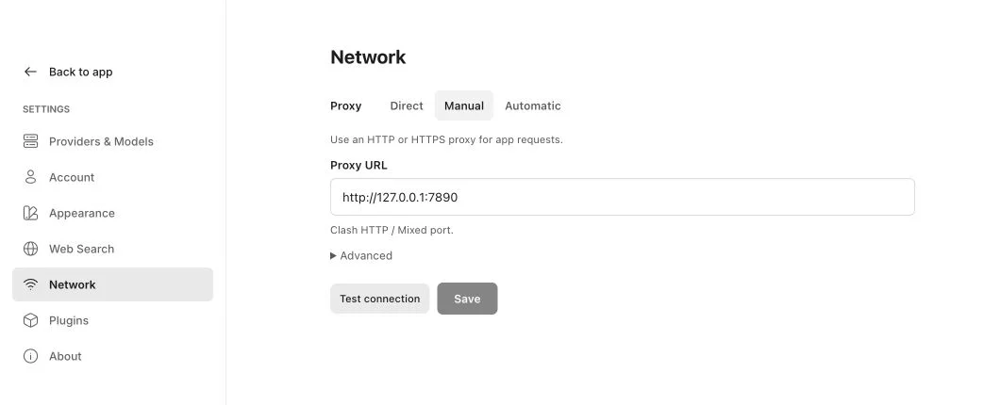
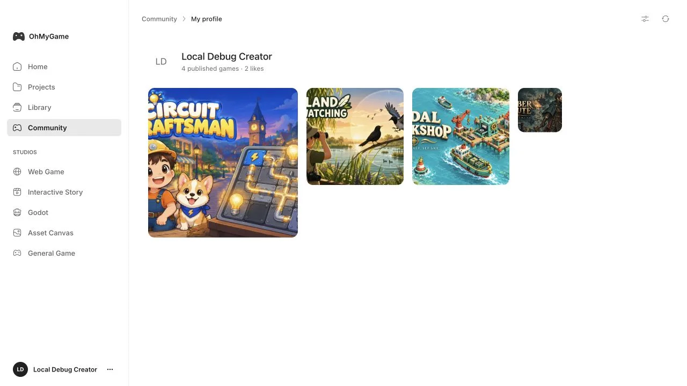
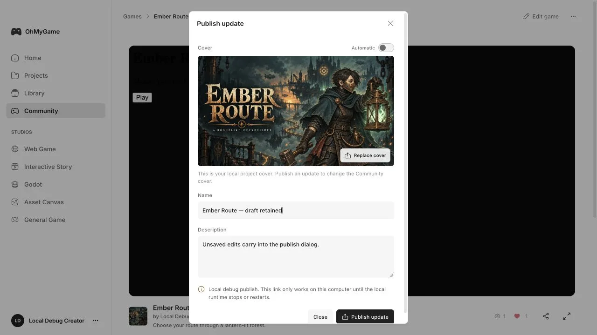

# Runtime

```text
┌──────────── Desktop app / web renderer ─────────────┐
│  Conversation            │  Live preview / watch    │
└──────────────┬──────────────────────────────────────┘
               │ local HTTP + SSE (127.0.0.1)
┌──────────────┴──────── Local daemon ────────────────┐
│  Pi agent · playtest · Asset Canvas · plugins · MCP │
│  project workspaces · preview dev server            │
└──────────────┬──────────────────────────────────────┘
               │ Publish (static build only)
┌──────────────┴──────── OhMyGame Cloud ──────────────┐
│  immutable deployments · Community                  │
└─────────────────────────────────────────────────────┘
```

Everything except publishing runs locally. The code is the source of truth for
the HTTP API and event names; this document covers the parts that are not
obvious from it.

## Processes

`bun run dev` starts the React renderer on `http://127.0.0.1:43120` and the
Fastify daemon on `http://127.0.0.1:43110`. Vite proxies the renderer's `/api`
requests to the daemon.

`bun run dev:desktop` starts Vite and Electron. Electron starts the compiled
daemon itself on an available loopback port, waits for `/health`, and passes
the daemon address plus a random process-scoped token through the isolated
preload bridge. The renderer has no Node.js access.

The main desktop window starts at 1200 × 780 logical pixels, centered on the
display containing the pointer. It fits within 90% of that display's available
width and 88% of its available height, excluding system panels and the Dock.
Its usual minimum is 960 × 640; smaller displays lower the minimum to fit the
initial window. First-run setup shares this window with the home screen, so
finishing setup does not resize it. Playtest and capture windows keep their
explicit content dimensions.

Bun 1.4.2 installs dependencies and executes builds, tests, and most preparation
scripts. Pinned Plugin archives are prepared with Node and store their entries
uncompressed, so their locked ZIP checksums do not depend on the zlib build;
desktop runtime preparation uses Node and its built-in environment-file loader.
Standalone daemon development and `bun run start` use Node.js 22.19+
explicitly; desktop development and packaged apps run the daemon with
Electron's embedded Node.js. Desktop packages retain the checksum-pinned
Node.js 22.19.0/npm distribution for workspace commands and MCP servers.
New workspaces still default to npm, and existing package-manager choices remain
authoritative. Prepared examples retain their npm lockfiles.

Build and test commands select Bun explicitly. `bunfig.toml` disables automatic
dotenv loading, automatic peer installation, and global Node-to-Bun substitution,
so a daemon's `node` command runs the real Node executable. Runtime preparation
loads `.env.local` while preserving values supplied by the parent process.
`bun run test:node-runtime` builds the daemon and checks startup and its
authenticated API with Node. `PI_CODING_AGENT_DIR` can isolate the desktop
agent's configuration during verification.

Electron main owns only desktop lifecycle. Projects, conversations, previews,
and events live in the daemon. Closing the last window quits the application
and gives the daemon time to stop active Pi and preview processes.

The renderer receives a small runtime event stream over SSE rather than Pi's
internal event objects. Reconnects replay recent events, and conversations are
restored from Pi's session files, so a reload does not lose or duplicate turns.

Preview failures stay with their project. The desktop supervises unexpected
daemon exits and reconnects the existing renderer to a fresh service generation.
See [preview isolation and service recovery](runtime-recovery.md) for behavior,
recovery limits, and validation scenarios.
See [preview configuration and lifecycle](preview-runtime.md) for startup modes,
automatic policy, idle collection, logs, and browser storage.

## First-run setup

The home route reads the daemon's `/settings/onboarding` preference before
opening the studio. The daemon stores version 1 state in `onboarding.json`
under its data directory: `status` is `pending`, `completed`, or `skipped`,
and `step` is `welcome` or `connect`. Atomic, serialized writes retain the
current step across restarts. Completing setup requires a language model in
the same enabled, visible catalog used by the home composer. This checks
configuration and catalog availability, without sending an inference request.
The provider screen enables **Start creating** only when a language model is
available; it records `completed`. Until then, a separate **Skip and start**
text button without a hover background records `skipped` and allows
configuration later in Settings; it is hidden once a model is ready.
**Next** and the provider screen's actions sit near the bottom, above the
step indicators.

Settings → Providers and the setup list share one grouping. Every working
connection, including free cloud and local services, is under **Connected
providers**. Unconnected providers follow as **Free cloud**, **Popular
providers** (OpenAI, Anthropic, OpenRouter, Google, DeepSeek, Meshy, Tripo,
filtered by capability), **Local providers**, and the collapsed **More
providers**.

The setup list shows language providers only. Without a search, connected and
popular providers come first, and the rest, including local services, stay
under **More providers**. The legacy OpenAI Codex entry is hidden unless it is
already connected, because OpenAI sign-in covers ChatGPT subscriptions.
Searching lists every match. Saved
built-in and custom connections show **Connected** instead of offering setup
again. Disabled connections offer **Enable** without changing credentials.
Before starting or retrying setup, the renderer refreshes the provider's saved
state to avoid reopening a connection that changed since the list loaded.
Existing provider credentials and models can be edited from Settings.

Connecting, adding, or enabling a provider during setup makes its recommended
language model the global default. Navigation and completion stay disabled
until the default is saved, including during catalog refreshes. If saving
fails, **Retry** saves the default again without repeating authorization.
The recommendation mirrors Pi's
per-provider defaults for the popular providers and falls back to the
provider's first visible model. The ready line names the default model and its
provider; with more than one model available, it is a menu that changes the
default.

An installation with no preference but existing projects or a configured
language provider is marked completed once. Media credentials alone do not
count as language setup. A saved completion or skip remains valid if providers
are later removed. Damaged preferences are logged and reinitialized rather
than blocking project access. Project links, playtest windows, and thumbnail
renderers do not pass through the home gate.

**Settings → About → View getting started** reopens the welcome. Moving to the
connection step with **Next** saves a pending preference again. The two bottom
step indicators are buttons for switching between the welcome and provider
screens. Selecting the provider step also returns from its inline forms to
the provider list. Step navigation is disabled while saving. The welcome's
illustration plays once per visit in 5.2 seconds. Only the forming game world
is visible at first: terrain rises, paths unfold, water reshapes, and trees
grow in sequence. Its outline then morphs into a small OhMyGame logo beside
the wordmark, followed by **Your own game studio.** and **Next**. Hidden
controls stay out of keyboard navigation. Reduced-motion preferences show the
final logo, title, and controls immediately. The connection screen reuses
the daemon's provider authentication flow and custom-provider form; it does
not require an OhMyGame cloud account. The add button beside provider search
opens that form inline. Settings uses the same form in its existing dialog.
Saving or cancelling returns to the provider list without adding a persisted
setup step. Image, video, and 3D connections and default models are configured
in Settings and do not change the language-only completion requirement.

## Network proxy

**Settings → Network** configures the application's network connection. Pi's
agent sessions and model requests run in the local daemon, so proxying only the
renderer would not cover the agent.



- **Direct** is the default for new installations. It clears inherited
  application proxy variables. System TUN and VPN routing still apply. An
  installation that already has projects, agent settings or a setup record but
  never saved network settings keeps **Automatic**, its earlier behavior. The
  first start records the chosen mode in `network-settings.json`.
- **Manual proxy** uses one HTTP/HTTPS proxy URL for both request schemes. For
  Clash, enter its HTTP or Mixed port, such as `http://127.0.0.1:7890`.
- **Automatic** uses `HTTP_PROXY` / `HTTPS_PROXY` (including lowercase variants)
  first, then a system HTTP/HTTPS proxy detected by Electron, then a direct
  connection. Desktop development and packaged apps detect the system proxy
  only when Automatic needs it. Browser-only development uses environment
  variables.

Existing saved modes are retained. Users who previously used the default
Automatic mode without saving settings now start with Direct; select and save
Automatic to keep inheriting proxy settings.

Settings are stored in `network-settings.json` under the daemon data directory.
The panel opens with the saved proxy mode selected, or Direct when no settings
have been saved. Unsaved edits are marked. Switching to Automatic refreshes
system detection when there is no environment proxy; later bypass-list edits
reuse the detected route.
Saving or detecting a new proxy does not change active connections. When the
effective proxy URLs or bypass list change, restart the desktop app (or the
standalone daemon) to apply them. Changing an inactive proxy draft or selecting
another mode with the same effective route does not require a restart.
The desktop panel offers
**Restart now**, which stops the daemon and relaunches the app. A full restart
also refreshes existing MCP child-process environments and long-lived network
connections; changing only the fetch dispatcher would not cover them. Environment
files load before proxy initialization, with parent variables taking precedence.

The daemon fetch dispatcher, Electron sessions (including account requests and
the updater), and new tool/MCP child-process environments share the startup
policy. Tools such as Python and npm must still support the proxy variables
they inherit. `localhost`, `.localhost`, `127.0.0.1`, and IPv6 `::1` always bypass
the proxy; advanced settings add more hosts. Automatic mode also preserves
inherited `NO_PROXY` exclusions. Proxy credentials supplied through environment
variables stay in the host processes and are removed from settings/diagnostics
returned to the renderer.

**Test connection** tests the current form, including unsaved settings, through
an isolated connection. It makes a bounded HTTPS HEAD request to
`https://api.openai.com/v1/models` without model credentials or redirects. An
HTTP response, including 401 or 403, confirms transport reachability, not model
access or successful inference. Results show elapsed time, with the tested
connection and HTTP status in a tooltip. The test neither saves the draft nor
changes the global dispatcher or the next-startup configuration. Automatic tests
refresh system detection only for the test when no environment proxy is set.
**Detect system proxy** is available for saved Automatic settings without an
environment proxy. It asks Electron over private child-process IPC and leaves
the active connection unchanged.

This first version accepts HTTP/HTTPS proxies. Manual SOCKS proxies, proxy
authentication fields, and `ALL_PROXY` are not supported. System detection
selects the first supported route for `https://api.openai.com` at startup; it
does not reproduce PAC rules for each destination or retry a PAC fallback list.
Use a fixed HTTP/Mixed proxy or TUN when destination-specific PAC rules are
required. Model **Base URL** fields describe API service/relay endpoints and
must not contain a Clash forward-proxy address.

## Trust boundary

Pi runs in trusted-local mode. The workspace is Pi's working directory, but
`cwd` is not an operating-system security boundary, and enabled Pi tools run
without an OhMyGame approval prompt. Provider credentials stay in the daemon
and are never written to workspaces or returned to the renderer.

The desktop app writes the daemon's access token to the daemon's stdin, not
to its environment, which other processes of the same user can read. A daemon
started on its own may be given the token in `OHMYGAME_DAEMON_TOKEN`; it
removes the variable at startup, though the original environment may still
be visible in process listings. Either way no process the daemon starts
inherits the token: preview servers, dependency installs, publish builds, the
Agent's shell, stdio MCP servers, and Git. Project processes also run without
the daemon's other settings (`OHMYGAME_*`, `DAEMON_HOST`, `DAEMON_PORT`).

## Agent game use

General Game projects open on Design as engine-independent workspaces with
Code, Design, Assets and Web preview. The bundled Game Studio plugin provides game production,
architecture, and verification Skills for General Game, Godot, and Interactive
Story projects. Web Game keeps its independent Web Game Studio plugin and
existing creation instructions. Plugins are enabled by default; a saved disabled
setting is respected when creating a project or agent session. Compatible
Skills are listed for the agent, which reads the relevant ones for its task.

General Game's **Web preview** switch in **Project settings** is on for newly
created projects. Existing projects retain their saved switch; projects without
the setting remain off. Adding a dev script does not override an explicit opt-out.
The switch is available from Design, Code and Preview, and exposes Preview,
Play, and the available Web `game_use` tool. It can be enabled before browser
output exists; automatic preview starts when its
configured script, static HTML, or custom command becomes runnable. Disabling it stops the preview server and returns
the workspace to Code if Preview was selected. The switch survives reload and
duplication. Native Electron, Tauri and Godot scripts are not treated as Web
servers. Web Game keeps its existing preview behavior.

Web publishing is independent of the switch: it validates a static `index.html`
or the configured build's static output. Native engines use their own tools or
Connections; General Game does not install an engine or initialize a Web wrapper.

The desktop **Play** button opens one human-controlled game window per project.
Repeated clicks focus it without reloading. Preview and Play move the same
WebContentsView between the editor and the native player window, preserving the
document, route, in-memory state, localStorage, and IndexedDB. Closing Play
returns the view to Preview. The editor shows the last project cover with a
**Return to game** action while the player is open. Opening or returning to the
player does not restart a ready or in-flight development server.

The game view receives no editor preload or daemon credentials. Browser-only
development uses a Preview iframe and a separate named popup; switching between
them reloads the game, and saved progress depends on the game's storage. Reload
targets the active human game. A restarted server reloads it at the current
route. The preview origin is retained across restarts when its saved port is
available. Human play and agent tests share the development server and source,
so code changes can hot-update both. See [preview lifecycle](preview-runtime.md)
for storage, diagnostics, and window details.

The desktop runtime exposes game interaction and verification as the Pi custom
tool `game_use`. This is an OhMyGame core capability rather than a Plugin:

1. The current Web adapter starts or reuses the project's local Preview and
   accepts only a path, query, or hash on that Preview origin.
2. A private child-process IPC channel forwards typed requests from the daemon
   to Electron main. It is not part of the renderer API.
3. Electron main owns hidden, per-playtest `BrowserWindow` sessions using the
   bundled Chromium runtime.
4. The custom tool returns bounded DOM, canvas, console, failed-request, and
   optional game-state data. Captures are scaled from device pixels to the
   page's CSS pixels, keeping their aspect ratio so image pixels match input
   coordinates, and returned to the model as JPEG image content. Every later
   request resends them, so they stay small.

The tool supports `open`, `inspect`, `act`, `capture`, and `close`. Runtime
adapters receive a typed open target; the Web adapter uses a Preview URL while
other adapters can use their project or process identity. Actions
cover semantic or coordinate clicks, text input, instant or held key presses,
touch, bounded waits, viewport resizing, and the optional game bridge below.
Calls are sequential, abort with the Agent turn, and time out after 30 seconds.
Sessions are destroyed when explicitly closed, when the daemon or Electron app
shuts down, or after an open failure. At most four sessions may remain open at
once, which bounds hidden-window resource use if an Agent misses cleanup.

The Preview toolbar can reveal the same isolated windows in a watch mode. These
are independent, movable, resizable native windows with the normal macOS title
bar and traffic-light controls. Showing them initially does not take focus, but
they accept normal window interaction after the user clicks them. They do not
stay above unrelated applications. This does not reuse the user Preview or
mirror screenshots: the user sees the exact Chromium surface receiving Agent
input. Closing the watch surface hides it without terminating the playtest
session.

Playtest windows use an isolated partition with sandboxing, context isolation,
and Node integration disabled. Main-frame navigation stays on the original
Preview origin, popups and downloads are blocked, and permissions are denied
except pointer and keyboard lock for game input. Only loopback HTTP Preview
URLs are accepted. This capability is available only when the daemon is owned
by the Electron process; browser-only daemon development does not register the
tool.

This is deliberately a game-use runtime, not unrestricted Browser Use or
desktop Computer Use. It provides the smallest stable surface needed for
repeatable gameplay and visual checks without adding Playwright, Puppeteer, or
a system Chrome dependency to generated games.

### Runtime adapter boundary

`game_use` is backed by a typed runtime adapter. The adapter advertises its
runtime, supported project types, input methods, observations, deterministic
operations, and whether it can be shown in watch mode. The daemon registers
the tool only when the current project's type is included in those capabilities
and, for General Game, its Web preview switch is enabled.

The shipped adapter is `web` for `web-game`, `interactive-story`, and configured
Web previews in `general` projects
and uses Electron's bundled Chromium. Godot and Unity projects do not receive this tool yet. When
their runtime bridges are added, they should implement the same adapter
contract for launch or attach, input, screenshots, state, reset or stepping,
and shutdown. An editor MCP connection alone is not a runtime adapter and
must not be presented as gameplay verification.

### Optional game bridge

Games with random, timed, or deeply nested states may expose a serializable,
test-only bridge while the `ohmygamePlaytest` query parameter is present:

```ts
declare global {
  interface Window {
    __OHMYGAME_PLAYTEST__?: {
      snapshot?: () => unknown | Promise<unknown>;
      reset?: () => void | Promise<void>;
      setSeed?: (seed: number) => void | Promise<void>;
      step?: (milliseconds: number) => void | Promise<void>;
    };
  }
}

export {};
```

`snapshot()` should return compact JSON-serializable simulation state, not
renderer objects or credentials. The other methods should perform one named,
deterministic operation and may be asynchronous. The driver advertises only
methods that exist. Games must remain fully playable without this bridge, and
playtests should still use real input and screenshots to verify what a player
sees. Capture analysis reports opacity and luminance variance as a blank-frame
warning; it is a heuristic rather than a semantic visual assertion.

## Persistence

Each project lives under the daemon data directory:

```text
projects/<project-id>/
├── project.json   project identity and latest publication
├── cover.webp     uploaded cover, retained while automatic mode is enabled
├── cover-auto.webp last automatic cover, retained when a custom cover is applied
├── cover-frozen.webp frozen automatic cover or Interactive Story thumbnail
├── cover-state.json explicit cover mode, including when no cover exists
├── preview-origin.json stable local preview port
├── checkpoints/   snapshots of the workspace, one bare Git repository
├── workspace/     the project files (or an existing folder in the desktop app)
└── session/       Pi session files, one per conversation
```

Removing a project never deletes an existing folder used as its workspace.
Choosing a folder that is already a project's workspace when creating a project
opens that project instead; a folder inside another workspace can hold a
project of its own.

## Checkpoints

All project types record private workspace snapshots before each consumed user
message and when its run ends. Finished, failed and cancelled turns show their
net file changes in Chat. The project does not need Git; snapshot storage stays
beside the workspace without changing its `.git`, branches or index.

**Undo** takes back one turn's files while preserving the conversation, and
**Reapply** restores their exact pre-undo contents. Editing a message preserves
files. **Restore to before this message** explicitly restores the workspace and
rewinds the selected conversation. These operations coordinate project writes,
check later edits for conflicts, and retain recovery data if interrupted.

See [turn file changes and recovery](checkpoints.md) for the UI, file scope,
workspace versions, model notices, storage limits, and API routes, and
[Git changes in Code](workspace-git.md) for the read-only repository view.

## Project covers

Project covers are saved independently of publishing. Selecting an image in the
publish dialog previews it; **Apply cover** saves it and stops automatic cover
replacement. The **Automatic** switch beside **Cover** can also stop replacement
without uploading an image: it freezes the current cover, including an
Interactive Story's Scene thumbnail, or keeps the cover empty if none exists.
Turning it back on returns to the last automatic cover, or an Interactive
Story's Scene thumbnail when available. Uploaded covers are retained: turning
**Automatic** off again restores the uploaded image. Without an uploaded image,
turning it off freezes the current automatic cover. Automatic captures
cannot overwrite a custom cover, including captures already in flight. Existing
covers from older app versions are protected as custom covers until the user
enables **Automatic**. Enabling it removes only the frozen snapshot and saves
automatic mode; uploaded and automatic covers are retained separately.
Unreadable JSON or invalid mode values fall back to custom mode when an uploaded
cover exists, or automatic mode otherwise. The preference survives restarts.
Duplicating a project preserves the covers and the selected mode.
The Community cover is a snapshot in the published Deployment and changes only
when an update is published; publication details show that snapshot.

## Publishing

A workspace is publishable when it has a non-empty `scripts.build` that
produces a static `index.html` under `dist`, `build`, or `out`, or has a root
`index.html`. Only that static output is uploaded; hidden files, dependencies,
and symbolic links are skipped, and binary assets are preserved byte for byte.
The workspace, Pi sessions, conversations, and credentials are never sent.

Each publish creates an immutable Deployment of the same Game, so the play link
stays the same. The project stores only the publication identity: Game ID,
Deployment ID, play URL, publish time, and the published title and description.

### Community and creator profiles



Community uses the original mosaic of large, medium, and small square covers.
Full groups use the existing 28-card layout; additional works continue in the
same pattern rather than being truncated. Narrow layouts use equal square
cards, with two columns on small screens. Clicking or tapping the cover opens
the game detail, including on the owner's profile. Covers are requested
only when cards approach the visible area. Desktop overlays retain the original
gradient, hover animation, and centered title and author, with viewer and like counts
below. Small mosaic cards omit the author to leave room for the title and
counts. Overlays appear on hover or keyboard focus; hidden links and likes
do not intercept cover clicks. Narrow layouts and touch devices show the
overlay directly. Long titles and author names truncate within the card.
The filter button beside **My profile** and **Refresh** supports title,
description, and author search, sorting by first listing, viewers, or likes,
and first-listing periods.

Author links open their public profile with listed works. **My profile** requires
sign-in and includes deployed works. Profile cards open the game detail; they
have no editing or unpublish controls. The game detail header shows **Edit game**
and a **More game actions → Unpublish** menu only for the signed-in author,
using the existing user and game author IDs without an extra ownership request.
These controls are available as soon as game metadata loads, independently of
related games and the game iframe. Owners can edit published titles and
descriptions without reuploading files. A matching local project also provides
**Open project** and **Publish update**; replacing game files or the cover requires
that project.
The current editor draft carries into **Publish update** without first saving
metadata. Related games request at most ten other listed works from the service.



Metadata edits update the local publication record when it exists.
Local project matching starts only when the owner opens the editor, so
unavailable local projects do not block viewing or editing published metadata.
Successful metadata edits update the detail directly without restarting the game;
a published file update reloads the player with its new deployment. Late reads
preserve completed edits and cannot restore an unpublished game.

**Unpublish** removes the uploaded game, its deployment files, and engagement
records from the cloud. Community and profile entries disappear, and old play
and cover URLs stop working. Local project files are kept; the daemon clears
only their saved publication state. Publishing again creates a new cloud game
with a new play URL and fresh engagement counts. The game detail asks for
confirmation before unpublishing and returns to the owner's profile on success.
The legacy Cloud listing endpoint remains part of the initial publish protocol;
the desktop has no hide/relist control.
Legacy hidden works remain accessible to their signed-in author through the
same detail page, with read-only engagement counts. Other visitors cannot read
their Community details or covers.

Viewer counts are cumulative unique viewers per work, recorded when the app
successfully opens the Community game detail. Refreshes and repeat visits do
not add viewers. Signed-in visits use the account identity; anonymous visits
use a random browser identifier. Logging in merges that browser's anonymous
visit with the account, and signed-out returns from it reuse the same identity.
Authenticated creator visits do not increment their own count. Shared play HTML
does not include an injected tracking script, so direct shared-link visits are
not included in this count. Clearing browser storage or visiting from another
browser can count an anonymous viewer again.

Likes require sign-in, support undo, and are unique per account and work. A
completed like updates the card, sort order, and profile total together, even
when an earlier refresh is still in flight.
Community reads opt in to metrics with `?metrics=true`; older service responses
without metrics show unavailable counts. Cloud access tokens are forwarded
transiently and never stored in project files. Local development provides the
same flows through temporary debug snapshots.

Hosted use requires the Community engagement migration and matching Cloud API
before releasing the updated client. See the Cloud contract for rollout order.

The Publish v1 contract is in the
[`ohmygame-cloud` repository](https://github.com/WhiteTowerAI/ohmygame-cloud/blob/main/docs/publish-v1.md).
