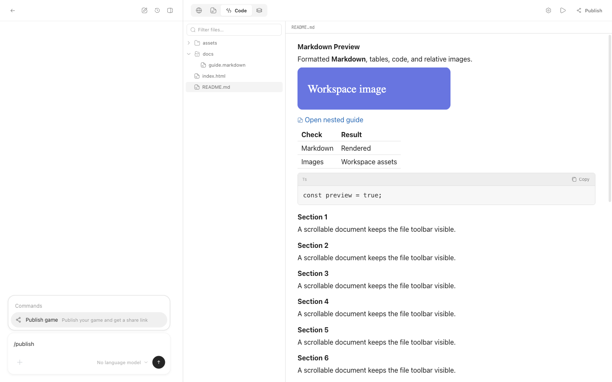
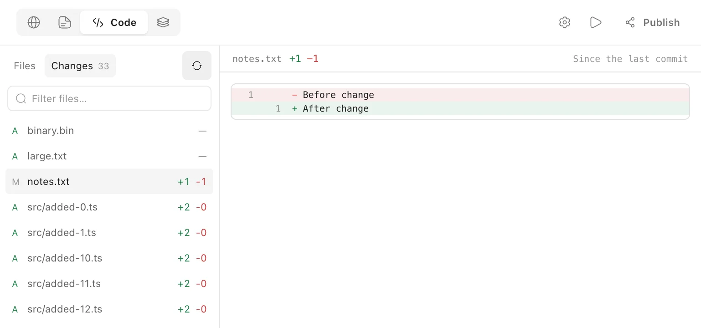

# Git changes in Code

The Files view renders `.md` and `.markdown` files as formatted Markdown.
Workspace links and images resolve relative to the document's folder; links
open the selected file in Code, and relative paths cannot leave the project.
Other source files keep their syntax-highlighted preview.

When the project directory is a Git repository, Code offers **Files** and
**Changes** in the existing explorer. Changes shows the current workspace
against the last commit, including staged edits, unstaged edits and untracked
files. Before the first commit, current files are compared with an empty tree.
Files that have been staged and then changed back to their committed contents
have no net workspace change and are omitted.
Removing a file from Git's index with `git rm --cached` also compares its
remaining, non-ignored working copy with the last commit: unchanged files
are omitted and edits are listed as modifications, with counts against HEAD.
Git's `core.filemode` and `core.symlinks` settings also apply to these files.
If a file disappears or becomes a directory during this comparison, its
deletion remains listed instead of failing the whole refresh.

Select a changed path to view its diff in the code pane. Added text files show
`+N -0`, removed files remain inspectable, and renames are shown as a removal and
an addition. Untracked files honor Git's ignore rules; an index removal whose
working copy is now ignored remains listed as a removal. The path filter applies
to both explorer views. Switching back to Files preserves the selected source
file; an explicit request to open a source file also switches back to Files.

The list refreshes when Code opens, when Changes opens, after an agent turn,
after Undo/Reapply, and after file operations in the explorer. **Refresh Git
changes** picks up external edits and commits. There is no continuous background
Git polling. A clean repository retains the Changes entry with a zero count.

This view is read-only. It never stages files, commits, restores paths, changes
branches or initializes a repository. Git commands use argument arrays, disable
optional index writes and external diff/text conversion commands, and have
bounded output and execution time. Linked Git worktrees are supported. A project
that is only a subdirectory of another repository does not inherit that
repository's Changes view.

Binary files have no line count or text diff. Text previews are bounded to
256 KiB per side; larger files retain Git's line counts where available but
show an unavailable-preview message. Diff views show up to 500 lines with a
truncation notice; this does not reduce the file's line counts. Links and submodules are listed without
reading their targets. File permission and line-ending changes may have no
textual hunks in the shared diff renderer.

Normal projects keep their existing file browser and
[turn file changes](checkpoints.md), without needing a project `.git` directory.
Turn changes describe an immutable before/after range and support Undo/Reapply;
Git Changes describes the current accumulated workspace changes. The private
checkpoint store is separate from the project's Git repository.

The daemon exposes read-only `GET /projects/:projectId/git/changes` and
`GET /projects/:projectId/git/file?path=...` routes. The latter accepts only a
currently changed path in that project's repository. Start with
`src/daemon/workspace-git.ts`, `src/shared/workspace-git.ts` and
`src/renderer/workspace-git-changes.tsx`; tests are in
`test/workspace-git.test.ts` and `test/workspace-git-renderer.test.tsx`.
